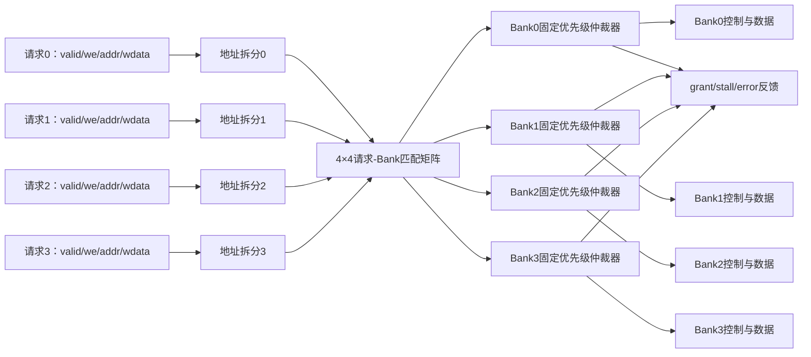

# 开放作业第一题上篇：多Bank SRAM访问路由与冲突仲裁器设计规格

日期：2026-11-09。

本篇为组合电路作业第一题的需求与微结构设计，不提供完整RTL。依据tiny-NPU固定版本`8216c22b762011aa20c05fc2768423fd12dda59d`中的`rtl/mem/banked_sram.sv`与`rtl/mem/sram_dp.sv`，把原项目的Bank选择思想扩展为可独立完成和仿真的多请求组合仲裁器。

此前已经完成第06讲SRAM、Bank、Buffer和Ping-Pong双缓冲，本篇不重复同步SRAM读写与双缓冲基础，只在需要时引用结论。

讲解顺序仍为：硬件结构→变量含义与单位→数据/控制流→代码组织顺序与验证时序。

## 1. 为什么第一题不直接复制banked_sram

原`banked_sram`不是纯组合电路。它包含：

- 多个`sram_dp`存储实例；
- 组合Bank编号计算；
- 组合Bank使能译码；
- 用于对齐返回数据的`rd_bank_idx_d`寄存器；
- `rd_valid`时序逻辑。

如果把整个模块交为组合电路题，电路类型不准确。原封装对外也只有一组读请求和一组写请求，不存在多个同类请求同时争抢同一Bank的仲裁问题。

本题保留Bank选择思想，新增四个并行请求者、请求到Bank的路由、同Bank冲突检测、固定优先级仲裁、阻塞反馈和地址越界处理。作业模块暂定名：

```text
bank_access_router
```

它是一个纯组合前端，不包含真正的SRAM数组。其输出可以在后续系统中接到四个单端口SRAM Bank。

## 2. 题目描述

设计一个面向NPU片上多Bank SRAM的组合访问路由与冲突仲裁器。模块同时接收4个访问请求，把每个全局字地址转换为Bank编号和Bank内局部地址。不同Bank的请求可在同一拍并行通过；多个请求访问同一Bank时，每个Bank独立采用固定优先级仲裁。未获授权的合法请求收到阻塞反馈，越界请求收到错误反馈。

模块内部不得使用时钟、复位、锁存器或状态寄存器。输入稳定后，输出经过组合传播延迟得到稳定结果。

### 2.1 默认配置

| 配置项 | 默认值 | 含义 |
|---|---:|---|
| 请求者数量 | 4 | 同时最多输入4个访问请求 |
| Bank数量 | 4 | 共有4份可独立访问的存储Bank |
| 每Bank深度 | 16 word | 每个Bank保存16个存储字 |
| 数据宽度 | 8 bit/word | 一个Bank地址保存1Byte数据 |
| 全局地址宽度 | 8 bit | 可编码0～255，但合法范围只有0～63 |
| 每Bank端口数 | 1 | 每个Bank每次组合仲裁最多接收1个请求 |
| 仲裁优先级 | req0最高 | req0 > req1 > req2 > req3 |

总容量为：

$$4\;Bank\times16\;word/Bank\times8\;bit/word=512\;bit=64\;Byte.$$

合法全局字地址为0～63。全局地址宽度故意取8bit而不是刚好6bit，以便真实验证地址越界条件。

## 3. 先画硬件结构



硬件由五类组合结构组成：

1. 4组请求输入线；
2. 4组地址有效性检查与地址拆分逻辑；
3. 16个请求与Bank的匹配条件；
4. 每Bank一个固定优先级仲裁器；
5. Bank输出选择与请求反馈逻辑。

不存在“中央一次只能选一个请求”的总仲裁器。四个Bank各自仲裁，因此四个请求访问四个不同Bank时可以全部通过。

## 4. 地址布局：全局地址如何拆成Bank号和局部地址

本题采用低位交织，即相邻全局地址轮流落入不同Bank。

默认Bank数为4，是2的幂，因此：

$$bank\_id=global\_addr[1:0]=global\_addr\bmod4,$$

$$local\_addr=global\_addr[5:2]=\lfloor global\_addr/4\rfloor.$$

地址映射表：

| 全局地址 | Bank编号 | Bank内地址 | 说明 |
|---:|---:|---:|---|
| 0 | 0 | 0 | 第0个字放Bank0 |
| 1 | 1 | 0 | 第1个字放Bank1 |
| 2 | 2 | 0 | 第2个字放Bank2 |
| 3 | 3 | 0 | 第3个字放Bank3 |
| 4 | 0 | 1 | 再轮回Bank0 |
| 5 | 1 | 1 | Bank1的第1个字 |
| 62 | 2 | 15 | 合法范围倒数第2项 |
| 63 | 3 | 15 | 最后一个合法字 |
| 64 | 0 | 16 | 越过Bank深度，必须报错 |

这里的地址单位是word编号。默认`DATA_W=8`，一个word恰好为1Byte，所以地址步长也等于1Byte。若以后把`DATA_W`改成32，地址加1表示下一个32bit word，不能继续把它理解成字节地址。

### 4.1 为什么采用低位交织

如果连续四个访问地址为0、1、2、3，它们分别进入Bank0、1、2、3，可同拍并行通过。若连续地址全部放进同一Bank，就无法利用多Bank提供的并行端口。

低位交织不能保证所有访问都无冲突。例如地址1、5、9、13的低两位都为1，它们全部进入Bank1，仍然需要仲裁。

## 5. 参数、端口和中间变量

为了让代码容易独立编译，作业模块不导入tiny-NPU的package。多组地址和数据建议使用扁平打包总线，在模块内部按请求号切片。

### 5.1 输入端口

| 信号 | 宽度 | 单位与含义 |
|---|---:|---|
| `req_valid` | 4 bit | 每一位表示对应请求者当前是否发出有效请求 |
| `req_we` | 4 bit | 每一位表示对应请求是写1还是读0 |
| `req_addr_flat` | 4×8=32 bit | 四个请求的全局word地址打包结果 |
| `req_wdata_flat` | 4×8=32 bit | 四个请求的写数据打包结果 |

以请求`r`为例：

```systemverilog
req_addr_r  = req_addr_flat [r*GLOBAL_ADDR_W +: GLOBAL_ADDR_W];
req_wdata_r = req_wdata_flat[r*DATA_W        +: DATA_W];
```

`+:`表示从起始位向高位取指定宽度。它只是导线切片，不是移位寄存器。

### 5.2 对每个请求的反馈

| 信号 | 宽度 | 含义 |
|---|---:|---|
| `req_grant` | 4 bit | 本次组合仲裁中请求已被某Bank接受 |
| `req_stall` | 4 bit | 请求地址合法，但因同Bank冲突未获授权，下一次应重试 |
| `req_error` | 4 bit | 请求有效但地址越界，不能送入任何Bank |

三者关系：

- 无请求：三者均为0；
- 合法且获胜：`grant=1, stall=0, error=0`；
- 合法但冲突失败：`grant=0, stall=1, error=0`；
- 地址越界：`grant=0, stall=0, error=1`。

越界不是“Bank忙”，所以不把它混进`stall`。

### 5.3 对每个Bank的输出

| 信号 | 总宽度 | 每Bank含义 |
|---|---:|---|
| `bank_en` | 4 bit | 本次是否有获胜请求送入该Bank |
| `bank_we` | 4 bit | 获胜请求的读写方向 |
| `bank_addr_flat` | 4×4=16 bit | 每Bank的局部word地址 |
| `bank_wdata_flat` | 4×8=32 bit | 每Bank的写数据 |
| `bank_owner_flat` | 4×2=8 bit | 本次获胜的请求者编号 |
| `bank_conflict` | 4 bit | 该Bank是否同时收到两个或以上合法请求 |

`bank_owner`主要用于波形观察和调试。Bank真正执行访问只需要`bank_en/we/addr/wdata`。

### 5.4 关键中间逻辑

| 名字 | 数量/宽度 | 含义 |
|---|---:|---|
| `addr_ok[r]` | 4×1 bit | 请求r地址是否小于64 |
| `req_bank[r]` | 4×2 bit | 请求r目标Bank编号 |
| `req_local_addr[r]` | 4×4 bit | 请求r在Bank内的地址 |
| `match[r][b]` | 4×4 bit矩阵 | 请求r是否为Bank b的合法候选 |
| `winner_found` | 仲裁Bank时1 bit | 是否已经选择了更高优先级请求 |
| `candidate_count` | 每Bank计数 | 当前Bank合法候选数量，用于冲突标志 |

这些中间量不是存储状态。输入变化时它们都会重新组合计算。

## 6. 数据流和控制决策顺序

组合电路没有跨周期状态机，但仍可按因果顺序理解：

```text
读取4组输入
    ↓
判断每个地址是否在0～63
    ↓
合法地址拆成bank_id和local_addr
    ↓
建立请求-Bank匹配矩阵
    ↓
每个Bank独立按req0→req3选择第一个候选
    ↓
把获胜请求的we/地址/数据送到Bank
    ↓
生成grant、stall、error与conflict
```

这表示逻辑依赖关系，不表示需要七个时钟周期。没有`clk`，所有步骤最终形成同一个组合传播路径。

### 6.1 匹配矩阵

请求r成为Bank b的候选需同时满足：

$$match[r][b]=req\_valid[r]\land addr\_ok[r]\land(req\_bank[r]=b).$$

一个合法请求只会匹配一个Bank。一个Bank可以同时有0～4个候选。

### 6.2 固定优先级仲裁

每个Bank从req0扫描到req3：

1. 尚未找到获胜者且当前请求匹配该Bank，则选择当前请求；
2. 置对应`req_grant`；
3. 记录`bank_owner`；
4. 把当前请求的操作、局部地址与写数据送到Bank；
5. 后续匹配同一Bank的低优先级请求不再获胜。

固定优先级的优点是组合逻辑清晰、无需状态；缺点是持续冲突时低优先级请求可能长期饥饿。本题属于纯组合电路，不能使用轮转指针；轮询仲裁需要记住上次获胜者，会变成时序电路。

### 6.3 冲突和阻塞

若某Bank候选数大于1：

```text
bank_conflict[b] = 1
```

最高优先级候选得到`grant`，其余合法候选得到`stall`。访问其他Bank的请求不受影响。

## 7. 一个完整组合例子

输入：

| 请求 | valid | we | 全局地址 | 写数据 | 地址拆分 |
|---|---:|---:|---:|---:|---|
| req0 | 1 | 0 | 5 | 无关 | Bank1，local=1 |
| req1 | 1 | 1 | 9 | 0xA1 | Bank1，local=2 |
| req2 | 1 | 1 | 14 | 0xB2 | Bank2，local=3 |
| req3 | 1 | 0 | 16 | 无关 | Bank0，local=4 |

Bank1同时收到req0和req1。由于req0优先级更高，输出为：

| Bank | en | owner | we | local_addr | wdata | conflict |
|---|---:|---:|---:|---:|---:|---:|
| Bank0 | 1 | req3 | 0 | 4 | 无关 | 0 |
| Bank1 | 1 | req0 | 0 | 1 | 无关 | 1 |
| Bank2 | 1 | req2 | 1 | 3 | 0xB2 | 0 |
| Bank3 | 0 | 无 | 0 | 0 | 0 | 0 |

请求反馈：

| 请求 | grant | stall | error | 原因 |
|---|---:|---:|---:|---|
| req0 | 1 | 0 | 0 | 赢得Bank1 |
| req1 | 0 | 1 | 0 | 与req0冲突，需重试 |
| req2 | 1 | 0 | 0 | 独占Bank2 |
| req3 | 1 | 0 | 0 | 独占Bank0 |

这一组输入在同一次组合求值中允许3个请求并行通过，不是全局只放行1个请求。

## 8. 必须明确的边界条件

### 8.1 没有有效请求

所有Bank必须`bank_en=0`，所有请求反馈为0。其他Bank输出字段可给0作为确定默认值，避免X传播并防止锁存器。

### 8.2 四个请求访问四个不同Bank

四个请求全部获得授权，`bank_conflict=0`。这是多Bank并行访问的理想情况。

### 8.3 四个请求访问同一Bank

只有req0获得授权，req1～req3阻塞，目标Bank的冲突标志为1。其他Bank保持禁用。

### 8.4 地址63与64

- 地址63映射到Bank3、local15，是最后一个合法地址；
- 地址64虽然低两位会给出Bank0，但local16超过深度，必须先由全局范围检查判错，不能送入Bank0。

这说明不能只取低位Bank号而不检查完整地址范围。

### 8.5 无效请求带着越界地址

若`req_valid=0`，即使地址总线上是200，也不产生`req_error`。未发出的请求不应制造错误事件。

### 8.6 读请求的写数据

读请求`we=0`时，`wdata`不参与功能。为了让波形确定，可以仍把它路由或统一置0；实现前必须选择一种规则并在文档中保持一致。本题建议Bank读请求时把`bank_wdata`置0。

## 9. 为什么不会推断锁存器

组合`always_comb`开始时要为所有输出和中间量设置默认值，然后只在候选获胜时覆盖对应字段。

概念顺序：

```text
先把grant/stall/error、Bank输出和中间数组全部清零
再做地址拆分
再做各Bank仲裁并覆盖获胜Bank字段
最后根据valid、addr_ok和grant计算stall/error
```

如果某个输出只在`if`成立时赋值、其他路径没有赋值，综合器可能认为它需要记住上一次值，从而推断锁存器。锁存器会破坏“纯组合路由器”的题目定义。

## 10. 后续RTL应按什么顺序独立写出

下一步不从完整答案开始，而按以下顺序构建：

1. 写模块名、参数和端口；
2. 写派生常量：总容量、Bank选择位宽、局部地址位宽；
3. 声明内部拆包数组和匹配矩阵；
4. 在`always_comb`开头写完整默认值；
5. 写四个请求的地址范围检查和地址拆分；
6. 写每个Bank的候选统计；
7. 写每个Bank的固定优先级选择；
8. 写`grant/stall/error/conflict`；
9. 用Icarus Verilog先做语法编译；
10. 再写自检Testbench，不靠肉眼单独判断正确性。

## 11. Testbench验证计划

本题是组合电路，Testbench不需要产生时钟。每组输入施加后等待一个很短的仿真延迟，再检查输出。

计划至少覆盖：

| 编号 | 场景 | 预期重点 |
|---:|---|---|
| T1 | 所有请求无效 | 所有Bank关闭，无错误和阻塞 |
| T2 | 单个合法读请求 | Bank号、局部地址、owner与grant正确 |
| T3 | 单个合法写请求 | we、地址、写数据正确 |
| T4 | 四请求访问不同Bank | 四请求全部grant，无冲突 |
| T5 | 两请求访问同Bank | 高优先级获胜，低优先级stall |
| T6 | 四请求访问同Bank | 只有req0获胜，其余阻塞 |
| T7 | 地址63 | 合法，映射到Bank3/local15 |
| T8 | 地址64 | error=1，不能使能任何Bank |
| T9 | valid=0且地址越界 | 不报错 |
| T10 | 一个越界请求加三个合法请求 | 越界请求不影响其他Bank仲裁 |
| T11 | 输入在不同测试向量间连续变化 | 输出不保存上一组结果，证明无意外状态 |

Testbench后续采用自检结构：每个场景通过任务施加请求，用`if`或断言比较期望值，失败时打印具体请求和Bank信息，并生成VCD供GTKWave观察。

## 12. 本篇结论

第一题不是“地址译码器换个名字”，而是一个小型多端口存储访问前端：

- 地址拆分决定数据应该进入哪个Bank；
- 匹配矩阵描述请求与Bank之间的连接关系；
- 每Bank独立仲裁保留跨Bank并行性；
- grant、stall、error分别表达接受、重试与非法请求；
- 全部逻辑在当前输入上组合完成，不保存历史状态。

下一篇从模块声明开始，按“参数→端口→中间信号→默认赋值→地址拆分”的顺序一起写出第一版RTL，再立即用Icarus Verilog做语法检查。
