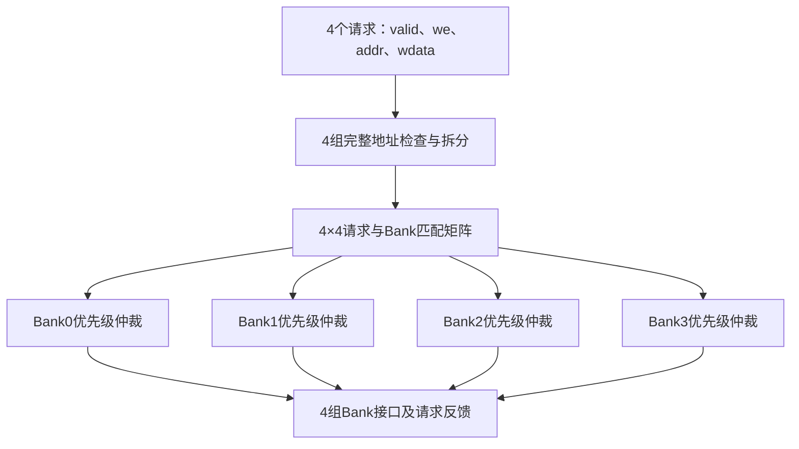

# 开放作业第一题中篇一：RTL基础与地址前端

日期：2026-11-09。承接 `HANDOFF.md` 与 `assignment-01-bank-router-part-01-spec.md`。

本阶段从已有规格继续，完成模块接口、参数、内部信号、组合默认赋值、输入拆包、地址检查与地址拆分。匹配矩阵、每Bank固定优先级仲裁、成功访问路由和完整Testbench留给后续阶段。本文件最后附可编译的阶段源码；它还不是完整的作业答案。

## 1. 硬件位置：今天写哪一段电路

把本模块放在NPU请求源与四个单端口SRAM Bank之间。上游可以是计算单元、数据搬运模块等；本题仅抽象为req0～req3，不额外设计这些请求源。下游每个Bank有使能、读写方向、局部地址和写数据输入。本模块不实例化SRAM，也不负责读数据返回路径。



本阶段实现图中的地址前端与全模块默认输出；其余结构先保留信号和插入位置。

这些方框将形成以下实际组合硬件：

| 结构 | 主要实现 | 是否保存历史 |
|---|---|---|
| 输入拆包 | 导线分组与连接 | 否 |
| 地址合法性判断 | 与常数比较，综合后可化简 | 否 |
| Bank号与局部地址拆分 | 固定取位与接线 | 否 |
| 匹配矩阵，后续实现 | Bank号相等判断与有效条件相与 | 否 |
| 固定优先级，后续实现 | 候选屏蔽、优先选择逻辑 | 否 |
| Bank输出，后续实现 | 地址、操作和数据的多路选择 | 否 |

四个Bank各自选一个候选，才能同时接收四个不同Bank的访问。例如地址0、1、2、3应允许四个请求一起通过；如果全局只选一个请求，就浪费了另外三个Bank的访问能力。

固定优先级只依据本次输入：req0优于req1，依次到req3。它不需要记住上一次获胜者，因此可实现为纯组合逻辑。轮询仲裁需要保存轮转位置，本题不使用。

完整电路的组合关键路径可能经过“输入地址→合法性/目标判断→优先选择→Bank地址或数据选择”，也可能通向反馈输出。比较与拆分可并行，不代表每个方框必须先后耗时一拍。最终哪条路径最慢，需要综合与时序分析，本阶段没有测量路径延迟。

## 2. 参数和派生常量：先确定线有多宽

| 名称 | 默认值 | 单位或作用 |
|---|---:|---|
| `N_REQ` | 4 | 请求者个数 |
| `N_BANKS` | 4 | Bank个数 |
| `BANK_DEPTH` | 16 | 每Bank的word个数 |
| `DATA_W` | 8 | 每个word的数据位数 |
| `GLOBAL_ADDR_W` | 8 | 每个全局word地址的位数 |
| `LOCAL_ADDR_W` | 4 | Bank内word编号的位数，`$clog2(16)` |
| `OWNER_W` | 2 | 请求者编号位数，`$clog2(4)` |
| `BANK_SEL_W` | 2 | Bank编号位数，`$clog2(4)` |
| `TOTAL_WORDS` | 64 | 总word数，`N_BANKS*BANK_DEPTH` |

`$clog2(n)`为向上取整的以2为底对数。16个位置用4bit编号0～15，4个请求者用2bit编号0～3。`TOTAL_WORDS`是容量64，不是最后地址63。

`parameter`允许实例化时指定值；`localparam`由已有配置推导，不允许实例化时单独改写。它们在展开电路时确定，不是运行时寄存器。

`LOCAL_ADDR_W`和`OWNER_W`会用于端口宽度，所以在模块参数列表中提前声明为`localparam`；仅供模块内部使用的`BANK_SEL_W`和`TOTAL_WORDS`放在模块体中。

本阶段只编译核验默认配置，不承诺任意参数都可用。当前低位交织要求Bank数为2的幂；Bank数、深度、请求数改变后还需检查零位宽、容量比较宽度等问题。不要把这一教学阶段源码当成已验证的通用IP。

所有地址的单位都是word编号。当前一个word等于1Byte；若将数据宽度改为32bit，word地址加1就表示移动到下一个4Byte的数据字，不能继续按字节地址解释。

## 3. 端口：接口上的每一组线代表什么

| 输入 | 默认宽度 | 含义与有效条件 |
|---|---:|---|
| `req_valid` | 4bit | 第r位为1时，第r个请求有效 |
| `req_we` | 4bit | 第r位1写0读，随有效请求解释 |
| `req_addr_flat` | 32bit | 4组8bit全局word地址 |
| `req_wdata_flat` | 32bit | 4组8bit写数据，写请求时有意义 |

`flat`表示把多组信号打包成一根宽总线，不表示一笔32bit访问。本题最多有四笔各自8bit的数据访问。

| 请求反馈 | 默认宽度 | 完整设计的含义 |
|---|---:|---|
| `req_grant` | 4bit | 合法请求赢得目标Bank，可被下游接收 |
| `req_stall` | 4bit | 合法请求因同Bank竞争失败，需要上游保持或重试 |
| `req_error` | 4bit | 有效请求的完整地址越界 |

本组合模块不保存被阻塞请求，也不自动重试。读请求的`grant`也不表示读数据已经返回；它只表示当前请求被授权路由。

| Bank输出 | 总宽度 | 每Bank字段与有效条件 |
|---|---:|---|
| `bank_en` | 4bit | 目标Bank本次有获胜请求 |
| `bank_we` | 4bit | 1写0读，`bank_en=1`时解释 |
| `bank_addr_flat` | 16bit | 4组4bit局部word地址 |
| `bank_wdata_flat` | 32bit | 4组8bit写数据，最终读请求时约定输出0 |
| `bank_owner_flat` | 8bit | 4组2bit获胜请求者编号，`bank_en=1`才有效 |
| `bank_conflict` | 4bit | 对应Bank有至少两个合法有效候选 |

禁用Bank的owner默认0不代表req0获胜，必须同时看`bank_en`。

这些信号不需要复位。完整组合逻辑由当前输入决定，输入稳定后经过传播延迟输出稳定；真实系统仍须满足下游采样时序。纯组合不意味着物理零延迟或绝无毛刺。

## 4. 内部信号：数组不等于存储器

```systemverilog
logic [GLOBAL_ADDR_W-1:0] req_addr [0:N_REQ-1];
```

先从名字两侧读：`[GLOBAL_ADDR_W-1:0]`表示每项8bit，`[0:N_REQ-1]`表示有4项。它用于给四组地址导线分别命名。

`logic`是SystemVerilog变量数据类型，是否形成触发器、锁存器或组合连线取决于赋值逻辑。这里没有时钟沿，且所有路径都赋值，所以不需要保存上一次值。声明数组本身不会强迫综合出SRAM。

| 内部信号 | 每项宽度/数量 | 当前作用 |
|---|---|---|
| `req_addr[r]` | 8bit×4 | 拆包后的完整全局地址 |
| `req_wdata[r]` | 8bit×4 | 拆包后的写数据 |
| `addr_ok[r]` | 1bit×4 | 完整地址是否小于64，与valid分开 |
| `req_bank[r]` | 2bit×4 | 地址低两位得到的Bank号 |
| `req_local_addr[r]` | 4bit×4 | 地址右移2位后的低4bit |
| `match[r][b]` | 1bit×16 | 后续表示请求r是否是Bank b候选；本阶段清零 |
| `winner_found` | 1bit | 后续仲裁循环临时量；本阶段清零 |
| `candidate_count` | `integer` | 后续当前Bank候选数量；本阶段清零 |

`candidate_count`的单位是候选请求数，未来最多为4，不是周期数。它尚未使用，后续也可根据需要改成足够宽的逻辑向量。`winner_found`未来是在组合计算过程中使用的临时变量，不是“上一拍已有获胜者”的状态。

## 5. 数据流、控制流与边界：先推导再写表达式

数据流为：打包地址/数据→拆出每个请求的地址/数据→地址分成目标Bank和局部地址→后续选择获胜者→Bank接口。

控制流为：valid确认是否有请求→完整地址检查阻止越界访问→匹配决定该请求进入哪个Bank的候选集合→优先级决定获胜→形成授权和阻塞反馈。

本阶段实际完成到地址前端，并接出地址错误反馈。合法请求暂时既不会grant也不会stall，因为仲裁尚未写。这是阶段占位行为，不是对上篇完整接口语义的修改。

### 5.1 打包布局必须先约定

```systemverilog
req_addr[r] = req_addr_flat[r*GLOBAL_ADDR_W +: GLOBAL_ADDR_W];
```

`[起点 +: 宽度]`从起点向高位取指定数量的位。因此默认配置为：

| 请求 | 地址位段 | 数据位段 |
|---|---|---|
| req0 | `[7:0]` | `[7:0]` |
| req1 | `[15:8]` | `[15:8]` |
| req2 | `[23:16]` | `[23:16]` |
| req3 | `[31:24]` | `[31:24]` |

比如四个地址依次为5、9、14、16，则可以用`{8'd16,8'd14,8'd9,8'd5}`打包；拼接最右边对应最低位，即req0。`+:`不是加法器，也不表示分多拍移动数据。

### 5.2 完整地址检查不能被取位代替

```systemverilog
addr_ok[r] = (req_addr[r] < TOTAL_WORDS);
req_bank[r] = req_addr[r][BANK_SEL_W-1:0];
req_local_addr[r] = req_addr[r] >> BANK_SEL_W;
req_error[r] = req_valid[r] && !addr_ok[r];
```

地址是无符号逻辑向量。默认配置下，`TOTAL_WORDS=64`，合法地址为0～63。

| 完整地址 | 二进制8bit | 拆得Bank | 数学局部地址 | 实际4bit局部信号 | addr_ok |
|---:|---|---:|---:|---:|---:|
| 5 | `00000101` | 1 | 1 | 1 | 1 |
| 14 | `00001110` | 2 | 3 | 3 | 1 |
| 63 | `00111111` | 3 | 15 | 15 | 1 |
| 64 | `01000000` | 0 | 16 | 0，因截断 | 0 |
| 255 | `11111111` | 3 | 63 | 15，因截断 | 0 |

关键点是64：数学上`64/4=16`，但4bit局部地址装不下16，赋值后只剩低4bit的0。若只检查截断后的局部地址，就会把越界访问误认为Bank0/local0。

因此要对保留8bit的完整地址做比较，并在后续匹配中使用：

```systemverilog
// 下一阶段实现，本阶段尚未写入核心逻辑：
match[r][b] = req_valid[r] && addr_ok[r] && (req_bank[r] == b);
```

先检查再使用是逻辑安全条件，不意味着一定经过两个时钟周期；这些组合逻辑可以并行展开，关键是最终使能必须受`addr_ok`约束。

`addr_ok`不包含valid：valid为0时，地址检查结果仍可为0或1，但`req_error`必须为0。未发出的请求不能触发错误。

## 6. 按顺序构建代码

### 6.1 模块声明和接口

先写模块名`bank_access_router`，写五个配置参数，再写两个端口派生宽度。随后按“请求输入→请求反馈→Bank输出”的分组声明端口。端口列表没有clk/rst，因为本题没有内部状态需要按时钟更新。

完整端口见文末源码。注意`N_REQ*GLOBAL_ADDR_W`是总线位数的编译时计算，不是硬件乘法器。

### 6.2 派生常量和内部数组

```systemverilog
localparam int BANK_SEL_W  = $clog2(N_BANKS);
localparam int TOTAL_WORDS = N_BANKS * BANK_DEPTH;
logic [GLOBAL_ADDR_W-1:0] req_addr [0:N_REQ-1];
logic [DATA_W-1:0] req_wdata [0:N_REQ-1];
```

先把电路中的线命名，再写它们怎样连接。不要看到数组就添加复位或时钟；本题只是把宽总线拆成几组易读的中间信号。

### 6.3 打开组合块，先写完整默认赋值

```systemverilog
always_comb begin
    req_grant = '0;
    req_stall = '0;
    req_error = '0;
    bank_en   = '0;
    // 其余Bank输出同样先清零，见完整源码。
end
```

`'0`按左侧目标宽度填0，因此可以给4bit、16bit或32bit信号清零。组合块使用阻塞赋值`=`：本次执行后面的语句立即使用前面算出的值。这不是触发器的非阻塞更新`<=`。

默认赋值和后面覆盖描述的是输出函数：没有命中条件时取0，命中时取所选值。它不是“先花一拍清零，再花一拍工作”。如果某条路径漏赋值，电路可能需要保留旧值而推断锁存器；`always_comb`表达组合意图，并不替你补全遗漏的分支。

### 6.4 给数组与预留变量默认值

```systemverilog
for (int r = 0; r < N_REQ; r = r + 1) begin
    req_addr[r]       = '0;
    req_wdata[r]      = '0;
    addr_ok[r]        = 1'b0;
    req_bank[r]       = '0;
    req_local_addr[r] = '0;
    for (int b = 0; b < N_BANKS; b = b + 1) begin
        match[r][b] = 1'b0;
    end
end
```

这类固定边界的循环在综合时展开为多组组合逻辑。不是一个硬件处理器轮流计算req0、req1、req2、req3，也不是要等四拍。对马上无条件覆盖的数组项，前面的清零有时可省略；这里保留以展示统一的“默认值→计算→后续覆盖”组织方式，综合器通常会优化冗余赋值。

`winner_found=0`和`candidate_count=0`也在组合块开头赋值。它们现在只是下一阶段预留变量，不参与当前授权输出。

### 6.5 拆包与地址前端

再写一个请求循环：拆出完整地址和写数据，比较完整地址，拆Bank号与局部地址，最后给出`req_error`。同一个组合块内部先赋`req_addr`再读取它，不依赖另一个进程的触发顺序。

默认Bank数为4，固定右移2位并截成4bit主要是导线选择，不需要通用除法器、桶形移位器或额外周期。

末尾留下两个TODO：匹配候选、每Bank仲裁与路由。先保留Bank输出为0，避免未完成模块误驱动真实Bank。但本模块当前不能接入完整系统作为可用路由器。

## 7. 本阶段源码

仓库文件：`assignments/assignment-01-bank-router/rtl/bank_access_router.sv`。

以下为同一份阶段源码，包含明确的未完成标记。

```systemverilog
// Stage 1: interface, combinational defaults, unpacking and address decoding.
// INCOMPLETE: no request-to-Bank matching, arbitration or successful routing yet.
// Supported for this lesson: the default configuration below.
// Future parameter changes require a separate width/range review.
module bank_access_router #(
    parameter int N_REQ         = 4,
    parameter int N_BANKS       = 4,
    parameter int BANK_DEPTH    = 16,
    parameter int DATA_W        = 8,
    parameter int GLOBAL_ADDR_W = 8,
    // Port widths must be known before declaring the ports.
    localparam int LOCAL_ADDR_W = $clog2(BANK_DEPTH),
    localparam int OWNER_W      = $clog2(N_REQ)
) (
    input  logic [N_REQ-1:0]                   req_valid,
    input  logic [N_REQ-1:0]                   req_we,
    input  logic [N_REQ*GLOBAL_ADDR_W-1:0]     req_addr_flat,
    input  logic [N_REQ*DATA_W-1:0]            req_wdata_flat,

    output logic [N_REQ-1:0]                   req_grant,
    output logic [N_REQ-1:0]                   req_stall,
    output logic [N_REQ-1:0]                   req_error,

    output logic [N_BANKS-1:0]                 bank_en,
    output logic [N_BANKS-1:0]                 bank_we,
    output logic [N_BANKS*LOCAL_ADDR_W-1:0]    bank_addr_flat,
    output logic [N_BANKS*DATA_W-1:0]          bank_wdata_flat,
    output logic [N_BANKS*OWNER_W-1:0]         bank_owner_flat,
    output logic [N_BANKS-1:0]                 bank_conflict
);

    // Constants are elaboration-time values, not physical registers.
    localparam int BANK_SEL_W  = $clog2(N_BANKS);
    localparam int TOTAL_WORDS = N_BANKS * BANK_DEPTH;

    // Unpacked arrays name the wires belonging to each requester.
    logic [GLOBAL_ADDR_W-1:0] req_addr       [0:N_REQ-1];
    logic [DATA_W-1:0]        req_wdata      [0:N_REQ-1];
    logic                    addr_ok        [0:N_REQ-1];
    logic [BANK_SEL_W-1:0]    req_bank       [0:N_REQ-1];
    logic [LOCAL_ADDR_W-1:0]  req_local_addr [0:N_REQ-1];

    // Reserved for the arbitration lesson; held at zero in this stage.
    logic match [0:N_REQ-1][0:N_BANKS-1];
    logic winner_found;
    integer candidate_count;

    always_comb begin
        // Every output receives a value on every path.
        req_grant       = '0;
        req_stall       = '0;
        req_error       = '0;
        bank_en         = '0;
        bank_we         = '0;
        bank_addr_flat  = '0;
        bank_wdata_flat = '0;
        bank_owner_flat = '0;
        bank_conflict   = '0;
        winner_found    = 1'b0;
        candidate_count = 0;

        // Constant-bound loops describe parallel combinational structures.
        for (int r = 0; r < N_REQ; r = r + 1) begin
            req_addr[r]       = '0;
            req_wdata[r]      = '0;
            addr_ok[r]        = 1'b0;
            req_bank[r]       = '0;
            req_local_addr[r] = '0;
            for (int b = 0; b < N_BANKS; b = b + 1) begin
                match[r][b] = 1'b0;
            end
        end

        for (int r = 0; r < N_REQ; r = r + 1) begin
            // Request 0 occupies the least-significant slice.
            req_addr[r] =
                req_addr_flat[r*GLOBAL_ADDR_W +: GLOBAL_ADDR_W];
            req_wdata[r] =
                req_wdata_flat[r*DATA_W +: DATA_W];

            // Compare the FULL global word address before trusting slices.
            addr_ok[r] = (req_addr[r] < TOTAL_WORDS);
            req_bank[r] = req_addr[r][BANK_SEL_W-1:0];
            req_local_addr[r] = req_addr[r] >> BANK_SEL_W;

            // Invalid requesters must not raise address errors.
            req_error[r] = req_valid[r] && !addr_ok[r];
        end

        // TODO next stage: match = valid && addr_ok && Bank equality.
        // TODO next stage: per-Bank priority, output muxes, grant/stall/conflict.
        // Current grant/stall and Bank outputs intentionally remain zero.
    end
endmodule
```

## 8. 真实编译与验证边界

本次运行环境原先没有Icarus Verilog；已将Ubuntu的Icarus Verilog 12.0程序包解包到临时工具目录，实际使用该程序完成编译。未依赖交接文档中旧机器的安装状态。

常规安装后的可复现命令（从仓库根目录运行）：

```bash
iverilog -g2012 -Wall -s bank_access_router \
  -o /tmp/router-foundation.vvp \
  assignments/assignment-01-bank-router/rtl/bank_access_router.sv
```

本次实际执行命令：

```bash
/tmp/npu-iverilog/usr/bin/iverilog \
  -B /tmp/npu-iverilog/usr/lib/x86_64-linux-gnu/ivl \
  -g2012 -Wall -s bank_access_router \
  -o /tmp/npu-iverilog/router-foundation.vvp \
  assignments/assignment-01-bank-router/rtl/bank_access_router.sv
```

编译退出码为0，生成了vvp编译产物。工具输出4次以下提示（源文件第48行）：

```text
sorry: constant selects in always_* processes are not currently supported (all bits will be included).
```

该提示表示Icarus对`always_comb`常量取位依赖的处理采用更宽的敏感范围，可能增加仿真求值次数；本次不是语法编译失败。它不能代替后续功能检查，也不是综合时序结论。保留真实工具输出，见`assignments/assignment-01-bank-router/checks/rtl-foundation-compile.txt`。

本阶段的验证边界：

| 项目 | 本次结果 |
|---|---|
| SystemVerilog语法与默认参数展开 | 编译通过，退出0，有上述工具提示 |
| 完整匹配与仲裁逻辑 | 尚未实现 |
| Testbench与vvp功能运行 | 尚未执行 |
| VCD与波形图 | 尚未生成 |
| 综合锁存器检查、STA和物理延迟 | 尚未执行 |
| 学校最终作业要求 | 仍需完成仲裁、测试和波形说明 |

源码的完整赋值方式旨在避免锁存器，但仅凭这次编译不能声称已用综合器证明无锁存器，也不能声称T1～T11通过。

## 9. 当前进度与下一步

现已完成：“模块声明→配置与派生常量→接口→内部信号→组合默认赋值→拆包→完整地址检查→地址拆分→错误反馈”。

本阶段`req_grant/req_stall`与所有Bank输出仍为0；`match/winner_found/candidate_count`仅清零。下一阶段从`match[r][b]`开始，逐Bank构造候选集合，按req0到req3选择获胜者，并接出Bank接口、`grant/stall/conflict`。随后另行编写自检Testbench，覆盖上篇T1～T11并生成真实波形。
