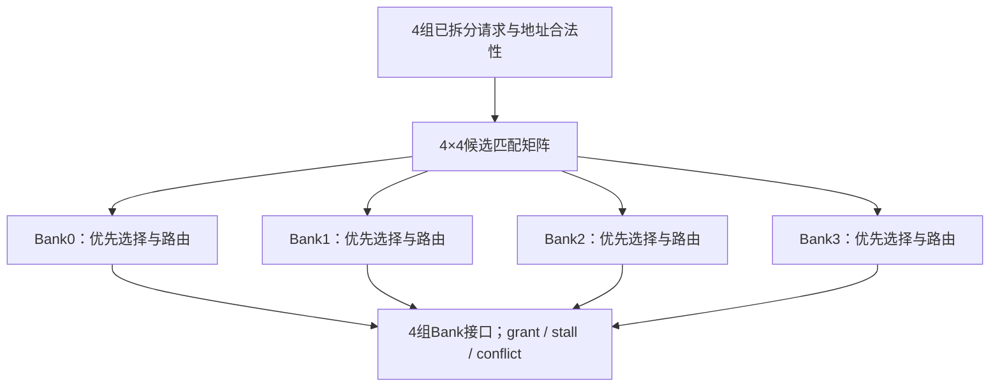

# 开放作业第一题第三篇：Bank匹配矩阵、固定优先级仲裁与数据路由

日期：2026-11-09。

本篇按仓库当前HANDOFF续接。第一题的接口、组合默认值、输入拆包和地址前端已经完成；本篇只补齐匹配、每Bank优先选择、输出路由与授权反馈，不重复前一篇。原DMA/AXI路线暂按最新作业计划后移。

本题是借鉴tiny-NPU Bank组织思想的教学扩展，模块名`bank_access_router`。本轮实际完成133行组合RTL、7组定向基础检查，并通过Icarus Verilog 12.0运行。没有完成全部T1～T11，没有生成VCD或波形截图，没有运行综合或时序分析。

## 1. 硬件位置与本篇增加的结构

上游为4个请求者，下游为4个单端口Bank。本模块只是请求前端，没有真正SRAM，也没有读数据返回通道。

上一阶段每个请求已经产生：

- `req_addr[r]`：完整8bit全局word地址；
- `addr_ok[r]`：地址是否小于64；
- `req_bank[r]`：低2bit Bank编号；
- `req_local_addr[r]`：4bit Bank内word地址；
- `req_wdata[r]`：8bit写数据；
- `req_error[r]`：有效请求的地址错误。

本篇在这些导线后连接三种结构：

1. 请求与Bank的16个匹配条件；
2. 4套互相独立的固定优先选择逻辑；
3. 选中请求的操作/地址/写数据多选一，以及反馈逻辑。



每个Bank最多选1个请求，4个Bank一共最多选4个请求。不存在“全模块只选1个获胜者”的总仲裁器。

这些结构只依赖当前输入，没有时钟、复位和跨拍记忆。图中的前后关系是组合依赖，不是多拍流程。

## 2. 本篇变量的含义、单位与有效范围

| 名字 | 默认宽度/数量 | 含义与单位 |
|---|---|---|
| `match[r][b]` | 4×4个1bit | 请求r是否为Bank b的合法有效候选 |
| `winner_found` | 1bit组合临时量 | 当前Bank是否已经选择了更高优先级候选 |
| `candidate_count` | integer，当前范围0～4 | 当前Bank合法有效候选数；不是周期数 |
| `r` | 循环整数0～3 | 请求者编号，0优先级最高 |
| `b` | 循环整数0～3 | Bank编号，各Bank独立仲裁 |
| `req_grant[r]` | 每请求1bit | 当前请求赢得目标Bank |
| `req_stall[r]` | 每请求1bit | 当前请求合法有效，但没有赢得Bank |
| `bank_en[b]` | 每Bank1bit | 当前Bank有获胜请求 |
| `bank_we[b]` | 每Bank1bit | 获胜请求的方向：1写、0读 |
| `bank_addr_flat` | 4×4bit | 每个Bank的局部word地址 |
| `bank_wdata_flat` | 4×8bit | 每个Bank的写数据；读请求统一0 |
| `bank_owner_flat` | 4×2bit | 每个Bank获胜请求者的编号 |
| `bank_conflict[b]` | 每Bank1bit | 当前Bank是否有至少2个合法候选 |

owner是“请求者编号”，Bank编号是b，二者不能混淆。`bank_en=0`时owner默认0不代表req0获胜。

`winner_found`与`candidate_count`出现在组合块中，用阻塞赋值完整重算；不保存“上一拍结果”。它们是写优先逻辑时使用的临时描述量，综合会按逻辑依赖展开。

现阶段保留前篇参数接口，但仅核验默认配置：4请求、4Bank、每Bank16word、每word8bit、全局地址8bit。尚未验证其他参数组合或含X/Z的请求协议。

## 3. 数据流与控制流

数据流：

$$req\_we/req\_local\_addr/req\_wdata
\rightarrow 选中请求的多路选择
\rightarrow Bank接口.$$

控制流：

$$valid+addr\_ok+目标Bank匹配
\rightarrow 候选集合
\rightarrow 固定优先选择
\rightarrow grant/en/owner.$$

候选集合同时还产生冲突信息。最后依据完整的grant结果产生stall。

Bank是否真能接受请求取决于连接协议；本题假设下游Bank可在采样沿接收已授权访问，没有额外bank_ready输入。grant表示请求授权，不是同步SRAM的读返回已经到达。

本模块也没有缓存被阻塞请求。上游收到stall后，要自行保持或重试；若丢弃当前请求，路由器不会下一拍自动补发。

## 4. 先推导4×4匹配矩阵

每个请求成为某Bank候选，需要同时满足：

$$match[r][b]
=req\_valid[r]\land addr\_ok[r]\land(req\_bank[r]=b).$$

例如输入：

| 请求 | valid | 操作 | 全局word地址 | 目标Bank | 局部word地址 |
|---|---:|---|---:|---:|---:|
| req0 | 1 | 读 | 5 | 1 | 1 |
| req1 | 1 | 写 | 9 | 1 | 2 |
| req2 | 1 | 写 | 14 | 2 | 3 |
| req3 | 1 | 读 | 16 | 0 | 4 |

匹配结果：

| `match[r][b]` | Bank0 | Bank1 | Bank2 | Bank3 |
|---|---:|---:|---:|---:|
| req0 | 0 | 1 | 0 | 0 |
| req1 | 0 | 1 | 0 | 0 |
| req2 | 0 | 0 | 1 | 0 |
| req3 | 1 | 0 | 0 | 0 |

从行看，一个合法请求只匹配一个Bank。从列看，一个Bank可以有0～4个候选，仲裁就是对每一列独立选择。

实现：

```systemverilog
for (int r = 0; r < N_REQ; r = r + 1) begin
    for (int b = 0; b < N_BANKS; b = b + 1) begin
        match[r][b] = req_valid[r] && addr_ok[r] &&
                      (req_bank[r] == b[BANK_SEL_W-1:0]);
    end
end
```

默认`BANK_SEL_W=2`，`b[BANK_SEL_W-1:0]`把循环整数Bank号写成对应2bit编码。循环边界固定，综合展开为16个匹配关系，不是执行16个时钟周期。

地址64在前端取位后也可能看起来指向Bank0/local0，但addr_ok=0，所以这一行match全0，无法参与任何Bank仲裁。

## 5. 每Bank固定优先选择的硬件含义

优先级为：

$$req0>req1>req2>req3.$$

对某个固定Bank，令四个候选分别为m0、m1、m2、m3，对应的获胜条件可展开为：

$$g_0=m_0,$$
$$g_1=m_1\land\neg m_0,$$
$$g_2=m_2\land\neg(m_0\lor m_1),$$
$$g_3=m_3\land\neg(m_0\lor m_1\lor m_2).$$

它是“有更高优先级候选就屏蔽当前候选”的组合结构。优先选择产生winner，winner再控制地址、数据和操作字段的多选一。

代码用`winner_found`表达“前面是否已有候选获胜”：

```systemverilog
for (int b = 0; b < N_BANKS; b = b + 1) begin
    winner_found    = 1'b0;
    candidate_count = 0;

    for (int r = 0; r < N_REQ; r = r + 1) begin
        if (match[r][b]) begin
            candidate_count = candidate_count + 1;
            if (!winner_found) begin
                winner_found = 1'b1;
                // 当前r成为Bank b的获胜者
            end
        end
    end
end
```

### 5.1 为什么第一个候选获胜

req0最先检查。若匹配，它令winner_found=1；之后req1～req3即便匹配，也不会再进入`if (!winner_found)`。

若req0不匹配，winner_found仍0，req1可以获胜。req0无效或越界都会使match为0，所以不会阻挡低优先级合法请求。

代码使用阻塞赋值`=`，后面的if立即看见本次组合计算更新后的winner_found。这里不能照搬时序逻辑的`<=`写法。

### 5.2 为什么每个Bank都必须重新清临时量

若只在always_comb开头清一次winner_found，Bank0选出获胜者后，处理Bank1时仍然为1，就可能阻止Bank1选出任何请求。

candidate_count也必须从0重新开始，避免把Bank0候选数带进Bank1。

正确位置是在每个Bank的循环体起点。初始默认值仍保留，但不能替代逐Bank初始化。

### 5.3 为什么计数必须包括失败候选

candidate_count在`if (match[r][b])`内增加，放在`if (!winner_found)`外。

因为每Bank最多只有1个winner，但可能有4个候选。若只统计winner，计数最多1，就永远检测不到冲突。

最后：

```systemverilog
bank_conflict[b] = (candidate_count > 1);
```

conflict=1表示本Bank确实有人竞争；本Bank仍可以授权其中最高优先级请求，并不代表整Bank禁止访问。

## 6. 获胜者怎样驱动Bank接口

在第一次找到候选时：

```systemverilog
winner_found = 1'b1;
req_grant[r] = 1'b1;
bank_en[b]   = 1'b1;
bank_we[b]   = req_we[r];

bank_addr_flat[b*LOCAL_ADDR_W +: LOCAL_ADDR_W] =
    req_local_addr[r];

bank_owner_flat[b*OWNER_W +: OWNER_W] =
    r[OWNER_W-1:0];

bank_wdata_flat[b*DATA_W +: DATA_W] =
    req_we[r] ? req_wdata[r] : '0;
```

逐项理解：

- grant[r]反馈给获胜请求者。
- en[b]使目标Bank本次有有效访问。
- we来自同一个获胜者，不能来自其他候选。
- 地址输出为该获胜者的局部word地址，不是完整全局地址。
- owner记录请求者编号r，不是Bank号b。
- 写请求转发获胜者写数据；读请求按已定规则输出0。

`[b*宽度 +: 宽度]`选择“第b个Bank的字段”。例如局部地址宽4bit：

| Bank | 局部地址输出切片 |
|---|---|
| Bank0 | `[3:0]` |
| Bank1 | `[7:4]` |
| Bank2 | `[11:8]` |
| Bank3 | `[15:12]` |

输入按r拆包，输出按b打包，中间的winner决定“哪个r接到哪个b”。这就是路由的具体含义。

如果某Bank完全没有候选，不进入获胜分支，它的字段保持组合块开头的0。完整默认赋值确保每组输入都有确定输出。

## 7. 最后生成stall，保持错误与阻塞语义独立

在全部Bank仲裁结束后：

```systemverilog
for (int r = 0; r < N_REQ; r = r + 1) begin
    req_stall[r] = req_valid[r] && addr_ok[r] && !req_grant[r];
end
```

| 请求情况 | grant | stall | error |
|---|---:|---:|---:|
| valid=0 | 0 | 0 | 0 |
| 合法且赢得Bank | 1 | 0 | 0 |
| 合法但竞争失败 | 0 | 1 | 0 |
| 有效但地址越界 | 0 | 0 | 1 |

前端仍负责：

```systemverilog
req_error[r] = req_valid[r] && !addr_ok[r];
```

不能简单写`stall=valid&&!grant`，否则地址越界请求也会被当成“等一等就能重试”的请求。

stall放在所有Bank处理之后，才能依据最终grant向量判断。反馈属于当前组合结果，不需要等一拍。

## 8. 把前面的完整例子一路算到输出

令req1写数据0xA1，req2写数据0xB2；req0、req3为读。

| Bank | 候选 | 获胜者 | en | we | local_addr | wdata | conflict |
|---|---|---|---:|---:|---:|---|---:|
| 0 | req3 | req3 | 1 | 0 | 4 | 0x00 | 0 |
| 1 | req0、req1 | req0 | 1 | 0 | 1 | 0x00 | 1 |
| 2 | req2 | req2 | 1 | 1 | 3 | 0xB2 | 0 |
| 3 | 无 | 无 | 0 | 0 | 0 | 0x00 | 0 |

请求向量按`[3:0]`展示：

```text
req_grant = 4'b1101
req_stall = 4'b0010
req_error = 4'b0000

bank_en       = 4'b0111
bank_we       = 4'b0100
bank_conflict = 4'b0010
```

右端最低位是req0或Bank0。这里3个请求同时通过，req1单独阻塞；Bank1的冲突不影响Bank0和Bank2。

## 9. 代码组织顺序与时序边界

当前always_comb依次组织为：

1. 所有输出与临时量给默认值；
2. 中间数组默认值；
3. 请求输入拆包、完整地址检查、地址拆分、error；
4. 建立全部match；
5. 外层逐Bank、内层按请求优先级选择并路由；
6. 生成每Bank conflict；
7. 根据最终grant生成每请求stall。

这些步骤不消耗7个周期。固定循环和阻塞赋值描述组合依赖，输入变化后输出经过真实门延迟稳定。

在真实系统中，上游寄存器发出请求，经本组合模块，目标SRAM在某个时钟沿采样bank_en/we/addr/wdata。该采样沿要求输入满足建立保持时序；本模块没有帮忙注册请求或消除组合毛刺。

同理，固定优先级需要在连续请求中由上游正确解释grant/stall。高优先级若持续请求同一Bank，低优先级可能饥饿。本篇没有增加轮询寄存器，因为本题要求纯组合。

## 10. 本轮实际验证：7组基础组合检查

新增文件：

- `checks/tb_arbitration_smoke.sv`：本阶段用的小型自检测试；
- `checks/arbitration-smoke-results.txt`：实际命令、工具输出、退出码；
- 路径均位于`assignments/assignment-01-bank-router/`之下。

测试不生成时钟，施加一组输入后`#1`再比较全部输出。这个1ns是测试平台的稳定等待，不是测得的电路传播延迟。期望值按场景显式填写，没有复制一份DUT仲裁算法充当判据。

| 检查 | 场景 | 本次结果 |
|---|---|---|
| S0 | 无效请求携带越界地址 | PASS，不报错、不使能Bank |
| S1 | 四请求访问不同Bank，混合读写 | PASS，全部授权、字段正确 |
| S2 | 四请求访问Bank1 | PASS，仅req0授权，其余stall |
| S3 | 两请求冲突，另外两请求独立 | PASS，3请求同时获授权 |
| S4 | 地址63合法、64越界，并行其他请求 | PASS，非法请求被隔离 |
| S5 | 非法req0不能获胜，req1优先于req2 | PASS，合法优先链正确 |
| S6 | 活跃访问之后全部撤销 | PASS，输出回到默认0 |

实际vvp输出：

```text
PASS S0 inactive out-of-range request
PASS S1 four independent Banks
PASS S2 four candidates on Bank1
PASS S3 partial conflict and parallel routing
PASS S4 address 63 accepted and 64 rejected
PASS S5 invalid req0 cannot win; req1 beats req2
PASS S6 outputs clear after active traffic
PASS arbitration smoke: 7/7 vectors
```

编译与仿真命令从仓库根目录执行。常规安装下可运行：

```bash
iverilog -g2012 -Wall -s bank_access_router \
  -o /tmp/router-arbitration.vvp \
  assignments/assignment-01-bank-router/rtl/bank_access_router.sv

iverilog -g2012 -Wall -s tb_arbitration_smoke \
  -o /tmp/router-arbitration-smoke.vvp \
  assignments/assignment-01-bank-router/checks/tb_arbitration_smoke.sv \
  assignments/assignment-01-bank-router/rtl/bank_access_router.sv

vvp /tmp/router-arbitration-smoke.vvp
```

本次实际使用已存在的临时Icarus 12.0安装：

- 编译器：`/tmp/npu-iverilog/usr/bin/iverilog`；
- 编译器附加参数：`-B /tmp/npu-iverilog/usr/lib/x86_64-linux-gnu/ivl`；
- 仿真器：`/tmp/npu-iverilog/usr/bin/vvp`。

两个编译命令和vvp均退出0。单独RTL编译有6条always_comb常量取位敏感范围提示；基础测试编译还有RTL继承测试文件timescale的提示，均原样保存在结果记录中。提示没有导致本次编译失败，也不能代替功能或综合验证。

| 验证项目 | 本轮范围 |
|---|---|
| 默认参数语法与展开 | 通过 |
| 基础定向功能仿真 | 7/7通过 |
| 完整T1～T11及扩展回归 | 待下一阶段 |
| VCD与真实波形截图 | 尚未生成 |
| 综合无锁存器证明、STA | 未执行 |
| 任意参数/全部输入空间 | 未验证 |

S6说明所测向量切换后未残留旧输出，不能把它升级表述为综合器已证明无锁存器。完整默认赋值是避免锁存器的设计方法，形式或综合证明仍需相应工具。

## 11. 完整阶段RTL

代码文件：`assignments/assignment-01-bank-router/rtl/bank_access_router.sv`。

本篇保留前篇接口和地址前端，只把原TODO区域替换为已讲解的组合核心。下面是与仓库同步的完整133行源码。

```systemverilog
// Stage 2: address decoding, per-Bank fixed-priority arbitration and routing.
// Pure combinational request front-end; SRAM and read-return paths are external.
// Supported for this lesson: the default configuration below.
// Future parameter changes require a separate width/range review.
module bank_access_router #(
    parameter int N_REQ         = 4,
    parameter int N_BANKS       = 4,
    parameter int BANK_DEPTH    = 16,
    parameter int DATA_W        = 8,
    parameter int GLOBAL_ADDR_W = 8,
    // Port widths must be known before declaring the ports.
    localparam int LOCAL_ADDR_W = $clog2(BANK_DEPTH),
    localparam int OWNER_W      = $clog2(N_REQ)
) (
    input  logic [N_REQ-1:0]                   req_valid,
    input  logic [N_REQ-1:0]                   req_we,
    input  logic [N_REQ*GLOBAL_ADDR_W-1:0]     req_addr_flat,
    input  logic [N_REQ*DATA_W-1:0]            req_wdata_flat,

    output logic [N_REQ-1:0]                   req_grant,
    output logic [N_REQ-1:0]                   req_stall,
    output logic [N_REQ-1:0]                   req_error,

    output logic [N_BANKS-1:0]                 bank_en,
    output logic [N_BANKS-1:0]                 bank_we,
    output logic [N_BANKS*LOCAL_ADDR_W-1:0]    bank_addr_flat,
    output logic [N_BANKS*DATA_W-1:0]          bank_wdata_flat,
    output logic [N_BANKS*OWNER_W-1:0]         bank_owner_flat,
    output logic [N_BANKS-1:0]                 bank_conflict
);

    // Constants are elaboration-time values, not physical registers.
    localparam int BANK_SEL_W  = $clog2(N_BANKS);
    localparam int TOTAL_WORDS = N_BANKS * BANK_DEPTH;

    // Unpacked arrays name the wires belonging to each requester.
    logic [GLOBAL_ADDR_W-1:0] req_addr       [0:N_REQ-1];
    logic [DATA_W-1:0]        req_wdata      [0:N_REQ-1];
    logic                    addr_ok        [0:N_REQ-1];
    logic [BANK_SEL_W-1:0]    req_bank       [0:N_REQ-1];
    logic [LOCAL_ADDR_W-1:0]  req_local_addr [0:N_REQ-1];

    // A requester is a candidate for exactly one Bank if valid and in range.
    logic match [0:N_REQ-1][0:N_BANKS-1];
    logic winner_found;
    integer candidate_count;

    always_comb begin
        // Every output receives a value on every path.
        req_grant       = '0;
        req_stall       = '0;
        req_error       = '0;
        bank_en         = '0;
        bank_we         = '0;
        bank_addr_flat  = '0;
        bank_wdata_flat = '0;
        bank_owner_flat = '0;
        bank_conflict   = '0;
        winner_found    = 1'b0;
        candidate_count = 0;

        // Constant-bound loops describe parallel combinational structures.
        for (int r = 0; r < N_REQ; r = r + 1) begin
            req_addr[r]       = '0;
            req_wdata[r]      = '0;
            addr_ok[r]        = 1'b0;
            req_bank[r]       = '0;
            req_local_addr[r] = '0;
            for (int b = 0; b < N_BANKS; b = b + 1) begin
                match[r][b] = 1'b0;
            end
        end

        for (int r = 0; r < N_REQ; r = r + 1) begin
            // Request 0 occupies the least-significant slice.
            req_addr[r] =
                req_addr_flat[r*GLOBAL_ADDR_W +: GLOBAL_ADDR_W];
            req_wdata[r] =
                req_wdata_flat[r*DATA_W +: DATA_W];

            // Compare the FULL global word address before trusting slices.
            addr_ok[r] = (req_addr[r] < TOTAL_WORDS);
            req_bank[r] = req_addr[r][BANK_SEL_W-1:0];
            req_local_addr[r] = req_addr[r] >> BANK_SEL_W;

            // Invalid requesters must not raise address errors.
            req_error[r] = req_valid[r] && !addr_ok[r];
        end

        // Build all requester-to-Bank candidates before priority selection.
        for (int r = 0; r < N_REQ; r = r + 1) begin
            for (int b = 0; b < N_BANKS; b = b + 1) begin
                match[r][b] = req_valid[r] && addr_ok[r] &&
                              (req_bank[r] == b[BANK_SEL_W-1:0]);
            end
        end

        // Each Bank independently chooses the lowest-numbered candidate.
        // These are combinational temporaries, reset for EVERY Bank.
        for (int b = 0; b < N_BANKS; b = b + 1) begin
            winner_found    = 1'b0;
            candidate_count = 0;

            for (int r = 0; r < N_REQ; r = r + 1) begin
                if (match[r][b]) begin
                    // Count every candidate, including those that lose.
                    candidate_count = candidate_count + 1;

                    if (!winner_found) begin
                        winner_found = 1'b1;
                        req_grant[r] = 1'b1;
                        bank_en[b]   = 1'b1;
                        bank_we[b]   = req_we[r];
                        bank_addr_flat[b*LOCAL_ADDR_W +: LOCAL_ADDR_W] =
                            req_local_addr[r];
                        bank_owner_flat[b*OWNER_W +: OWNER_W] =
                            r[OWNER_W-1:0];
                        // Read requests have a deterministic zero write bus.
                        bank_wdata_flat[b*DATA_W +: DATA_W] =
                            req_we[r] ? req_wdata[r] : '0;
                    end
                end
            end

            bank_conflict[b] = (candidate_count > 1);
        end

        // Only legal valid losers retry; invalid addresses report error.
        for (int r = 0; r < N_REQ; r = r + 1) begin
            req_stall[r] = req_valid[r] && addr_ok[r] && !req_grant[r];
        end
    end
endmodule

```


## 12. 当前停点与下一步

当前已完成第一题组合功能核心，默认配置经过7组基础仿真。尚未把它宣称为学校作业的完整验证成稿。

下一阶段进入第一题正式Testbench与波形：先讲组合测试的输入驱动、稳定等待、自检、任务封装，再覆盖规格中的T1～T11与必要扩展，生成真实VCD并解释关键波形。完成第一题后，再进入第二题双Bank乒乓Tile Buffer；暂不直接跳入DMA/AXI。
