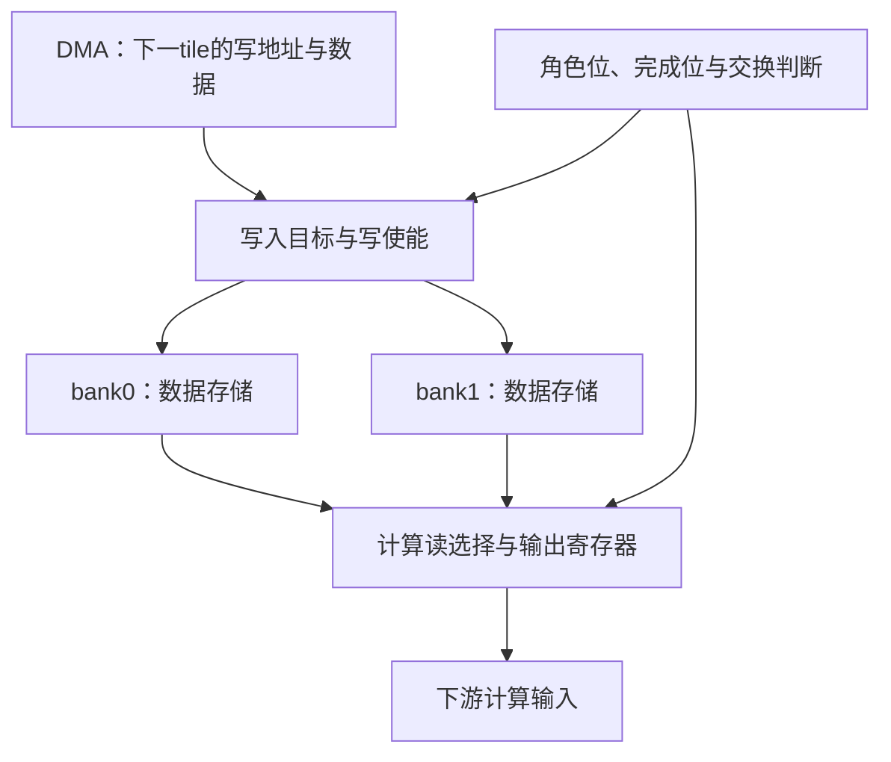

# 第二实验第一讲：双Bank Tile Buffer的硬件、完成状态与安全交换时序

日期：2026-11-09。

当前任务：按用户要求暂停第一题截图/Word成稿，进入第二实验。第一题已有T1～T11与VCD资产，不等于用户已亲自完成或掌握。

最新协作方式：用户亲自写Verilog-2005、运行编译与仿真；Codex只逐步讲解、审查当前步骤和维护讲义。本篇不提供完整RTL，不创建用户实验代码，不把助手此前参考检查计入用户进度。

本篇顺序：硬件位置→整体结构→变量含义与单位→数据/控制流→逐沿时序→用户目录准备。端口和最终访问协议留到用户反馈后共同确定。

## 1. 第二实验具体解决什么问题

参考tiny-NPU固定版本`8216c22b762011aa20c05fc2768423fd12dda59d`的`rtl/mem/tile_buffer.sv`。

前面已经学过双缓冲概念。本实验新增的设计工作，是让“数据已准备好”“当前数据可释放”“角色可以交换”有真实硬件依据。

模块位于DMA与计算供数逻辑之间：



图中的DMA只表示上游搬运者；本题不设计AXI DMA，也不实现PE阵列。两份Bank是数据存储，角色/完成状态是控制存储。

同一份tile区域仍被计算需要时，装载下一tile若覆盖相同地址会破坏输入。两份空间把当前数据和下一块数据隔开；相应的访问路径与角色控制允许它们并行。单Bank双端口在严格地址分区下也可以做其他流水，本题讨论完整tile轮换的双Bank结构。

## 2. 两份Bank与一个角色位

参考模块使用：

| active_bank | compute bank | prefetch bank |
|---:|---|---|
| 0 | bank0 | bank1 |
| 1 | bank1 | bank0 |

active_bank是1bit寄存器，表示计算当前选择哪份，不是“这个Bank一定有完整数据”。

需要区分四类硬件：

1. 两份数据数组，保存tile内容；
2. 读写选择逻辑，选择访问哪份；
3. 读输出寄存器，保存本次同步读返回；
4. 控制寄存器，保存角色、准备/完成状态。

角色交换只是改变选择条件，不复制整块数据。复位角色位不等于清空整个数据数组，也不证明第一块已装好。

## 3. 本讲涉及的变量与单位

最终端口还未与用户共同确认。下表用原模块名字解释硬件语义，扩展端口以后再定。

| 名字 | 原模块宽度/单位 | 作用与有效时机 |
|---|---|---|
| clk | 时钟 | 同步读写与角色更新的采样基准 |
| rst_n | 1bit，低有效 | 清控制/输出状态；数据数组是否清零需明确约定 |
| bank0/bank1 | 各BANK_DEPTH项，每项DATA_W bit | 保存两份tile |
| BANK_DEPTH | 原默认256个word | 一份Bank有多少寻址单元 |
| DATA_W | 原默认8bit/word | 每个地址对应多少bit |
| active_bank | 1bit角色寄存器 | 选择计算Bank和预取Bank |
| dma_wr_en | 1bit写请求/使能 | 上游要求把一个数据字写入预取Bank |
| dma_wr_addr | 原默认8bit，word编号 | 预取Bank内位置 |
| dma_wr_data | 原默认8bit | 当前写入数据 |
| compute_rd_en | 1bit读请求/使能 | 请求读取计算Bank中的一个word |
| compute_rd_addr | 原默认8bit，word编号 | 计算Bank内位置 |
| compute_rd_data | 原默认8bit寄存输出 | 最近一次有效同步读的返回 |
| swap或swap_req | 1bit请求 | 外部提出交换角色，不应自动等价于允许交换 |
| next_tile_ready | 1bit准备状态 | 下一块必要数据已实际装入预取Bank |
| tile_done | 1bit释放/完成状态 | 当前块之后不再需要，满足约定的返回接收条件 |

原模块没有读返回valid，也没有完整接受/拒绝协议。实验是否增加valid/ready、首次启动状态和交换确认，需要下一阶段共同决定。

## 4. 数据流和控制流分开看

### 4.1 写入路径

以active_bank=0为例：

1. DMA送出地址和数据；
2. 写选择逻辑选择bank1；
3. 有效写采样沿将数据写入bank1的目标位置；
4. 若这次写证明下一tile已经完整，更新next_tile_ready。

数据方向：DMA→写选择→预取Bank。

### 4.2 读取路径

仍以active_bank=0为例：

1. 计算端给出读取地址；
2. 读选择逻辑选择bank0；
3. 在采样沿读取对应数据并更新输出寄存器；
4. 下游按读返回协议接收。

数据方向：计算Bank→读选择→输出寄存器→计算端。

### 4.3 角色交换路径

控制器不能只根据swap_req就交换，应检查：

- 当前tile是否已达到释放条件；
- 下一tile是否完整；
- 是否还有最后一次返回需要交接；
- 初次启动时是否存在可消费的当前tile。

交换后进入新一轮，完成/准备标志的含义也换到新tile，不能把旧1永久带入下一轮。

## 5. 同步读的一拍延迟：用时钟沿消除歧义

不要仅凭“第N拍、第N+1拍”猜时序。直接定义两个相邻上升沿E0和E1。

假设读请求在E0前已稳定，旧输出为9，目标存储字为37：

| 时刻 | 本模块 | 下游时序逻辑 |
|---|---|---|
| E0前 | 地址和读使能稳定；输出仍9 | 看见旧输出9 |
| E0沿 | 采样请求，安排输出寄存器更新 | 同沿仍读取旧输出9 |
| E0沿后至E1前 | 输出寄存器已经是37 | 新返回在这一周期可用 |
| E1沿 | 可以采样后续请求 | 可以捕获37 |

这通常称为一拍同步读：请求被采样后沿后更新输出，下游寄存器在下一沿捕获。不能凭“一拍”再给存储输出额外多加一个不存在的寄存级。

原因是非阻塞赋值同沿先读取旧右值，再更新左侧寄存器。这个规则也适用于角色、完成位和读返回标签。

## 6. 最后一次读与tile_done要对齐

假设当前tile最后一个word的读请求在E0采样：

1. E0沿后，最后一个数据进入本模块输出寄存器；
2. 下游在E1沿才能按同步协议捕获它；
3. 若采用保守交接，E1确认最后返回接收后再置tile_done；
4. 若下一tile已准备好，可在后续交换沿切换角色。

这个序列的目的，是不让“发出了最后一个请求”冒充“下游已经安全拿到最后一个数据”。

具体可以采用不同协议：

| 协议选择 | 能否提前释放输入Bank | 必须保证什么 |
|---|---|---|
| 最后数据已锁存在本模块输出寄存器，之后不再重读 | 可以考虑 | 输出不会丢失，返回归属正确，下游按约定接收 |
| 等下游确认最后返回后释放 | 更保守 | 有明确的返回有效/接收事件 |

本讲采用后者来解释交接顺序；最终实现由下一步共同确定，不能假定端口已经设计完成。若下游可以反压，还必须考虑“valid不等于已接收”。

## 7. 两个完成标志应该怎样产生

### 7.1 next_tile_ready

它应该证明必要数据已经写入，而不是“DMA命令已经发出”。

若约定写入按地址0、1、…、D−1顺序完成，且每次写都真实被接受，那么最后一次写可以作为完成依据。

例如D=4：

| 接受的写入 | 写完后的含义 |
|---|---|
| 地址0 | 只完成第1项 |
| 地址1 | 完成第2项 |
| 地址2 | 完成第3项 |
| 地址3 | 四项都完成，可置next_tile_ready |

如果允许乱序或重复写，单看“最后地址”或“写了四次”都不够；四次写同一地址不代表整块完整。需要先选访问约定，再决定计数、外部完成通知或覆盖记录。

### 7.2 tile_done

它应该证明之后不再需要当前输入。若只顺序读一次，可以依据最后读返回的交接产生；若还要复用数据，就必须由更高层计算控制器确认不再需要。

它不是默认意义上的“整个PE计算结束”。读输入完成与乘加流水排空可能是不同时间。

### 7.3 为什么用保持标志更容易交接

DMA与计算可能不同拍完成：

- DMA先完成，就绪状态应保留，等当前块释放；
- 计算先完成，完成状态应保留，等下一块装完。

如果两者只是单拍脉冲，可能错过彼此。可以用保持标志或把脉冲锁存为状态；交换成功后，再清除对应旧状态开始下一轮。

## 8. 安全交换条件与首次启动

正常稳态的概念条件：

$$swap\_fire=swap\_req\land tile\_done\land next\_tile\_ready.$$

| 当前块可释放 | 下一块准备好 | 交换请求能否通过 |
|---:|---:|---|
| 0 | 0 | 不通过 |
| 0 | 1 | 等待当前块 |
| 1 | 0 | 等待下一块 |
| 1 | 1 | 可以安排交换 |

但启动是一个必须单独处理的边界：

复位后没有有效当前tile。如果把tile_done复位0，同时禁止读取未初始化的当前Bank，又机械要求tile_done=1才能首次交换，就会无法启动。

下一阶段可以共同选择：

- 增加“当前tile有效”状态：首次交换只要求下一tile完整；
- 或明确把“没有当前tile”等价为已经释放，定义对应初始状态。

不能在没有说明启动语义时直接写死三个信号相与。

另一个待定边界是交换沿是否允许读写：

- 原始模块同沿访问使用旧active_bank，沿后才改角色；
- 实验可以保留此行为，也可以规定成功交换优先、该沿不接受读写；
- 必须选定并在RTL与Testbench中保持一致。

提前swap是拒绝、等待还是锁存为待处理请求，也需要写进规格，不能仅靠名字推断。

## 9. 对照原始代码：哪些机制已有，哪些缺失

已存在：

- 两份存储数组；
- active_bank角色寄存器；
- DMA写非活动Bank；
- 计算同步读活动Bank；
- swap时翻转角色。

占位逻辑：

```verilog
// 原码行为摘录；不是本实验最终实现。
else if (swap)
    next_tile_ready <= ~next_tile_ready;

assign tile_done = 1'b0;
```

next_tile_ready没有检查写入完成；tile_done不检测读取完成；swap没有检查是否安全。这些才是第二题要逐步补齐的设计内容。

该题满足时序电路主题，是因为它有真实数据存储、时钟边沿读写、读输出寄存器、角色寄存器和完成状态，核心超出了一个简单计数器。

## 10. 本次停点：用户亲自准备目录

本轮只完成硬件与时序讲解，最终参数、端口与协议尚未共同确认；不能把助手参考代码或参考仿真当作用户已完成实验。

请用户在自己的终端执行：

```bash
cd /home/zenia/aiinfra/assignment
mkdir -p tile_buffer/rtl tile_buffer/tb tile_buffer/build tile_buffer/waves
pwd
find tile_buffer -maxdepth 2 -type d
```

等待用户贴出pwd与目录输出后，下一步只共同确定题目规格和端口；不提前交付整份RTL/Testbench，不代替用户运行。

## 11. 参考

[tiny-NPU原始tile_buffer.sv固定版本](https://github.com/harishsg993010/tiny-NPU/blob/8216c22b762011aa20c05fc2768423fd12dda59d/rtl/mem/tile_buffer.sv)。

本篇内容是硬件推导与待讨论协议，不声称用户已编译、仿真或掌握第二实验。仓库最新HANDOFF的协作限制优先于此前代完成的工作方式。
