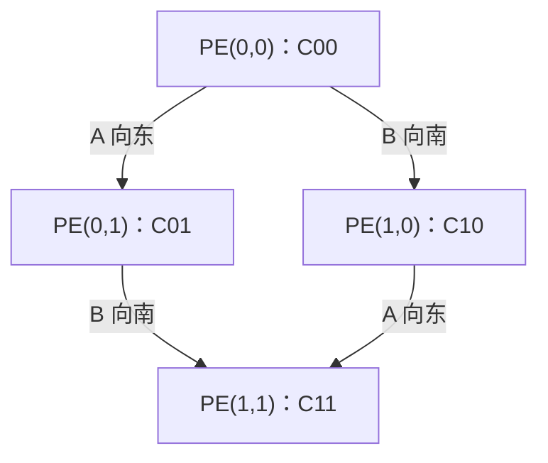

# tiny-NPU 第04讲：二维脉动阵列的数据流与周期级执行

> 学习顺序：硬件逻辑 → 精确逐周期时序 → SystemVerilog 语法 → 真实源码 → 阵列性能与映射。
>
> 本讲承接第03讲，不重复展开单个 INT8/FP16 MAC 的算术电路。重点是：多个 PE 怎样在同一时钟下协作，怎样判断结果何时真正完成，以及数学延迟公式如何对应 RTL。
>
> 源码核对日期：2026-10-27。上游：[harishsg993010/tiny-NPU](https://github.com/harishsg993010/tiny-NPU)，固定版本 [`8216c22b762011aa20c05fc2768423fd12dda59d`](https://github.com/harishsg993010/tiny-NPU/commit/8216c22b762011aa20c05fc2768423fd12dda59d)。本文所有行号均对应此版本。

## 1. 先确定每个 PE 到底负责什么

### 1.1 数学维度与物理阵列维度要分开

本讲统一使用标准 GEMM（General Matrix-Matrix Multiplication，通用矩阵乘法）记法：

$$
C_{M\times N}=A_{M\times K}B_{K\times N},\qquad
C[i,j]=\sum_{k=0}^{K-1}A[i,k]B[k,j].
$$

| 符号 | 含义 | 对应硬件问题 |
|---|---|---|
| $M$ | 输出矩阵行数 | 一次需要负责多少行输出 |
| $N$ | 输出矩阵列数 | 一次需要负责多少列输出 |
| $K$ | 点积长度、归约维度 | 每个输出需要累加多少组乘积 |
| $P\times Q$ | 物理 PE 阵列的行数×列数 | 实际搭建多少个计算位置 |
| $m,n,k_t$ | 当前 tile 的有效行、列、归约长度 | 当前这一批实际使用多少位置、累加多少次 |

`systolic_array.sv` 自己把物理行、列参数命名为 `M`、`N`；`gemm_ctrl.sv` 中 `cmd_M/N/K` 才是整次矩阵乘法的形状。阅读两个模块时，不能把同名变量当成同一层含义。

如果以前使用的是 $A[M,N]\times B[N,K]$，则以前的 `N` 对应本讲的归约维度 `K`，以前的输出列数 `K` 对应本讲的 `N`。换符号不会改变硬件，但推导时必须统一。

### 1.2 一个 PE 保存一个输出元素的部分和

先假设输出块刚好能够放入阵列。PE$(i,j)$ 负责 $C[i,j]$，每遇到同一个归约索引 $k$ 的两个操作数，就进行：

$$S_{i,j}\leftarrow S_{i,j}+A[i,k]B[k,j].$$

它不需要知道完整矩阵，也不需要知道其他 PE 当前累加了多少。它需要的是：

1. 从西侧收到正确的 $A[i,k]$。
2. 从北侧收到与它匹配的 $B[k,j]$。
3. 将这组乘积加入自己的局部 ACC（Accumulator，累加器）。
4. 把 A 向东、B 向南继续传递，供邻居复用。

因此，阵列中移动的是操作数，局部保存的是输出部分和。当前实现从这一特征看属于 **output-stationary（输出驻留）** 数据流。源码开头虽然写了 `Weight-stationary style`，但 B 每拍向南移动；不能据此把它解释成“权重固定在每个 PE 内部”。这里的“输出驻留”也只针对一个正在计算的 tile，跨 K-tile 的部分和还会保存到外部 ACC SRAM。

### 1.3 2×2 阵列的连接和复用



边界输入关系如下：

| 输入端 | 服务的计算行/列 | 后续传播 |
|---|---|---|
| 左边界 `a_col[0]` | 输出第0行 | PE00 → PE01 |
| 左边界 `a_col[1]` | 输出第1行 | PE10 → PE11 |
| 上边界 `b_row[0]` | 输出第0列 | PE00 → PE10 |
| 上边界 `b_row[1]` | 输出第1列 | PE01 → PE11 |

一个 $A[i,k]$ 从边界进入一次，可以依次被该行的多个 PE 使用；一个 $B[k,j]$ 也可以依次被该列的多个 PE 使用。这样把一部分全局存储访问转换成邻居之间的短距离传输。

这里的复用有时间差：同一个 A 在相邻两个 PE 的使用时刻相差一拍，并不是同一拍瞬间广播到整行。

### 1.4 本地 MAC 与转发在同一个上升沿并行采样

假设某个上升沿之前，PE00 输入已经稳定为 A=1、B=5。在这个上升沿：

- PE00 的乘法流水级采样 `1*5`。
- PE00 的 A/B 转发寄存器同时采样 1 和 5。
- PE01/PE10 在这个沿读到的仍是 PE00 转发寄存器的旧值。

时钟沿过后，PE00 的转发输出才变成 1、5。下一个上升沿，相邻 PE 才会采样这两个新值。

**一个上升沿不会让数据穿过多个带寄存器的 PE。** 即使 RTL 中给每个 PE 写了 `always_ff`，这些过程也是并行工作的，源文件中的书写先后不会变成硬件执行先后。

## 2. 为什么边界输入必须错开：从到达时间推导

### 2.1 直接同时送每行、每列会错配

取：

$$
A=\begin{bmatrix}1&2\\3&4\end{bmatrix},\qquad
B=\begin{bmatrix}5&6\\7&8\end{bmatrix}.
$$

如果第0拍直接输入 A 的第0列 `[1,3]` 和 B 的第0行 `[5,6]`，PE00 可以计算 `1*5`，但 PE01 此时还没收到由 PE00 转来的 A=1，B=6 却已经到达。如果下一拍继续送 B 的下一项8，PE01 才收到 A=1，便可能形成错误的 `1*8`。

问题不在乘法器，而在两个操作数的归约索引没有对齐。

### 2.2 正确的偏斜输入

设第0个有效采样沿为 $E_0$，其相对拍号为 $t=0$。在没有额外边界流水寄存器时：

$$t_{A,\mathrm{inject}}=i+k,\qquad
t_{B,\mathrm{inject}}=j+k.$$

A 到 PE$(i,j)$ 要再水平走 j 次，B 要再竖直走 i 次，所以：

$$
t_{A,\mathrm{arrive}}=i+k+j,
\qquad
t_{B,\mathrm{arrive}}=j+k+i.
$$

两个到达时刻相等：

$$\boxed{t_{\mathrm{pair}}=i+j+k}.$$

这就是 skew/stagger（偏斜、错拍输入）的依据：**第 i 行的 A 延迟 i 拍开始，第 j 列的 B 延迟 j 拍开始。**

反过来，在拍号 t，应从 A 缓冲区取 `k=t-i`，从 B 缓冲区取 `k=t-j`。这正是后面 `gemm_ctrl` 中减去行号、列号的原因。

### 2.3 边界的零是气泡，不是整个阵列停止

某行暂时没有有效 A，或者某列暂时没有有效 B，就在该入口送0。整个阵列的 `en` 仍然保持1，让已经进入阵列的数据继续前进。

例如，PE00 的两项已经输入完毕时，PE11 可能还需要一两拍才能收到它的最后一组操作数。这时如果关闭全局 `en`，会冻结所有 PE 的转发寄存器，阻止在途数据到达。

本实现没有给每个 A/B 元素配独立 valid；空拍主要靠边界零填充。在 `en=1` 的拍中，即便某个位置正在处理气泡，它的 MAC 也会采样一组操作数。因此要区分：

- **有用 MAC**：算法确实需要的乘加。
- **硬件被使能**：寄存器/算术路径实际发生采样，可能只是在处理0。

## 3. 2×2 算例：按真实 MAC 两级流水逐沿跟踪

### 3.1 先固定观测口径

本节设物理阵列为2×2，INT8 模式，`PIPE_STAGE=32`，没有额外边界流水。所有输入在对应上升沿之前稳定，表中的寄存器值指**该沿非阻塞赋值更新之后**的值。

- $E_{-1}$：单独清零准备拍，`clear_acc=1,en=0`。
- $E_0$：开始流式输入，`clear_acc=0,en=1`。
- $E_0$ 到 $E_5$：控制器保持流动；无数据入口填0。
- $E_6$：可以进入存储阶段，`en=0`。

`mac_int8` 第一级采样乘积 `product`，第二级使用**上一个沿留下的 product** 更新 ACC。也就是说，某组操作数在 $E_t$ 采样，其乘积在 $E_{t+1}$ 加入 ACC。

本节统计“从第一个有效采样槽开始，需要经过多少个采样沿/流式拍”，并把 $E_0$ 计入。若只数 $E_0$ 到 $E_4$ 之间的完整时钟间隔，会得到4；若数包含两端的采样槽，会得到5。下文所有公式使用后一种槽数口径，避免把起点不同造成的差1误认为硬件差异。

### 3.2 边界每拍究竟送什么

| 上升沿 | `a_col[0]` | `a_col[1]` | `b_row[0]` | `b_row[1]` | `en` | `clear_acc` |
|---|---:|---:|---:|---:|---:|---:|
| $E_{-1}$ | 0 | 0 | 0 | 0 | 0 | 1 |
| $E_0$ | 1 | 0 | 5 | 0 | 1 | 0 |
| $E_1$ | 2 | 3 | 7 | 6 | 1 | 0 |
| $E_2$ | 0 | 4 | 0 | 8 | 1 | 0 |
| $E_3$ | 0 | 0 | 0 | 0 | 1 | 0 |
| $E_4$ | 0 | 0 | 0 | 0 | 1 | 0 |
| $E_5$ | 0 | 0 | 0 | 0 | 1 | 0 |
| $E_6$ | 0 | 0 | 0 | 0 | 0 | 0 |

第0行先启动，第1行晚一拍；第0列先启动，第1列晚一拍。注意 $E_3$ 边界已经全0，但最后一组 `4*8` 才刚刚在 PE11 相遇。

### 3.3 各 PE 沿前输入和沿后 product

表中 `a×b→p` 表示：沿前 A/B 输入为 a、b，该沿后乘积寄存器成为 p。零乘积也列出来，方便理解真实硬件没有独立的逐元素 valid。

| 上升沿 | PE00 | PE01 | PE10 | PE11 |
|---|---|---|---|---|
| $E_0$ | 1×5→5 | 0×0→0 | 0×0→0 | 0×0→0 |
| $E_1$ | 2×7→14 | 1×6→6 | 3×5→15 | 0×0→0 |
| $E_2$ | 0×0→0 | 2×8→16 | 4×7→28 | 3×6→18 |
| $E_3$ | 0×0→0 | 0×0→0 | 0×0→0 | 4×8→32 |
| $E_4$ | 0×0→0 | 0×0→0 | 0×0→0 | 0×0→0 |
| $E_5$ | 0×0→0 | 0×0→0 | 0×0→0 | 0×0→0 |

### 3.4 同一组时钟沿之后，ACC 实际是多少

| 上升沿 | PE00 ACC | PE01 ACC | PE10 ACC | PE11 ACC | 发生的关键事件 |
|---|---:|---:|---:|---:|---|
| $E_0$ | 0 | 0 | 0 | 0 | 清零延迟信号生效，同时采样第一组乘积 |
| $E_1$ | 5 | 0 | 0 | 0 | `5` 进入 PE00 的 ACC |
| $E_2$ | 19 | 6 | 15 | 0 | C00 完成，其余部分和继续增长 |
| $E_3$ | 19 | 22 | 43 | 18 | C01、C10 完成；PE11 采样最后乘积32 |
| $E_4$ | 19 | 22 | 43 | 50 | 32 进入 PE11 ACC，整个结果块完成 |
| $E_5$ | 19 | 22 | 43 | 50 | 控制器额外保留的一拍，累加0 |
| $E_6$ | 19 | 22 | 43 | 50 | 可写回，结果保持 |

因此：

$$C=\begin{bmatrix}19&22\\43&50\end{bmatrix}.$$

“PE11 在 $E_3$ 收到最后一组操作数”与“PE11 在 $E_4$ 得到最终 ACC”是两个不同事件。读波形、写 simulator、计算阵列完成时间时，都必须把它们分开。

### 3.5 单看 PE11，就能看清两级流水的意义

| 上升沿 | 沿前输入 A/B | 沿前旧 product | 沿后新 product | 沿后 ACC |
|---|---|---:|---:|---:|
| $E_1$ | 0 / 0 | 0 | 0 | 0 |
| $E_2$ | 3 / 6 | 0 | 18 | 0 |
| $E_3$ | 4 / 8 | 18 | 32 | 18 |
| $E_4$ | 0 / 0 | 32 | 0 | 50 |

在 $E_3$，它一边把旧乘积18累加，一边采样新乘积32。两项操作属于不同流水级，可以同拍进行。因此两级流水增加了单组数据的延迟，却仍能做到每拍接收一组新的乘法操作数。

这两个概念分别是：

- Latency（延迟）：一组输入进入后多久反映到输出。
- Initiation interval，II（启动间隔）：相邻两组新输入至少间隔多久。本 INT8 路径正常流式工作时 II=1。

### 3.6 `en_d1` 与 `clear_d1` 的真实变化

这两个信号在 INT8 模式下对所有 PE 相同：

| 上升沿 | 沿前 `en/clear_acc` | 沿后 `en_d1/clear_d1` | 当沿 ACC 使用的旧控制 |
|---|---|---|---|
| $E_{-1}$ | 0 / 1 | 0 / 1 | 取决于此前状态；准备清零 |
| $E_0$ | 1 / 0 | 1 / 0 | 旧 `clear_d1=1`，清 ACC |
| $E_1$～$E_5$ | 1 / 0 | 1 / 0 | 旧 `en_d1=1`，累加旧 product |
| $E_6$ | 0 / 0 | 0 / 0 | 旧 `en_d1=1`，最后再累加一次0 |
| $E_7$ | 0 / 0 | 0 / 0 | 不累加，ACC 保持 |

这个 `en` 不是整个模块所有寄存器的统一时钟门控。关闭 `en` 的第一个沿，第二级仍可能消化前一拍已经有效的乘积。

### 3.7 为什么清零要单独安排

源码第二级的优先级是：复位 → `clear_d1` → `en_d1`。如果在第一组有效输入的同一个沿才拉高 `clear_acc`：

- $E_0$：product 采样5，`clear_d1` 变1。
- $E_1$：第二级因为旧 `clear_d1=1` 而清零，没有累加旧 product=5。
- $E_2$：只把后面的14累加进去，C00 变成14，丢失第一项5。

正确安排是先有独立的 $E_{-1}$ 清零拍，之后再开始第一组输入。这样 $E_0$ 清掉旧 ACC 的同时采样第一组 product，$E_1$ 恰好把它加进去。

另外，`clear_acc` 只清累加相关状态，并不清 PE 的 A/B 转发寄存器。连续执行多个 tile 时，还需要流式末尾的零填充、正确的加载/清零顺序保证有效区域中的旧操作数被排走，不能把“清 ACC”等同于“所有数据流水寄存器复位”。

## 4. 从2×2推广到3×3：波前、填充、稳态与排空

### 4.1 九个 PE 各自工作的时间窗口

对于3×3输出块、K=3，每个 PE 需要三组乘积，其有用乘积采样时刻为：

| PE | 三个 k 对应的采样拍号 t | 最后一项进入 ACC 的沿 |
|---|---|---|
| PE00 | 0、1、2 | $E_3$ |
| PE01、PE10 | 1、2、3 | $E_4$ |
| PE02、PE11、PE20 | 2、3、4 | $E_5$ |
| PE12、PE21 | 3、4、5 | $E_6$ |
| PE22 | 4、5、6 | $E_7$ |

同一条反对角线上的 PE 具有相同的 `i+j`，因此一起启动、一起结束，形成从左上向右下推进的 wavefront（波前）。

取一个完整数值例子：

$$
A=\begin{bmatrix}1&2&3\\4&5&6\\7&8&9\end{bmatrix},\quad
B=\begin{bmatrix}9&8&7\\6&5&4\\3&2&1\end{bmatrix},\quad
C=\begin{bmatrix}30&24&18\\84&69&54\\138&114&90\end{bmatrix}.
$$

PE22 在 $E_4,E_5,E_6$ 依次采样 `7*7=49`、`8*4=32`、`9*1=9`。所以其 ACC 在这些沿之后依次为0、49、81，直到 $E_7$ 才变成90。

### 4.2 为什么“小矩阵也不一定能让小阵列满载”

3×3、K=3时，每拍有用乘法的数量是：

| 拍号 t | 0 | 1 | 2 | 3 | 4 | 5 | 6 |
|---|---:|---:|---:|---:|---:|---:|---:|
| 有用乘法数 | 1 | 3 | 6 | 7 | 6 | 3 | 1 |

总和是27，恰好等于 $3\times3\times3$。但任何一拍都没有同时进行9个有用乘法。因为最早启动的 PE00 在右下角 PE22 开始之前就已经结束了。

要出现“全部 $m\times n$ 个有效 PE 同时工作”的时间段，所有 PE 的有效区间必须有交集：

$$m+n-2\le t\le K-1.$$

因此至少需要：

$$K\ge m+n-1.$$

满载拍数为：

$$N_{\mathrm{full}}=\max(0,K-m-n+2).$$

例如3×3、K=8时，有用乘法数是：

| 拍号 t | 0 | 1 | 2 | 3 | 4 | 5 | 6 | 7 | 8 | 9 | 10 | 11 |
|---|---:|---:|---:|---:|---:|---:|---:|---:|---:|---:|---:|---:|
| 有用乘法数 | 1 | 3 | 6 | 8 | 9 | 9 | 9 | 9 | 8 | 6 | 3 | 1 |

这里 t=4～7 才出现连续4拍全阵列满载。

### 4.3 Fill / Steady / Drain 应该怎样理解

- **Fill（填充）**：波前逐渐到达更多 PE，参与有用计算的位置增加。
- **Steady（稳态）**：如果 K 足够长，所有有效 PE 可以连续接收正确的操作数对；K很短时这一阶段可能不存在。
- **Drain（排空）**：边界逐渐停止注入有效数据，在途数据继续向右下移动，之后还要让本地 MAC 的最后一项进入 ACC。

这些是帮助理解的阶段名称，不应强行认为它们对应三个互不重叠、长度固定的控制器状态。当前源码只用一个 `ST_STREAM` 状态，靠计数器与零填充完成整个流动过程。

还要区分两种排空：阵列内部的 A/B 空间传播，以及每个 PE 内的乘积到 ACC 的时间传播。把前者算完，不代表后者已经结束。

## 5. 延迟公式：数学模型、INT8 RTL 和控制器分别是多少

### 5.1 先推导最后一组有用乘积的位置

对于从左上角开始放置的有效块 $m\times n$，归约长度为 $k_t$：

$$t_{\mathrm{last\ product}}=(m-1)+(n-1)+(k_t-1)=k_t+m+n-3.$$

因为从 $E_0$ 开始计入采样槽，到该沿共：

$$\boxed{T_{\mathrm{product}}=k_t+m+n-2}.$$

这就是常见的“归约长度+输出行数+输出列数−2”的来源。它需要以下前提：一跳一拍、输入偏斜正确、无存储供数停顿、无额外边界寄存器，以及结果块能够映射到该有效阵列区域。

如果把乘加看成在同一采样槽更新 ACC 的单级模型，公式也可表示结果完成槽数；但本项目的 INT8 MAC 还有一个独立的累加流水级。

### 5.2 当前 INT8 路径需要再等一拍

本项目某组输入在 $E_t$ 进入 product，在 $E_{t+1}$ 进入 ACC，因此：

$$t_{\mathrm{last\ ACC}}=k_t+m+n-2,$$

$$\boxed{T_{\mathrm{INT8,minimum}}=k_t+m+n-1}.$$

例如2×2、归约长度2：最后乘积在 $E_3$，最后 ACC 在 $E_4$；分别需要4、5个采样槽。3×3、归约长度3：分别在 $E_6$、$E_7$，需要7、8个槽。

这里的最短时间不包含清零、读存储、写存储，也没有假设其他模块能够在最终 ACC 更新的同一个沿立即读取到新值。同步消费者在该沿读取的仍是旧 ACC，通常应在更新后形成写回数据，再于后续沿采样。

### 5.3 控制器还多保留一个流式槽

`gemm_ctrl.sv` 第660～667行：

```systemverilog
ST_CLEAR: begin
    stream_cnt   <= '0;
    stream_total <= 6'(k_eff) + 6'(m_eff) + 6'(n_eff) - 6'd1;
end

ST_STREAM: begin
    stream_cnt <= stream_cnt + 6'd1;
end
```

第201～204行的转移条件是：

```systemverilog
ST_STREAM: begin
    if (stream_cnt == stream_total)
        state_next = ST_STORE;
end
```

`stream_cnt` 从0开始，等于 `stream_total` 的那一拍仍处于 `ST_STREAM`，输出 `sa_en=1`，直到该拍结束沿才转入 `ST_STORE`。所以流式槽数是：

$$T_{\mathrm{STREAM}}=\mathrm{stream\_total}+1=k_t+m+n.$$

**变量名 `stream_total` 在这里实际保存最后一个计数值，不是状态持续拍数。** 对2×2例子，值为5，实际运行计数0、1、2、3、4、5，共6拍。

| 统计对象 | 槽数 | 2×2，$k_t=2$ | 16×16，$k_t=16$ |
|---|---:|---:|---:|
| 采样完全部有用乘积 | $k_t+m+n-2$ | 4 | 46 |
| 当前 INT8 MAC 完成全部 ACC | $k_t+m+n-1$ | 5 | 47 |
| 当前控制器 `ST_STREAM` | $k_t+m+n$ | 6 | 48 |

这三行没有矛盾，只是结束事件不同。对16×16、$k_t=16$，最后乘积在 $E_{45}$，最后 ACC 在 $E_{46}$，控制器最后一个流式沿为 $E_{47}$。

### 5.4 峰值吞吐不等于平均利用率

16×16阵列在选定数值模式下有256个 PE 计算位置，峰值每拍256次 MAC。如果一个 MAC 按一次乘法加一次加法计为2 operations，才可以说每拍512 operations；汇报时要说明统计口径。

一个 tile 的有用 MAC 总量为 $m n k_t$。仅针对当前流式阶段，平均有用利用率可以写成：

$$U_{\mathrm{STREAM}}=\frac{m n k_t}{P Q(k_t+m+n)}.$$

它可拆成：

$$U_{\mathrm{STREAM}}=
\underbrace{\frac{mn}{PQ}}_{\text{空间占用率}}
\times
\underbrace{\frac{k_t}{k_t+m+n}}_{\text{波前与控制开销的影响}}.$$

对完整16×16、$k_t=16$：

$$U_{\mathrm{STREAM}}=\frac{16}{48}=33.3\%.$$

如果仅按 MAC 最短完成时间47拍统计，则为 $16/47\approx34.0\%$。两者都不能被写成“系统整体利用率”，因为尚未计入装载和写回。

“K很长可以摊薄波前开销”是连续流式阵列的一般规律。**当前 `gemm_ctrl` 不会把任意长 K 一次连续送完**：它把每个 K-tile 限制在最多16项，并且每个 tile 都经历装载、清零、流式、部分和保存等过程。

例如 $M=N=16,K=64$：当前路径有4个 K-tile，仅 `ST_STREAM` 就需要 $4\times48=192$ 拍。一个能够连续累加64项、无需在中间清零/存取部分和的理想两级 INT8 阵列只需要 $64+16+16-1=95$ 个计算槽。这是不同控制与缓冲组织的比较，不代表当前代码已经实现后一种方式。

### 5.5 整个 GEMM 的时间不能只写成阵列公式

更完整的性能拆分是：

$$T_{\mathrm{GEMM}}=T_{\mathrm{setup}}+T_{\mathrm{load}}+
T_{\mathrm{clear}}+T_{\mathrm{stream}}+
T_{\mathrm{store/partial\ sum}}+T_{\mathrm{tile\ control}}.$$

这里各阶段在当前 `gemm_ctrl` 状态机内按顺序执行；只有在设计确实实现了相应重叠时，才能把某些阶段改为取最大值，而不能直接假设“双缓冲自动隐藏了全部装载”。

本控制器的 SRAM 读接口每拍传1 Byte，且 `LOAD_A/B` 用“发请求/取返回”两个 phase 处理每个字节。按源码控制节拍，一个16×16×16 INT8 tile：

- A有256 Byte，B有256 Byte，共512 Byte。
- 装载状态约需要 $2\times512=1024$ 拍。
- `ST_STREAM` 为48拍。
- 单 K-tile 的 INT8 输出按每拍1 Byte写256个元素，又需要256个写回拍。

这里还没有加上 setup、clear、tile切换等状态。这个例子说明：**即便阵列内部每拍能够接收16个A与16个B，外部 SRAM 也未必每拍提供32个新字节。** 当前设计先慢速装入内部 `buf_a/b`，再由这些缓冲区在计算阶段提供多路边界数据。

因而，NPU设计既要分析乘法器数量，也要分析存储端口、缓冲组织、载入方式和计算重叠。它们决定峰值算力能被使用多少。

## 6. SystemVerilog：先读懂表达硬件连接的语法

现在再看语法，重点是把每句话还原成电路，而不是单独记关键字。

### 6.1 `parameter` 与二维数组：位宽和元素数量不是一回事

```systemverilog
module systolic_array #(
    parameter int M = 16,
    parameter int N = 16,
    parameter int DATA_W = 8,
    parameter int ACC_W = 32,
    parameter int PIPE_STAGE = 32
)(
    input wire signed [DATA_W-1:0] a_col [M],
    input wire signed [DATA_W-1:0] b_row [N],
    // 其余端口略
```

`parameter` 决定 elaboration（展开）时的电路结构，通常不能在运行期间改变。这里的 M/N 决定要实例化多少 PE，`DATA_W` 决定每个操作数多少位。

`signed [DATA_W-1:0] a_col [M]` 应按两层读：

- 名字前的 `[DATA_W-1:0]`：一个元素内部的 packed（打包）位向量；默认8位有符号数。
- 名字后的 `[M]`：含 M 个元素的 unpacked（非打包）数组，合法下标为0～M−1。

所以 `a_col[3]` 是一个8位数，不是“整个输入总线的第3位”。如果写 `a_col[3][2]`，第二个下标才是在该8位数中取一位。

同理：

```systemverilog
logic signed [DATA_W-1:0] a_wire [M][N+1];
logic signed [ACC_W-1:0]  pe_acc [M][N];
```

分别表示 M×(N+1) 个 DATA_W 位元素，以及 M×N 个 ACC_W 位元素。`logic` 声明本身不意味着一定产生寄存器；要看它由 `always_ff` 还是连续组合连接驱动。

### 6.2 `assign` 表达持续连接，不主动增加时钟拍

```systemverilog
assign a_wire[gi][0] = a_col[gi];
```

含义是把边界端口连接到内部线网。输入改变后，右侧值通过组合连接反映到左侧，不需要等下一次上升沿。实际电路仍有传播延迟，但这里没有新增一个完整的寄存器流水拍。

同理，默认参数下：

```systemverilog
assign a_pipe[gi][gj] = a_wire[gi][gj];
```

只是连接两个名字。**变量叫 `pipe`，不意味着它一定经过寄存器。** 要看具体分支。

### 6.3 `genvar`、`generate for` 是复制电路

```systemverilog
genvar gi, gj;
generate
    for (gi = 0; gi < M; gi++) begin : gen_row
        for (gj = 0; gj < N; gj++) begin : gen_col
            pe #(
                .DATA_W (DATA_W),
                .ACC_W  (ACC_W)
            ) u_pe (
                // 各实例的连接略
            );
        end
    end
endgenerate
```

这段不是“每拍循环执行256次”。它在展开时生成 M×N 个**同时存在**的 PE。默认16×16时，有256个实例，各自拥有转发寄存器与累加状态。

`gen_row`、`gen_col` 是层次名称。实例的层次路径可以写成 `gen_row[1].gen_col[2].u_pe`，方便在波形或调试工具中定位第1行、第2列。

`#(...)` 是参数覆盖，决定实例结构；后面的 `(...)` 是端口连接，决定具体信号接到哪里。`.DATA_W(DATA_W)` 中，点号后是子模块参数名，括号里是父模块传入的值。

### 6.4 `always_ff` 与 `<=`：同步更新，读取旧状态

```systemverilog
always_ff @(posedge clk or negedge rst_n) begin
    if (!rst_n) begin
        a_out <= '0;
        b_out <= '0;
    end else if (en) begin
        a_out <= a_in;
        b_out <= b_in;
    end
end
```

对应电路是带低有效异步复位、带更新使能的寄存器。`posedge` 是上升沿，`negedge rst_n` 表示复位拉低时也会触发复位行为。`'0` 按目标宽度填满0。

`<=` 是 nonblocking assignment（非阻塞赋值）：同一上升沿的时序逻辑先依据旧值求右侧，再统一更新状态。它使串联的转发寄存器表现为一拍一级，而不是让所有 PE 在同一沿连锁传递到最右侧。

`en=0` 时这里没有 `else`，含义是寄存器保持原值；对时序过程来说这是正常的寄存器使能语义。不要与组合过程中漏赋值可能推导锁存器的情况混淆。

### 6.5 两类 `if`：生成电路与选择运行行为

```systemverilog
if (gj != 0 && (gj % PIPE_STAGE == 0)) begin : a_pipe_reg
    // always_ff 寄存器
end else begin : a_pipe_thru
    // assign 连接
end
```

它位于 generate 区域，条件只依赖展开常量，决定这个坐标**是否制造额外寄存器**。默认列号0～15，`PIPE_STAGE=32`，没有一个非零列号满足条件，所以全部展开成直连。

而 `always_ff` 内的 `if(en)` 在运行时根据控制输入决定寄存器是否更新。二者都写 `if`，但含义不同。

### 6.6 `always_comb` 中的索引运算还原成偏斜输入

控制器的核心代码：

```systemverilog
for (int i = 0; i < ARRAY_M; i++) begin
    automatic int idx_a = int'(stream_cnt) - i;
    if (idx_a >= 0 && idx_a < int'(k_eff) && i < int'(m_eff))
        sa_a_col[i] = buf_a[i][idx_a[3:0]];
    else
        sa_a_col[i] = '0;
end
```

逐句解释：

| 写法 | 含义 | 硬件上的作用 |
|---|---|---|
| `for(int i...)` | 为每一行描述同类组合逻辑 | 各行并行形成自己的输入选择 |
| `automatic int idx_a = ...` | 每次执行时形成局部整数临时量 | 根据当前计数与行号算本行应取的 k |
| `int'(stream_cnt)` | 转成32位 `int` 后运算 | 便于表示 `t-i` 可能出现的负值 |
| `idx_a >= 0` | 本行是否已经开始 | 开始前填0 |
| `idx_a < k_eff` | 本行是否还有有效项 | 输入结束后填0 |
| `i < m_eff` | 该物理行是否属于当前有效 tile | 不使用的行填0 |
| `idx_a[3:0]` | 取低4位作为0～15索引 | 在有效条件和最多16项的约束下访问缓冲区 |

它把数学式 $k=t-i$ 变成了真实 RTL。B 的同类逻辑使用 `idx_b=stream_cnt-j`，形成 $k=t-j$。

这里没有凭空出现 i 级延迟 FIFO。控制器通过“什么时候从缓冲区选择哪一个元素”实现错拍，阵列内部再通过转发寄存器完成空间传播。

`6'(k_eff)` 是显式把表达式转换到6位宽的 sized cast（定宽转换）；`6'd1` 是6位十进制常量1。代码明确位宽有助于避免加法表达式意外在较窄宽度下截断。

## 7. 真实源码阅读：把边界、连线、PE和控制串起来

### 7.1 本讲应打开的文件与位置

以下均为上游固定版本的源码链接：

| 文件与起始位置 | 本次阅读目的 |
|---|---|
| [`systolic_array.sv:14`](https://github.com/harishsg993010/tiny-NPU/blob/8216c22b762011aa20c05fc2768423fd12dda59d/rtl/gemm/systolic_array.sv#L14) | 物理参数与端口 |
| [`systolic_array.sv:41`](https://github.com/harishsg993010/tiny-NPU/blob/8216c22b762011aa20c05fc2768423fd12dda59d/rtl/gemm/systolic_array.sv#L41) | `a_wire/b_wire/a_pipe/b_pipe` |
| [`systolic_array.sv:75`](https://github.com/harishsg993010/tiny-NPU/blob/8216c22b762011aa20c05fc2768423fd12dda59d/rtl/gemm/systolic_array.sv#L75) | 外部输入与边界连接 |
| [`systolic_array.sv:94`](https://github.com/harishsg993010/tiny-NPU/blob/8216c22b762011aa20c05fc2768423fd12dda59d/rtl/gemm/systolic_array.sv#L94) | 可选的额外边界流水寄存器 |
| [`systolic_array.sv:156`](https://github.com/harishsg993010/tiny-NPU/blob/8216c22b762011aa20c05fc2768423fd12dda59d/rtl/gemm/systolic_array.sv#L156) | 生成二维PE网格 |
| [`systolic_array.sv:206`](https://github.com/harishsg993010/tiny-NPU/blob/8216c22b762011aa20c05fc2768423fd12dda59d/rtl/gemm/systolic_array.sv#L206) | `acc_valid` 计数逻辑 |
| [`pe.sv:32`](https://github.com/harishsg993010/tiny-NPU/blob/8216c22b762011aa20c05fc2768423fd12dda59d/rtl/gemm/pe.sv#L32) | 一跳一拍的转发寄存器 |
| [`mac_int8.sv:19`](https://github.com/harishsg993010/tiny-NPU/blob/8216c22b762011aa20c05fc2768423fd12dda59d/rtl/gemm/mac_int8.sv#L19) | product、延迟使能与ACC更新 |
| [`gemm_ctrl.sv:330`](https://github.com/harishsg993010/tiny-NPU/blob/8216c22b762011aa20c05fc2768423fd12dda59d/rtl/gemm/gemm_ctrl.sv#L330) | 清零和偏斜流式输入 |
| [`gemm_ctrl.sv:660`](https://github.com/harishsg993010/tiny-NPU/blob/8216c22b762011aa20c05fc2768423fd12dda59d/rtl/gemm/gemm_ctrl.sv#L660) | 流式周期计数 |
| [`onnx_sim_top.sv:153`](https://github.com/harishsg993010/tiny-NPU/blob/8216c22b762011aa20c05fc2768423fd12dda59d/sim/verilator/onnx_sim_top.sv#L153) | 实际把控制器和阵列接起来的仿真封装 |

建议按“控制器产生边界数据 → 阵列接线 → 单PE动作 → 完成计数”的顺序读，而不是从一个文件第一行逐行读到最后。

### 7.2 为什么 `a_wire` 比 PE 多一列，`b_wire` 多一行

`a_wire[row][col]` 表示水平方向的连接位置：

- 下标0：左边界输入。
- 下标1：PE第0列的转发输出。
- 下标2：PE第1列的转发输出。
- ……下标N：最右侧PE的转发输出。

因此N个PE沿水平方向需要N+1个连接位置。这里多出来的是线网位置，不是多出一列 PE 或额外一拍。

B同理：M个竖直PE之间需要M+1个连接位置。

### 7.3 读一个具体实例，比盯着 gi/gj 更容易

实例端口的关键连接为：

```systemverilog
.a_in  (a_pipe[gi][gj]),
.b_in  (b_pipe[gi][gj]),
.a_out (a_wire[gi][gj+1]),
.b_out (b_wire[gi+1][gj]),
.acc_out(pe_acc[gi][gj])
```

以PE(1,2)为例，默认没有额外边界寄存器：

| 信号 | 具体来源/去向 |
|---|---|
| `a_in=a_pipe[1][2]=a_wire[1][2]` | PE(1,1)的A转发寄存器输出 |
| `b_in=b_pipe[1][2]=b_wire[1][2]` | PE(0,2)的B转发寄存器输出 |
| `a_out=a_wire[1][3]` | 送往PE(1,3)，如果该列存在 |
| `b_out=b_wire[2][2]` | 送往PE(2,2)，如果该行存在 |
| `pe_acc[1][2]` | 本地输出元素C[1,2]的部分和 |

对边界PE，只需把不存在的西侧/北侧邻居换成外部 `a_col`/`b_row`。这样整个连接规律就可以从一个实例推广到所有位置。

### 7.4 `a_pipe/b_pipe` 什么时候才真的多一拍

默认 `PIPE_STAGE=32`，16×16坐标都没有遇到非零的32倍数，所以 `a_pipe=a_wire`、`b_pipe=b_wire`，没有新增寄存器。

如果改成 `PIPE_STAGE=2`：A在列2、4……前增加寄存器，B在行2、4……前增加寄存器。此时不能直接沿用原来的输入偏斜。

设 $S=\mathrm{PIPE\_STAGE}>0$：

$$g(j)=\lfloor j/S\rfloor,\qquad h(i)=\lfloor i/S\rfloor.$$

仍按原控制器送入时，到达时间会成为：

$$t_A=i+k+j+g(j),\qquad t_B=j+k+i+h(i).$$

除非该位置恰有 $g(j)=h(i)$，A/B会错拍。举例，PE(0,2)多经过一个A边界寄存器，却没有多经过B边界寄存器；它的A比匹配B晚一拍。

一种在理想无停顿情况下重新对齐的调度是：

$$t_{A,\mathrm{inject}}=i+k+h(i),\qquad
t_{B,\mathrm{inject}}=j+k+g(j).$$

这样两路都在 $i+j+k+h(i)+g(j)$ 到达。**这只是推导出的修改方向，当前控制器没有实现此修正。** 还必须同步调整流式结束计数、排空与验证，不能只给 `DRAIN_LATENCY` 加几拍就认为计算正确。

而且当前PE本来每跳就有转发寄存器；额外边界寄存器的收益需要结合布局、布线、扇出和实际静态时序分析判断，不能仅凭文件注释就认为存在穿越整行的组合乘法路径。

### 7.5 `acc_valid` 为什么不能当整次 GEMM 的 done

阵列的关键逻辑如下：

```systemverilog
localparam int DRAIN_LATENCY = M + N + NUM_A_PIPES + NUM_B_PIPES;
// 复位和 clear_acc 分支略
else if (en) begin
    if (valid_cnt < DRAIN_MAX)
        valid_cnt <= valid_cnt + 1;
    else
        acc_valid <= 1'b1;
end
```

它只知道物理阵列尺寸和额外边界寄存器数量，**根本没有 K 或 k_eff 输入**，无法对任意长度点积判断“最后一项是否已经累加”。

假设清零后连续使能，令 $D=\mathrm{DRAIN\_LATENCY}$：$E_0$ 后计数为1；$E_{D-1}$ 后刚到D；直到 $E_D$ 才拉高 `acc_valid`，即第D+1个使能沿。

| 情形 | `acc_valid` 首次拉高 | 全部最终ACC实际完成 | 说明 |
|---|---|---|---|
| 物理2×2，$k_t=2$ | $E_4$ | $E_4$ | 这个例子恰好重合 |
| 物理2×2，$k_t=4$ | $E_4$ | $E_6$ | valid偏早 |
| 物理16×16，有效16×16，$k_t=16$ | $E_{32}$ | $E_{46}$ | valid远早于最后结果 |
| 物理16×16，有效2×2，$k_t=2$ | 连续使能到 $E_{32}$ 才可能拉高 | $E_4$ | 控制器6拍后已结束STREAM，valid仍为0 |

此外，它拉高后在 `en=0` 时不会自动回到0，只有复位或 `clear_acc` 才清掉。因此它也不是“只持续一拍的完成脉冲”。

实际连接进一步确认了这一点：`onnx_sim_top.sv` 第213行写的是：

```systemverilog
.acc_valid ()
```

输出端口悬空，没有使用。`gemm_ctrl` 的接口也没有接收 `acc_valid`；当前有效路径依靠自己的 `stream_cnt/stream_total` 决定何时进入 `ST_STORE`，再在全部tile存储后给出 `done`。

所以本项目至少要区分：单PE ACC随时可见、有效tile全部ACC完成、控制器写回完成三个事件。信号名字包含 valid，不足以证明它覆盖了后两种语义。

### 7.6 真实源码中的几项边界

1. **阵列可参数化，不代表控制器已完全通用。** `gemm_ctrl` 多处固定按16分块，使用4位tile计数、低4位缓冲索引和5位有效尺寸。`ST_SETUP` 的tile数量是 `4'((r_K+15)>>4)` 等，16个tile就会超出4位计数容量。不能仅凭16位 `cmd_K` 就认为任意大矩阵都支持，也不能只改 `ARRAY_M/N` 就宣称已实现任意阵列规模。
2. **FP16连接方式类似，算术语义不同。** 本讲的精确数值表验证的是INT8；FP16路径的32位ACC表示FP32位编码，不是INT32整数。A/B空间错拍原则可类推，但舍入、特殊值和FP16路径的算术正确性需要独立验证。
3. **根目录 `top.sv` 与实际完整仿真封装要分清。** 根目录 `top.sv` 第543行仍有“In full implementation, gemm_ctrl drives the systolic array”的占位说明；本讲以实际例化控制器和阵列的 `onnx_sim_top.sv` 为连接证据。
4. **构建入口不能混用。** 根目录 `Makefile` 的 `SV_SRC` 未列出新PE所依赖的 `mac_fp16.sv`、`fp16_utils.sv` 等；`sim/verilator/CMakeLists.txt` 则列入这些源文件。本文没有在本环境运行 `make sim`，不能把数学核算通过写成整个项目仿真通过。

这些边界用于建立源码证据链；不影响我们使用已核对的INT8 PE连接来学习周期级数据流。

## 8. 矩阵形状为什么影响阵列适配性

### 8.1 输出维度不足，先损失空间占用率

物理阵列固定16×16：

| 当前输出块形状 | 被分配有用输出的PE数 | 空间占用率 |
|---|---:|---:|
| 16×16 | 256 | 100% |
| 8×8 | 64 | 25% |
| 1×16 | 16 | 6.25% |
| 16×1 | 16 | 6.25% |

这些比例仅表示有多少位置负责有效输出，不包含填充/排空，也不等于其余位置已经被时钟门控或断电。

当前阵列把同一个全局 `en` 接给所有PE，没有针对 `m_eff/n_eff` 的逐PE使能。控制器给无效行列送0，但两条数值路径的转发寄存器仍由全局使能控制，选中模式的MAC也没有从阵列获得逐元素valid。因此“输出区以外没有有用计算”不能直接推出“输出区以外零动态能耗”。

### 8.2 K很小，进一步损失时间利用率

即使输出16×16全部填满，K较小也会让波前开销占据很大比例。例如理想单级阵列的计算槽数为 $K+30$；K=1时每个PE只做一次有用乘法，却需要波前走到最远位置。

从这类阵列的一般原理看，大输出块与长点积更容易摊薄开销。但具体到当前项目，还要考虑它把长K切成小tile带来的重复启动与部分和访存。

### 8.3 GEMM 与 GEMV 的区别落在空间映射上

GEMV（General Matrix-Vector Multiplication，通用矩阵向量乘法）可以写成 $A[M,K]\times x[K,1]$，即输出只有1列。在本讲这套固定映射中，只使用一列PE。

如果采用行向量形式 $x[1,K]\times B[K,N]$，则只使用一行PE。它们的数学方向不同，但都难以填满二维阵列。

例如单token线性层常具有较小的批量维度；多个token或多个batch合并后，输出行维可以增大，从而提高空间占用率。同时要付出更高的排队等待或批量延迟。是否适合实时边缘任务，需要把吞吐与响应时间一起看。

这并不表示“所有GEMV都必然在PE上表现差”。其他架构可以把归约维展开到多个PE，使用归约树、阵列分区或批量拼接。本讲的空间占用率结论限定在**当前每个PE负责一个输出元素、沿K在时间上累加的映射**。

### 8.4 大于16×16的矩阵如何处理

例如 $A[32,32]\times B[32,32]$：

- M方向切成2块，每块16行。
- N方向切成2块，每块16列。
- K方向切成2块，每块累加16项。

一共2×2×2=8次阵列tile计算，但只有4个最终输出块。对于任一输出块：

$$C_{\mathrm{tile}}=A_{\mathrm{tile},0}B_{0,\mathrm{tile}}+
A_{\mathrm{tile},1}B_{1,\mathrm{tile}}.$$

两个K-tile不是两个独立的最终输出，必须合并部分和。当前控制器把这部分工作交给ACC SRAM相关接口：先保存第一块部分和，后续块读取、相加，最后再量化并写最终输出。

tile次序、A/B重复装载次数、部分和保留在哪里，都会影响总访存和性能。这正是第05讲GEMM控制器与Tiling要深入讨论的内容。

### 8.5 与未来 PE / CIM 选择怎样衔接

仅比较 $K+m+n-2$ 与一个CIM计算公式，还不足以判断真实优劣。至少需要统一：

| 项目 | PE阵列要计入什么 | CIM方案要计入什么 |
|---|---|---|
| 矩阵映射 | 有效行列、K-tile、填充/排空 | 阵列容量、分块、行列激活方式 |
| 数值实现 | INT8/FP16流水、累加、饱和/量化 | 位串行/位并行、数值转换、部分和 |
| 数据供给 | SRAM读、内部缓冲、邻居传输 | 权重写入/驻留、输入分发、输出归约 |
| 系统时间 | 装载、计算、写回、调度停顿 | 计算宏周期之外的外围与搬运 |
| 能量 | 访存、转发、实际使能的算术、控制 | 存储操作、计算、外围、互连与控制 |

可以先建立事件计数模型：

$$E_{\mathrm{total}}=\sum_{x}N_x e_x,$$

其中x代表SRAM读、SRAM写、某类转发、某类算术或控制事件。$e_x$ 需要来自相应工艺、电路或经校准的估计，不能从时序表直接得出。

算法有用MAC数是 $mnk_t$；真实使能次数还包括零填充位置和流式余量。若只用有用MAC数乘一个能量常数，可能低估当前全局使能实现的实际成本。本讲建立的是延迟和事件计数的基础，尚未给出测量得到的能量结论。

## 9. 本讲怎样核验，结论的证据边界在哪里

本次实际做了以下工作：

1. 通过GitHub读取并固定上游commit，核对 `mac_int8`、`pe`、`systolic_array`、`gemm_ctrl` 及实际连接封装。
2. 根据所读RTL的“同沿读旧值、沿后更新”规则建立独立Python整数状态模型，包含转发寄存器、乘积级、延迟使能、延迟清零、饱和累加与valid计数。模型见文末附录。
3. 对2×2例子的每拍product与ACC逐项断言，得到本文表格；3×3数值矩阵乘法也与直接数学计算一致。
4. 对有效行数1～4、有效列数1～4、K=1～7，分别放到匹配尺寸和16×16物理阵列上，共224组形状/物理尺寸检查，使用含正负数的小整数，均与数学GEMM结果一致。
5. 额外核对清零与首输入重叠会丢第一项，以及4×4、`PIPE_STAGE=2`时原偏斜失败、按新增边界延迟修正后对齐的例子。

**这些是源码检查与独立状态模型的结果，不是Verilator/Icarus运行报告。** 当前执行环境未安装这两个HDL仿真器，本次没有运行完整RTL仿真、没有生成VCD，也没有证明整个Graph Mode或FP16算术通过验证。Python模型用于核对本讲所推导的时序与边界，不替代直接运行RTL。

被数学与状态核算支持的结果是：

```text
2x2最终输出 = [[19,22],[43,50]]
2x2各拍ACC  = [0,0,0,0]
               [5,0,0,0]
               [19,6,15,0]
               [19,22,43,18]
               [19,22,43,50]
               [19,22,43,50]
3x3最终输出 = [[30,24,18],[84,69,54],[138,114,90]]
形状/物理尺寸检查通过：224组
```

上面的四元素顺序统一为 `[PE00, PE01, PE10, PE11]`。代码块仅列出数值结果，不是波形图。

以后观察RTL波形时，应该同时看 `sa_en/sa_clear/stream_cnt`、四个PE的 `a_in/b_in/product/en_d1/clear_d1/acc_reg`，并在同一沿的非阻塞更新完成后读取结果。若testbench恰好在上升沿修改输入或过早采样输出，可能引入仿真竞争或观察到更新前的值；测试驱动宜在采样沿前稳定输入，输出则在RTL求值稳定后观察。

## 10. 本讲建立的结论与下一讲衔接

完成本讲后，整个执行过程可以按下面的关系理解：

1. 缓冲区保存当前A/B子块，控制器按 `t-i`、`t-j` 选择边界元素。
2. A向东、B向南各一跳一拍，在PE(i,j)的第 `i+j+k` 拍相遇。
3. 每个PE局部保存一个输出部分和，不在PE之间传递本讲的ACC。
4. INT8乘积采样后一拍才进入ACC，因此不能把乘积波前图直接当成输出波形。
5. 当前控制器每个tile运行 `k_eff+m_eff+n_eff` 个流式槽，再写回或保存部分和；`acc_valid` 没有承担实际完成控制。
6. 总GEMM时间还要加装载、清零、写回和tile调度；矩阵形状通过空间占用、波前开销与tile次数改变性能。

第05讲直接进入 `gemm_ctrl.sv`：沿一次具体命令讲清 `ST_SETUP → ST_TILE_SETUP → ST_LOAD_A/B → ST_CLEAR → ST_STREAM → ST_STORE → ST_TILE_NEXT`，重点解释矩阵地址计算、三维tiling循环以及跨K-tile的部分和保存。不需要先做额外练习。

## 附录：本次使用的独立Python状态核验脚本

这是已执行的核验工具，方便以后复现本文时序；不要求先运行它才能继续课程。只使用Python标准库。模型仅覆盖本文的INT8状态行为，不能作为FP16或完整NPU的golden model。

```python
"""Independent INT8 state model of the inspected RTL; not an HDL simulation."""
import random


class Array:
    def __init__(self, rows, cols, pipe=32):
        self.r, self.c, self.pipe = rows, cols, pipe
        grid = lambda: [[0] * cols for _ in range(rows)]
        self.a, self.b, self.p, self.acc = grid(), grid(), grid(), grid()
        self.ap, self.bp = grid(), grid()
        self.ed = self.cd = self.cnt = self.valid = 0
        self.drain = rows + cols + (cols-1)//pipe + (rows-1)//pipe

    def step(self, left, top, en=1, clear=0):
        aw = [[left[i] if j == 0 else self.a[i][j-1]
               for j in range(self.c)] for i in range(self.r)]
        bw = [[top[j] if i == 0 else self.b[i-1][j]
               for j in range(self.c)] for i in range(self.r)]
        ai = [[self.ap[i][j] if j and j % self.pipe == 0 else aw[i][j]
               for j in range(self.c)] for i in range(self.r)]
        bi = [[self.bp[i][j] if i and i % self.pipe == 0 else bw[i][j]
               for j in range(self.c)] for i in range(self.r)]
        nxt_acc = [[0 if self.cd else
                    max(-(1 << 31), min((1 << 31)-1,
                        self.acc[i][j] + (self.p[i][j] if self.ed else 0)))
                    for j in range(self.c)] for i in range(self.r)]
        nxt_p = [[ai[i][j] * bi[i][j] if en else 0
                  for j in range(self.c)] for i in range(self.r)]
        if en:
            self.a, self.b, self.ap, self.bp = ai, bi, aw, bw
        self.p, self.acc, self.ed, self.cd = nxt_p, nxt_acc, en, clear
        if clear:
            self.cnt, self.valid = 0, 0
        elif en:
            if self.cnt < self.drain:
                self.cnt += 1
            else:
                self.valid = 1
        return dict(inputs=(ai, bi), product=self.p, acc=self.acc,
                    en_d1=self.ed, clear_d1=self.cd, valid_cnt=self.cnt,
                    acc_valid=self.valid)


def gemm(a, b):
    return [[sum(a[i][k]*b[k][j] for k in range(len(b)))
             for j in range(len(b[0]))] for i in range(len(a))]


def run(a, b, physical=None, pipe=32, corrected=False):
    m, k, n = len(a), len(b), len(b[0])
    r, c = physical or (m, n)
    sa = Array(r, c, pipe)
    sa.step([0]*r, [0]*c, en=0, clear=1)
    trace = []
    for t in range(k+m+n + (m-1)//pipe + (n-1)//pipe):
        ka = [t-i-(i//pipe if corrected else 0) for i in range(r)]
        kb = [t-j-(j//pipe if corrected else 0) for j in range(c)]
        left = [a[i][ka[i]] if i < m and 0 <= ka[i] < k else 0
                for i in range(r)]
        top = [b[kb[j]][j] if j < n and 0 <= kb[j] < k else 0
               for j in range(c)]
        trace.append(sa.step(left, top))
    return [row[:n] for row in sa.acc[:m]], trace


def flat(g):
    return [v for row in g for v in row]


if __name__ == '__main__':
    a, b = [[1, 2], [3, 4]], [[5, 6], [7, 8]]
    result, trace = run(a, b)
    assert result == [[19, 22], [43, 50]]
    expected_p = [[5,0,0,0], [14,6,15,0], [0,16,28,18],
                  [0,0,0,32], [0,0,0,0], [0,0,0,0]]
    expected_acc = [[0,0,0,0], [5,0,0,0], [19,6,15,0],
                    [19,22,43,18], [19,22,43,50], [19,22,43,50]]
    for t in range(6):
        assert flat(trace[t]['product']) == expected_p[t]
        assert flat(trace[t]['acc']) == expected_acc[t]
        print('2x2', t, 'product', expected_p[t], 'ACC', expected_acc[t],
              'acc_valid', trace[t]['acc_valid'])
    a3 = [[1,2,3],[4,5,6],[7,8,9]]
    b3 = [[9,8,7],[6,5,4],[3,2,1]]
    out3, _ = run(a3,b3)
    assert out3 == gemm(a3,b3)
    print('3x3 result', out3)
    random.seed(4)
    count = 0
    for m in range(1,5):
        for n in range(1,5):
            for k in range(1,8):
                aa = [[random.randint(-8,8) for _ in range(k)] for _ in range(m)]
                bb = [[random.randint(-8,8) for _ in range(n)] for _ in range(k)]
                for physical in [(m,n),(16,16)]:
                    out, _ = run(aa,bb,physical)
                    assert out == gemm(aa,bb)
                    count += 1
    out, trace16 = run([[1,2],[3,4]],[[5,6],[7,8]],(16,16))
    assert out == [[19,22],[43,50]] and trace16[-1]['acc_valid'] == 0
    print('16x16 physical, 2x2 tile: correct result; acc_valid remains 0')
    aa = [[i*4+k+1 for k in range(4)] for i in range(4)]
    bb = [[k*4+j+2 for j in range(4)] for k in range(4)]
    bad, _ = run(aa,bb,pipe=2)
    good, _ = run(aa,bb,pipe=2,corrected=True)
    assert bad != gemm(aa,bb) and good == gemm(aa,bb)
    print('PIPE_STAGE=2: existing skew fails; analytically corrected skew passes')
    sa = Array(2,2)
    sa.step([1,0],[5,0],en=1,clear=1)
    sa.step([2,3],[7,6])
    assert sa.acc[0][0] == 0
    sa.step([0,4],[0,8])
    assert sa.acc[0][0] == 14
    print('Clear overlapping first input: first product 5 is discarded')
    print('Randomized shape/physical-size cases passed:', count)
    for k in [3,8]:
        active = [sum(0 <= t-i-j < k for i in range(3) for j in range(3))
                  for t in range(k+3+3-2)]
        print('3x3 K=',k,'useful MAC counts:',active)
```
