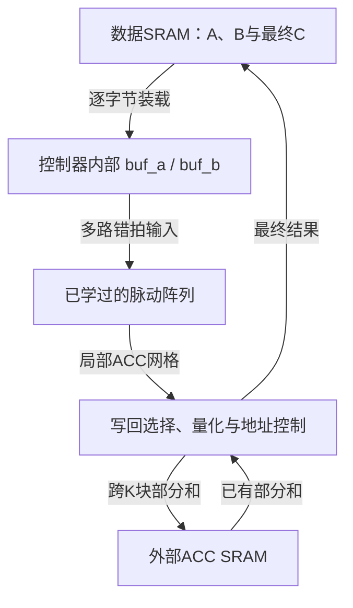

# tiny-NPU GEMM源码精读：从阵列边界到完整控制器

> 承接进度：已理解 `mac_int8.sv`、`pe.sv` 和 `systolic_array.sv` 的阵列内部连接。本讲只补齐阵列边界输入及尾部计数，再完整阅读 `gemm_ctrl.sv`；最后阅读尚未展开的 `gemm_post.sv` 与 `mac_fp16.sv`。不重新讲整数MAC和PE基本结构。
>
> 讲解原则：先明确硬件需要做什么，再按源文件顺序解释变量和代码。遇到同一状态分散在三个代码块中，会标明各块职责；不是把三段当作先后执行的软件函数。
>
> 固定上游版本：[`8216c22b762011aa20c05fc2768423fd12dda59d`](https://github.com/harishsg993010/tiny-NPU/commit/8216c22b762011aa20c05fc2768423fd12dda59d)，核对日期2026-10-27。以下行号均指该版本。

## 1. 先补齐 `systolic_array.sv` 尚未看懂的两处

### 1.1 边界输入是一组端口，不是一次送入完整矩阵

**硬件问题。** 阵列第i行最左侧PE需要获得该行的A数据，第j列最上侧PE需要获得该列的B数据。它们从阵列外部进入的位置就是“边界”。

假设物理阵列为16×16：

| 接口 | 元素数量 | 每个元素的意义 |
|---|---:|---|
| `a_col[16]` | 16个INT8数 | `a_col[i]` 是这一拍第i行左入口的数 |
| `b_row[16]` | 16个INT8数 | `b_row[j]` 是这一拍第j列上入口的数 |
| `a_col_fp16[16]` | 16个16位编码 | A的FP16边界接口 |
| `b_row_fp16[16]` | 16个16位编码 | B的FP16边界接口 |

名字中的 `col` 来自“从A各行取出一列元素”，`row` 来自“从B各列取出一行元素”。但进入偏斜阶段以后，不同行/列处于不同的归约索引，不能认为每拍边界一定还是原矩阵的一整列或一整行。

**源代码，第75～85行。**

```systemverilog
genvar gi, gj;
generate
    for (gi = 0; gi < M; gi++) begin : gen_a_input
        assign a_wire[gi][0] = a_col[gi];
        assign a_wire_fp16[gi][0] = a_col_fp16[gi];
    end
    for (gj = 0; gj < N; gj++) begin : gen_b_input
        assign b_wire[0][gj] = b_row[gj];
        assign b_wire_fp16[0][gj] = b_row_fp16[gj];
    end
endgenerate
```

逐个符号对应：

- `M/N`：这里是物理阵列行/列数。
- `gi/gj`：展开时的行/列编号，没有运行时计数器电路。
- `gen_a_input/gen_b_input`：给生成的连接分组命名，便于定位层次。
- `a_wire[gi][0]`：第gi行、最左侧连接位置；列坐标0不是PE输出，而是外部入口。
- `b_wire[0][gj]`：第gj列、最上侧连接位置。
- `assign`：连续连接，不存储、不额外延迟一拍。

例如 `gi=3` 的展开结果就是 `a_wire[3][0]=a_col[3]`：外部的第3行入口连到第3行的第一颗PE。它没有判断“该送哪个A元素”，仅仅负责接线。

**数据是谁决定的？** 是后面的 `gemm_ctrl`。控制器根据当前流式拍号t，让 `sa_a_col[i]=buf_a[i][t-i]`、`sa_b_row[j]=buf_b[t-j][j]`，越界填0。阵列只接收已经排好时间的数据。本节先明确连接职责，读控制器时再解释取数过程。

### 1.2 `DRAIN_LATENCY`：先看它实际做什么，再看名字

**硬件问题。** 文件尾部额外做了一个小计数器：清零后，每遇到一次 `en=1` 的采样沿就计一次，达到固定阈值之后拉高 `acc_valid`。它没有对A/B进行运算，也不会自动排空数据。

第206～211行：

```systemverilog
localparam int NUM_A_PIPES = (N > 1) ? ((N - 1) / PIPE_STAGE) : 0;
localparam int NUM_B_PIPES = (M > 1) ? ((M - 1) / PIPE_STAGE) : 0;
localparam int DRAIN_LATENCY = M + N + NUM_A_PIPES + NUM_B_PIPES;
localparam int CNT_W = $clog2(DRAIN_LATENCY + 1);
logic [CNT_W-1:0] valid_cnt;
localparam [CNT_W-1:0] DRAIN_MAX = CNT_W'(DRAIN_LATENCY);
```

| 名字 | 类型/是否运行时变化 | 具体意义 |
|---|---|---|
| `PIPE_STAGE` | 参数 | 每隔多少行/列考虑增加一道额外边界寄存器 |
| `NUM_A_PIPES` | 编译展开常量 | A从左端到最右PE输入共跨过几道额外边界寄存器 |
| `NUM_B_PIPES` | 编译展开常量 | B从上端到最下PE输入共跨过几道额外边界寄存器 |
| `DRAIN_LATENCY` | 编译展开常量 | 这段计数逻辑使用的整数阈值；不要直接等同于GEMM完成时间 |
| `CNT_W` | 编译展开常量 | 计数器需要多少位 |
| `valid_cnt` | 寄存器 | 从清零后累计了多少次使能沿，达到阈值后停止增长 |
| `DRAIN_MAX` | 定宽常量 | 与 `DRAIN_LATENCY` 同值，转换成与计数器一样的位宽供比较 |
| `acc_valid` | 输出寄存器 | 计数到阈值后置1，复位或 `clear_acc` 清0 |

为什么是 `(N-1)/PIPE_STAGE`？以N=16为例，最右PE的输入列号为15，因此检查的是到列15之前跨过的边界。若间隔S=4，经过列4、8、12三道，整数除法 `15/4=3`。默认S=32，一道也没有。M方向同理。参数必须为正数。

`?:` 是条件表达式：条件成立取问号后的值，否则取冒号后的值。这里 `N>1` 不成立时直接取0。

默认16×16、S=32时，逐个代入：

```text
NUM_A_PIPES = 15/32 = 0
NUM_B_PIPES = 15/32 = 0
DRAIN_LATENCY = 16+16 = 32
CNT_W = ceil(log2(33)) = 6
valid_cnt 是6位寄存器
DRAIN_MAX 是6位常量32，即100000
```

为什么 `$clog2(DRAIN_LATENCY+1)` 要加1？计数器需要表示0到32，共33种值。5位只能表示0～31，6位才能容纳32。`$clog2` 返回以2为底对数的向上取整。

`CNT_W'(DRAIN_LATENCY)` 是“转成CNT_W位”的定宽转换，不是乘法，也不是函数调用。`localparam` 表示模块内部的固定配置值，不允许实例化时像普通parameter那样覆盖；它们在这里用于确定电路结构与常量。

### 1.3 尾部 `always_ff` 按分支逐行读

```systemverilog
if (!rst_n) begin
    valid_cnt <= '0;
    acc_valid <= 1'b0;
end else if (clear_acc) begin
    valid_cnt <= '0;
    acc_valid <= 1'b0;
end else if (en) begin
    if (valid_cnt < DRAIN_MAX)
        valid_cnt <= valid_cnt + 1;
    else
        acc_valid <= 1'b1;
end
```

按优先级看：

1. 复位拉低：两个寄存器归零。
2. 没复位但要求清零：两个寄存器归零，不继续计数。
3. 否则如果使能：还小于阈值就加1，否则拉高valid。
4. 没有命中的赋值：相应寄存器保持原值。

默认阈值32时：

| 自清零以来的使能沿序号 | 沿前计数 | 沿后计数 | 沿后valid |
|---|---:|---:|---:|
| 第1个 | 0 | 1 | 0 |
| 第2个 | 1 | 2 | 0 |
| 第32个 | 31 | 32 | 0 |
| 第33个 | 32 | 32 | 1 |

**第32个沿只是计数器变成32，第33个沿才进入else。** 这不是“计数器到32时组合输出立即置1”。之后即使 `en=0`，valid也会保持1，而不是自动变回0。

### 1.4 这段与真正完成时间的关系

真正的点积完成还依赖K，这段却没有K输入。因此它不能对任意矩阵长度可靠地产生完成信号。默认完整16×16、K-tile长度16时，最后INT8 ACC在第47个流式采样槽完成，而该valid在第33个使能沿就置1。

实际Graph Mode封装 `sim/verilator/onnx_sim_top.sv:213` 连接为 `.acc_valid()`，没有使用此输出；`gemm_ctrl` 也没有valid输入。实际读结果时机由控制器自己的流式计数决定。

所以把这段理解为“当前版本未被主执行路径使用的固定延迟标志逻辑”。注释把阈值描述成drain latency，但你不需要为它找一个能够覆盖任意K的正确GEMM推导；代码本身没有实现那种语义。

## 2. 进入控制器之前：硬件必须完成哪些工作

### 2.1 控制器搬数据、排时间，不替代PE计算

主数据路径是：



三个容易混淆的位置：

- `buf_a/b`：当前输入tile的内部缓冲，由控制器变量数组描述。
- `sa_acc`：PE阵列局部ACC的输出网格，控制器可选择其中一个元素读取。
- ACC SRAM：阵列外的32位部分和存储，跨K-tile保存结果，不能与每个PE里的ACC混为一谈。

控制器先从窄SRAM接口装满小缓冲，再用缓冲提供多路阵列输入。因此SRAM每拍只有一个字节读接口，与阵列每拍需要多路A/B并不矛盾：它们在不同阶段工作。

### 2.2 本讲贯穿的INT8例子

使用物理16×16阵列，但有效尺寸M=2、N=2、K=3：

$$A=\begin{bmatrix}1&2&3\\4&5&6\end{bmatrix},\quad
B=\begin{bmatrix}1&2\\3&4\\5&6\end{bmatrix},\quad
C=\begin{bmatrix}22&28\\49&64\end{bmatrix}.$$

指定A起始字节地址100，B地址200，C地址300；关闭转置、再量化，dtype=INT8。按行连续存放：

| 数据 | 地址序列 | 字节值序列 |
|---|---|---|
| A | 100、101、102、103、104、105 | 1、2、3、4、5、6 |
| B | 200、201、202、203、204、205 | 1、2、3、4、5、6 |
| 最终C | 300、301、302、303 | 22、28、49、64 |

### 2.3 先用硬件动作定义全部状态

| 状态 | 当前阶段的硬件职责 | 为什么不能省略 |
|---|---|---|
| `ST_IDLE` | 等命令，收到后锁存字段 | 后续运算不能依赖上游持续保持命令 |
| `ST_SETUP` | 计算M/N/K各需要几块，tile索引清0 | 大矩阵需要多次执行 |
| `ST_TILE_SETUP` | 算当前块大小和SRAM地址，初始化游标 | 边缘块可能不足16 |
| `ST_LOAD_A` | 逐元素把A当前子块搬入buf_a | 阵列不能自己寻址外部SRAM |
| `ST_LOAD_B` | 逐元素把B当前子块搬入buf_b | 准备另一组操作数 |
| `ST_CLEAR` | 清阵列ACC，准备流式计数 | 避免混入上一个tile结果 |
| `ST_STREAM` | 按拍送错开的A/B，末尾填0排空 | 驱动阵列实际乘加 |
| `ST_STORE` | 选ACC元素，保存部分和或写最终结果 | 阵列输出必须落入存储 |
| `ST_TILE_NEXT` | K优先，再N，再M推进tile索引 | 管理整个三维分块循环 |
| `ST_DONE` | 报告完成一个状态周期 | 上游才能释放依赖或派发后续任务 |

### 2.4 为什么源文件同一个状态写了三次

控制器用三种电路描述共同实现状态机：

| 代码段 | 回答的问题 | 赋值习惯 |
|---|---|---|
| 状态寄存器 `always_ff` | 时钟沿之后当前状态是什么 | `state <= state_next` |
| 转移逻辑 `always_comb` | 按当前状态与游标，下一状态应该是什么 | `state_next = ...` |
| 输出逻辑 `always_comb` | 当前状态对SRAM/阵列发出哪些信号 | `sram_rd_en = ...` |
| 数据/游标寄存器 `always_ff` | 当前这一拍结束时要保存哪些值 | `buf_a[...] <= ...` 等 |

例如一次读取：输出逻辑先把地址和读使能送出；后续采样沿把返回值写入buf；转移逻辑据游标决定是否结束LOAD。它们是同时工作的硬件，不是按源文件行序调用的三个函数。

下面仍按文件的声明、状态寄存器、转移逻辑、输出逻辑、时序更新顺序读。某个寄存器的更新写在后面时，先明确它在此处被读取的含义，不会假装它在组合块中已经更新。

## 3. `gemm_ctrl.sv` 第12～138行：每个参数、端口与变量

### 3.1 模块与导入，第12～21行

`import npu_pkg::*` 引入饱和、再量化等函数；`isa_pkg::*` 引入标志位定义；`fp16_utils_pkg::*` 引入FP32到FP16等辅助函数。`::*` 表示从该包引入可见名字，不是在这里实例化一个计算模块。

| 参数 | 默认值 | 含义 |
|---|---:|---|
| `ARRAY_M` | 16 | 物理阵列行数，也是A缓冲第一维长度 |
| `ARRAY_N` | 16 | 物理阵列列数；代码还将它用作缓冲K方向容量 |
| `DATA_W` | 8 | 窄SRAM接口和INT8通路元素位宽 |
| `ACC_W` | 32 | PE结果和外部ACC SRAM数据宽度 |
| `SRAM_ADDR_W` | 16 | 数据SRAM读写地址的位数 |

这些参数不等于整次矩阵M/N/K。当前实现多处固定16分块，不能只修改ARRAY参数就认为整套控制器已支持任意阵列大小。

### 3.2 命令输入，第23～36行

| 端口 | 含义 | 本例输入 |
|---|---|---|
| `clk` | 系统时钟 | — |
| `rst_n` | 低有效异步复位 | 运行时为1 |
| `cmd_valid` | 有一条待接收的GEMM命令 | IDLE时脉冲/保持至接收 |
| `cmd_src0` | A在数据SRAM中的起始字节地址 | 100 |
| `cmd_src1` | B的起始字节地址 | 200 |
| `cmd_dst` | C的起始字节地址 | 300 |
| `cmd_M` | 整个输出行数，即A行数 | 2 |
| `cmd_N` | 整个输出列数，即B列数 | 2 |
| `cmd_K` | 整个点积长度 | 3 |
| `cmd_flags` | 若干独立控制位组成的8位字段 | 0 |
| `cmd_imm` | 低8位scale、高8位shift | 本例不用 |
| `cmd_dtype` | 0选择INT8，1选择FP16 | 0 |

这不是带 `cmd_ready` 的完整valid/ready接口。代码只在IDLE接收命令，忙时不会捕获新命令；上游要遵守这一约束。若valid一直不撤销，回到IDLE之后可能再次接受同一命令。

### 3.3 数据SRAM接口，第38～46行

| 端口 | 方向（相对控制器） | 含义 |
|---|---|---|
| `sram_rd_en` | 输出 | 本拍发起读取 |
| `sram_rd_addr` | 输出 | 要读的字节地址 |
| `sram_rd_data` | 输入 | SRAM返回的一个字节，随后写入缓冲 |
| `sram_wr_en` | 输出 | 本拍写一个字节 |
| `sram_wr_addr` | 输出 | 输出字节写往何处 |
| `sram_wr_data` | 输出 | 要写的字节 |

此接口没有ready/valid等待协议，控制器假定读延迟固定符合约定；`load_phase`用于安排发请求与取回数据。写接口注释的“no latency”表示没有额外响应等待，不等于物理SRAM不需要时钟采样。

### 3.4 外部ACC SRAM接口，第48～54行

| 端口 | 含义 |
|---|---|
| `acc_rd_en` | 读取之前K块保存的部分和 |
| `acc_rd_addr[7:0]` | 读取哪个部分和元素，按32位元素寻址，不是字节偏移 |
| `acc_rd_data` | 读回的32位部分和 |
| `acc_wr_en` | 保存一个32位部分和 |
| `acc_wr_addr[7:0]` | 保存到哪一项，最多256项 |
| `acc_wr_data` | 本次写入的32位部分和 |

为什么只要256项？一次只保留当前一个最多16×16输出tile的部分和，K方向切完后就写最终输出，再复用这片空间。

### 3.5 阵列接口与状态，第56～70行

| 端口 | 含义 |
|---|---|
| `sa_clear` | 发给阵列的ACC清零控制 |
| `sa_en` | 发给所有PE的流动/运算使能 |
| `sa_a_col[ARRAY_M]` | INT8左边界每行的输入 |
| `sa_b_row[ARRAY_N]` | INT8上边界每列的输入 |
| `sa_acc[ARRAY_M][ARRAY_N]` | 阵列全部局部ACC的输出，方向是输入到控制器 |
| `dtype_fp16` | 告诉阵列使用哪条数值路径，来自锁存的模式 |
| `sa_a_col_fp16` | FP16左边界输入 |
| `sa_b_row_fp16` | FP16上边界输入 |
| `busy` | 非IDLE阶段为1；DONE阶段也仍为1 |
| `done` | 只在ST_DONE为1，报告整条GEMM命令结束 |

`sa_acc`不是串口，控制器通过数组索引选择当前要存储的PE结果。整个结果网格保持在阵列寄存器中，写回阶段逐元素读取。

### 3.6 状态类型与命令寄存器，第76～101行

`typedef enum logic[3:0] {...} state_t` 定义一个4位枚举类型，10个状态各占一个编码；`state`是当前状态寄存器，`state_next`是组合逻辑算出的下一状态。枚举名使状态机可读，不额外赋予“顺序执行到下一个名字”的语义。

| 变量 | 含义 |
|---|---|
| `r_src0/r_src1/r_dst` | 锁存命令的A/B/C起始地址 |
| `r_M/r_N/r_K` | 锁存整次矩阵尺寸 |
| `r_transpose_b` | B是否在存储中按转置布局摆放，取flags第0位 |
| `r_do_requant` | 是否执行再量化，取flags第2位 |
| `r_scale` | 再量化整数乘数，来自imm低8位 |
| `r_shift` | 再量化右移量，来自imm高8位 |
| `m_eff/n_eff/k_eff` | 当前tile有效的输出行/输出列/归约长度，范围通常1～16 |

前缀 `r_` 只是作者的命名习惯，提示“注册保存的命令字段”，不是SystemVerilog语法。`eff`为effective，表示当前块实际有效大小。

为什么eff使用5位？4位能表示0～15，却不能表示16；这里要表示“这个块有16项”，所以至少5位。

### 3.7 tile游标、地址、缓冲与拍内游标，第106～138行

| 变量 | 含义 | 典型取值 |
|---|---|---|
| `m_tile_r/n_tile_r/k_tile_r` | 当前正在处理第几个M/N/K块，从0开始 | 0、1…… |
| `m_tiles_r/n_tiles_r/k_tiles_r` | M/N/K各一共分成几块 | 本例均1 |
| `a_tile_base` | 当前A子块左上角在原SRAM里的地址 | 本例100 |
| `b_tile_base` | 当前B子块左上角的地址 | 本例200 |
| `c_tile_base` | 当前输出子块左上角的地址 | 本例300 |
| `store_phase` | 跨K块部分和读改写的阶段 | 0读旧和，1合并/写 |
| `buf_a` | INT8 A子块，逻辑坐标为[输出行][归约项] | 本例2×3有效 |
| `buf_b` | INT8 B子块，逻辑坐标为[归约项][输出列] | 本例3×2有效 |
| `buf_a_fp16/buf_b_fp16` | 同样组织的FP16输入缓冲 | 每元素16位 |
| `r_dtype` | 锁存的数值模式 | 0/1 |
| `load_byte` | FP16正在取低字节还是高字节 | 0低、1高 |
| `store_byte` | FP16正在写低字节还是高字节 | 0低、1高 |
| `lo_byte` | FP16低字节暂存寄存器 | 等高字节拼接 |
| `load_row/load_col` | 缓冲区当前要装入的元素坐标 | A为i/k，B为k/j |
| `load_phase` | SRAM读取进度 | 0发地址，1捕获返回值 |
| `stream_cnt` | 当前流式拍号，从0递增 | 本例0～6 |
| `stream_total` | 最后一个流式拍号，不是拍数 | 本例3+2+2−1=6 |
| `store_row/store_col` | 当前选中哪个PE结果写回 | 本例(0,0)到(1,1) |

tile变量名字只差一个s，但含义不同：`k_tile_r=1`是“当前第1号块”，`k_tiles_r=2`是“一共2块”。判断最后一个块是 `k_tile_r==k_tiles_r-1`。

`load_row/col`和`store_row/col`均为5位，除了表示0～15，还可以容纳最后一次推进后的16。`stream_cnt/total`为6位，因为默认最大计数为16+16+16−1=47，6位可以容纳。

## 4. 第143～262行：状态寄存器、辅助判断、下一状态

### 4.1 当前状态如何保存，第143～148行

```systemverilog
always_ff @(posedge clk or negedge rst_n) begin
    if (!rst_n)
        state <= ST_IDLE;
    else
        state <= state_next;
end
```

硬件是一组保存状态编码的触发器。当前 `state=ST_LOAD_A` 时，组合逻辑已经可以算好 `state_next`，但在下一次上升沿之前，当前状态仍是LOAD_A；不会因为给next赋值就立刻改变state。

### 4.2 三个辅助线网，第153～155行

```systemverilog
wire multi_k = (k_tiles_r > 4'd1);
wire last_k_tile = (k_tile_r == k_tiles_r - 4'd1);
wire first_k_tile = (k_tile_r == 4'd0);
```

它们是当前tile寄存器经过比较器形成的组合结果，不是三个另行递增的寄存器。这里 `wire ... = 表达式` 是线网的持续驱动。

| 名字 | 问题 | K=20时 |
|---|---|---|
| `multi_k` | 整个K是否超过一个tile | 2个K块，所以为1 |
| `first_k_tile` | 当前是否为第0个K块 | k_tile=0时为1 |
| `last_k_tile` | 当前是否为最后一个K块 | k_tile=1时为1 |

当只有一个K块，first与last都为1是合理的；代码先判断 `!multi_k`，因此不会误走多块部分和路径。

### 4.3 下一状态逻辑，第160～262行

硬件上需要根据“当前阶段有没有做完”来决定是否转移。组合块首先写 `state_next=state`，表示默认留在原状态；然后case按当前状态覆盖这个默认值。

| 按源码顺序的分支 | 何时转移 | 目的状态 |
|---|---|---|
| `ST_IDLE` | `cmd_valid=1` | SETUP |
| `ST_SETUP` | 无条件，持续一拍 | TILE_SETUP |
| `ST_TILE_SETUP` | 无条件，持续一拍 | LOAD_A |
| `ST_LOAD_A` INT8 | `load_phase=1`，且坐标是A的最后元素 | LOAD_B |
| `ST_LOAD_A` FP16 | 上一条件再要求 `load_byte=1`，即最后高字节 | LOAD_B |
| `ST_LOAD_B` INT8 | `load_phase=1`，且坐标是B的最后元素 | CLEAR |
| `ST_LOAD_B` FP16 | 再要求最后高字节已经返回 | CLEAR |
| `ST_CLEAR` | 无条件 | STREAM |
| `ST_STREAM` | `stream_cnt==stream_total` | STORE |
| `ST_STORE` | 当前输出tile所有元素已处理完，细分见下表 | TILE_NEXT |
| `ST_TILE_NEXT` | 还有K、N或M方向的块 | TILE_SETUP |
| `ST_TILE_NEXT` | 三个方向都结束 | DONE |
| `ST_DONE` | 无条件 | IDLE |
| `default` | 状态编码不在枚举范围 | IDLE |

A的最后元素坐标是 `(m_eff-1,k_eff-1)`；B是 `(k_eff-1,n_eff-1)`。同一套 `load_row/col` 被两个状态复用，不能把B的行号也理解成输出行号。

STORE最后一项的判断为什么分支很多？因为一个元素可能需要不同拍数：

| 情况 | 最后坐标之外还要求什么 | 原因 |
|---|---|---|
| 单K块INT8 | 无额外条件 | 一个元素一次写 |
| 单K块FP16 | `store_byte=1` | 高字节写完才算完整 |
| 多K块第一块 | 无额外条件 | 一次写32位部分和 |
| 多K块中间块 | `store_phase=1` | 旧和已读回，本拍合并写入 |
| 多K块最后块INT8 | `store_phase=1` | 本拍写最终量化值 |
| 多K块最后块FP16 | `store_phase=1 && store_byte=1` | 本拍完成最终高字节 |

转移条件是在**当前沿之前的状态与游标**上判断；同一沿会完成该元素的采样/写入，并把state更新到下一状态。因此在捕获最后一个A元素的沿转入LOAD_B不会漏掉它。

## 5. 第267～435行：当前状态实际驱动什么信号

### 5.1 ACC SRAM地址，第267～268行

```systemverilog
logic [7:0] acc_elem_addr;
assign acc_elem_addr = {3'b0, store_row} * {3'b0, n_eff}
                    + {3'b0, store_col};
```

**硬件含义：** 把二维部分和坐标映射成线性元素地址：

$$a_{\mathrm{ACC}}=\mathrm{store\_row}\times n_{\mathrm{eff}}+\mathrm{store\_col}.$$

这里按当前输出块有效列数紧密存放，而不是永远按16作为步长。最大16×16时地址范围0～255。`{3'b0,store_row}` 是在5位行号前拼3个0，得到8位无符号值。

它与最终C的SRAM地址不同：最终C仍按整矩阵列数 `r_N` 计算行步长。

### 5.2 输出默认值，第273～296行

`always_comb` 开头把所有读写使能清0、地址/数据置0、阵列入口置0，并令 `dtype_fp16=r_dtype`、`busy=(state!=ST_IDLE)`、`done=0`。

**硬件目的：** 当前状态只打开自己需要的接口。默认零再按case覆盖，能让每个组合输出在所有路径上得到赋值，避免误保留上一状态的读写请求。这里的赋值不是在复位寄存器，而是在描述当前拍组合输出应该是什么。

所以在LOAD时 `sa_en=0`；在STREAM时SRAM读使能默认0；在STORE时阵列使能仍为0。数据移动、计算与写回按阶段分开。

### 5.3 LOAD_A / LOAD_B：生成地址，第303～328行

**先讲硬件地址。** 所有原矩阵按行连续存放，某个元素地址是“基址+行号×一行长度+列号”。当前tile是大矩阵中的一个矩形，它的各行之间仍可能隔着整张矩阵的行跨度，不能按tile宽度寻址。

INT8时：

$$a_A=a_{\mathrm{tile}}+\mathrm{load\_row}\,r_K+\mathrm{load\_col},$$
$$a_B=b_{\mathrm{tile}}+\mathrm{load\_row}\,r_N+\mathrm{load\_col}.$$

FP16每元素2 Byte，因此元素偏移乘2，再加 `load_byte` 选择低/高字节。

源码LOAD_A的两个分支：

```systemverilog
if (!load_phase) begin
    sram_rd_en = 1'b1;
    if (r_dtype)
        sram_rd_addr = a_tile_base
                     + {11'b0, load_row} * (r_K << 1)
                     + ({11'b0, load_col} << 1)
                     + {15'b0, load_byte};
    else
        sram_rd_addr = a_tile_base
                     + {11'b0, load_row} * r_K
                     + {11'b0, load_col};
end
```

只有 `load_phase=0` 发读请求，phase1不重复发请求。`<<1` 在这里表示乘2，拼接零用于扩宽索引。

**B转置分支。** `r_transpose_b=1` 表示存储中按 $B^T[N,K]$ 的布局摆放；逻辑上仍要填 `buf_b[k][j]`。因此读地址变成：

$$a_{B^T}=b_{\mathrm{tile}}+\mathrm{load\_col}\,r_K+\mathrm{load\_row}.$$

例子中逻辑B的元素B[1,0]=3：普通布局读200+1×2+0=202；转置布局若存 `[1,3,5,2,4,6]`，就读200+0×3+1=201，读回仍放 `buf_b[1][0]`。它不额外改变阵列的乘法方向，只改变从存储取出元素的位置。

### 5.4 CLEAR / STREAM：从缓冲到边界，第330～365行

CLEAR只把 `sa_clear=1`；`sa_en`仍为默认0。STREAM才把 `sa_en=1`，逐行/列选择缓冲元素。

```systemverilog
for (int i = 0; i < ARRAY_M; i++) begin
    automatic int idx_a = int'(stream_cnt) - i;
    if (idx_a >= 0 && idx_a < int'(k_eff) && i < int'(m_eff))
        sa_a_col[i] = buf_a[i][idx_a[3:0]];
    else
        sa_a_col[i] = '0;
end
```

这里每个变量都对应一个明确问题：

- `i`：现在为哪一个物理行生成输入。
- `stream_cnt`：已经来到哪一个流式拍。
- `idx_a=t-i`：这一行在本拍应当送它的第几项。
- `k_eff`：这一行共有多少有效项。
- `m_eff`：哪些物理行属于本tile。
- `buf_a[i][idx_a]`：从内部输入缓冲选择的数据。
- `sa_a_col[i]`：送给阵列第i行边界端口的组合输出。

`int'(...)` 先转成32位int再相减，便于表示负索引；`automatic` 使这个局部临时量随本次组合过程执行计算；`idx_a[3:0]` 在确认索引处于0～15有效区间后取低4位作缓冲下标。

本例只列有效的两行/列，其余14路均送0：

| stream_cnt | A左入口 `[行0,行1]` | B上入口 `[列0,列1]` |
|---:|---|---|
| 0 | `[1,0]` | `[1,0]` |
| 1 | `[2,4]` | `[3,2]` |
| 2 | `[3,5]` | `[5,4]` |
| 3 | `[0,6]` | `[0,6]` |
| 4 | `[0,0]` | `[0,0]` |
| 5 | `[0,0]` | `[0,0]` |
| 6 | `[0,0]` | `[0,0]` |

例如t=2时：第0行取 `buf_a[0][2]=3`，第1行取 `buf_a[1][1]=5`；第0列取 `buf_b[2][0]=5`，第1列取 `buf_b[1][1]=4`。不同行列的归约索引本来就不同，这正是边界偏斜。

B的代码把i换成j、使用 `idx_b=t-j`，访问 `buf_b[idx_b][j]`。FP16下面两段重复相同的调度规则，只是访问16位缓冲与端口。两套边界值均会被驱动，但PE依据dtype选择真正运算的MAC。

### 5.5 STORE：结果送往哪里，第368～427行

**硬件先行。** 若K没有分块，当前PE结果已经是完整点积；可以量化后直接写C。若K被分块，当前PE只算了其中一段，不能直接当成最终结果，必须与之前的部分和合并。

按源代码判断顺序：

| 分支 | 数据操作 | 写往哪里 |
|---|---|---|
| `!multi_k` | 当前PE结果直接转换/量化 | 最终数据SRAM |
| 否则 `first_k_tile` | 当前PE结果原样作为部分和 | 外部ACC SRAM |
| 否则 `!store_phase` | 先读取之前部分和 | 不写，发ACC读请求 |
| 否则且 `last_k_tile` | 旧部分和+当前PE结果，再量化/转换 | 最终数据SRAM |
| 否则 | 旧部分和+当前PE结果 | 外部ACC SRAM |

当前元素由 `sa_acc[store_row[3:0]][store_col[3:0]]` 选择。写最终INT8 C的地址为：

$$a_C=c_{\mathrm{tile}}+\mathrm{store\_row}\,r_N+\mathrm{store\_col}.$$

默认每拍写一项，STORE阶段不是256个结果同拍写完。写FP16则每元素分成两拍，`store_byte=0`输出低8位，1输出高8位；`fp16_val`是当前32位结果转换得到的16位临时值。

`r_do_requant=0`时仍然调用 `saturate_i8`，所以不能理解为“把32位ACC原样存成32位”。它把结果限制在−128～127，然后只写一个字节；本例四个结果均在范围内。

**FP16跨K块的实际问题。** 源码第402、423行用普通 `+` 合并32位部分和，但FP16模式的32位值是FP32编码。整数位模式加法不等于浮点加法：`0x3F800000`代表1.0，两个这样的编码直接相加是 `0x7F000000`，而2.0应为 `0x40000000`。因此这里可以看懂“读改写”的控制意图，但不能把当前FP16跨K累加当作已正确实现的浮点数据通路。本文不修改上游RTL。

### 5.6 DONE，第429～431行

只在当前 `state=ST_DONE` 时把done置1，其他状态默认0。这是状态输出，不是某个 `always_ff` 里永远保存的完成标志。

## 6. 第440～757行：时钟沿到底更新哪些寄存器

### 6.1 复位，第441～487行

这一大段逐个清掉命令寄存器、尺寸、tile游标、基址、byte/phase、流式计数、存取坐标和全部INT8/FP16输入缓冲。它不是在一次命令开始时重新执行的软件初始化函数，而是在 `rst_n` 拉低时作用于这些寄存器的复位描述。

每个tile开始时只重新初始化本tile相关游标，不会重新清全部缓冲；后续索引有效性判断决定哪些缓冲元素可被使用。缓冲数组用 `always_ff` 描述并且有多路读选择，不能仅凭名字buf断言它已经映射成某个单端口SRAM宏。

### 6.2 IDLE捕获命令，第490～503行

```systemverilog
if (cmd_valid) begin
    r_src0        <= cmd_src0;
    r_src1        <= cmd_src1;
    r_dst         <= cmd_dst;
    r_M           <= cmd_M;
    r_N           <= cmd_N;
    r_K           <= cmd_K;
    r_transpose_b <= cmd_flags[FLAG_TRANSPOSE_B];
    r_do_requant  <= cmd_flags[FLAG_REQUANT];
    r_scale       <= cmd_imm[7:0];
    r_shift       <= cmd_imm[15:8];
    r_dtype       <= cmd_dtype;
end
```

这是所有后续阶段使用 `r_` 而不是 `cmd_` 的原因：命令只需在接收沿有效，接收后控制器自己保存。此沿state同时进入SETUP；随后SETUP读到的就是已经锁存的尺寸。

`FLAG_TRANSPOSE_B=0`、`FLAG_REQUANT=2` 是 `isa_pkg` 中的位位置常量。`cmd_flags[0]` 是取一个控制位，不是把整个flags与0比较。当前控制器没有捕获BIAS、RELU等全部flags，所以不能认为命令包定义了某位，这个模块就一定执行它。

### 6.3 SETUP：一共几块，第506～515行

```systemverilog
m_tiles_r <= 4'((r_M + 16'd15) >> 4);
n_tiles_r <= 4'((r_N + 16'd15) >> 4);
k_tiles_r <= 4'((r_K + 16'd15) >> 4);
m_tile_r <= '0;
n_tile_r <= '0;
k_tile_r <= '0;
```

对正整数维度，`(D+15)>>4` 等于 $\lceil D/16\rceil$。右移4位在这里相当于除16并向下取整，加15把有余数的情况补到下一块。例如20→35>>4→2；16→31>>4→1。

`4'(...)` 取4位结果，因此块数超过15会截断，16块会变成0。当前版本不能只看命令字段16位宽就推断它支持任意大矩阵。维度为0的输入也没有在此做有效性保护，本讲例子均使用合法正维度。

### 6.4 TILE_SETUP：当前块有多大、从哪里读，第517～565行

**尺寸。** 先减去前面已经覆盖的16倍tile索引，再限制在16以内：

$$m_{\mathrm{remain}}=r_M-16m_{\mathrm{tile}},\quad
m_{\mathrm{eff}}=\min(16,m_{\mathrm{remain}}).$$

N/K同理。`m_remain/n_remain/k_remain`是本段局部临时变量，不是独立推进的游标。`m_remain[4:0]`在剩余小于16时提取可容纳的有效值。

**地址。** 设tile索引为 $t_m,t_n,t_k$。INT8正常B布局：

$$a_{\mathrm{tile}}=r_{\mathrm{src0}}+(16t_m)r_K+16t_k,$$
$$b_{\mathrm{tile}}=r_{\mathrm{src1}}+(16t_k)r_N+16t_n,$$
$$c_{\mathrm{tile}}=r_{\mathrm{dst}}+(16t_m)r_N+16t_n.$$

代码 `{8'b0,m_tile_r,4'b0}` 是把4位索引前补8个0、后拼4个0，组成16位数，数值等于 `m_tile_r*16`。它与前面只补零的扩位不同：**尾部补0改变数值，相当于左移。**

B转置布局则使用 `(16*t_n)*r_K+16*t_k`，因为其存储行是输出列j，存储列是归约项k。FP16所有元素偏移再乘2；代码中的 `<<<1` 在这些非负地址量上与左移一位同样用于乘2，不能理解为自动改变矩阵布局。

用M=20、N=18、K=20的最后一块 `(t_m,t_n,t_k)=(1,1,1)`核对：

| 项目 | 结果 |
|---|---|
| 有效尺寸 | m=4、n=2、k=4 |
| A tile基址偏移 | 16×20+16=336 |
| B tile基址偏移 | 16×18+16=304 |
| C tile基址偏移 | 16×18+16=304 |
| A局部[3,2] | 偏移336+3×20+2=398，对应全局A[19,18] |
| B局部[2,1] | 偏移304+2×18+1=341，对应全局B[18,17] |
| C局部[3,1] | 偏移304+3×18+1=359，对应全局C[19,17] |

注意这些是加在各自src/dst上的偏移，不是三个矩阵共享同一个基址。

**最后初始化当前tile游标。** `load_row/col/phase/byte`、`lo_byte`、`stream_cnt`、`store_row/col/phase/byte`清0。它们是新tile的工作进度，必须从头开始；整条命令字段与当前tile编号不在这里清掉。

### 6.5 LOAD_A：发请求与捕获返回值，第568～612行

**硬件时序。** 固定1拍SRAM读延迟下，一次INT8元素读取有两个状态周期：

| phase | 本拍组合输出 | 拍末上升沿的寄存器动作 |
|---:|---|---|
| 0 | rd_en=1，地址指向当前元素 | SRAM采样地址；控制器把phase置1 |
| 1 | rd_en=0，SRAM返回值已稳定 | 控制器把data写buf，把phase置0，并推进坐标 |

所以 `load_phase=1` 不是“再发一次读”，而是“捕获上拍的读结果”。不能在发地址的同一个沿假设拿到了新SRAM输出。

对应INT8分支：

```systemverilog
buf_a[load_row][load_col] <= signed'(sram_rd_data);
load_phase <= 1'b0;
if (load_col == k_eff - 5'd1) begin
    load_col <= '0;
    if (load_row == m_eff - 5'd1) begin
        load_row <= '0;
        load_col <= '0;
    end else begin
        load_row <= load_row + 5'd1;
    end
end else begin
    load_col <= load_col + 5'd1;
end
```

`signed'` 将读回的位模式按有符号数解释；例如字节11111111表示−1。一次填完一行的K项，再换下一行；最后一个A元素捕获完成的同一个沿，状态逻辑会转到LOAD_B，游标回0正好供B复用。

**FP16为何再需要load_byte？** SRAM一次只有8位，一个16位元素要读两次：

| 操作阶段 | phase/byte | 动作 |
|---|---|---|
| 请求低字节 | 0/0 | 读元素起始地址 |
| 捕获低字节 | 1/0 | 存 `lo_byte`，byte置1，phase回0 |
| 请求高字节 | 0/1 | 读元素起始地址+1 |
| 捕获高字节 | 1/1 | `{sram_rd_data,lo_byte}`拼16位，写FP16缓冲，推进元素 |

`load_phase`回答“请求还是返回”，`load_byte`回答“哪个字节”，是两个不同维度，不能用一个信号替代。

### 6.6 LOAD_B，第614～658行

与LOAD_A使用同一套phase/byte流程，但坐标范围改变：B有k_eff行、n_eff列，填入 `buf_b[load_row][load_col]` 或FP16版本。

不能只看长得相似就忽略差别：A的内层边界是k_eff，外层m_eff；B的内层边界是n_eff，外层k_eff。B转置并不改变缓冲的这个逻辑组织，它只在前面组合输出阶段交换了存储地址的行列含义。

### 6.7 CLEAR与STREAM计数，第660～667行

CLEAR拍末把 `stream_cnt=0`，并设置最后拍号 `stream_total=k_eff+m_eff+n_eff-1`。本例为6。随后STREAM每拍 `stream_cnt<=stream_cnt+1`，计数0～6共7拍。

这个计数每拍增长，不是在“一行输入完”时才增长；每拍所有边界入口并行根据同一个计数取数。当前固定方案没有ready/backpressure分支，不能在外部供数暂时缺失时自动等待。

### 6.8 STORE推进游标，第669～735行

前面输出逻辑决定写什么；这一段只更新“下一拍写哪个元素/字节/phase”。源码分支与输出逻辑一一配合：

| 分支 | 当前拍末如何推进 |
|---|---|
| 单K INT8 | 每拍列号+1，行末列清0、行+1 |
| 单K FP16 | 低字节后只把byte置1；高字节后byte回0并推进元素 |
| 多K第一块 | 每拍存一个32位部分和，推进元素 |
| 多K其他块phase0 | 发完旧和读取后，把phase置1，坐标不变 |
| 多K中间块/最后INT8 phase1 | 合并写入后phase回0，推进元素 |
| 多K最后FP16 phase1 | 分低/高字节写，全部写完才phase回0并推进 |

这些情况共同保证：一项还没完整处理完，不会提前换到下一坐标。最终元素写完的沿，state进入TILE_NEXT；STORE坐标即使在同一沿也向后推进，不影响已经采样的最后写入。

### 6.9 TILE_NEXT与文件结尾，第737～757行

先判断K还有没有块：有就k_tile+1。K完了，k_tile回0，再看N；N完了，n_tile回0，再看M。等价的硬件调度顺序可用软件伪代码帮助理解：

```python
for tm in range(m_tiles):
    for tn in range(n_tiles):
        for tk in range(k_tiles):
            load_compute_store_one_tile(tm, tn, tk)
```

这段伪代码只是解释块次序，不是源码中的实时软件循环。硬件真正一次只推进一个tile编号，然后回TILE_SETUP执行下一块。

例如M/N/K各2块，顺序为 `(0,0,0)、(0,0,1)、(0,1,0)、(0,1,1)、(1,0,0)…`。K放最内层，可以在当前输出块完成以前一直复用同一片ACC SRAM保存部分和。

尾部 `default: ;` 表示该时序case在其他状态不修改本块列出的寄存器，让它们保持。`endmodule`结束模块；`` `default_nettype wire `` 恢复之后文件的默认线网类型，避免本文件开头的 `` `default_nettype none `` 对后续文件产生意外影响。

## 7. 把整份控制器串成一次真实命令

这里不新增硬件概念，只把前面文件顺序阅读的各段拼到同一条时间线上。假定固定1拍SRAM读取、无外部停顿；E0为IDLE接收命令的上升沿，表格描述各沿发生的动作。

| 时钟沿 | 当沿动作 | 对应源码职责 |
|---|---|---|
| E0 | 捕获地址100/200/300与M=2、N=2、K=3，进入SETUP | 命令寄存器+状态寄存器 |
| E1 | 算出三个方向各1块，进入TILE_SETUP | SETUP时序块 |
| E2 | eff=2/2/3、tile基址100/200/300、游标归零，进入LOAD_A | TILE_SETUP时序块 |
| E3/E4 | 请求A[0,0]地址100 / 捕获值1到buf_a[0][0] | LOAD_A输出/时序块 |
| E5/E6 | 请求地址101 / 捕获2 | 同上 |
| E7/E8 | 请求地址102 / 捕获3 | 同上 |
| E9/E10 | 请求地址103 / 捕获4 | 同上，已换到A第1行 |
| E11/E12 | 请求地址104 / 捕获5 | 同上 |
| E13/E14 | 请求地址105 / 捕获6，转LOAD_B | 最后坐标触发转移 |
| E15/E16 | 请求B[0,0]地址200 / 捕获1 | LOAD_B |
| E17/E18 | 请求201 / 捕获2 | 同上 |
| E19/E20 | 请求202 / 捕获3 | 同上 |
| E21/E22 | 请求203 / 捕获4 | 同上 |
| E23/E24 | 请求204 / 捕获5 | 同上 |
| E25/E26 | 请求205 / 捕获6，转CLEAR | 同上 |
| E27 | 阵列采样clear，流式计数0、末拍号6，转STREAM | CLEAR输出与时序块 |
| E28～E34 | 采样流式拍0～6；E33后有效输出块ACC全部完成 | STREAM |
| E35 | 向300写22，坐标推进至(0,1) | STORE输出/时序块 |
| E36 | 向301写28，坐标推进至(1,0) | 同上 |
| E37 | 向302写49，坐标推进至(1,1) | 同上 |
| E38 | 向303写64，转TILE_NEXT | 同上+转移逻辑 |
| E39 | 无更多tile，进入DONE；沿后done为1 | TILE_NEXT |
| E40 | DONE结束，回IDLE；沿后done为0 | DONE |

这是一份根据状态机和同步SRAM约定推导的时间表，不是本次HDL仿真波形。它解释了为什么在物理16×16阵列上做一个很小矩阵仍需多个装载与写回周期，也解释了为何外部ACC SRAM在本例完全没有启用：K只有一个tile。

## 8. 控制器用到的三个整数函数：读懂写回的数据转换

它们在 `rtl/pkg/npu_pkg.sv`，不是新的独立时钟模块；函数表达式会成为调用位置的数据通路。

### 8.1 `saturate_i8`，第115～122行

**硬件逻辑：** 32位结果要变成8位，直接截位可能改变数值符号，因此先与127、−128比较，超界取边界。

变量只有输入 `val` 和函数返回值。300→127，−200→−128，22→22。返回 `val[7:0]` 只发生在数值已经确认处于INT8范围时。

### 8.2 `requantize`，第134～153行

**硬件逻辑：** 累加值通常需要按缩放系数重新映射到INT8，再进行饱和。当前实现用整数scale与右移shift近似比例。

| 变量 | 含义 |
|---|---|
| `acc` | 原32位累加值 |
| `scale` | 8位非负整数缩放乘数 |
| `shift` | 右移位数 |
| `product[63:0]` | 扩宽后的acc×scale |
| `rounded[63:0]` | 移位前按源码规则加舍入偏移后的值 |
| `shifted[31:0]` | 算术右移后转换为32位的值 |

按代码顺序：

1. `product=64'(acc)*64'(signed'({1'b0,scale}))`：scale前补0，避免128～255被错误当成负数；扩宽乘积。
2. shift>0时加 $2^{shift-1}$，否则不加。
3. `rounded >>> shift`：对有符号值做算术右移，高位补符号位。
4. 转32位后调用 `saturate_i8`。

例如acc=100、scale=3、shift=2，product=300，rounded=302，右移后75，最终75。源码这个固定加半单位的规则不能直接称为完整的ties-to-even浮点舍入，也不能认为任意shift和极端中间值都已受到保护。

### 8.3 `sat_add_i32`，第156～168行

用于后处理bias加法：输入 `a/b`，局部33位 `sum` 检查是否超出INT32范围，超出则返回最大/最小值，否则取低32位。它与前面INT8 MAC已经学过的“扩一位检查溢出”思想相同，不再重复电路展开。

## 9. `gemm_post.sv`：独立的结果后处理模块

### 9.1 先明确它与控制器的关系

**硬件意图：** 从ACC存储逐个读出32位值，按需加bias、再量化、ReLU，写8位结果。

但它不是 `gemm_ctrl` 内部自动调用的下一步骤。前面读到的控制器STORE已经自己做最终转换和写回；所核对的 `onnx_sim_top.sv` 直接连接控制器、阵列与ACC SRAM，没有实例化 `gemm_post`。目录里存在一个模块，不等于每条实际执行路径都经过它。

因此完整阅读这个文件可以理解其独立设计，不能擅自把它加到前面40拍例子的时间线上。

### 9.2 第11～64行，按声明顺序解释全部名字

ARRAY_M/N、DATA_W、ACC_W与前面含义相同。clk/rst_n仍是时钟/复位。其余变量：

| 声明组 | 名字 | 含义 |
|---|---|---|
| 命令 | `cmd_valid/cmd_ready` | 输入命令有效/当前可接收；ready仅IDLE为1 |
| 控制 | `flags` | bias、requant、ReLU的位控制 |
| 缩放 | `scale/shift` | 当前再量化参数；此模块未把它们锁存到专门r_寄存器 |
| 模式 | `dtype` | INT8/FP16选择输入 |
| ACC读 | `acc_rd_en/acc_rd_addr` | 请求读一个ACC元素及其地址 |
| ACC返回 | `acc_rd_data/acc_rd_valid` | 返回值及返回有效标志；此处有valid等待 |
| bias | `bias_data` | 当前元素对应的偏置，由外部提供 |
| 结果写 | `res_wr_en/res_addr/res_data` | 写结果使能、地址和一个8位结果 |
| 状态 | `busy/done` | 正在处理/整个输出块处理结束 |
| FSM类型 | `pp_state_t` | 3位、6个后处理状态的枚举类型 |
| FSM信号 | `pp_state/pp_state_next` | 当前状态寄存器/组合下一状态 |
| 元素进度 | `elem_cnt/total_elems` | 当前第几项/共处理几项，默认256项 |
| 地址 | `base_addr/dst_addr` | ACC读取起点/结果写入起点，当前命令接收时都设0 |
| 锁存标志 | `bias_en/requant_en/relu_en` | flags的第1/2/3位 |
| 锁存模式 | `r_dtype` | 接收命令时保存dtype |
| 读回寄存器 | `acc_val` | 保持当前已收到的32位ACC |
| 算术临时量 | `biased` | 当前值加bias或旁路之后的32位结果 |
| 输出寄存器 | `result` | 准备在WRITE状态送出的8位结果 |
| FP16局部量 | `fp16_tmp` | PROCESS内部的FP32转FP16临时值 |

该模块没有有效m/n命令参数，`total_elems`固定取ARRAY_M×ARRAY_N；地址也没有命令基址输入。若要处理边缘tile或任意地址，接口与控制还需扩展。上游必须在使用期间提供正确的scale、shift及当前bias数据，不能假设这些都已内部保存。

### 9.3 第66～124行：状态和输出顺序

| 状态 | 组合动作/转移 | 后续时序动作 |
|---|---|---|
| PP_IDLE | ready=1，有valid就去READ | 捕获控制标志，elem_cnt=0，总数=ARRAY_M×ARRAY_N |
| PP_READ | 发 `base_addr+elem_cnt` 读请求，去WAIT | — |
| PP_WAIT | 等待acc_rd_valid，到了才去PROCESS | valid沿把data锁入acc_val |
| PP_PROCESS | 下一拍去WRITE | 形成result |
| PP_WRITE | 输出result到 `dst_addr+elem_cnt` | elem_cnt+1；最后元素去DONE，否则回READ |
| PP_DONE | done=1，再去IDLE | — |

WAIT先保存acc_val，下一状态PROCESS才使用它，因此不会把尚未返回的SRAM数据拿去计算。与gemm_ctrl的固定phase不同，这里通过valid等待返回。

### 9.4 第127～189行：处理逻辑及非阻塞语义问题

复位与IDLE捕获前面表中各寄存器；WAIT只在valid时捕获acc_val；WRITE只推进elem_cnt。主要算术位于PROCESS：

```systemverilog
biased = bias_en ? sat_add_i32(acc_val, bias_data) : acc_val;
if (requant_en)
    result <= requantize(biased, scale, shift);
else
    result <= saturate_i8(biased);
if (relu_en && result < 0)
    result <= '0;
```

从硬件意图看，顺序应是：bias → 量化/饱和 → ReLU。`biased`使用阻塞赋值 `=`，后面同一次执行中可以立即使用刚算出的值；`result`使用非阻塞 `<=`，下面判断里的result却仍是旧结果。

因此这段并未可靠地对本次新结果执行ReLU。例如旧result=5，本次数值为−3，判断看到旧5不小于0，就会让−3写出；旧result<0而本次为正时，也可能错误地把本次清0。

理解正确实现时，应先在组合临时量里完成全部本元素处理，最后只对result做一次非阻塞更新；本文仅解释原码，不提交修复。

FP16分支调用 `fp32_to_fp16`，却只把 `fp16_tmp[7:0]` 写入默认8位result，没有像gemm_ctrl那样再输出高字节；注释也说明完整FP16写回主要由控制器承担。不能把这里解释为完整的16位FP16结果输出。

## 10. `mac_fp16.sv`：只讲尚未逐段读过的浮点实现

### 10.1 先明确硬件算术，再读文件结构

浮点位串不能用整数乘法解释。对普通FP16正规数：

$$x=(-1)^s\times(1+f/2^{10})\times2^{e-15}.$$

所以乘法需要：符号异或、有效数相乘、指数相加并扣偏置、规格化、重组编码。累加需要先把指数对齐，再按符号加减有效数，最后规格化与舍入。

这套数值操作嵌入与INT8相同的两级流水外壳：FP16×FP16先形成FP32编码乘积，再对FP32累加器做浮点加法。此处不是融合FMA；不要根据文件名就假定具有某个成熟浮点IP的全部IEEE 754行为。

### 10.2 第9～48行：参数、端口和字段

DATA_W默认16、ACC_W默认32，但实现内部使用固定FP16/FP32字段与常量，参数并不意味着能直接改成任意浮点格式。clk/rst_n/clear_acc/en与INT8控制含义相同，a_in/b_in是浮点输入位模式，acc_out是FP32结果位模式。

| 字段变量 | 提取位置/意义 |
|---|---|
| `a_sign/b_sign` | 输入第15位，符号 |
| `a_exp/b_exp` | 第14～10位，带偏置指数 |
| `a_mant/b_mant` | 第9～0位，显式fraction字段，不包含隐含前导位 |
| `a_is_zero/b_is_zero` | 指数与fraction全0 |
| `a_is_inf/b_is_inf` | 指数全1、fraction为0 |
| `a_is_nan/b_is_nan` | 指数全1、fraction非0 |

第34～48行 `always_comb` 根据输入持续解码这些字段。指数为0、fraction非0的值是subnormal（非正规数），不能被当成0。

### 10.3 第53～92行：流水寄存器

| 变量 | 作用 |
|---|---|
| `product_fp32` | 第一级保存FP32编码乘积 |
| `en_d1` | 将第一级使能延迟一拍，供累加级使用 |
| `clear_d1` | 将清零延迟一拍 |
| `acc_reg` | 第二级保存FP32累加位模式 |

使能时 `product_fp32<=fp16_mul(...)`；第二级在旧en_d1有效时执行 `acc_reg<=fp32_add(product_fp32,acc_reg)`。清零优先级和同沿读旧值的规则与已学INT8相同，不再重复逐周期表。

这里 `fp16_mul/fp32_add` 是模块内部function描述的组合算术；函数写在文件后面不表示它们会在之后的另一个时钟周期才运行，也不会自动各自生成一套状态机。

### 10.4 第97～200行：`fp16_mul` 的所有局部量与顺序

函数输入 `sa/ea/ma`、`sb/eb/mb` 分别是a/b的符号、指数、fraction；`a_zero/b_zero/a_inf/b_inf/a_nan/b_nan` 是上面解码得到的特殊值标志。

| 局部变量 | 意义 |
|---|---|
| `res_sign` | 输出符号 `sa^sb` |
| `full_ma/full_mb[10:0]` | 补上隐含前导位的11位有效数；正规数补1，非正规数补0 |
| `mant_prod[21:0]` | 11×11位有效数乘积 |
| `raw_exp` | 中间指数计算量；当前源码声明为8位signed，存在位宽问题，见下文 |
| `prod_overflow` | 有效数乘积最高位为1，需要按[2,4)形式调整指数的标志，不是最终FP32范围溢出标志 |
| `fp32_exp[7:0]` | 准备打包的FP32带偏置指数 |
| `fp32_mant[22:0]` | 准备打包的FP32 fraction |

按源码顺序读：

1. 第120行起：符号异或。
2. 第125～144行：NaN优先传播；Inf×0返回NaN；Inf返回带符号Inf；0返回带符号0，命中则直接return。
3. 第150～153行：构建11位有效数，形成22位乘积。
4. 第158～160行：输入指数相加减15；非正规输入的有效指数暂按1处理。
5. 第165～170行：若乘积第21位为1，指数加1，后面取不同fraction位段。
6. 第173行：从FP16偏置域换到FP32偏置域，加127−15=112。
7. 第176～184行：企图判断下溢/上溢。
8. 第186～199行：取指数，按乘积有效数位置拼补零，打包 `{res_sign,fp32_exp,fp32_mant}`。

**读到第7步必须指出源码问题。** `raw_exp`是signed[7:0]，只能表示−128～127，而代码比较 `raw_exp >= signed'(8'd255)`；8位255解释为有符号数是−1，并不是正255。

例如普通输入1.0×1.0：输入ea=eb=15、ma=mb=0；偏置转换后raw_exp=127，接着与−1比较会命中“上溢”分支。按这些表达式的位宽语义推导，会返回Inf，而数学正确结果应是FP32 1.0。这是静态源码推导与整数表达式核算，不是本次HDL仿真报告。

因此前面“FP16乘法→FP32累加”描述的是模块设计意图和接口结构，不能据此证明当前算术正确。raw_exp至少需要能容纳中间正负范围的更宽类型，比较常量也要统一位宽；非正规数的有效数规格化等还需要另外验证。

### 10.5 第206～379行：`fp32_add` 的所有局部量

| 变量 | 含义 |
|---|---|
| `x/y` | 两个FP32输入：本次乘积与旧ACC |
| `sx/sy` | x/y符号 |
| `ex/ey` | x/y带偏置指数 |
| `mx/my` | x/y的23位fraction |
| `sr/er` | 结果符号与指数 |
| `wx/wy[26:0]` | 输入有效数补隐含1与3个GRS位后的工作值 |
| `wsum[27:0]` | 有效数加减结果，多一位接住进位 |
| `x_zero/y_zero` | 输入零标志 |
| `x_inf/y_inf` | 输入无穷标志 |
| `x_nan/y_nan` | 输入NaN标志 |
| `swap` | 是否交换x/y的大小位置 |
| `sl/ss` | 绝对值较大/较小操作数的符号 |
| `el/es` | 较大/较小操作数的指数 |
| `wl/ws` | 较大/较小操作数的有效数工作值 |
| `exp_diff` | 两个指数的差，用于对齐 |
| `sticky` | 被移出的低位中是否至少有一个1 |
| `lzc` | leading-zero count，前导零数量，用于消去后的左移规格化 |
| `i` | 两个for循环的组合遍历索引，不是时钟计数器 |
| `guard/round_bit/sticky_bit` | 本次舍入的G/R/S三位 |
| `round_up` | 是否对保留的有效数加1 |

### 10.6 按函数原顺序读浮点加法过程

**第229～262行，解包及特殊值。** 拆出符号/指数/fraction，先处理NaN、异号Inf、零等情况。命中return就不再经过普通有效数计算。

**第267～280行，构造有效数、比较大小。** 对普通正规数，`{1'b1,mx,3'b000}`由1个隐含位、23个fraction位、3个辅助位组成，共27位。先按指数、再按fraction把绝对值较大的操作数放到l，较小的放到s，方便后续相减的结果符号取sl。

**第285～299行，对齐。** 小指数操作数右移 `el-es` 位，让两个有效数使用相同指数。例如2.0+0.5要把0.5有效数相对右移2位后再相加。移出位不能全丢：如果其中有任何1，就把sticky记为1并合入最低工作位。`|ws` 是把所有位做或归约，输出一个布尔位，不是逐位或上另一个同宽数。

**第304～316行，加减。** 同号加绝对值，异号做“大−小”，结果符号sr取较大操作数符号；完全抵消直接返回正0。

**第321～351行，规格化。** 若加法产生最高进位，右移一位并指数加1；若相减消去很多高位，计算前导零lzc，左移并减指数。循环中的“当前lzc是否等于已扫描位数”用于保证只数第一个1之前的连续前导零，不把中间的0也算进去。

**第358～375行，舍入。** `guard=wsum[2]`、round=bit1、sticky=bit0。`guard & (round_bit|sticky_bit|wsum[3])` 描述round-to-nearest-even的加1条件：大于半个单位时进位，恰好一半时根据保留值最低位决定取偶。若舍入再产生进位，还要调整指数。

**第378行，打包。** 返回 `{sr,er,wsum[25:3]}`：符号1位、指数8位、显式fraction23位。

函数中对普通输入统一补隐含1、部分下溢flush-to-zero等行为仍有限制。理解它的结构，不等于可以声称它覆盖全部IEEE 754非正规数与舍入边界。

### 10.7 写回调用的 `fp32_to_fp16` 从哪里来

控制器和后处理导入的这个函数在 `rtl/graph/fp16_utils.sv:486`，不是上面MAC的同名内部乘法函数。只解释当前直接调用所需的部分，不展开该包其他未使用函数。

| 变量 | 意义 |
|---|---|
| `val` | 输入FP32位模式 |
| `sign/fp32_exp/fp32_mant` | 拆出的符号、指数、fraction |
| `is_nan/is_inf/is_zero` | 特殊值判断 |
| `unbiased_exp` | fp32_exp−127，9位signed中间值 |
| `fp16_exp_s` | 无偏指数+15，仍用9位signed判断上下界 |
| `fp16_exp/fp16_mant` | 5位输出指数、10位输出fraction |
| `result` | 最终16位编码 |
| `guard/round_bit/sticky_bit/round_up` | 缩短fraction时的舍入辅助位 |

过程依次是：解包→特殊值→换指数偏置→上下界判断→保留fraction高10位→用剩余13位形成GRS→舍入→拼出FP16。它在过小数值处直接清零，不生成完整FP16非正规结果。与MAC里的8位raw_exp不同，此函数的指数中间量用了9位signed；读代码时要看具体声明，不能因为函数都处理浮点就假设其位宽一致。

## 11. 回到编辑器时按这个连续顺序读

不要再把控制器的STREAM段当作唯一入口。依次打开下列位置，本文第3～6节已经覆盖控制器从声明到文件结尾：

| 源码顺序 | 内容 | 对应本文 |
|---|---|---|
| [systolic_array:75](https://github.com/harishsg993010/tiny-NPU/blob/8216c22b762011aa20c05fc2768423fd12dda59d/rtl/gemm/systolic_array.sv#L75) | 尚未理解的边界连接 | 1.1 |
| [systolic_array:206](https://github.com/harishsg993010/tiny-NPU/blob/8216c22b762011aa20c05fc2768423fd12dda59d/rtl/gemm/systolic_array.sv#L206) | 常量、计数位宽、valid | 1.2～1.4 |
| [gemm_ctrl:12](https://github.com/harishsg993010/tiny-NPU/blob/8216c22b762011aa20c05fc2768423fd12dda59d/rtl/gemm/gemm_ctrl.sv#L12) | 模块接口与所有声明 | 第3节 |
| [gemm_ctrl:143](https://github.com/harishsg993010/tiny-NPU/blob/8216c22b762011aa20c05fc2768423fd12dda59d/rtl/gemm/gemm_ctrl.sv#L143) | 状态寄存器与辅助判断 | 4.1～4.2 |
| [gemm_ctrl:160](https://github.com/harishsg993010/tiny-NPU/blob/8216c22b762011aa20c05fc2768423fd12dda59d/rtl/gemm/gemm_ctrl.sv#L160) | 完整下一状态逻辑 | 4.3 |
| [gemm_ctrl:267](https://github.com/harishsg993010/tiny-NPU/blob/8216c22b762011aa20c05fc2768423fd12dda59d/rtl/gemm/gemm_ctrl.sv#L267) | 地址与全部状态输出 | 第5节 |
| [gemm_ctrl:440](https://github.com/harishsg993010/tiny-NPU/blob/8216c22b762011aa20c05fc2768423fd12dda59d/rtl/gemm/gemm_ctrl.sv#L440) | 复位、命令捕获、全部寄存器更新 | 第6节 |
| [npu_pkg:115](https://github.com/harishsg993010/tiny-NPU/blob/8216c22b762011aa20c05fc2768423fd12dda59d/rtl/pkg/npu_pkg.sv#L115) | 控制器调用的整数转换函数 | 第8节 |
| [gemm_post:7](https://github.com/harishsg993010/tiny-NPU/blob/8216c22b762011aa20c05fc2768423fd12dda59d/rtl/gemm/gemm_post.sv#L7) | 后处理文件从头到尾 | 第9节 |
| [mac_fp16:9](https://github.com/harishsg993010/tiny-NPU/blob/8216c22b762011aa20c05fc2768423fd12dda59d/rtl/gemm/mac_fp16.sv#L9) | FP16接口、流水、乘法、加法 | 第10节 |
| [fp16_utils:486](https://github.com/harishsg993010/tiny-NPU/blob/8216c22b762011aa20c05fc2768423fd12dda59d/rtl/graph/fp16_utils.sv#L486) | 写回所调用的格式转换 | 10.7 |

这次不要重读已经掌握的PE转发与整数MAC实现；只在需要确认一个输入/输出接到哪里时引用它们。

## 12. 本文验证范围

本次核对固定版本源码、逐行分组与变量覆盖；通过简单整数核算检查了示例矩阵、tile地址、计数时间线和signed8位常量的解释。没有安装或运行HDL仿真器，没有修改上游RTL，也没有把静态问题推导写成仿真测试结果。

上次第04讲的224组Python阵列状态模型检查只覆盖其说明的INT8阵列行为，不是这份控制器、后处理或FP16模块的整体测试；不能挪来证明这些文件全部正确。

本文指出的valid与K无关、FP16跨K使用位模式整数加法、后处理ReLU读取旧result、FP16乘法指数位宽问题，都应与“模块想实现的硬件逻辑”分开理解。读懂项目包括读懂作者意图、实际RTL语义及二者的差异，不要求你把不一致之处强行解释成正确行为。
