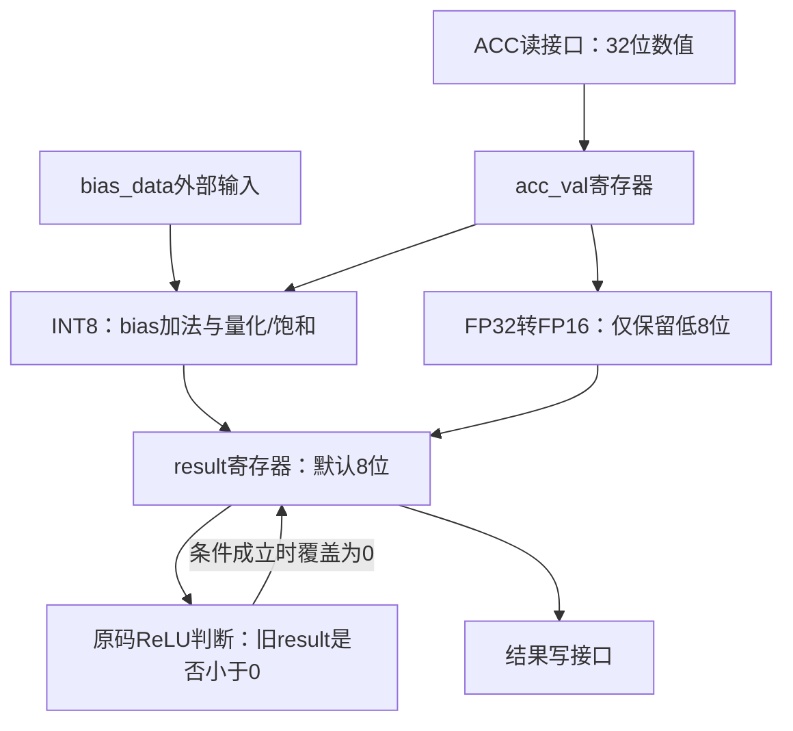

# tiny-NPU：gemm_post硬件结构、变量、数据通路与源码精读

> 依据：用户上传的 `gemm_post.sv`，共193行；已确认与此前固定的上游提交 `8216c22b762011aa20c05fc2768423fd12dda59d` 中同名文件一致。整理日期：2026-10-30。
>
> 阅读顺序：硬件结构 → 全部变量 → 数据通路 → 控制流 → 按文件行序解释 → 逐周期执行 → 实际代码问题。已学过的PE和整数MAC不再重讲。

## 1. 这个模块到底做什么

GEMM产生的INT32累加值往往不能直接作为下一层的INT8输入。后处理通常需要加偏置bias、重新缩放并量化、执行ReLU，再把结果写入输出存储。

`gemm_post`的INT8设计意图可以写成：

$$x\ \xrightarrow{\text{可选bias加法}}\ u\ \xrightarrow{\text{可选再量化，否则饱和}}\ q\ \xrightarrow{\text{可选ReLU}}\ y.$$

本模块从ACC读接口接收32位结果，从结果写接口输出一个8位结果。它没有乘法阵列，也没有A/B输入buffer；它处理的是已经计算好的输出元素。

默认ARRAY_M=ARRAY_N=16，只表示一条命令处理256个元素，并不意味着这里有256套并行后处理电路。当前代码按“读一项→等待→处理→写一项”的状态流程串行工作。

它是独立模块。不能仅根据目录结构，就默认所有GEMM命令都会在gemm_ctrl之后自动执行它；顶层必须显式实例化、连线、提供读返回有效信号并派发命令。此前核对的Graph Mode GEMM连接中，gemm_ctrl自身已有转换/写回路径，不应把本模块重复加入那条执行时间线。

## 2. 先建立硬件图

### 2.1 数据路径和真正保存数据的位置

下图对应当前文件的数据分支，并明确标出原代码ReLU读取旧result的反馈关系：



- `acc_val`：保存一次读回的ACC，读接口变化后，处理阶段仍有稳定的本地输入。
- `result`：保存处理结果，让后续WRITE状态能够稳定输出。
- bias加法、再量化、饱和与FP16转换由表达式/函数描述，不会因为写成function就自动新增时钟流水级。
- `biased`在时序过程中保存/计算中间值，但INT8分支使用阻塞赋值，后续表达式在同一次执行中就使用新biased；不能把它当作必须再等一拍的独立处理级。

ACC SRAM与结果存储并不在本文件内部实例化。模块只提供接口；实际存储、valid产生、读写端口仲裁和bias来源由外部系统连接。

### 2.2 控制路径

状态寄存器决定本拍做什么；元素计数器决定正在处理哪一项。控制逻辑负责：

1. 接收命令并保存模式标志。
2. 生成当前ACC地址并发出读取。
3. 等待返回有效，再保存数值。
4. 使能一次后处理，保存result。
5. 把result送到输出端口，推进元素编号。
6. 最后一项写完后报告done。

此模块只保留一个正在处理的元素，没有同时发出多笔读取，也没有让不同元素同时占据READ/PROCESS/WRITE不同阶段。注释中的“Processing pipeline”不代表实现了每拍一个新元素的流水吞吐。

## 3. 全部参数和端口：先明确含义与接口方向

### 3.1 参数，第12～15行

| 参数 | 默认值 | 对硬件的意义 |
|---|---:|---|
| ARRAY_M | 16 | 用于计算每条命令需要处理的元素数量 |
| ARRAY_N | 16 | 同上，总数为ARRAY_M×ARRAY_N |
| DATA_W | 8 | result寄存器与结果输出端口的位宽 |
| ACC_W | 32 | ACC输入、acc_val与bias数据的位宽 |

虽然有这些参数，整数辅助函数按INT32→INT8、浮点辅助函数按FP32→FP16定义；不能只改参数就假设自动支持任意格式。

### 3.2 命令和时钟端口，第17～26行

| 变量 | 类型/方向 | 含义和作用 |
|---|---|---|
| clk | 时钟输入 | 状态与数据寄存器在上升沿更新 |
| rst_n | 复位输入 | 低有效异步复位 |
| cmd_valid | 输入 | 上游当前给出一条有效后处理命令 |
| cmd_ready | 输出 | 本模块处于IDLE，可以接收命令 |
| flags[7:0] | 输入 | 若干独立功能使能位；当前使用bias、requant、ReLU三位 |
| scale[7:0] | 输入 | 再量化的非负整数乘数 |
| shift[7:0] | 输入 | 再量化的右移位数，和scale共同表示缩放比例 |
| dtype | 输入 | 0选择INT8分支，1选择FP16转换分支 |

命令在IDLE且cmd_valid有效的上升沿被接受；此时cmd_ready也为1。因此可按 `cmd_valid && cmd_ready` 理解接受条件。忙时输入valid不会被排队保存；上游应遵守接口约定，已接受的valid也要及时撤销，避免回到IDLE后重复执行。

### 3.3 ACC读取、bias与结果输出，第28～44行

| 变量 | 方向 | 含义 |
|---|---|---|
| acc_rd_en | 输出 | 发起一次ACC元素读取 |
| acc_rd_addr[15:0] | 输出 | 要读取的ACC元素地址，按元素编号递增 |
| acc_rd_data | 输入 | 外部返回的ACC数值，默认32位 |
| acc_rd_valid | 输入 | 返回的ACC数据当前有效，可以捕获 |
| bias_data | 输入 | 当前元素对应的32位偏置，由外部提供 |
| res_wr_en | 输出 | 本拍输出一个结果写请求 |
| res_addr[15:0] | 输出 | 当前结果的目标地址，默认INT8时每项占一个字节 |
| res_data | 输出 | 待写结果，默认8位signed |
| busy | 输出 | 当前状态非IDLE；在DONE状态也为1 |
| done | 输出 | 当前处于PP_DONE，表示这条命令处理结束 |

读地址和写地址属于不同接口，不能因两者都从0开始，就认定读写的是同一物理存储位置。实际地址解释和存储连接由顶层决定。

读取有valid等待；结果写出没有res_ready、写响应或重试逻辑。因此本模块假定PP_WRITE中的结果能够按接口约定被接收，不能直接当作完整AXI读写主机。

bias_data也没有独立读取地址或请求信号。若需要不同输出通道使用不同bias，外部必须保证PROCESS采样时给出匹配偏置。

## 4. 全部内部变量，第47～64行

| 名字 | 硬件角色 | 含义、更新与使用 |
|---|---|---|
| pp_state_t | 枚举类型 | 定义6个状态的3位编码类型，不是一个额外寄存器 |
| pp_state | 状态寄存器 | 保存当前状态，复位为PP_IDLE |
| pp_state_next | 组合信号 | 根据当前状态和条件计算下一状态 |
| elem_cnt[15:0] | 计数寄存器 | 当前元素编号，从0开始，仅在WRITE拍末递增 |
| total_elems[15:0] | 配置寄存器 | 总元素数，命令接收时设为ARRAY_M×ARRAY_N |
| base_addr[15:0] | 地址寄存器 | ACC读取起点；当前实现每条命令都固定设0 |
| dst_addr[15:0] | 地址寄存器 | 结果写入起点；当前实现每条命令都固定设0 |
| bias_en | 控制寄存器 | 保存flags第1位，决定是否加bias |
| requant_en | 控制寄存器 | 保存flags第2位，决定是否进行缩放再量化 |
| relu_en | 控制寄存器 | 保存flags第3位，决定是否启用ReLU判断 |
| r_dtype | 模式寄存器 | 保存命令接受时的dtype，后面使用锁存值 |
| acc_val | 数据寄存器 | 在WAIT收到有效数据时保存acc_rd_data |
| biased | 32位signed中间变量 | 当前ACC加bias或旁路后的值，PROCESS内用阻塞赋值形成 |
| result | 输出数据寄存器 | PROCESS拍末更新，WRITE状态从这里取结果 |
| fp16_tmp | PROCESS局部16位变量 | 当前FP32值转换后的FP16编码，原码只取其低8位 |

注意两项区别：

- `elem_cnt`是“当前编号”，`total_elems`是“总数量”。默认编号0～255，共256项。
- flags和dtype被锁存，**scale、shift、bias_data没有被锁存为命令寄存器**。实际处理使用这些外部输入当时的值，外部应确保其时刻与当前任务/元素匹配。

这里没有store_row/store_col，是因为ACC接口已经把结果展开成一维元素序列。若外部按行存储完整阵列，元素编号可理解为 `row*ARRAY_N+col`，但模块自己不计算二维坐标。

## 5. 先讲通INT8数据运算

### 5.1 Bias：给当前结果加偏置

设ACC值为x、当前bias为b：

$$u=\begin{cases}\mathrm{sat32}(x+b),&bias\_en=1\\x,&bias\_en=0.\end{cases}$$

偏置是额外的模型参数；对于神经网络线性层，可以理解成矩阵乘法结果之后再加的一项。这个模块只使用外部给来的bias，不负责计算或存储整组bias。

`sat_add_i32`先扩成33位相加，再判断是否超出INT32范围，超出取最大/最小值，避免直接环绕。

### 5.2 Requantize：将32位累加尺度映射到INT8

有效缩放比例近似为scale/2^shift。源码辅助函数顺序是：先计算64位乘积，再在shift>0时加半单位偏移，算术右移，转32位后饱和到INT8。

$$p=u\times scale,\qquad
q=\mathrm{sat8}\left(\frac{p+2^{shift-1}}{2^{shift}}\text{按源码算术右移}\right),\quad shift>0.$$

shift=0时不加该偏移。源码这种固定加半单位的舍入，不能直接称为完整的ties-to-even规则，极端位宽/移位范围也需要另行约束。

若requant_en=0，直接 `saturate_i8(u)`，仍然限制在−128～127，并非输出32位原值。

例如x=100、b=20、bias_en=1、scale=3、shift=2：

$$u=120,\quad p=360,\quad rounded=362,\quad q=362\mathbin{>>>}2=90.$$

### 5.3 ReLU：设计意图是将当前负结果置0

$$y=\begin{cases}\max(0,q),&relu\_en=1\\q,&relu\_en=0.\end{cases}$$

ReLU不是读另一个存储，而是一次符号判断加选择。**但原码没有正确对当前新q做判断，而是读了旧result。** 先记住设计意图，第8节会按原代码精确说明。

## 6. 控制流：一个元素要经过哪些阶段

| 状态 | 本拍驱动/等待什么 | 拍末保存什么 | 下一状态 |
|---|---|---|---|
| PP_IDLE | cmd_ready=1，等待命令 | 接收时初始化计数、保存标志 | 有cmd_valid则READ |
| PP_READ | acc_rd_en=1，给出base_addr+elem_cnt | 无返回值捕获 | WAIT |
| PP_WAIT | 等待acc_rd_valid | valid时保存acc_val | valid时PROCESS，否则停留 |
| PP_PROCESS | 使用保存的acc_val进行后处理 | 保存result | WRITE |
| PP_WRITE | res_wr_en=1，给出地址和result | elem_cnt加1 | 还有元素则READ，否则DONE |
| PP_DONE | done=1 | 无额外数据更新 | IDLE |

READ只发一次请求。WAIT即使停留多拍，也不会重复拉高acc_rd_en；它等待对应返回值。接口需要保证返回在WAIT期间可被观察到，不能只在READ期间短暂给一个随后消失的valid。

默认每条命令处理256项；本模块没有m_eff/n_eff输入，也没有命令元素数或地址基址输入，因此不能自动适配任意边缘tile和任意存储区域。

## 7. 严格按照代码顺序阅读实现

### 7.1 第1～15行：文件约束、包和参数

开头注释说明作者的设计意图，不是功能已经通过验证的证明。

`` `default_nettype none `` 禁止拼错名字时自动产生隐式wire，便于发现错误连接。第7行开始模块声明，三个import分别引入：

| 包 | 本文件使用的内容 |
|---|---|
| npu_pkg | sat_add_i32、requantize、saturate_i8 |
| isa_pkg | FLAG_BIAS_EN=1、FLAG_REQUANT=2、FLAG_RELU=3 |
| fp16_utils_pkg | fp32_to_fp16 |

`::*`表示从包引入可见名字，不是在这里实例化一个独立硬件模块。参数和端口的逐项含义见第3节；从端口可以看出本模块依赖外部存储和bias来源。

### 7.2 第17～64行：端口、状态类型和内部保存值

声明次序为：命令接口→ACC读接口→bias输入→结果写接口→状态输出→FSM类型→内部变量。按这个次序在硬件图上定位，就不会把acc_val误认为一整块ACC SRAM，也不会把res_data误认为保存全部结果的数组。

```systemverilog
typedef enum logic [2:0] {
    PP_IDLE, PP_READ, PP_WAIT,
    PP_PROCESS, PP_WRITE, PP_DONE
} pp_state_t;

pp_state_t pp_state, pp_state_next;
```

3位足以编码6个状态。typedef给类型起名字；pp_state才是当前状态保存值。状态名不会因为排列相邻就自动依次执行，转移由下面的case明确指定。

### 7.3 第66～71行：状态寄存器

```systemverilog
always_ff @(posedge clk or negedge rst_n) begin
    if (!rst_n)
        pp_state <= PP_IDLE;
    else
        pp_state <= pp_state_next;
end
```

它只保存“处于哪个阶段”。下一状态由组合逻辑提前算好，等下一上升沿才成为当前状态。复位拉低时异步回IDLE。

### 7.4 第73～82行：下一状态和输出的默认值

```systemverilog
pp_state_next = pp_state;
cmd_ready    = 1'b0;
acc_rd_en    = 1'b0;
acc_rd_addr  = '0;
res_wr_en    = 1'b0;
res_addr     = '0;
res_data     = '0;
busy         = (pp_state != PP_IDLE);
done         = 1'b0;
```

默认state不变，默认不发读写请求，不接受命令，也不报告done；随后具体状态覆盖需要打开的输出。组合输出在每种路径都先有定义，避免锁存器或上一状态使能残留。

res_data在非WRITE状态默认0，不意味着result寄存器被清0；这是“输出端口当前值”与“内部保存值”的区别。只有WRITE才把端口接到result。

### 7.5 第85～90行：PP_IDLE接收条件

```systemverilog
cmd_ready = 1'b1;
busy = 1'b0;
if (cmd_valid)
    pp_state_next = PP_READ;
```

空闲时开放命令接收。这个组合分支只决定下个状态，flags捕获写在后面的时序块；在接收沿两者并行完成，随后进入READ。

### 7.6 第92～96行：PP_READ发请求

```systemverilog
acc_rd_en   = 1'b1;
acc_rd_addr = base_addr + elem_cnt;
pp_state_next = PP_WAIT;
```

当前编号为e，就读取base+e。这里没有把data写进acc_val，因为请求尚不能等同于返回。READ不检查返回值，无条件转WAIT。

### 7.7 第98～101行：PP_WAIT等待

```systemverilog
if (acc_rd_valid)
    pp_state_next = PP_PROCESS;
```

valid为0时，默认state_next=当前WAIT，因此一直停留。valid为1的沿，后面的时序块把acc_rd_data写入acc_val，同时状态进入PROCESS。不会因为停留WAIT而重复发起ACC读取。

### 7.8 第103～105行：PP_PROCESS安排下一阶段

```systemverilog
pp_state_next = PP_WRITE;
```

PROCESS固定持续一个状态周期。后处理算术就在这一周期对应的时序执行中形成result，然后进入WRITE。这里没有再等待一个算术done输入，所以当前结构假定这套组合算术能按该时序完成，物理频率是否满足还需综合和静态时序分析。

### 7.9 第107～115行：PP_WRITE给出结果并判断结束

```systemverilog
res_wr_en = 1'b1;
res_addr  = dst_addr + elem_cnt;
res_data  = result;
if (elem_cnt >= total_elems - 1)
    pp_state_next = PP_DONE;
else
    pp_state_next = PP_READ;
```

输出使用result寄存器，而非直接使用acc_rd_data。输出地址按当前元素号逐项加1；默认INT8一项就是一个字节。

默认total_elems=256，最后编号255。到最后编号时，当前仍处于WRITE，写使能仍为1；下一个上升沿完成这次写入并进入DONE，不会因为提前算出了state_next就丢掉最后一次输出。

### 7.10 第117～124行：PP_DONE及默认分支

DONE输出done=1，再安排回IDLE。在DONE期间busy仍为1，cmd_ready仍为0；回到IDLE以后才重新接受下一条命令。default使异常状态编码回到IDLE。

### 7.11 第127～139行：数据寄存器复位

这段将计数、总数、起止地址、锁存标志、模式以及acc_val/biased/result清0。它只负责保存值的初始化，状态寄存器由前面独立always_ff复位。

result不是每一项开始时都清0，它会保存上一项处理结果直到下一次PROCESS覆盖。因此原码中的旧result判断会在后续元素之间产生影响。

### 7.12 第142～152行：IDLE接受命令时保存什么

```systemverilog
elem_cnt    <= '0;
total_elems <= 16'(ARRAY_M * ARRAY_N);
base_addr   <= '0;
dst_addr    <= '0;
bias_en     <= flags[FLAG_BIAS_EN];
requant_en  <= flags[FLAG_REQUANT];
relu_en     <= flags[FLAG_RELU];
r_dtype     <= dtype;
```

`16'(...)`把元素总数转换为16位，默认16×16=256。这里是一个元素总数寄存器，不是创建二维结果网格。

flags[n]取一个布尔控制位。例如flags=8'b0000_0110表示bias和requant开启、ReLU关闭，其他位不在本文件使用。

这段没有r_scale/r_shift，也没有bias寄存器；scale/shift/bias_data在PROCESS中直接读取。base_addr/dst_addr都被固定为0，也没有从命令端口读取任意地址的能力。

### 7.13 第155～158行：WAIT保存读回值

```systemverilog
if (acc_rd_valid)
    acc_val <= acc_rd_data;
```

valid沿之后，acc_val才更新。状态同一沿进入PROCESS，所以接下来PROCESS期间有完整稳定的新值可用。此后读接口即使变化，也不会改变已经保存的acc_val。

### 7.14 第160～168行：PROCESS的FP16分支

```systemverilog
logic [15:0] fp16_tmp;
fp16_tmp = fp32_to_fp16(acc_val);
result <= signed'(fp16_tmp[7:0]);
```

r_dtype=1时把32位位模式解释为FP32，经函数转成16位FP16。**原代码只取低8位**写入默认8位result；没有store_byte，也没有之后再写高字节的状态。

例如FP32 1.0的编码0x3F800000转换成FP16 0x3C00，当前分支只输出0x00，缺失高字节0x3C，不能作为完整FP16结果写出。注释也说明完整FP16存储主要由gemm_ctrl承担。

本分支不会执行下面else中的bias、INT8再量化和ReLU。不能把FP16模式理解成“只跳过requant，其他功能自动保留”。

### 7.15 第169～175行：PROCESS的INT8分支

```systemverilog
biased = bias_en ? sat_add_i32(acc_val, bias_data) : acc_val;
if (requant_en)
    result <= requantize(biased, scale, shift);
else
    result <= saturate_i8(biased);
```

`?:`选择加bias的结果或原值。biased使用阻塞赋值 `=`，后面两条函数调用在本次执行中就使用刚计算出的biased，不需要等下一上升沿。

result使用非阻塞赋值 `<=`，安排在本沿稍后更新。它保存本项8位处理结果，让后面的WRITE状态使用。

函数的组合逻辑依赖关系可以串接成“bias加法→缩放乘法→移位→饱和”，不等于每个函数各占一个状态周期。

### 7.16 第176～178行：ReLU的实际执行问题

```systemverilog
if (relu_en && result < 0)
    result <= '0;
```

判断里的result仍是本沿之前保存的旧值，因为上面的 `result <= ...` 尚未更新。因此判断的不是当前新量化结果，详见下一节。

### 7.17 第182～189行：WRITE推进元素，其他阶段保持

```systemverilog
PP_WRITE: begin
    elem_cnt <= elem_cnt + 1;
end
```

只在WRITE拍末推进编号，不在READ、WAIT或PROCESS递增。WAIT可以延长，而元素地址不会提前变化。最后WRITE沿也会把计数加1，但状态已经转DONE，不会因此多发一个读写。

default不修改这些寄存器，让它们保持旧值。第191行endmodule结束模块，第193行恢复默认线网类型，避免影响后续文件。

## 8. 用三个元素看清ReLU错误，并理解正确写法

设bias和requant关闭，ReLU开启，依次读回[5,−3,7]，初始result=0。原码实际为：

| 当前输入 | 本次待写候选值 | 判断看到的旧result | 实际result | 正确ReLU输出 |
|---:|---:|---:|---:|---:|
| 5 | 5 | 0 | 5 | 5 |
| −3 | −3 | 5 | −3 | 0 |
| 7 | 7 | −3 | 0 | 7 |

旧值为负时，最后一条非阻塞赋值 `result <= '0`覆盖本次候选值；旧值为正时，本次负值反而没有被清零。

应先对“本次候选结果”完成全部组合运算，再只更新一次输出寄存器。下面是可替换原INT8处理分支的写法示意；不是已经修改后的上传文件，也不是完整新模块：

```systemverilog
begin
    logic signed [ACC_W-1:0] biased_now;
    logic signed [DATA_W-1:0] next_result;

    biased_now = bias_en
               ? sat_add_i32(acc_val, bias_data)
               : acc_val;

    next_result = requant_en
                ? requantize(biased_now, scale, shift)
                : saturate_i8(biased_now);

    if (relu_en && next_result < 0)
        next_result = '0;

    result <= next_result;
end
```

这里biased_now表示本项加偏置的临时值，next_result表示本项尚未寄存的候选输出。两者用阻塞赋值在本次执行中形成依赖，最后仅用一次非阻塞赋值保存结果。

这体现了通用经验：组合运算链上需要立即使用的中间值，与跨时钟沿保存的寄存器值，应明确区分。看到代码在同一个begin/end里上下排列，不代表非阻塞赋值会像软件变量赋值一样立即对下一行生效。

## 9. 把一次处理放到真实时钟沿上

为缩短例子，设参数ARRAY_M=ARRAY_N=2，共4个元素。开启bias、requant，关闭ReLU，dtype=0；第一个ACC=100、bias_data=20、scale=3、shift=2。固定假设外部能在READ之后的第一个WAIT周期给出匹配的valid/data。

E0是接受命令的沿；表中“沿前状态”决定当沿执行哪个case分支，“沿后状态”是state寄存器更新后的结果。

| 上升沿 | 沿前状态 | 当沿的动作 | 沿后状态/保存值 |
|---|---|---|---|
| E0 | IDLE | 接收命令，计数清0，总数4，保存标志 | READ；elem_cnt=0 |
| E1 | READ | 外部采样acc_rd_en及读地址0 | WAIT |
| E2 | WAIT | valid=1，保存ACC值100 | PROCESS；acc_val=100 |
| E3 | PROCESS | 本次biased=120，再量化为90，更新result | WRITE；result=90 |
| E4 | WRITE | 外部按约定写入res_addr=0、res_data=90，计数加1 | READ；elem_cnt=1 |
| E5 | READ | 外部采样第二项读地址1 | WAIT |
| E6 | WAIT | 保存第二项ACC | PROCESS |
| E7 | PROCESS | 形成第二项result | WRITE |
| E8 | WRITE | 写地址1，编号加1 | READ；elem_cnt=2 |

后续以同样方式处理第2、3号元素。若每次WAIT只用一拍，第3号元素在E16写出，沿后进入DONE、done=1；E17回IDLE，done=0、cmd_ready=1。

注意E3沿前还是PROCESS，res_wr_en仍为默认0；E3沿后才进入WRITE并形成写接口数据。不能认为算术产生result的同一个沿，外部已经采样到了新result并完成写入。

如果E2没有valid，state继续WAIT，acc_val和elem_cnt均不前进；表格后续动作整体向后延迟，不会因为时钟继续运行就跳过当前元素。

## 10. 吞吐、接口和实现范围

### 10.1 不是每拍处理一个输出元素

每项占用READ、WAIT、PROCESS、WRITE四个状态阶段。WAIT至少一个周期时，最短启动间隔是4拍，第二个元素的读取要等第一个写回后才开始。

若第e项的WAIT占w_e拍，元素处理阶段共需要：

$$T_{\mathrm{elements}}=\sum_e(1+w_e+1+1).$$

所有w_e=1、默认256项时，这部分是1024拍；不把接受命令与DONE等边界阶段混进此数。需要更高吞吐时，应重新组织有效位、寄存器和接口，使不同元素能处于不同处理阶段，而不是仅把状态名称叫pipeline。

### 10.2 接口连接必须补齐的含义

- acc_rd_valid不是本模块自己产生，外部必须与返回数据对齐。若SRAM只有固定延迟的读数据而没有valid，顶层需按实际延迟产生匹配有效信号。
- bias_data要在当前PROCESS使用时对应当前元素；模块没有bias地址生成或偏置SRAM接口。
- flags/dtype接收后可由内部锁存值使用，但scale/shift直接来自外部，应在任务使用期间保持正确稳定。
- res_wr_en表示当前发出写数据；因为没有ready/response，done的成立依赖外部按约定接收每次写入，不能自动升级为任意存储协议的完成保证。

### 10.3 目前不能直接当作通用后处理器的地方

| 当前实现 | 直接影响 |
|---|---|
| 总数固定ARRAY_M×ARRAY_N | 不能自动只处理边缘tile中的有效元素 |
| 两个基址固定0 | 没有命令级任意输入/输出基址功能 |
| scale/shift未锁存 | 必须遵守相应外部保持约定，或在新设计中增加寄存器 |
| 原ReLU读取旧result | 当前元素的ReLU结果可能错误 |
| FP16只输出低8位 | 不能写回完整FP16元素 |
| WRITE没有接收反馈 | 不能自动承受写端口停顿 |

这些是从当前文件可直接看到的行为边界，理解时不要把作者注释中的功能意图替代实际代码语义。

## 11. 从这个文件学走的设计方法

1. **输入返回与本地数据保存分开。** READ发请求，WAIT等返回并写acc_val，PROCESS只使用已经保存的输入。
2. **结果计算与结果写出分开。** PROCESS更新result，WRITE用稳定寄存器输出。这样延迟关系容易推演。
3. **进度跟随完成事件。** elem_cnt只在当前输出写回阶段结束时更新，WAIT停顿不会造成跳项。
4. **区分当前值与候选新值。** 多步组合算术先形成候选结果，再更新寄存器，避免旧result参与当前元素判断。
5. **模式支持要覆盖整条路径。** FP16不仅是转换函数返回16位，还必须有完整的接口传输、地址增量和结束条件。
6. **参数、接口和生命周期一起设计。** 若要支持不同有效元素数、基址、按通道bias或稳定量化参数，需要相应命令字段、寄存器和时序协议。

## 12. 阅读位置与核验说明

| 起始行 | 阅读内容 |
|---:|---|
| 7 | 模块声明、包和参数 |
| 17 | 全部端口 |
| 47 | 状态类型及内部变量 |
| 66 | 状态寄存器 |
| 73 | 组合下一状态与输出 |
| 127 | 数据寄存器复位与更新 |
| 142 | 命令接受时的初始化 |
| 155 | 返回数据捕获 |
| 160 | FP16/INT8处理 |
| 177 | ReLU旧值问题 |
| 182 | 元素编号推进 |

[对应上游源文件](https://github.com/harishsg993010/tiny-NPU/blob/8216c22b762011aa20c05fc2768423fd12dda59d/rtl/gemm/gemm_post.sv)。整数函数来自同提交的 `rtl/pkg/npu_pkg.sv:115` 起，标志位置来自 `rtl/pkg/isa_pkg.sv:35` 起。

本次以上传文件为准逐行核对，检查全部参数、端口和内部变量是否在讲义中说明，并对示例数值和ReLU旧值序列做简单核算。时钟表依据接口假设和RTL非阻塞语义推导，不是实际HDL波形；未修改上传源文件，未运行完整NPU或本模块HDL仿真。文中的修正片段是教学示意，不能视为已提交并验证的RTL补丁。
