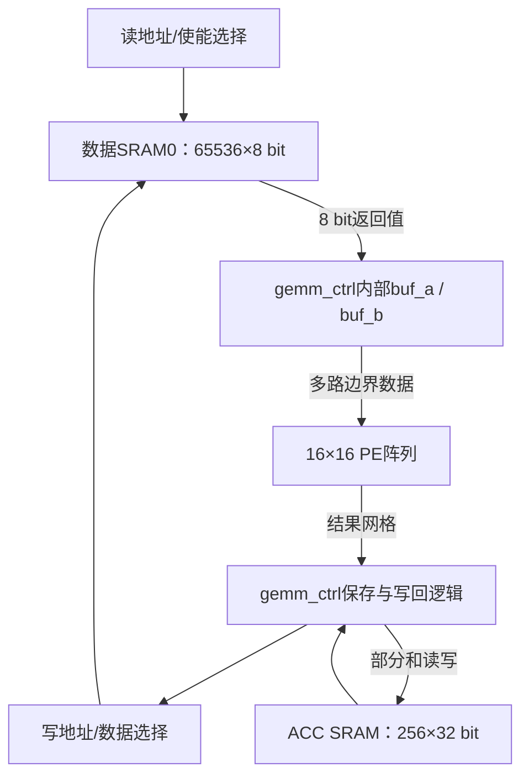
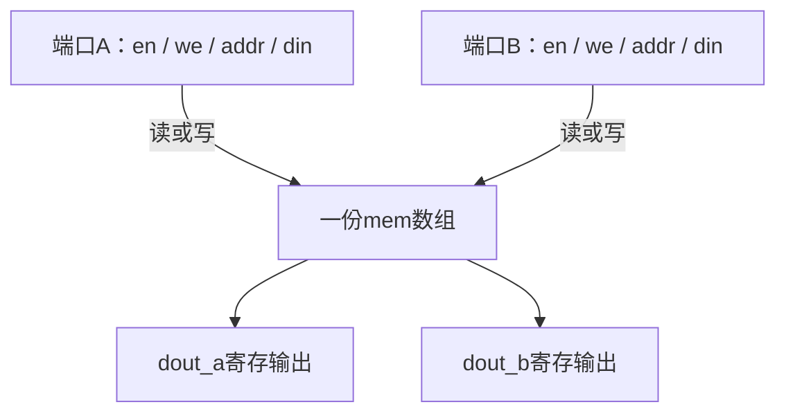
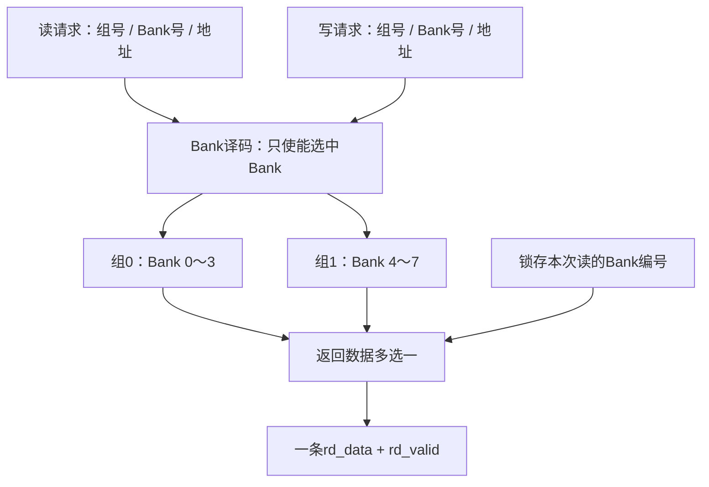
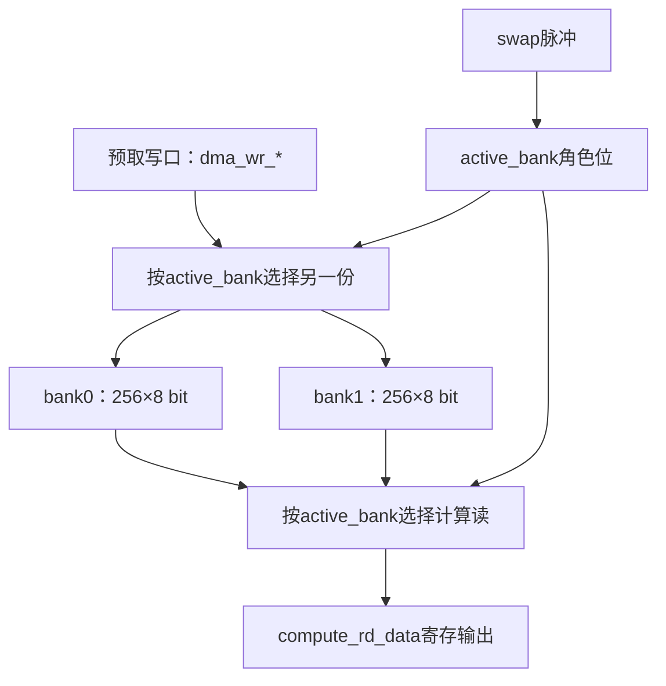

# 第06讲：SRAM、Bank与Buffer——从存储端口到双缓冲时序

日期：2026-11-06。

本讲承接gemm_ctrl与gemm_post，沿用上游固定版本：`8216c22b762011aa20c05fc2768423fd12dda59d`。讲解顺序固定为：硬件结构→变量含义与单位→数据/控制流→源码顺序与逐周期时序。本讲是源码精读与静态推导，没有运行HDL仿真，没有修改上游RTL。

## 1. 本讲要建立的联系

前面已经知道gemm_ctrl会把A/B子块装入内部buffer，再向阵列供数。本讲解释“SRAM为什么要等时钟沿、Bank怎样选、读数据怎样与请求对应、双缓冲怎样交接”。

本讲源码：

| 文件 | 本讲关注点 |
|---|---|
| `rtl/mem/sram_dp.sv` | 一份存储、两个访问端口、同步读写 |
| `rtl/mem/banked_sram.sv` | 多份SRAM、Bank译码、返回数据选择 |
| `rtl/mem/tile_buffer.sv` | 两份存储、计算/预取角色切换 |
| `sim/verilator/onnx_sim_top.sv` | 实际Graph仿真封装如何连接数据SRAM与ACC SRAM |
| `rtl/gemm/gemm_ctrl.sv` | 只核对LOAD阶段怎样等待同步SRAM返回 |

不要把目录中的独立模块全部画成一条已接通的数据通路。所核对的onnx_sim_top直接例化sram_dp；该文件没有例化banked_sram或tile_buffer。

## 2. 先看硬件结构

### 2.1 SRAM、Bank、Buffer描述不同层面的事

| 名词 | 回答的问题 | 本项目例子 |
|---|---|---|
| SRAM | 存储资源用什么形式提供？ | sram_dp的mem数组与同步端口 |
| Bank | 一块存储怎样分成可独立访问的若干份？ | banked_sram内部多个u_bank |
| Buffer | 这块存储承担什么暂存用途？ | 暂存输入子块、下一块数据或部分和 |
| Port，端口 | 外部通过哪组地址/控制/数据线访问？ | addr_a、din_a、dout_a、en_a、we_a |

一个buffer可以由SRAM实现，也可以由寄存器实现；一个buffer可以包含多个bank。名称“buffer”本身不能决定物理电路。

SRAM的“静态”指通电保持时不需要DRAM式周期刷新；本讲学习的是RTL访问模型。`ram_style="block"`表达FPGA块RAM推断意图，具体映射要看综合结果；这份代码没有描述6T晶体管级电路，也不是直接实例化ASIC工艺库SRAM宏。

### 2.2 先画已核对的实际GEMM路径



图中的读、写选择在onnx_sim_top中由组合逻辑完成。GEMM与其他引擎共享数据SRAM端口，图为聚焦GEMM省略了其他请求者。

- 数据SRAM0默认65536个8位存储字，共64KiB；地址一步是一字节。
- ACC SRAM为256个32位存储字，共1KiB；地址一步是一项32位部分和。
- gemm_ctrl内部buf_a/buf_b仍是自己的数组。独立tile_buffer不会因为名字相似就成为它们的物理实现。
- PE内部ACC、独立ACC SRAM、输入buffer各有自己的存储位置和用途。

特别注意：“存储字word”就是某个接口一次寻址的数据单位，宽度取决于该存储。此处不能统一把word理解成32bit。

### 2.3 单个sram_dp的结构



两个端口访问同一份mem。数据不会因为有两个端口就自动复制成两份。

两个端口都有读写能力，所以模块是true dual-port风格。到了banked_sram和Graph封装，外围连接把A固定用于读、B固定用于写，这是使用方式进一步收窄了能力。

## 3. sram_dp：变量含义与单位

源码中，参数和端口在6～24行，存储声明在26行，A端口时序块从29行开始，B端口从41行开始，仿真专用断言从52行开始。附录保存了完整源码，便于按原顺序对照。

| 名字 | 默认宽度/值 | 单位与含义 | 何时变化 |
|---|---:|---|---|
| DEPTH | 4096 | 存储字数量 | elaboration时确定 |
| WIDTH | 8 | 每个存储字的bit数 | elaboration时确定 |
| ADDR_W | 12 | 地址编码所需bit数 | `$clog2(DEPTH)` |
| clk | 1 bit | 所有端口共用的时钟 | 每个上升沿触发访问 |
| en_a/en_b | 各1 bit | 当前端口本拍是否访问 | 外部驱动 |
| we_a/we_b | 各1 bit | 使能访问时，1写、0读 | 外部驱动 |
| addr_a/addr_b | 各ADDR_W bit | 存储字编号 | 被上升沿采样 |
| din_a/din_b | 各WIDTH bit | 当前写入字的位模式 | 写沿采样 |
| dout_a/dout_b | 各WIDTH bit | 当前端口最近一次有效访问的输出 | 有效访问沿后更新 |
| mem | DEPTH项×WIDTH bit | 实际保存的数组内容 | 写使能沿更新 |

参数是生成硬件前确定的配置，不是运行时计数器。`DEPTH=4096`时编号为0～4095，12bit地址刚好表示4096种编号。

容量计算：

$$容量_{bit}=DEPTH\times WIDTH,\qquad 容量_{Byte}=DEPTH\times WIDTH/8.$$

默认容量为4096Byte=4KiB；若改为DEPTH=256、WIDTH=32，容量变成1024Byte=1KiB，地址0、1、2分别指向第0、1、2个32位存储字。

若上层另有字节地址，32位对齐情况下可把字节地址右移2位得到32位字编号；当前ACC接口本来就传递项编号，不需要凭空再乘4或除4。

## 4. sram_dp：数据流与控制流

一拍由en和we共同决定：

| en | we | 该上升沿执行什么 | 沿后dout |
|---:|---:|---|---|
| 0 | 任意 | 不读、不写 | 保持原值 |
| 1 | 0 | 读取mem[addr] | 更新为所读的字 |
| 1 | 1 | 将din写入mem[addr] | 更新为本端口din |

地址改变只会改变“准备访问哪里”。这份同步读模型需要时钟上升沿，dout才会更新。

写操作没有单独ready反馈；外部要按约定保证有效地址和数据在访问沿前稳定。“无额外写等待”也仍然要求写入沿，不能把它理解成en一拉高就异步写入。

### 4.1 为什么gemm_ctrl不能在发读请求的同一个沿捕获新返回值

假设mem[5]=37，dout_a旧值为9，外部使用另一个always_ff把dout_a存入buffer。

| 时刻 | SRAM看到什么 | 控制器看到什么 |
|---|---|---|
| E0前 | en_a=1，we_a=0，addr_a=5 | dout_a还是9 |
| E0这个沿 | 执行`dout_a <= mem[5]` | 若此时执行`buffer <= dout_a`，读到9 |
| E0之后 | dout_a更新成37 | 37在整段E0～E1期间可用 |
| E1这个沿 | 可接下一次访问或保持 | `buffer <= dout_a`可以捕获37 |

原因是非阻塞赋值`<=`在当前沿先读取右值，随后更新左值。多个always_ff不会按文件从上到下依次“算完再让下一个读新值”。

这正好解释旧代码中的load_phase：

| 阶段 | 沿前输出 | 沿上动作 |
|---|---|---|
| load_phase=0 | sram_rd_en=1，给当前地址 | SRAM采样请求；控制器令phase变1 |
| load_phase=1 | sram_rd_en=0 | 控制器捕获上次dout，推进坐标并令phase回0 |

默认INT8每元素花两个LOAD状态周期，是控制器采用“请求/捕获”交替安排的结果。

### 4.2 一拍读延迟与每拍一项吞吐可以同时成立

若在E0、E1、E2连续给地址5、6、7，SRAM会在每个沿之后依次输出对应数据。流水化消费者可在E1、E2、E3分别捕获它们。

因此：

- 读延迟：请求被采样后，数据在该沿后更新；与下游同步逻辑配合时按一拍返回理解。
- 持续吞吐：此端口可以每拍接受一个读请求。
- 当前gemm_ctrl吞吐：LOAD使用两拍一字节，尚未利用连续读能力。

接口能做什么，与使用接口的状态机实际做什么，要分开分析。

### 4.3 两端口冲突必须单独看

A读地址5、B写地址9，可以在同沿进行。两端口同时读同一地址也没有双写竞争。

A、B同沿写同一地址且数据不同，代码没有规定优先级，也没有冲突仲裁。跨端口“同地址一读一写”同样不能仅凭write-first注释就认定读端一定看到新值；纯RTL事件语义通常读到沿前mem值，实际RAM的跨端口碰撞行为还取决于器件和配置。可靠使用应避免依赖未规定的碰撞结果。

## 5. sram_dp：按源码顺序读

### 5.1 禁止隐式连线

```systemverilog
`default_nettype none
```

写错信号名时让工具报错，防止悄悄生成一个未预期的隐式wire。文件末尾恢复`default_nettype wire`，避免影响后续编译文件。

### 5.2 参数化模块与端口

```systemverilog
module sram_dp #(
    parameter int DEPTH  = 4096,
    parameter int WIDTH  = 8,
    parameter int ADDR_W = $clog2(DEPTH)
)( ... );
```

`#(...)`配置硬件规模；`(...)`连接运行时信号。`$clog2`取以2为底对数的上取整，例如256需要8bit地址。

若DEPTH不是2的幂，ADDR_W能编码的范围可能更大，外部仍必须只给0～DEPTH−1。DEPTH=1时`$clog2(1)=0`会产生零宽度相关问题，不能宣称任意参数都受支持。

### 5.3 一份存储数组

```systemverilog
(* ram_style = "block" *) logic [WIDTH-1:0] mem [0:DEPTH-1];
```

- 名字前`[WIDTH-1:0]`表示每个元素有多少bit。
- 名字后`[0:DEPTH-1]`表示有多少个元素。
- `mem[5]`选一个完整的WIDTH位存储字。
- 属性`ram_style`给综合工具一个实现提示。

mem没有复位清零，也没有初始化文件。四态RTL仿真中，未写区域可能为X；上层要保证先初始化、再读取有效内容。

### 5.4 A端口时序块

```systemverilog
always_ff @(posedge clk) begin
    if (en_a) begin
        if (we_a) begin
            mem[addr_a] <= din_a;
            dout_a      <= din_a;
        end else begin
            dout_a <= mem[addr_a];
        end
    end
end
```

从外往里读：

1. 只在posedge clk执行访问。
2. en_a=0时没有赋值，存储与输出保持。
3. en_a=1且we_a=1时写入指定存储字。
4. 同时让本端口dout直接得到写入数据，形成write-first行为。
5. en_a=1且we_a=0时从mem读一个字到输出寄存器。

这里每次访问只处理选中的一个地址。数组声明不会让整个数组自动一次读出。

### 5.5 B端口与断言

B端口结构与A端口相同，共享mem，拥有独立addr/en/we/din/dout。

`ifndef SYNTHESIS`包围的assert用于仿真时检查地址越界。它不会增加接口ready，也不会替外部请求做排队。本文件也没有增加双端口同地址冲突检查。

## 6. banked_sram：先看硬件结构

默认NUM_BANKS=4、PINGPONG=1，因此实际例化8个sram_dp。



Bank是独立存储实例。rd_addr是选中Bank内的地址；rd_bank_sel是组内Bank号；rd_pingpong_sel选择哪一组。

默认每Bank 4KiB，总容量：

$$8\times4096\times8/8=32768Byte=32KiB.$$

对外端口只有一组rd_en/rd_addr/rd_data以及一组wr_en/wr_addr/wr_data。默认每拍最多提供一个8位读返回和一次8位写入；多个Bank没有在这个封装中直接变成多路并行读输出。

多Bank有利于组织容量、读写目标和后续扩展。若要一拍向16路PE送16个独立元素，还需要实际的多路读接口、宽字布局或本地buffer等结构，不能只增加NUM_BANKS就得到对应带宽。

## 7. banked_sram：全部变量按作用分组

| 名字 | 默认值/宽度 | 含义与单位 |
|---|---:|---|
| NUM_BANKS | 4 | 每组Bank数量 |
| BANK_DEPTH | 4096 | 每Bank存储字数量 |
| DATA_W | 8 bit | 每个存储字位宽 |
| PINGPONG | 1 | 是否生成两组Bank，属于构建时参数 |
| ADDR_W | 12 bit | Bank内地址位数 |
| BSEL_W | 2 bit | 组内Bank编号位数 |
| TOTAL_BANKS | 8 | 实际例化的SRAM数量 |
| TSEL_W | 3 bit | 实际Bank总编号位数 |
| clk/rst_n | 各1 bit | 时钟/低有效异步复位 |
| rd_en/wr_en | 各1 bit | 当前读/写请求是否有效 |
| rd_bank_sel/wr_bank_sel | 各2 bit | 组内Bank编号0～3 |
| rd_pingpong_sel/wr_pingpong_sel | 各1 bit | 组号0或1，由外部决定 |
| rd_addr/wr_addr | 各12 bit | 选中Bank内的字编号 |
| wr_data/rd_data | 各8 bit | 写入数据/返回数据 |
| rd_valid | 1 bit | 此返回是否对应一个读请求 |
| rd_bank_idx/wr_bank_idx | 各3 bit | 组合计算出的实际Bank总编号 |
| rd_bank_idx_d | 3 bit寄存器 | 与SRAM返回对齐的读Bank编号 |
| g | elaboration索引 | generate时实例化第几个Bank |
| i | 组合for循环索引 | 为每个Bank生成各自控制逻辑 |

两组每Bank信号完整对应sram_dp：

| 数组 | 每项含义 | 当前封装中的用法 |
|---|---|---|
| bank_en_a | Bank A端口使能 | 读请求选中它时为1 |
| bank_we_a | Bank A端口写选择 | 固定0，A只读 |
| bank_addr_a | Bank A端口地址 | 所有Bank接rd_addr |
| bank_din_a | Bank A端口写数据 | 固定0，因A不写 |
| bank_dout_a | Bank A端口读输出 | 送返回多选一 |
| bank_en_b | Bank B端口使能 | 写请求选中它时为1 |
| bank_we_b | Bank B端口写选择 | 与选中写请求一致 |
| bank_addr_b | Bank B端口地址 | 所有Bank接wr_addr |
| bank_din_b | Bank B端口写数据 | 所有Bank接wr_data |
| bank_dout_b | Bank B端口输出 | 子模块产生，封装没有用作返回 |

这些数组大多是各Bank的连接线。它们的声明为logic，不代表每项都会成为寄存器；是否存状态要看驱动方式。

## 8. banked_sram：数据流、控制流与返回对齐

### 8.1 拼接Bank号

```systemverilog
rd_bank_idx = {rd_pingpong_sel, rd_bank_sel};
```

默认BSEL_W=2，拼接就是3bit编号：

| 组号 | 组内Bank号 | 拼接结果 | 实际Bank |
|---:|---:|---|---:|
| 0 | 2 | 0_10 | 2 |
| 1 | 2 | 1_10 | 6 |
| 1 | 3 | 1_11 | 7 |

默认等价于：

$$bank\_idx=group\times4+bank\_sel.$$

这不是乘以存储字节数。Bank内地址仍由rd_addr决定，例如组1、Bank号2、rd_addr=10访问实际Bank6的第10个字。

拼接依赖每组Bank数量为2的幂。若NUM_BANKS=3，组1拼接的起点是4而不是3，还可能产生越界编号，因此当前实现不能直接视为支持任意Bank数量。NUM_BANKS=1同样有`$clog2`零宽度问题。

### 8.2 地址广播与选择使能

```systemverilog
bank_en_a[i] = rd_en && (rd_bank_idx == i[TSEL_W-1:0]);
bank_addr_a[i] = rd_addr;
```

地址线可以广播给所有Bank；只有en为1的Bank真正执行访问。未选中的Bank不因地址线变化就更新输出。

`i[TSEL_W-1:0]`把循环整数i取成匹配索引宽度的位段；默认3bit足以表示0～7。

写端口同理。rd_bank_idx与wr_bank_idx彼此独立，所以可以读Bank2、写Bank6，也可以访问同一Bank的不同地址。是否构成碰撞还要看地址与端口行为。

### 8.3 为什么需要rd_bank_idx_d

假设E0请求Bank2，E1准备请求Bank5。E0沿后得到的是Bank2的数据。若返回多选一直接使用当前请求Bank号，那么外部提前切换到Bank5时，返回也会错误切到Bank5的旧dout。

源码把“本次读的是哪个Bank”与请求一起锁存：

```systemverilog
rd_valid      <= rd_en;
rd_bank_idx_d <= rd_bank_idx;
```

然后：

```systemverilog
rd_data = bank_dout_a[rd_bank_idx_d];
```

E0沿后，Bank2的dout和rd_bank_idx_d=2同时更新，组合多选一选择正确返回。当前读请求地址继续变化，不会改变已经锁存的返回归属。

这是通用时序方法：请求的附属信息要与数据一起经过对应延迟。Bank编号、目的寄存器号、请求ID、字节选择都可能需要这样对齐。

### 8.4 一张逐沿表

假设Bank2[10]=37，Bank5[3]=88，数据此前已写好，复位已释放。

| 上升沿 | 沿前读请求 | 沿后rd_bank_idx_d | 沿后rd_valid | 沿后rd_data | 下游同沿可捕获的旧返回 |
|---|---|---:|---:|---:|---|
| E0 | en=1，Bank2，addr10 | 2 | 1 | 37 | 上一拍返回 |
| E1 | en=1，Bank5，addr3 | 5 | 1 | 88 | E0返回37 |
| E2 | en=0 | 当前组合Bank号 | 0 | 无有效返回保证 | E1返回88 |

E2即便没有新读，rd_bank_idx_d仍会更新；rd_data可能选到另一Bank保存的旧输出。只能在rd_valid表示有效时使用返回数据，不能把空闲时数据变化解释成新响应。

复位只清rd_valid与rd_bank_idx_d，没有清所有SRAM内容。SRAM本身没有rst_n，复位期间若外部仍给访问使能，底层仍可能访问；系统应按约定控制复位期请求。

## 9. banked_sram：按源码顺序读

1. 参数与端口：先确定每组有几Bank、每Bank有多少字、接口宽度。
2. localparam：用PINGPONG计算TOTAL_BANKS与TSEL_W。
3. 每Bank信号数组：把每个sram_dp的A/B端口接线集中列出。
4. generate for：构建时真正复制TOTAL_BANKS份sram_dp实例。默认g=0～7；这些实例同时存在，不是运行时一拍创建一个。
5. Bank编号组合逻辑：PINGPONG=1时拼组号与组内编号；关闭时使用组内编号。
6. 驱动Bank信号的always_comb：逐Bank比较索引，把使能变成“只有选中的那一份为1”，读写地址和写数据广播。
7. 返回归属always_ff：锁存Bank编号与rd_en，复位清有效标志。
8. 返回多选一always_comb：用锁存编号选bank_dout_a。

注释“Read data mux (registered for timing)”不能误读为“多选一输出又经过一个寄存器”。实际代码注册的是Bank选择和valid；rd_data的最后一级多选一是组合逻辑，底层sram_dp已经注册读输出，没有再多加一整拍数据寄存。

这个模块没有active_bank、swap、自动交替控制，也没有检查一组数据是否已加载。PINGPONG=1只生成两组资源，哪组供计算、哪组供预取由外部选择信号决定。

## 10. tile_buffer：先看硬件结构与角色

tile_buffer没有例化banked_sram或sram_dp，它直接声明两份数组bank0/bank1。



默认每份256Byte，总容量512Byte。地址0～255与16×16=256个INT8元素数量相符，但模块自身只识别一维地址，不知道行、列或M/N/K。

| active_bank | 计算读哪份 | DMA写哪份 |
|---:|---|---|
| 0 | bank0 | bank1 |
| 1 | bank1 | bank0 |

active_bank=0的含义是“计算侧当前使用bank0”。它不表示bank0是刚填好的，也不表示bank1一定完整。

DMA接口名表示上游可连接搬运/预取单元；tile_buffer内部没有DDR地址生成、AXI事务或DMA引擎，它只接收已经送来的写地址和数据。

## 11. tile_buffer：全部变量与生命周期

| 名字 | 默认宽度/数量 | 含义、单位、生命周期 |
|---|---:|---|
| BANK_DEPTH | 256 | 每份buffer存储字数量，构建时确定 |
| DATA_W | 8 bit | 每字位宽，构建时确定 |
| ADDR_W | 8 | localparam计算的地址位数；本版本后续未直接使用该名字 |
| clk/rst_n | 各1 bit | 时钟/低有效异步复位 |
| bank0/bank1 | 各256项×8bit | 两份实际数据存储，写入后保持，未整体复位 |
| active_bank | 1 bit寄存器 | 计算读哪份；复位0，swap沿翻转 |
| dma_wr_en | 1 bit | 本拍是否写预取buffer |
| dma_wr_addr | 8 bit | 当前写入字的编号 |
| dma_wr_data | 8 bit | 当前写入字内容 |
| compute_rd_en | 1 bit | 本拍是否读计算buffer |
| compute_rd_addr | 8 bit | 当前读取字的编号 |
| compute_rd_data | 8 bit寄存器 | 最近有效读的字；复位0，未使能时保持 |
| swap | 1 bit | 角色切换请求，设计约定是单拍脉冲 |
| next_tile_ready | 1 bit寄存器 | 当前实现仅在swap时翻转，未跟踪填充完成 |
| tile_done | 1 bit | 当前实现恒0，未跟踪读完 |

数据数组没有整片清零。复位输出为0只说明compute_rd_data寄存器被清零，不意味着bank0/bank1所有地址都有有效0。

## 12. tile_buffer：数据流、控制流与双缓冲

### 12.1 角色切换不会复制整块数据

假设bank0已经装有tile A，active_bank=0：

- 计算侧逐地址读bank0中的A。
- DMA同时逐地址写bank1中的下一块B。
- A已经不再需要，B也确实装完时，外部给swap。
- active_bank变1，下一阶段计算读bank1中的B，DMA可以向bank0写C。

swap只翻转一个bit。之所以立即“换整块数据”，是读写选择逻辑改变了目标，存储内容本身没有整体搬移。

在理想稳态，独立的装载和计算可以重叠：

$$T_{\text{串行每块}}=T_{\text{load}}+T_{\text{compute}},$$
$$T_{\text{双缓冲稳态每块}}\approx\max(T_{\text{load}},T_{\text{compute}}).$$

还要考虑首次装载、末块收尾、切换与其他资源冲突；这些公式是结构潜力，不是当前Graph GEMM已经实现的性能结论。只有buffer确实接入、DMA与计算真的独立、交接条件可靠时，才能获得这种重叠。

### 12.2 swap发生的那个沿，读写仍使用旧角色

所有always_ff同沿读取旧active_bank。设E0前active_bank=0：

| 时刻 | active_bank | compute读取 | DMA写入 |
|---|---:|---|---|
| E0前 | 0 | 准备读bank0 | 准备写bank1 |
| E0沿，swap=1 | 各时序块仍读旧0 | 本沿读取bank0 | 本沿写入bank1 |
| E0之后 | 1 | 新请求选择bank1 | 新请求选择bank0 |
| E1沿 | 1 | 本沿读取bank1 | 本沿写入bank0 |

因此可以在swap沿完成旧计算buffer最后一次读、旧预取buffer最后一次写；沿后新角色生效。但这需要外部准确安排边界，模块不会帮忙检查。旧buffer最后一项返回可能在角色已切换后才被下游捕获，也要按请求时序理解。

如果swap连续高两个沿，active_bank翻转两次又回原值。必须按接口约定给单拍脉冲，而不是长期保持高电平表示“请切过去”。

### 12.3 启动时怎样让第一块可用

复位后active_bank=0，DMA默认写bank1。bank0没有因复位而装好第一块。

一个合理的外部使用序列是：

1. 复位释放后先让计算读使能为0。
2. DMA把第一块完整写进bank1。
3. 外部确认写完，发一次swap，active_bank变1。
4. 后续计算读bank1，同时DMA向bank0填下一块。

这是建议的外部调度协议，原模块没有完整的启动状态机。

### 12.4 两个“握手”输出实际还未实现其注释含义

原代码：

```systemverilog
else if (swap)
    next_tile_ready <= ~next_tile_ready;

assign tile_done = 1'b0;
```

next_tile_ready没有根据dma_wr_en计数，没有检查最后一个地址，也没有接收DMA完成信号。它与active_bank都从0开始、每次swap翻转，因此正常复位后的已定义运行中两者只是同样变化，不能证明下一块已经装满。

tile_done永远0，模块也不知道当前tile应读几项、某地址会不会重复读、计算是否还需复用它。

所以外部调度不能把这两个输出当成已完成的ready/done协议。要实现可靠协议，通常需要外部完成事件或明确有效位、实际装载/消费数量、切换许可；本讲说明所缺的信息，不修改RTL。

本模块也没有compute_rd_valid。使用者要用自己的读请求延迟一拍，识别compute_rd_data何时对应有效请求；没有读使能时dout保持旧值，不是新数据。

## 13. tile_buffer：按源码顺序读

### 13.1 参数、端口与两份存储

```systemverilog
logic [DATA_W-1:0] bank0 [0:BANK_DEPTH-1];
logic [DATA_W-1:0] bank1 [0:BANK_DEPTH-1];
logic active_bank;
```

两个数组是两份数据空间；active_bank只是角色位。物理实现需要综合确认，不能只凭logic数组声明认定必然使用BRAM。

### 13.2 角色寄存器

```systemverilog
always_ff @(posedge clk or negedge rst_n) begin
    if (!rst_n)
        active_bank <= 1'b0;
    else if (swap)
        active_bank <= ~active_bank;
end
```

复位异步拉低立即清角色；正常运行只在时钟沿响应swap。没有swap时保持原值。

### 13.3 写预取buffer

```systemverilog
always_ff @(posedge clk) begin
    if (dma_wr_en) begin
        if (active_bank)
            bank0[dma_wr_addr] <= dma_wr_data;
        else
            bank1[dma_wr_addr] <= dma_wr_data;
    end
end
```

active_bank=1时计算使用bank1，所以写bank0；active_bank=0时写bank1。写逻辑没有rst_n分支，因此复位期间外部也应禁止无意写请求。

### 13.4 读计算buffer

```systemverilog
always_ff @(posedge clk or negedge rst_n) begin
    if (!rst_n)
        compute_rd_data <= '0;
    else if (compute_rd_en) begin
        if (active_bank)
            compute_rd_data <= bank1[compute_rd_addr];
        else
            compute_rd_data <= bank0[compute_rd_addr];
    end
end
```

这是同步读加输出寄存器：有效沿后更新compute_rd_data，下游同沿仍看到旧输出。不读时保持。

复位清的是输出寄存器，不清两份数组；读写正常按相反角色进行，避免计算读和预取写争用同一份buffer。

### 13.5 占位握手与文件结尾

最后一个always_ff仅使next_tile_ready随swap翻转；tile_done连续赋0。文件末尾恢复默认net类型。本模块没有读写进度计数器，没有自动交换时机判断，没有二维tile寻址。

## 14. 回到实际顶层，避免把学习模块误当成已集成结构

onnx_sim_top中的数据SRAM：

```systemverilog
sram_dp #(.DEPTH(SRAM0_DEPTH), .WIDTH(8)) u_sram0 (
    .clk    (clk),
    .en_a   (s0_a_en),
    .we_a   (1'b0),
    .addr_a (s0_a_addr),
    .din_a  (8'd0),
    .dout_a (s0_a_dout),
    .en_b   (s0_b_en),
    .we_b   (s0_b_we),
    .addr_b (s0_b_addr),
    .din_b  (s0_b_din),
    .dout_b ()
);
```

A固定读，B用于写。gemm_ctrl的sram_rd_data直接接s0_a_dout。前面的组合读地址选择以请求使能为条件，若多个引擎同拍请求，同一端口只选择优先级最高的一个。

多选一只负责选信号，不会自动缓存被挤掉的请求。本段SRAM接口没有给每个请求者独立返回grant/ready；系统调度必须确保同一时段的访问不会让低优先级请求者把别人的返回当作自己的数据。这是接口边界条件，不等于本讲已经验证所有调度路径有冲突。

外部ACC SRAM：

```systemverilog
sram_dp #(.DEPTH(256), .WIDTH(32)) u_acc_sram (
    .clk    (clk),
    .en_a   (gm_acc_rd_en),
    .we_a   (1'b0),
    .addr_a (gm_acc_rd_addr),
    .din_a  (32'd0),
    .dout_a (gm_acc_rd_data),
    .en_b   (gm_acc_wr_en),
    .we_b   (gm_acc_wr_en),
    .addr_b (gm_acc_wr_addr),
    .din_b  (gm_acc_wr_data),
    .dout_b ()
);
```

| 对比项 | 数据SRAM0 | ACC SRAM |
|---|---|---|
| 默认深度 | 65536项 | 256项 |
| 每项宽度 | 8bit | 32bit |
| 默认容量 | 64KiB | 1KiB |
| 地址一步 | 1Byte | 1个32bit部分和 |
| 主要用途 | A/B和最终输出 | 当前输出tile跨K块部分和 |
| 封装类型 | 直接sram_dp | 直接sram_dp |

banked_sram和tile_buffer作为独立模块提供结构示例；本讲核对的Graph封装并未实例化它们。因此不能据此声称现有GEMM已通过tile_buffer实现装载/计算重叠。

## 15. 读后续存储相关RTL时的检查顺序

1. 画出数据真正存在哪几份数组或RAM实例中。
2. 写清每份容量、每字bit数、地址单位。
3. 数清对外真正暴露几条独立读写通道。
4. 确定读请求在哪个沿采样、输出何时更新、消费者何时捕获。
5. 将Bank编号/目的位置等附属信息与返回延迟对齐。
6. 检查多请求者如何选择，未选中的请求是否有等待机制。
7. 对双缓冲，确认谁证明“下一块已装完”和“当前块可释放”。
8. 复位后确认哪些控制位清了，哪些数据内容仍需初始化。

本讲停点：已完成SRAM、Bank与Buffer三个文件的结构与时序精读，尚不据此判断已经全部掌握。下一步如继续按计划推进，可进入DMA/AXI，解释本地写口上的数据如何从外部存储搬进来。

## 附录A：来源与核对范围

所有上游链接均固定到同一个commit：

- [sram_dp.sv](https://github.com/harishsg993010/tiny-NPU/blob/8216c22b762011aa20c05fc2768423fd12dda59d/rtl/mem/sram_dp.sv)
- [banked_sram.sv](https://github.com/harishsg993010/tiny-NPU/blob/8216c22b762011aa20c05fc2768423fd12dda59d/rtl/mem/banked_sram.sv)
- [tile_buffer.sv](https://github.com/harishsg993010/tiny-NPU/blob/8216c22b762011aa20c05fc2768423fd12dda59d/rtl/mem/tile_buffer.sv)
- [onnx_sim_top.sv](https://github.com/harishsg993010/tiny-NPU/blob/8216c22b762011aa20c05fc2768423fd12dda59d/sim/verilator/onnx_sim_top.sv)
- [gemm_ctrl.sv](https://github.com/harishsg993010/tiny-NPU/blob/8216c22b762011aa20c05fc2768423fd12dda59d/rtl/gemm/gemm_ctrl.sv)

本讲已实际读取三个存储模块、Graph仿真封装与gemm_ctrl，核对参数、控制分支、返回对齐和连接；同时参考学习仓库当前复习文档以衔接已有进度。

本次没有运行HDL仿真，没有VCD波形。文中的逐沿表是源码推导；没有把它表述成仿真结果。工作环境未发现iverilog或verilator，本讲没有要求用户安装工具，也没有提交任何RTL修复。

## 附录B：三个存储模块源码快照

以下完整代码从固定上游版本读取，便于离线按原顺序对照。它们是原始源码，包含正文指出的边界与占位逻辑。

### rtl/mem/sram_dp.sv

Blob SHA：`64f0a8e523022f52c16c215839cea506445d79e3`

```systemverilog
// =============================================================================
// True Dual-Port SRAM - BRAM Inferred for Xilinx
// =============================================================================
`default_nettype none

module sram_dp #(
    parameter int DEPTH  = 4096,
    parameter int WIDTH  = 8,
    parameter int ADDR_W = $clog2(DEPTH)
)(
    input  wire                 clk,
    // Port A
    input  wire                 en_a,
    input  wire                 we_a,
    input  wire  [ADDR_W-1:0]  addr_a,
    input  wire  [WIDTH-1:0]   din_a,
    output logic [WIDTH-1:0]   dout_a,
    // Port B
    input  wire                 en_b,
    input  wire                 we_b,
    input  wire  [ADDR_W-1:0]  addr_b,
    input  wire  [WIDTH-1:0]   din_b,
    output logic [WIDTH-1:0]   dout_b
);

    (* ram_style = "block" *) logic [WIDTH-1:0] mem [0:DEPTH-1];

    // Port A: write-first
    always_ff @(posedge clk) begin
        if (en_a) begin
            if (we_a) begin
                mem[addr_a] <= din_a;
                dout_a      <= din_a;
            end else begin
                dout_a <= mem[addr_a];
            end
        end
    end

    // Port B: write-first
    always_ff @(posedge clk) begin
        if (en_b) begin
            if (we_b) begin
                mem[addr_b] <= din_b;
                dout_b      <= din_b;
            end else begin
                dout_b <= mem[addr_b];
            end
        end
    end

`ifndef SYNTHESIS
    // Assertions
    always @(posedge clk) begin
        if (en_a) begin
            assert (addr_a < DEPTH)
                else $error("SRAM Port A address out of bounds: %0d >= %0d", addr_a, DEPTH);
        end
        if (en_b) begin
            assert (addr_b < DEPTH)
                else $error("SRAM Port B address out of bounds: %0d >= %0d", addr_b, DEPTH);
        end
    end
`endif

endmodule

`default_nettype wire
```

### rtl/mem/banked_sram.sv

Blob SHA：`65aeba9b0f874dfe955e0ef3ec22b745ef785eab`

```systemverilog
// =============================================================================
// Banked SRAM with optional Ping-Pong
// =============================================================================
`default_nettype none

module banked_sram #(
    parameter int NUM_BANKS  = 4,
    parameter int BANK_DEPTH = 4096,
    parameter int DATA_W     = 8,
    parameter int PINGPONG   = 1,
    parameter int ADDR_W     = $clog2(BANK_DEPTH),
    parameter int BSEL_W     = $clog2(NUM_BANKS)
)(
    input  wire                  clk,
    input  wire                  rst_n,
    // Read port
    input  wire                  rd_en,
    input  wire  [BSEL_W-1:0]   rd_bank_sel,
    input  wire  [ADDR_W-1:0]   rd_addr,
    input  wire                  rd_pingpong_sel,
    output logic [DATA_W-1:0]   rd_data,
    output logic                 rd_valid,
    // Write port
    input  wire                  wr_en,
    input  wire  [BSEL_W-1:0]   wr_bank_sel,
    input  wire  [ADDR_W-1:0]   wr_addr,
    input  wire                  wr_pingpong_sel,
    input  wire  [DATA_W-1:0]   wr_data
);

    localparam int TOTAL_BANKS = PINGPONG ? NUM_BANKS * 2 : NUM_BANKS;
    localparam int TSEL_W = $clog2(TOTAL_BANKS);

    // Per-bank signals
    logic                 bank_en_a [TOTAL_BANKS];
    logic                 bank_we_a [TOTAL_BANKS];
    logic [ADDR_W-1:0]   bank_addr_a [TOTAL_BANKS];
    logic [DATA_W-1:0]   bank_din_a [TOTAL_BANKS];
    logic [DATA_W-1:0]   bank_dout_a [TOTAL_BANKS];

    logic                 bank_en_b [TOTAL_BANKS];
    logic                 bank_we_b [TOTAL_BANKS];
    logic [ADDR_W-1:0]   bank_addr_b [TOTAL_BANKS];
    logic [DATA_W-1:0]   bank_din_b [TOTAL_BANKS];
    logic [DATA_W-1:0]   bank_dout_b [TOTAL_BANKS];

    // Instantiate SRAM banks
    genvar g;
    generate
        for (g = 0; g < TOTAL_BANKS; g++) begin : gen_banks
            sram_dp #(
                .DEPTH (BANK_DEPTH),
                .WIDTH (DATA_W)
            ) u_bank (
                .clk    (clk),
                .en_a   (bank_en_a[g]),
                .we_a   (bank_we_a[g]),
                .addr_a (bank_addr_a[g]),
                .din_a  (bank_din_a[g]),
                .dout_a (bank_dout_a[g]),
                .en_b   (bank_en_b[g]),
                .we_b   (bank_we_b[g]),
                .addr_b (bank_addr_b[g]),
                .din_b  (bank_din_b[g]),
                .dout_b (bank_dout_b[g])
            );
        end
    endgenerate

    // Bank index calculation
    logic [TSEL_W-1:0] rd_bank_idx;
    logic [TSEL_W-1:0] wr_bank_idx;

    always_comb begin
        if (PINGPONG) begin
            rd_bank_idx = {rd_pingpong_sel, rd_bank_sel};
            wr_bank_idx = {wr_pingpong_sel, wr_bank_sel};
        end else begin
            rd_bank_idx = {{(TSEL_W-BSEL_W){1'b0}}, rd_bank_sel};
            wr_bank_idx = {{(TSEL_W-BSEL_W){1'b0}}, wr_bank_sel};
        end
    end

    // Drive bank signals
    // Port A used for reads, Port B used for writes
    always_comb begin
        for (int i = 0; i < TOTAL_BANKS; i++) begin
            // Read (Port A)
            bank_en_a[i]   = rd_en && (rd_bank_idx == i[TSEL_W-1:0]);
            bank_we_a[i]   = 1'b0;
            bank_addr_a[i] = rd_addr;
            bank_din_a[i]  = {DATA_W{1'b0}};
            // Write (Port B)
            bank_en_b[i]   = wr_en && (wr_bank_idx == i[TSEL_W-1:0]);
            bank_we_b[i]   = wr_en && (wr_bank_idx == i[TSEL_W-1:0]);
            bank_addr_b[i] = wr_addr;
            bank_din_b[i]  = wr_data;
        end
    end

    // Read data mux (registered for timing)
    logic [TSEL_W-1:0] rd_bank_idx_d;

    always_ff @(posedge clk or negedge rst_n) begin
        if (!rst_n) begin
            rd_valid     <= 1'b0;
            rd_bank_idx_d <= '0;
        end else begin
            rd_valid      <= rd_en;
            rd_bank_idx_d <= rd_bank_idx;
        end
    end

    always_comb begin
        rd_data = bank_dout_a[rd_bank_idx_d];
    end

endmodule

`default_nettype wire
```

### rtl/mem/tile_buffer.sv

Blob SHA：`1d97b5b0d71005feed1704fe3b5177316eb6bfee`

```systemverilog
`default_nettype none

module tile_buffer #(
    parameter int BANK_DEPTH = 256,  // ARRAY_M * ARRAY_N for 16x16
    parameter int DATA_W     = 8
)(
    input  wire                           clk,
    input  wire                           rst_n,

    // DMA/prefetch write port (writes to prefetch_bank)
    input  wire                           dma_wr_en,
    input  wire  [$clog2(BANK_DEPTH)-1:0] dma_wr_addr,
    input  wire  [DATA_W-1:0]             dma_wr_data,

    // Compute read port (reads from compute_bank)
    input  wire                           compute_rd_en,
    input  wire  [$clog2(BANK_DEPTH)-1:0] compute_rd_addr,
    output logic [DATA_W-1:0]             compute_rd_data,

    // Bank swap control
    input  wire                           swap,           // pulse to swap banks

    // Handshake signals
    output logic                          tile_done,      // compute bank has been fully read
    output logic                          next_tile_ready // prefetch bank is loaded and ready
);

    localparam int ADDR_W = $clog2(BANK_DEPTH);

    // ---------------------------------------------------------------
    // Two banks of storage
    // ---------------------------------------------------------------
    logic [DATA_W-1:0] bank0 [0:BANK_DEPTH-1];
    logic [DATA_W-1:0] bank1 [0:BANK_DEPTH-1];

    // Active bank for compute reads (0 or 1)
    logic active_bank;

    always_ff @(posedge clk or negedge rst_n) begin
        if (!rst_n)
            active_bank <= 1'b0;
        else if (swap)
            active_bank <= ~active_bank;
    end

    // ---------------------------------------------------------------
    // DMA writes to prefetch bank (opposite of active)
    // ---------------------------------------------------------------
    always_ff @(posedge clk) begin
        if (dma_wr_en) begin
            if (active_bank)
                bank0[dma_wr_addr] <= dma_wr_data;
            else
                bank1[dma_wr_addr] <= dma_wr_data;
        end
    end

    // ---------------------------------------------------------------
    // Compute reads from active bank (registered output, 1-cycle latency)
    // ---------------------------------------------------------------
    always_ff @(posedge clk or negedge rst_n) begin
        if (!rst_n)
            compute_rd_data <= '0;
        else if (compute_rd_en) begin
            if (active_bank)
                compute_rd_data <= bank1[compute_rd_addr];
            else
                compute_rd_data <= bank0[compute_rd_addr];
        end
    end

    // ---------------------------------------------------------------
    // Handshake placeholders
    // ---------------------------------------------------------------

    // next_tile_ready: registered flag, toggles on each swap pulse
    always_ff @(posedge clk or negedge rst_n) begin
        if (!rst_n)
            next_tile_ready <= 1'b0;
        else if (swap)
            next_tile_ready <= ~next_tile_ready;
    end

    // tile_done: placeholder, tied low (GEMM controller manages externally)
    assign tile_done = 1'b0;

endmodule

`default_nettype wire
```
