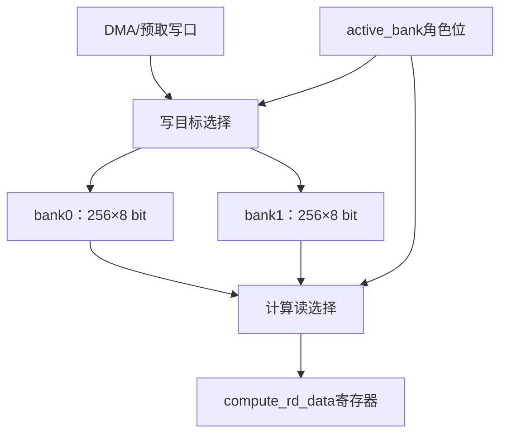

# 第06讲补充：Ping-Pong双缓冲的硬件结构、块级流水与切换时序

日期：2026-11-06。

本讲回答“什么是pingpang，详细讲解对应的流水和硬件结构”。代码中的名称为**Ping-Pong**，中文常称**乒乓双缓冲**。承接上一讲，只深入双缓冲；不重新讲GEMM。

依据上游固定版本`8216c22b762011aa20c05fc2768423fd12dda59d`，已重新读取`tile_buffer.sv`与`banked_sram.sv`。本讲包含结构解释、教学时序示例和源码静态推导，没有运行HDL仿真，没有修改RTL。

## 1. 先确定结构：两块数据空间交替承担两个角色

乒乓双缓冲的基本安排是：

> 一份存储让计算使用当前tile，另一份存储装载下一个tile；满足交接条件后交换角色。

tile表示一次暂存、处理的一块数据。这里T0、T1、T2表示按顺序处理的数据块，不预先限定它们一定对应GEMM的哪个矩阵或哪个维度。

| 角色 | 当前任务 | 常见执行资源 |
|---|---|---|
| 生产者/装载端 | 从上游搬来下一块数据，写入预取buffer | DMA或预取单元 |
| 消费者/计算端 | 从计算buffer读取当前块的数据 | 计算引擎或供数逻辑 |

两份存储空间是真的同时存在。角色切换不复制数据，只改变读、写选择。

### 1.1 当前tile_buffer的结构



默认总容量为：

$$2\times256\times8bit=512Byte.$$

每个Bank为256Byte，不是整个双缓冲共256Byte。16×16个INT8元素可以放进其中一份，但模块只接受一维地址，不知道矩阵行列。

更接近硬件连线的理解：

- 两份存储各有写使能，dma_wr_addr/dma_wr_data可广播，两份使能只选一份。
- 读侧按active_bank选择相应Bank的内容，在时钟沿保存到compute_rd_data。
- 综合可能把选择实现到RAM端口或外围多选一中，具体物理电路要看综合结果。
- 模块没有实例化DMA引擎；“DMA写口”表示它接收搬运单元已经送来的写请求。

等价的写使能关系：

$$we_{bank0}=dma\_wr\_en\land active\_bank,$$
$$we_{bank1}=dma\_wr\_en\land \neg active\_bank.$$

等价的读值选择：

$$read\_value=
\begin{cases}
bank0[compute\_rd\_addr], & active\_bank=0\\
bank1[compute\_rd\_addr], & active\_bank=1.
\end{cases}$$

该read_value在有效读时钟沿后更新到compute_rd_data，并不是异步直接输出给计算端。

### 1.2 Ping、Pong只是两份交替空间的称呼

可以把bank0叫Ping、bank1叫Pong，但名字没有固定“谁永远负责计算”。

| active_bank | 计算端读 | 装载端写 |
|---:|---|---|
| 0 | bank0（Ping） | bank1（Pong） |
| 1 | bank1（Pong） | bank0（Ping） |

角色位翻转后，原来的预取buffer成为计算buffer，原来的计算buffer成为新的预取buffer。

## 2. 变量含义、单位与生命周期

| 变量 | 宽度/单位 | 含义 | 生命周期 |
|---|---|---|---|
| BANK_DEPTH | 默认256个存储字 | 每份Bank的容量深度 | 生成硬件前确定 |
| DATA_W | 默认8bit/字 | 一个地址存多少bit | 生成硬件前确定 |
| bank0、bank1 | 各BANK_DEPTH项 | 两份数据内容 | 写入后保持，不整体复位 |
| active_bank | 1bit、角色编号 | 当前计算使用哪份 | 复位0，每个swap沿翻转 |
| dma_wr_en | 1bit、有效标志 | 本拍是否写入一个字 | 上游每拍驱动 |
| dma_wr_addr | 默认8bit、字编号 | 预取Bank内的写位置 | 写沿采样 |
| dma_wr_data | 默认8bit、数据 | 当前写入的一个字 | 写沿采样 |
| compute_rd_en | 1bit、有效标志 | 本拍是否读取一个字 | 计算侧每拍驱动 |
| compute_rd_addr | 默认8bit、字编号 | 计算Bank内的读位置 | 读沿采样 |
| compute_rd_data | 默认8bit、数据寄存器 | 最近一次有效读的返回 | 有效读沿后更新，空闲保持 |
| swap | 1bit、切换脉冲 | 请求交换两个角色 | 接口约定单拍有效 |
| next_tile_ready | 1bit | 原码仅随swap翻转 | 没有跟踪实际装载完成 |
| tile_done | 1bit | 原码恒0 | 没有跟踪实际消费完成 |
| clk、rst_n | 时钟/低有效复位 | 驱动时序与部分控制复位 | rst_n不清两份数据数组 |

active_bank只回答“计算端选哪份”。它不能回答“那份内容是否完整有效”。

正确的完整调度还需要知道预取是否完成、当前buffer是否可释放；本模块没有完整实现这些状态。

## 3. 数据流与控制流：哪些东西同时发生

设当前active_bank=0：

1. 计算从bank0读T0。
2. DMA同时向bank1写T1。
3. DMA写完后，bank1保存完整T1，等待计算端可以交接。
4. 当前bank0已不再需要且T1已准备好，发swap。
5. 沿后active_bank=1，计算改读bank1的T1。
6. DMA可以向bank0写T2。

交换的只是访问角色。T1仍留在bank1，没有被复制进bank0，也没有整体搬进计算阵列。

### 3.1 为什么要两份空间

假设仅有一份存放整个tile的输入区，计算还需从中继续读取当前T0。如果DMA提前把T1写到相同地址，计算可能读到被覆盖的数据。

双缓冲让当前数据与下一块数据分别占用不同空间，简化完整tile的所有权管理。

单份双端口RAM可以同拍读写不同地址；若做了严格分区或逐元素消费管理，也可能形成其他流水。本讲对比的是“当前tile仍需保留、下一tile要装到相同大小区域”的整块复用场景，不能把有无双端口与有无双缓冲混为一谈。

### 3.2 形成的是按tile交错的装载—计算流水

| 流水层级 | 同时推进的对象 | 例子 |
|---|---|---|
| 运算电路流水 | 不同操作数处于不同运算阶段 | 乘法寄存器、ACC寄存器 |
| 双缓冲形成的任务流水 | 不同tile处于装载与计算阶段 | DMA装T1，同时计算T0 |

一个处理对象T0仍然需要先装好，再计算。重叠发生在T0的计算与T1的装载之间。

双缓冲不会自动把计算从6拍缩短为3拍，也不会让一个8bit读口变成16路输出。它利用已经存在的装载与计算资源，把原来分开的时间重叠起来。

## 4. 三个tile的完整时间线

以下是用于理解调度的假设例子，不是测得的项目性能：

- 每个tile装载需4拍：`T_L=4`。
- 每个tile计算/占用当前buffer需6拍：`T_C=6`。
- 两个阶段可以独立并行。
- 忽略额外切换开销，区间采用左闭右开记法，例如[0,4)为4拍。

### 4.1 单buffer按整块串行复用

| 时间区间 | 装载资源 | 计算资源 |
|---|---|---|
| [0,4) | 装T0 | 等待 |
| [4,10) | 等待 | 算T0 |
| [10,14) | 装T1 | 等待 |
| [14,20) | 等待 | 算T1 |
| [20,24) | 装T2 | 等待 |
| [24,30) | 等待 | 算T2 |

总计：

$$3(4+6)=30拍.$$

### 4.2 使用本模块复位后的角色安排

复位后active_bank=0，DMA写bank1，所以第一块先装进bank1。

| 时间区间 | DMA/装载端 | 计算端 | Bank内容与角色 |
|---|---|---|---|
| [0,4) | bank1装T0 | 等待 | bank0尚无有效计算tile |
| t=4边界 | 交换角色 | 准备T0 | active_bank变1 |
| [4,8) | bank0装T1 | bank1算T0 | 两个阶段重叠 |
| [8,10) | 等待，T1已装完 | bank1继续算T0 | 保留bank0的T1 |
| t=10边界 | 交换角色 | 准备T1 | active_bank变0 |
| [10,14) | bank1装T2 | bank0算T1 | 两个阶段重叠 |
| [14,16) | 等待，T2已装完 | bank0继续算T1 | 保留bank1的T2 |
| t=16边界 | 交换角色 | 准备T2 | active_bank变1 |
| [16,22) | 无后续tile | bank1算T2 | 最后一块收尾 |

总计22拍，比串行30拍少8拍。

t=8时DMA已经写完T1，但不能立即覆盖bank1来装T2，因为计算仍在使用bank1的T0。这就是生产者等待消费者释放空间的情况。

表中的切换边界是抽象阶段边界，实际要安排到哪个采样沿，见后文逐沿表。

### 4.3 为什么速度取决于较慢阶段

在阶段耗时固定、可独立并行、按整块交换且忽略额外开销时，N块的理想时间为：

$$T_{\text{double}}=T_L+(N-1)\max(T_L,T_C)+T_C.$$

本例：

$$4+2\times6+6=22拍.$$

N很大时，稳态每块间隔接近：

$$I=\max(T_L,T_C).$$

相对整块串行的理想稳态加速比：

$$S\approx\frac{T_L+T_C}{\max(T_L,T_C)}.$$

| 装载耗时 | 计算耗时 | 稳态每块间隔 | 主要等待方 |
|---:|---:|---:|---|
| 4拍 | 6拍 | 6拍 | DMA先完成后等待 |
| 6拍 | 4拍 | 6拍 | 计算先完成后等待 |
| 5拍 | 5拍 | 5拍 | 理想情况下基本匹配 |

只有这两个阶段、且只靠隐藏两阶段重叠时，理想稳态加速最多约2倍。若装载远慢于计算，双缓冲也不能消除装载带宽瓶颈。

## 5. 安全交接需要什么硬件状态

“有两份存储”和“已有可靠双缓冲协议”需要分别检查。

常见的控制器会跟踪：

| 概念状态/事件 | 谁提供 | 意义 |
|---|---|---|
| prefetch_complete | DMA或写入计数逻辑 | 下一tile的必要数据已实际写入本地存储 |
| compute_buffer_released | 计算控制器 | 旧buffer中的内容之后不再需要 |
| 当前计算Bank编号 | 角色寄存器 | 当前tile的数据存在哪里 |
| 是否还有后续tile | 命令/循环控制 | 决定继续预取或收尾 |

概念上的切换许可：

$$can\_swap=prefetch\_complete\land compute\_buffer\_released.$$

这不是当前tile_buffer里已经存在的实现。

prefetch_complete必须表示数据已经进入可读存储；不能只依据“DMA命令已经发出”。

compute_buffer_released也不一定要等整个计算结果产生。如果所有输入已被安全捕获在下游寄存器中，之后不再重读原buffer，就可能提前释放。反过来，即使某个地址读过一次，若还有复用需求，也不能覆盖。

本讲时间线把T_C定义成buffer从开始被使用到可以释放所需的时长；若将它理解成完整引擎执行时间，就采用较保守的交接方式。

### 5.1 为什么不能只检查“下一块装好了”

若下一块已准备好，但当前tile还有数据未读，切换会让计算读到下一块的数据。

若当前tile已消费完，但下一块仍在写，切换可能读到未初始化或新旧混合的数据。

所以生产者完成与消费者释放都要有可核对依据。

### 5.2 停顿时数据必须保留

- 装载慢：计算端等待下一块，不能读取半成品。
- 计算慢：DMA保持已装好的预取块，不能提前覆盖计算Bank。
- 最后一块：没有下一块时不必继续交换，计算完进入收尾。
- 有下游反压时：还需检查返回是否已被接收，不能假设读请求发出就代表消费者已收下。

当前tile_buffer没有ready反馈与返回valid，使用它的外部逻辑必须采用约定时序。

## 6. 回到代码：角色和数据通路按顺序怎样实现

### 6.1 先声明两份存储

```systemverilog
logic [DATA_W-1:0] bank0 [0:BANK_DEPTH-1];
logic [DATA_W-1:0] bank1 [0:BANK_DEPTH-1];
logic active_bank;
```

bank0/1保存数据；active_bank保存访问角色。复位不会清整份数据数组。

### 6.2 swap只修改角色位

```systemverilog
always_ff @(posedge clk or negedge rst_n) begin
    if (!rst_n)
        active_bank <= 1'b0;
    else if (swap)
        active_bank <= ~active_bank;
end
```

没有swap时保持。swap连续高两个沿会翻转两次，所以外部应产生单拍脉冲。

### 6.3 写端始终选择另一份Bank

```systemverilog
always_ff @(posedge clk) begin
    if (dma_wr_en) begin
        if (active_bank)
            bank0[dma_wr_addr] <= dma_wr_data;
        else
            bank1[dma_wr_addr] <= dma_wr_data;
    end
end
```

active_bank=1说明计算用bank1，因此DMA写bank0。写逻辑没有rst_n分支，外部应避免复位期发出无意写使能。

### 6.4 读端选择当前计算Bank，并寄存输出

```systemverilog
always_ff @(posedge clk or negedge rst_n) begin
    if (!rst_n)
        compute_rd_data <= '0;
    else if (compute_rd_en) begin
        if (active_bank)
            compute_rd_data <= bank1[compute_rd_addr];
        else
            compute_rd_data <= bank0[compute_rd_addr];
    end
end
```

读值在有效沿后更新。没有读使能时输出保持旧值。复位输出为0不代表两份存储都已初始化成0。

## 7. 最关键的逐沿例子：swap沿究竟读哪份

下面是一个独立于前述4/6拍性能例子的微小时序示例。

假设进入稳态时：

- active_bank=0。
- bank0已经保存T0=[a0,a1,a2,a3]。
- 正在向bank1写T1=[b0,b1,b2,b3]。
- 计算每拍读一个字，DMA每拍写一个字。
- E3沿完成旧Bank最后一次读和预取Bank最后一次写，同时swap=1。
- 后续不会重读T0，返回没有反压。

| 上升沿 | 沿前active | 读地址 | 本沿计算读 | 本沿DMA写 | swap | 沿后active | 沿后compute_rd_data |
|---|---:|---:|---|---|---:|---:|---|
| E0 | 0 | 0 | bank0[0]=a0 | bank1[0]←b0 | 0 | 0 | a0 |
| E1 | 0 | 1 | bank0[1]=a1 | bank1[1]←b1 | 0 | 0 | a1 |
| E2 | 0 | 2 | bank0[2]=a2 | bank1[2]←b2 | 0 | 0 | a2 |
| E3 | 0 | 3 | bank0[3]=a3 | bank1[3]←b3 | 1 | 1 | a3 |
| E4 | 1 | 0 | bank1[0]=b0 | bank0[0]←c0 | 0 | 1 | b0 |
| E5 | 1 | 1 | bank1[1]=b1 | bank0[1]←c1 | 0 | 1 | b1 |

E3沿的所有always_ff都读取旧active_bank=0。因此：

1. 读时序块从bank0读a3。
2. 写时序块把b3写进bank1。
3. 角色时序块安排active_bank变1。
4. E3沿后，输出为a3，后续访问角色已变1。

下游若在always_ff中捕获compute_rd_data：

- E3沿捕获的是E2返回a2。
- E4沿捕获的是E3返回a3。
- E5沿捕获的是E4返回b0。

**E3沿后，active_bank已经是1，但返回a3仍属于旧tile T0。** 不能拿当前active_bank直接当返回数据的tile标签。需要标签时，应把请求时的Bank号/tile编号与读使能一起寄存对齐。

本例E4可以覆盖bank0[0]，是因为a3已在E3沿被保存进输出寄存器，旧T0之后也不再重读。若消费者可能停顿或重放，则释放条件必须相应更严格。

## 8. 当前源码的两个握手输出仍是占位逻辑

```systemverilog
always_ff @(posedge clk or negedge rst_n) begin
    if (!rst_n)
        next_tile_ready <= 1'b0;
    else if (swap)
        next_tile_ready <= ~next_tile_ready;
end

assign tile_done = 1'b0;
```

next_tile_ready没有统计写入数量，没有检查DMA完成。它和active_bank都从0开始且都随swap翻转，正常复位后的已定义运行中只是同步变化的两个bit。

tile_done恒0，也没有统计读进度或数据复用结束。

所以当前代码的角色切换机制已经存在，完整的“下一块可用/旧块释放”协议尚未实现。上面的可靠调度条件和示例，是帮助理解应如何使用或补全外部控制，不是声称原码已经检查了这些条件。

## 9. banked_sram中的PINGPONG怎样对应

banked_sram的默认配置为NUM_BANKS=4、PINGPONG=1：

$$TOTAL\_BANKS=4\times2=8.$$

它把“每份buffer”进一步组织成4个Bank：

| 组选择 | 组内Bank号 | 实际Bank总编号 |
|---:|---:|---:|
| 0 | 0～3 | 0～3 |
| 1 | 0～3 | 4～7 |

编号生成：

```systemverilog
rd_bank_idx = {rd_pingpong_sel, rd_bank_sel};
wr_bank_idx = {wr_pingpong_sel, wr_bank_sel};
```

例如rd_pingpong_sel=1、rd_bank_sel=2，实际读Bank6。

要按乒乓方式使用，可以由外部控制器安排：

| 阶段 | 计算读组 | DMA写组 |
|---|---:|---:|
| 当前阶段 | 0 | 1 |
| 交换后 | 1 | 0 |

但是rd_pingpong_sel与wr_pingpong_sel都是外部输入，模块没有自动保证它们互补，也没有active_bank或swap。

| 对比 | tile_buffer | banked_sram默认开启PINGPONG |
|---|---|---|
| 数据空间 | 2份数组 | 2组，每组4个sram_dp |
| 角色选择 | 内部active_bank | 外部提供读写组号 |
| 自动响应swap | 有，翻转角色 | 没有swap端口 |
| 是否判断预取完成 | 没有完整实现 | 没有 |
| 对外读返回 | 1个DATA_W位字 | 1个DATA_W位字加rd_valid |

PINGPONG是生成两组资源的参数；NUM_BANKS是每组内如何再分Bank。这两个维度不能混淆。

## 10. 对tiny-NPU当前GEMM的实际含义

前一讲核对的Graph仿真封装直接连接sram_dp与gemm_ctrl。gemm_ctrl当前通过LOAD_A/LOAD_B装好内部buf_a/b，再进入STREAM。

独立tile_buffer没有在该路径中实例化，所以不能因为目录中有它，就说当前GEMM已经实现DMA装下一tile与STREAM算当前tile的流水。

如果以后要引入真实重叠，至少需要明确：

1. 哪一份数据需要双缓冲：A、B，还是一个包含多份操作数的tile存储组。
2. 下一tile写入哪份空间，当前STREAM从哪份空间取数。
3. 预取地址、块坐标如何比当前计算进度超前一块。
4. 哪个完成事件证明下一tile已经可用。
5. 当前tile何时不再需要，何时允许覆盖。
6. 本地读口是否有足够宽度/路数给阵列供数。
7. 跨K块部分和依赖、写回、共享SRAM或总线是否限制并发。

双缓冲增加了存储空间与控制状态；性能收益来自装载与计算确实能够并发。它不会自动消除A/B供数宽度和共享端口约束。

## 11. 本次核对与来源

本讲实际重新读取：

- [tile_buffer.sv](https://github.com/harishsg993010/tiny-NPU/blob/8216c22b762011aa20c05fc2768423fd12dda59d/rtl/mem/tile_buffer.sv)
- [banked_sram.sv](https://github.com/harishsg993010/tiny-NPU/blob/8216c22b762011aa20c05fc2768423fd12dda59d/rtl/mem/banked_sram.sv)

与上一讲相同的Graph路径依据：

- [onnx_sim_top.sv](https://github.com/harishsg993010/tiny-NPU/blob/8216c22b762011aa20c05fc2768423fd12dda59d/sim/verilator/onnx_sim_top.sv)
- [gemm_ctrl.sv](https://github.com/harishsg993010/tiny-NPU/blob/8216c22b762011aa20c05fc2768423fd12dda59d/rtl/gemm/gemm_ctrl.sv)

4/6拍时间线与a/b/c逐沿表是明确设定条件下的教学推导，不是实测性能或HDL测试结果。没有提交RTL补丁。
