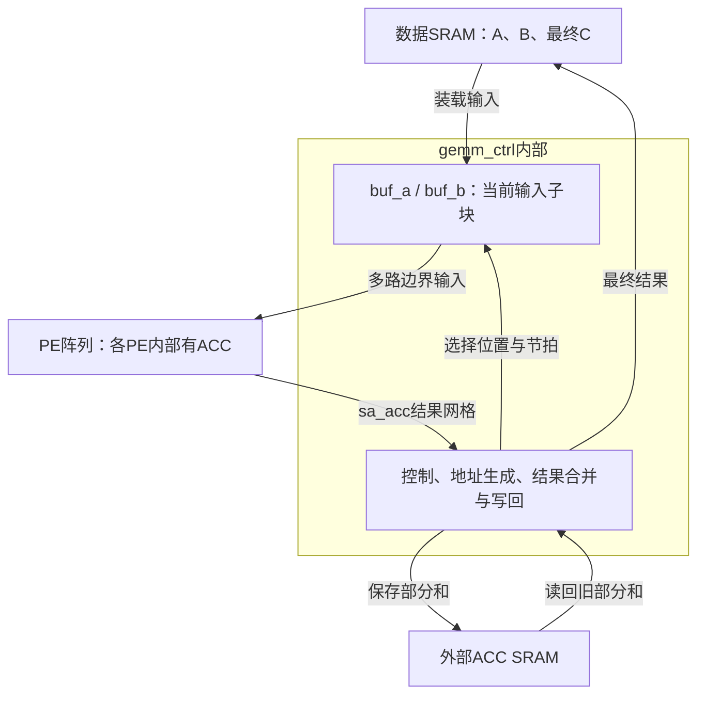

# tiny-NPU快速复习：从MAC到GEMM控制与后处理

日期：2026-11-06。用途：恢复已有学习框架，衔接SRAM/Bank/Buffer。依据仓库内现有讲义和2026-10-31交接摘要；沿用上游固定版本8216c22b762011aa20c05fc2768423fd12dda59d，不代表已核对上游最新代码。

## 1. 我们学到哪里了

已经讲过GEMM这条主线：单个乘加器→单个PE→二维阵列→GEMM控制器→独立后处理模块。之前明确理解过mac_int8、pe和阵列主体；后续逐项补充了buffer、外部ACC、归约维度、地址和写回时序。讲解过不等于已经全部掌握，本次用于恢复关键联系。

| 文件 | 一句话职责 |
|---|---|
| rtl/gemm/mac_int8.sv | 一组INT8输入相乘，再累加到本地32位ACC |
| rtl/gemm/pe.sv | 调用MAC，并把A向东、B向南各转发一拍；选择INT8/FP16路径 |
| rtl/gemm/systolic_array.sv | 把PE连接成默认16×16阵列 |
| rtl/gemm/gemm_ctrl.sv | 管理命令、分块、输入装载、阵列节拍和结果写回 |
| rtl/gemm/gemm_post.sv | 独立的逐元素bias/量化/ReLU后处理设计 |

mac_fp16.sv的设计意图是FP16乘法生成FP32乘积，再做FP32累加，但此前发现数值实现问题；不要把它当成已验证正确的浮点IP。

## 2. 先恢复硬件位置与数据流

| 名字 | 保存的内容 | 位置/作用 |
|---|---|---|
| 数据SRAM | 原始A/B、最终C | 控制器通过端口访问 |
| buf_a[i][k] | 当前A子块 | gemm_ctrl内部输入buffer |
| buf_b[k][j] | 当前B子块 | gemm_ctrl内部输入buffer |
| PE内部ACC | 当前K块的计算部分和 | 每个PE自己保存 |
| 外部ACC SRAM | 前面K块的部分和 | 阵列之外的独立存储；不是说它在芯片外 |
| sa_acc[i][j] | 对应PE的ACC输出信号 | 连接网格，不是额外复制的一块存储 |

默认外部ACC SRAM为256×32bit，即1KiB，用来保存当前输出tile的部分和。输入buffer的具体物理映射需看综合；RTL数组不自动等于SRAM宏。

gemm_post不是这张图上自动接在控制器后的必经模块。此前核对的Graph Mode路径由gemm_ctrl自身做最终转换和写回；使用独立后处理模块需要顶层明确连接和派发。

## 3. 数学维度如何落到PE

统一使用：

$$A[M,K]\times B[K,N]=C[M,N],\qquad C[i,j]=\sum_{k=0}^{K-1}A[i,k]B[k,j].$$

- M：输出行数。
- N：输出列数。
- K：每个输出需要相加的乘积项数，即归约维度。
- PE(i,j)：负责当前输出子块的一个C[i,j]，沿时间接收各个k的操作数对。
- 物理阵列16×16，与整张矩阵M/N/K是不同概念；超出容量需分块。

例如K=32分成两块16项：先算出前16项部分和20并保存到外部ACC SRAM；清PE的ACC，再算后16项得到30；控制器读回旧20并合并得到50。输入buffer存操作数，ACC存计算结果，不能混淆。

## 4. 恢复阵列的时钟概念

INT8 MAC有两级：product寄存器→ACC寄存器。同一上升沿使用旧寄存器值，所以某组输入在E_t采样，其乘积到E_(t+1)才进入ACC。

PE在本地采样计算的同时，把输入存入转发寄存器；邻居要到下一沿才能采样这份新输出。因此A每向东一格、B每向南一格，都要一拍。

为了使同一个k的操作数匹配，边界输入要错拍：

$$A[i,k]\text{在 }t=i+k\text{ 注入},\qquad B[k,j]\text{在 }t=j+k\text{ 注入}.$$

两者在PE(i,j)的t=i+j+k同时到达。当前实现A/B移动、ACC留本地，是输出驻留特征。

用熟悉的例子恢复直觉：

$$A=\begin{bmatrix}1&2\\3&4\end{bmatrix},\quad
B=\begin{bmatrix}5&6\\7&8\end{bmatrix},\quad
C=\begin{bmatrix}19&22\\43&50\end{bmatrix}.$$

| 流式拍号 | A左入口 | B上入口 |
|---:|---|---|
| 0 | [1,0] | [5,0] |
| 1 | [2,3] | [7,6] |
| 2 | [0,4] | [0,8] |
| 3及以后 | [0,0] | [0,0] |

拍3边界已经全0，但PE11此时才采样最后乘积4×8；拍4后ACC才得到50。填0期间仍需保持阵列流动，不能只因边界没有新数据就关闭全局en。

清ACC要在第一组有效输入之前安排独立清零拍；清零也有延迟控制，错误地与首输入重叠会丢第一项。

对有效块m×n、归约长度k，无额外边界流水时，以首拍计入的槽数为口径：

| 结束事件 | 槽数 |
|---|---:|
| 采样完最后有用乘积 | k+m+n−2 |
| 当前INT8流水完成最后ACC | k+m+n−1 |
| 当前控制器结束STREAM | k+m+n |

不要只背一个公式，而要先确定统计的结束事件。

## 5. gemm_ctrl怎么组织一次任务

| 阶段 | 状态 | 关键动作 |
|---|---|---|
| 接任务 | IDLE | 保存命令地址、尺寸、模式 |
| 准备 | SETUP / TILE_SETUP | 计算块数、当前有效尺寸与基址，初始化局部进度 |
| 装载 | LOAD_A / LOAD_B | 窄接口逐元素填buffer |
| 计算 | CLEAR / STREAM | 清ACC，按拍选择边界元素，排空流水 |
| 保存 | STORE | 写部分和或最终输出 |
| 继续/结束 | TILE_NEXT / DONE | K优先、然后N/M推进；全部完成后给done |

关键变量只需先恢复这几组：

| 变量 | 作用/单位 |
|---|---|
| r_M/N/K、r_src0/1/dst | 保存本次命令，不依赖上游一直保持 |
| m_eff/n_eff/k_eff | 当前子块有效元素数量 |
| *_tile_r / *_tiles_r | 当前块编号 / 总块数，注意有无s |
| a/b/c_tile_base | 当前子块在原存储布局中的起点 |
| load_row/col、store_row/col | 当前输入/输出的元素坐标 |
| load_phase | 发读请求还是捕获返回值 |
| load_byte、store_byte | FP16低字节还是高字节 |
| lo_byte | 已读回的低字节暂存 |
| stream_cnt | 当前流式拍号t |
| stream_total | 最后拍号k_eff+m_eff+n_eff−1，不是拍数 |
| store_phase | 跨K部分和的读/合并写阶段 |

STREAM通过 `idx_a=t-i`、`idx_b=t-j` 从buffer选择数据，越界送0。计数从0到stream_total且包含末拍，因此实际拍数还需加1。

写回时，组合电路用当前坐标选择数据与地址；上升沿SRAM接收当前写入，坐标寄存器同时按旧值计算下一位置。沿后新坐标准备下一项。INT8单K块每拍推进；FP16要高低字节都写完才推进。

`sa_acc[store_row[3:0]][store_col[3:0]]`截取的是行列索引低4bit，选择完整ACC；默认元素占4Byte来自32位ACC宽度，不是来自[3:0]。

## 6. 地址与精度只恢复两条规则

**地址先按单位理解。**

$$addr_{byte}=base_{byte}+(row\times stride_{elem}+col)\times bytes\_per\_elem+byte\_sel.$$

当前tile仍按原矩阵行跨度寻址；普通B布局的跨度是N，Bᵀ存储布局跨度是K、读地址中的行列交换，但读回buffer仍按逻辑B[k][j]组织。

**传输次数由接口宽度决定。** 数据SRAM接口默认8bit，INT8一个元素1Byte、FP16一个元素2Byte。因此FP16需要先读低字节到lo_byte，再读高字节，拼成完整16位进入buffer。当前请求/捕获安排使FP16装载每元素需4个状态周期，PE输入处使用完整FP16编码。

## 7. 最新讲过的gemm_post

它处理已经得到的ACC数值，设计意图为：可选bias加法→再量化或直接INT8饱和→可选ReLU→结果写回。

| 变量/状态 | 要记住什么 |
|---|---|
| acc_val | 保存当前读回的32位ACC |
| result | 保存准备写出的默认8位结果 |
| elem_cnt / total_elems | 当前编号 / 总数量，默认0～255共256项 |
| READ / WAIT | 发一次请求，再等待acc_rd_valid并捕获 |
| PROCESS / WRITE | 处理并保存result，再写出并推进编号 |
| IDLE / DONE | 接命令 / 报告结束 |

最快通常4拍一项：READ、WAIT、PROCESS、WRITE。没有多元素重叠，也没有结果写ready。

尚需记住的原码限制：ReLU判断了旧result；FP16只写低8位；总数固定、基址固定0；scale/shift没有作为命令寄存器锁存。此前仅解释了修正思路，没有改RTL或运行HDL仿真。

## 8. 继续学习时保留的设计方法

- 先画数据存储与运算资源，再写状态机。
- 把字节、元素、tile、命令分层，当前事务完成后才推进上一层进度。
- 分清组合输出、当前寄存器值和下一沿更新值；同沿读旧值是时序分析基础。
- 一个元素的计算完成、最终写入完成与整条命令done是不同事件。
- 总时延包含装载、计算、部分和搬运与写回；只有真实支持重叠时才能隐藏一部分时间。

阵列acc_valid没有K信息且未接入实际完成控制；FP16算术与跨K合并存在已记录的问题。先沿INT8主路径恢复结构即可，无需把复习变成源码修复工程。

## 9. 下一讲怎样衔接

建议从 `rtl/mem/sram_dp.sv` 开始学习SRAM/Bank/Buffer：先确定存储容量、端口、使能和同步读写时序，再逐行读RTL；之后看banked_sram与tile_buffer，最后回到GEMM顶层的实际连线。

独立tile_buffer模块与gemm_ctrl内部buf_a/b不是自动同一个东西。存储学习将帮助解释：为什么装载要等、两个端口能同时做什么、多个计算单元怎样共享存储、buffer怎样改善供数。

详细旧笔记见同目录：lesson-04-systolic-array.md、lesson-05-gemm-code-walkthrough.md、lesson-05-gemm-controller-design-patterns.md、lesson-05-gemm-post.md。本次是复习整理，没有新增RTL实验或修复结论。
