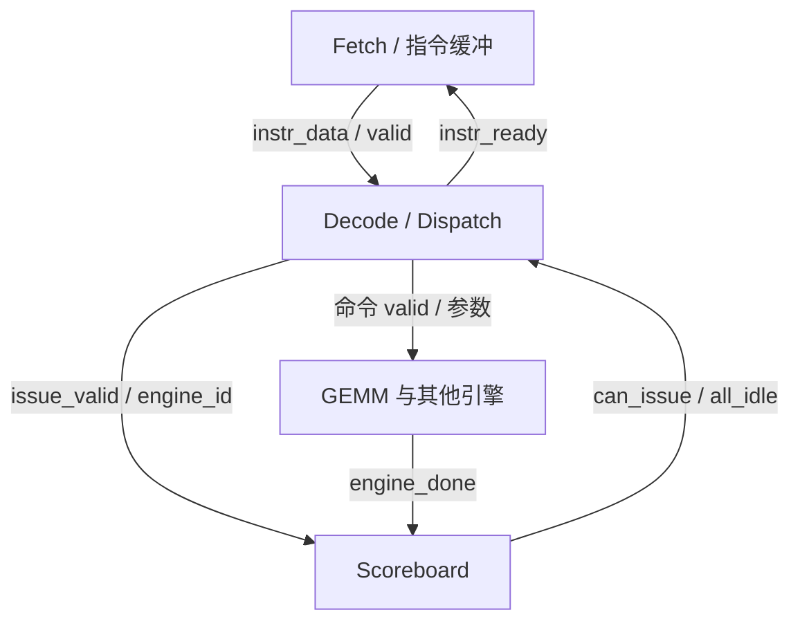
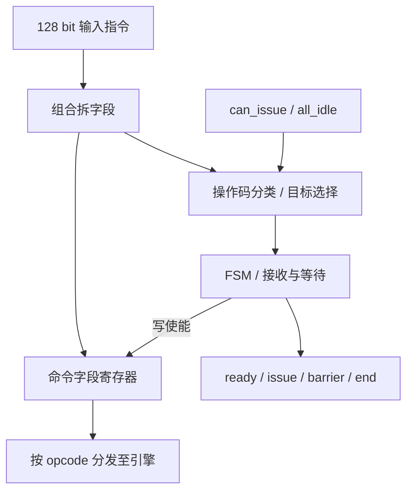

# 第 08 讲（下）：微码译码与命令分发 ucode_decode

固定源码版本：[harishsg993010/tiny-NPU@8216c22](https://github.com/harishsg993010/tiny-NPU/tree/8216c22b762011aa20c05fc2768423fd12dda59d)。本讲顺序为硬件结构、指令/数据/控制流、信号位宽、源码顺序和逐拍时序。所有周期表是源码推导，不是仿真结果。

## 一、本模块解决什么问题

上讲 Fetch 将 128 bit 指令交给 Decode。本讲回答：

1. 这条指令要驱动哪个引擎？
2. 引擎忙时，是否可以接受新指令？
3. 指令中的地址和维度怎样变成命令端口？
4. 什么时候登记引擎忙？怎样等待依赖？

Decode 本身不做 GEMM，不读矩阵数据。它是**指令译码与发射控制**，将指令字段翻译成下游控制信息。

### 系统位置



模块内部可分成 4 块：



这里 Scoreboard 记录引擎忙闲，不跟踪任意 SRAM 地址的读写依赖。不同引擎能否并行仍需软件安排同步和内存资源；指令之间数据依赖需要正确的 Barrier 等机制。

**顶层范围**：固定版本 `rtl/top.sv` 中计算引擎 GEMM 等是计时产生 done 的占位，真实运算核未在此顶层接通。另一个仿真顶层可以连接真实计算 RTL 与 C++ DMA shim，不能把两个顶层的行为混成一个硬件系统。

## 二、三条流先看懂

### 1. 指令流

Fetch 输出 `instr_data` 和 `instr_valid`。Decode 组合拆字段、检查 opcode 和忙闲；只有 `instr_valid && instr_ready` 在上升沿同时为 1，才代表 Fetch 与 Decode 完成一条指令的交接。

例如约定：

- `opcode=OP_GEMM=8'd3`；
- `src0=16'h0100`、`src1=16'h0300`、`dst=16'h0500`；
- `M=2,N=3,K=4`；`flags=0,imm=0`。

其中 A 为 2×4，B 为 4×3，C 为 2×3；地址字段是按下游存储接口解释的位置，不包含实际矩阵元素。128 bit 编码为 `128'h0000_0004_0003_0002_0300_0100_0500_0003`。握手沿后，字段进入命令寄存器，GEMM 的 valid 与参数出现在输出端。

### 2. 数据流

本模块的数据是“指令信息”和“命令参数”，不是乘数矩阵：

`instr_data → dec_*组合字段 → cmd_*_q寄存器 → 各引擎参数`。

有效命令由对应的 `*_cmd_valid` 标明。参数端口即使 valid=0 也可能维持旧值，不能单看地址是否变化判断有新命令。

### 3. 控制流

`instr_valid + opcode + can_issue + state_q` 决定 `instr_ready` 和下一状态。若目标引擎空闲，握手时保存指令并准备 issue 脉冲；发射后 Scoreboard 在**下一个沿**采样 issue、设置 busy；引擎稍后返回 done 清除对应 busy。Barrier 指令在 Decode 自身 D_BARRIER 中等待 all_idle。

## 三、接口、位宽和单位

`INSTR_W` 默认 128 bit。代码字段切片固定访问到 bit 127，因此这里默认按 128 bit 指令理解，不宜任意缩小参数。

| 接口 | 方向 / 宽度 | 实际含义 |
|---|---|---|
| clk、rst_n | 输入，各 1 bit | 时钟，低有效异步复位 |
| instr_valid | 输入 1 bit | Fetch 有一条有效待交付指令 |
| instr_data | 输入 INSTR_W bit | 指令内容 |
| instr_ready | 输出 1 bit | Decode 当前愿意接收；本代码还取决于 instr_valid |
| can_issue | 输入 8 bit | 每位表示对应引擎可发射，索引为引擎 ID |
| all_idle | 输入 1 bit | Scoreboard 中所有受管理引擎均空闲 |
| 各 `*_cmd_valid` | 输出各 1 bit | 指示对应命令有效；输出没有 cmd_ready 握手 |
| 地址 src/dst/gamma/sin/cos | 输出各 16 bit | 各操作指定的存储位置/地址字段，解释取决于目标引擎 |
| M/N/K、len、rows、head_dim、pos_offset | 输出各 16 bit | 参数；维度通常以元素、行或位置计，具体依 opcode |
| flags | 输出 8 bit | 不同操作复用的控制标志 |
| imm | 输出 16 bit | 即时参数，依 opcode 改变含义 |
| barrier_trigger | 输出 1 bit | Barrier 指令接收后的寄存脉冲 |
| issue_valid | 输出 1 bit | 发射通知，供 Scoreboard 采样 |
| issue_engine_id | 输出 3 bit | 目标引擎编号 |
| decoded_instr | 输出 128 bit packed struct | 寄存命令字段的调试视图 |
| program_end | 输出 1 bit | Decode 接收 END 后产生的寄存脉冲 |

**每组输出的完整映射**：

| 引擎 | valid 对应 opcode | 命令参数 |
|---|---|---|
| GEMM | GEMM | src0、src1、dst、M、N、K、flags |
| Softmax | SOFTMAX | src0、dst、len=N、flags |
| LayerNorm | LAYERNORM | src0、dst、len=N、flags |
| GELU / SiLU | GELU 或 SILU | src0、dst、len=N、flags；另有 silu_mode |
| Vec | VEC | src0、src1、dst、len=N、flags、imm |
| DMA read | DMA_LOAD | src=src0、dst、len=N、flags |
| DMA write | DMA_STORE | src=src0、dst、len=N、flags |
| KV | KV_APPEND / KV_READ | opcode、src0、dst、len=N、flags、imm |
| RMSNorm | RMSNORM | src0、dst、len=N、gamma=src1 |
| RoPE | ROPE | src0、dst、num_rows=M、head_dim=N、pos_offset=K、sin_base=src1、cos_base=imm |

**DMA 长度以本文件实际连线为准：len=cmd_n_q。** 上游 README 的 ISA 表曾写 DMA 长度使用 M，与该 RTL 存在差异；不能混用。

## 四、按源码顺序精读

源码入口：[ucode_decode.sv](https://github.com/harishsg993010/tiny-NPU/blob/8216c22b762011aa20c05fc2768423fd12dda59d/rtl/ctrl/ucode_decode.sv)。

### 4.1 模块声明、参数和端口

逻辑：导入 `npu_pkg` 和 `isa_pkg`，使用共同定义的引擎编号、opcode 和 packed struct；建立从 Fetch 到 Scoreboard 和引擎的输入输出。端口见上表。

`input/output logic` 描述方向和类型，不意味着所有信号自动成为寄存器：需看赋值方式。当前 `instr_ready` 是组合输出，`cmd_*_q` 是时钟沿更新的寄存器。

### 4.2 状态枚举

逻辑：Decode 三状态，每个 2 bit；它与 Fetch 的六状态是两个并发状态机。

```systemverilog
typedef enum logic [1:0] {
    D_IDLE    = 2'd0,
    D_DECODE  = 2'd1,
    D_BARRIER = 2'd2
} decode_state_e;
decode_state_e state_q, state_d;
```

| 状态 | 作用 |
|---|---|
| D_IDLE | 指令有效时分类、判断是否可接收 |
| D_DECODE | 已接受普通命令后的一个周期，准备回 IDLE；此时对应寄存命令有效 |
| D_BARRIER | 等待 all_idle；instr_ready 保持 0 |

`_q` 是当前状态寄存器值，`_d` 是组合算出的下一状态。一个上升沿将 d 采样到 q。

### 4.3 组合拆分字段

逻辑：对输入指令进行固定切片；硬件上主要是接线，不是时钟驱动顺序读取。字段可以一直随 instr_data 变化，但只有满足 valid/ready 接收时才作为有效指令保存。

```systemverilog
dec_opcode    = instr_data[7:0];
dec_flags     = instr_data[15:8];
dec_dst_base  = instr_data[31:16];
dec_src0_base = instr_data[47:32];
dec_src1_base = instr_data[63:48];
dec_m         = instr_data[79:64];
dec_n         = instr_data[95:80];
dec_k         = instr_data[111:96];
dec_imm       = instr_data[127:112];
```

opcode、flags 各 8 bit，其余各 16 bit。示例 GEMM 指令的 `dec_opcode=3, dec_m=2, dec_n=3, dec_k=4`。

### 4.4 opcode → 目标引擎

逻辑：对 opcode 做比较，输出目标引擎 ID 和特殊指令类型；通过该 ID 选择 `can_issue` 中的一位。

| 变量 | 位宽 | 作用 |
|---|---:|---|
| target_engine | 3 | 目标引擎 ID |
| target_valid | 1 | 是映射到引擎的普通操作 |
| target_is_barrier | 1 | opcode 是 Barrier |
| target_is_end | 1 | opcode 是 END |
| target_is_nop | 1 | NOP 或未识别 opcode |
| engine_free | 1 | can_issue[target_engine] |

部分映射：GEMM→0，SOFTMAX→1，LAYERNORM→2，GELU/SILU→3，VEC→4，DMA_LOAD/STORE 与 KV→5，RMSNORM→6，ROPE→7。具体常量定义于 [npu_pkg.sv](https://github.com/harishsg993010/tiny-NPU/blob/8216c22b762011aa20c05fc2768423fd12dda59d/rtl/pkg/npu_pkg.sv)。

示例代码：

```systemverilog
OP_GEMM: begin
    target_engine = ENG_GEMM;
    target_valid  = 1'b1;
end
// ...
engine_free = can_issue[target_engine];
```

`can_issue[target_engine]` 是动态位选择：GEMM 的 ID 为 0，因此读取 bit 0。未知 opcode 在 default 分支被当作 NOP 消费，不会由这里自动报错。

固定 top 的 Scoreboard 只管理 6 个引擎，位 6、7 补成 1；但 RMSNorm / RoPE 输出未连接。因此位 6/7 显示可发射不代表对应真实引擎在该 top 存在。

### 4.5 命令寄存器与下一值

逻辑：握手时把字段保存在寄存器；输出通过这些稳定值驱动命令。普通命令的 valid 和 issue 是脉冲，字段没新命令时保持之前的值。

| q/d 变量 | 位宽 | 含义 |
|---|---:|---|
| cmd_valid_q/d | 1 | 寄存后的普通命令有效脉冲 |
| cmd_opcode_q/d、cmd_flags_q/d | 各 8 | 保存操作类型、标志 |
| cmd_dst_q/d、cmd_src0_q/d、cmd_src1_q/d | 各 16 | 保存目标、源地址字段 |
| cmd_m_q/d、cmd_n_q/d、cmd_k_q/d、cmd_imm_q/d | 各 16 | 保存维度及附加参数 |
| cmd_engine_q/d | 3 | 发射目标引擎 ID |
| issue_valid_q/d | 1 | 发射通知脉冲 |
| barrier_trigger_q/d | 1 | Barrier 通知脉冲 |
| program_end_q/d | 1 | END 通知脉冲 |

组合块每次计算开头：字段 `*_d=*_q` 保持；`cmd_valid_d、issue_valid_d、barrier_trigger_d、program_end_d` 默认置 0。这样无新事件时脉冲下一沿撤销，字段不必清零。

### 4.6 FSM 和发射逻辑：普通指令

逻辑：D_IDLE 看到 instr_valid 后依次识别 END、NOP、Barrier、普通目标引擎；普通指令只有目标空闲才将 ready 置 1 并准备存字段。

```systemverilog
state_d       = state_q;
instr_ready   = 1'b0;
cmd_valid_d   = 1'b0;
issue_valid_d = 1'b0;
// 各字段默认保持 ...

if (instr_valid) begin
    // 特殊指令分支 ...
    if (target_valid && engine_free) begin
        instr_ready   = 1'b1;
        cmd_valid_d   = 1'b1;
        cmd_opcode_d  = dec_opcode;
        cmd_flags_d   = dec_flags;
        cmd_dst_d     = dec_dst_base;
        cmd_src0_d    = dec_src0_base;
        cmd_src1_d    = dec_src1_base;
        cmd_m_d       = dec_m;
        cmd_n_d       = dec_n;
        cmd_k_d       = dec_k;
        cmd_imm_d     = dec_imm;
        cmd_engine_d  = target_engine;
        issue_valid_d = 1'b1;
        state_d       = D_DECODE;
    end
end
```

上述只摘取普通路径，实际源码为 `else if` 链。若引擎 busy，ready 保持 0，字段不采样；假定上游遵守 valid/ready，Fetch 会保持待交付指令。注意此代码在 instr_valid=0 时 ready=0，不是一个始终主动预告空闲的 ready。

一个重要边界：Decode 对引擎没有 cmd_ready 输入，它依赖 Scoreboard 的忙闲和既定模块时序安排；不能把其输出自动当作具备 ready/valid 完整握手的接口。

### 4.7 特殊指令和等待

- END：ready=1，`program_end_d=1`，保持 IDLE；但当前 Fetch 已提前拦截 END，所以这一路只有其他上游直接向 Decode 提供 END 才能触发。
- NOP 和未知 opcode：ready=1，消费指令但不发引擎命令。
- Barrier：ready=1 接收，`barrier_trigger_d=1`，进入 D_BARRIER；D_BARRIER 中 `instr_ready=0`，直到采样 `all_idle=1` 的时钟沿才回 IDLE。
- 普通命令进入 D_DECODE；该状态默认 ready=0，下一沿回 IDLE。

代码中的独立 barrier 模块接收 barrier_trigger 和 all_idle，但固定 top 的 `barrier_stall` **并未反馈给 Decode**；真正让 Decode 停止接收的是它自己的 D_BARRIER 和 all_idle 逻辑。

### 4.8 时序寄存器块

逻辑：异步复位将状态与命令寄存器、脉冲寄存器清零；否则在每个上升沿采样 d。

```systemverilog
always_ff @(posedge clk or negedge rst_n) begin
    if (!rst_n) begin
        state_q       <= D_IDLE;
        cmd_valid_q   <= 1'b0;
        issue_valid_q <= 1'b0;
        // 其他寄存器复位为 0
    end else begin
        state_q       <= state_d;
        cmd_valid_q   <= cmd_valid_d;
        issue_valid_q <= issue_valid_d;
        // 其他 q <= 相应 d
    end
end
```

非阻塞赋值意味着本沿所有时序块读到的是沿前旧值：Decode 在 E0 沿才更新 issue_valid_q，Scoreboard 不能在同一个 E0 沿读到刚生成的新值，要等 E1 沿。

### 4.9 输出命令路由

逻辑：每条命令的寄存字段共享一套寄存器，通过 opcode 比较产生目标模块的 valid；没有发给某引擎时，该引擎的参数也可能有旧数据。

```systemverilog
assign gemm_cmd_valid = cmd_valid_q && (cmd_opcode_q == OP_GEMM);
assign gemm_cmd_src0  = cmd_src0_q;
assign gemm_cmd_src1  = cmd_src1_q;
assign gemm_cmd_dst   = cmd_dst_q;
assign gemm_cmd_m     = cmd_m_q;
assign gemm_cmd_n     = cmd_n_q;
assign gemm_cmd_k     = cmd_k_q;
assign gemm_cmd_flags = cmd_flags_q;
```

其余输出的完整字段映射见第三节。特殊输出 `barrier_trigger=barrier_trigger_q`、`issue_valid=issue_valid_q`、`issue_engine_id=cmd_engine_q`、`program_end=program_end_q`。最后 `decoded_instr` 由 cmd_*_q 按字段组合构造，是寄存命令的调试视图；在无有效命令时仍可能显示旧内容。

## 五、关联 Scoreboard：时钟沿为什么差一拍

源码：[scoreboard.sv](https://github.com/harishsg993010/tiny-NPU/blob/8216c22b762011aa20c05fc2768423fd12dda59d/rtl/ctrl/scoreboard.sv)。核心：

```systemverilog
assign engine_busy = busy_q;
assign can_issue   = ~busy_q;
assign all_idle    = (busy_q == '0);
```

`issue_valid` 与对应 3 bit ID 组合译为 one-hot；寄存 busy_q 对应位。done 会清对应位。源码最后一个循环明确规定：若相同引擎在同周期同时 issue 和 done，则 **done 清零优先**；注释里有互相矛盾的描述，须以最后赋值逻辑为准。遇到这种情况新 issue 可能被忽略，不能根据注释断言必然安全。

## 六、周期例子：正常 GEMM

假设沿前 Decode 在 IDLE、Fetch 正提供本讲 GEMM、`can_issue[0]=1`、引擎在命令有效的下个沿采样；Scoreboard 和 Decode 均正常复位。为了聚焦 Decode，本表不假设矩阵实际算出，也不以顶层 stub 计时作为计算性能。

| 上升沿 | 沿前条件 | 该沿采样 / 动作 | 沿后结果 |
|---|---|---|---|
| E0 | IDLE，instr_valid=1，GEMM free；ready=1 | Fetch→Decode 握手，Decode 保存字段 | D_DECODE，gemm_cmd_valid=1，issue_valid=1，cmd_engine=0；busy 位仍是旧值 |
| E1 | D_DECODE，issue_valid=1，GEMM 命令有效 | 引擎和 Scoreboard 采样命令/issue | IDLE，cmd_valid=0，issue_valid=0，busy[0]=1、can_issue[0]=0 |
| E2… | GEMM 尚未 done | Scoreboard 保持 busy | 目标引擎不能再接收新 GEMM |
| E_done | engine_done[0]=1，先前 busy=1 | Scoreboard 清 busy[0] | can_issue[0]=1；后续可再握手 |

如果 Decode 在同一时刻出现其他引擎指令，该模块是否接收还取决于 D_IDLE、目标 busy 和上游实际送达时刻。引擎完成不一定等同整个程序结束。

## 七、周期例子：目标引擎忙导致反压

假设 Decode 已在 IDLE，当前待接收 GEMM，Fetch 保持 valid 和指令，busy[0]=1。

| 上升沿 | 沿前信号 | 沿后效果 |
|---|---|---|
| B0 | valid=1，can_issue[0]=0，ready=0 | 未握手，Fetch 保持指令，Decode 留在 IDLE |
| B1 | 同上，且 engine_done[0]=1 | 此沿仍未握手；Scoreboard 沿后清 busy、can_issue 变 1 |
| B2 | valid=1，can_issue[0]=1，ready=1 | 握手；沿后进入 D_DECODE，命令/issue 有效 |
| B3 | issue_valid=1 | Scoreboard 采样 issue；沿后 busy[0]=1 |

B1 的 done 无法在同一采样沿让 Decode 看见更新后的 busy；ready 是由**沿前** busy_q 产生的。

## 八、周期例子：Barrier 等待

假设 Barrier 到达并在 C0 成功交接，之前命令已登记 busy、all_idle=0。另假设某引擎 done 在 C1 沿前有效，且没有其他忙引擎，也没有新的 issue。

| 上升沿 | 沿前状态 / 信号 | 该沿动作 | 沿后结果 |
|---|---|---|---|
| C0 | D_IDLE，valid=1，opcode=BARRIER，ready=1，all_idle=0 | 接收 Barrier | D_BARRIER，barrier_trigger=1 |
| C1 | D_BARRIER，all_idle=0，engine_done=1 | Decode 仍等待；Scoreboard 清 busy | all_idle=1，Decode 仍在 D_BARRIER，ready=0 |
| C2 | D_BARRIER，all_idle=1 | 采样 all_idle | 进入 D_IDLE；随后可按下一条指令及 can_issue 组合计算 ready |
| C3 | 若下条有效且目标空闲，则 ready=1 | 下一条可握手 | 进入对应执行路径 |

条件是先前 issue 已被 Scoreboard 登记；Barrier 只依靠 all_idle，不能替代对存储器实际写入完成的完整验证。

## 九、边界清单与下一步

- Fetch 当前拦截 END，Decode 里的 END 分支不能当成当前 Fetch 路径下一定执行。
- 当前 top 的计算引擎是 stub；decode 能输出命令不代表真实 GEMM 已运行。
- DMA 的 len 在本 RTL 从 N 获取；不同文档如有冲突先以具体使用源码为准。
- Scoreboard 管理引擎而非任意地址依赖；done 与 issue 同拍的优先级以 RTL 为准。
- 所列逐拍表为静态推导，未执行 HDL 仿真。
- 下一步可结合具体疑问深入 `scoreboard.sv`、Barrier 实现，或追踪真实仿真顶层的引擎命令连接。

参考：[ucode_decode.sv](https://github.com/harishsg993010/tiny-NPU/blob/8216c22b762011aa20c05fc2768423fd12dda59d/rtl/ctrl/ucode_decode.sv)、[scoreboard.sv](https://github.com/harishsg993010/tiny-NPU/blob/8216c22b762011aa20c05fc2768423fd12dda59d/rtl/ctrl/scoreboard.sv)、[isa_pkg.sv](https://github.com/harishsg993010/tiny-NPU/blob/8216c22b762011aa20c05fc2768423fd12dda59d/rtl/pkg/isa_pkg.sv)、[top.sv](https://github.com/harishsg993010/tiny-NPU/blob/8216c22b762011aa20c05fc2768423fd12dda59d/rtl/top.sv)。
