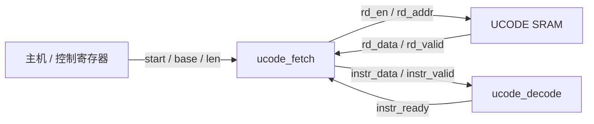

# 第 08 讲（上）：微码指令、指令 SRAM 与取指控制器

本讲是 tiny-NPU 项目主线，基于 [固定版本 8216c22](https://github.com/harishsg993010/tiny-NPU/tree/8216c22b762011aa20c05fc2768423fd12dda59d)。讲解顺序：硬件结构 → 变量含义和单位 → 数据与控制流 → 源码 → 时序。仅按源码分析，没有修改上游 RTL 或运行仿真。

## 1. 在整个 NPU 中的位置

Fetch 是取指控制器：按指令序号发起 SRAM 读请求，等返回值，缓存指令并交给 Decode。它**不执行矩阵乘法**；Decode 决定后续命令。128 bit 指令是读出的数据；start、rd_en 和 valid/ready 是组织传输的控制信号。

在固定版本的 [rtl/top.sv](https://github.com/harishsg993010/tiny-NPU/blob/8216c22b762011aa20c05fc2768423fd12dda59d/rtl/top.sv) 中，UCODE SRAM 为 128 bit × 默认 1024 条，A 口由 Fetch 读取，B 口写使能关闭；因此不能称该顶层已经支持通过主机或 DMA 写入微码。仿真顶层 [gpt2_block_top.sv](https://github.com/harishsg993010/tiny-NPU/blob/8216c22b762011aa20c05fc2768423fd12dda59d/sim/verilator/gpt2_block_top.sv) 有测试端口装载微码，它是另一条集成路径。

## 2. 一条指令是什么

指令是预先编码的 128 位二进制信息。其字段由具体指令决定含义：

| 位段 | 字段 | 示例含义 |
|---|---|---|
| [7:0] | opcode | 做哪种操作 |
| [15:8] | flags | 模式标志 |
| [31:16] | dst | 目标地址字段 |
| [47:32] | src0 | 第一个源地址字段 |
| [63:48] | src1 | 第二个源地址字段 |
| [79:64] | M | GEMM 的 M |
| [95:80] | N | GEMM 的 N |
| [111:96] | K | GEMM 的 K |
| [127:112] | imm | 依操作而定的附加参数 |

例如 GEMM 一条指令说“使用 A 地址、B 地址、输出地址和 M/N/K 执行矩阵乘”。地址字段是位置，不是矩阵本身。Fetch 对整条指令做什么理解？它只检查低 8 bit 是否 OP_END；其他字段保持原样交给 Decode。

## 3. 指令存储与地址

默认 UCODE SRAM 的每个存储单元是 128 bit，即一条指令。Fetch 的：

- `pc`：相对当前程序的**指令序号**，从 0 开始。
- `ucode_base_addr`：指令 SRAM 中的程序基址，按 SRAM 词寻址。
- `rd_addr = base_q + pc_q`：读哪一条指令，而不是按 8 bit 字节地址每次加 16。
- `ucode_len`：最大指令条目数，不是 byte 数。

若基址为 4、长度 3，且前面没有遇到 END，理论读地址是 4、5、6。实际应保证地址可由存储深度正确表示，避免越界或地址截断。

模块本身 `SRAM_ADDR_W=12`；top 实例化时传入 `P_SRAM_ADDR_W=16`，但默认 1024 深度的 SRAM 实际地址口只用低 10 位。默认 top 的基址直接接零，长度取寄存器低 16 位；不能把理论 16 bit 地址空间等同于 SRAM 实际深度。

## 4. 接口信号表

| 信号 | 方向 | 宽度 | 单位或用途 |
|---|---|---|---|
| clk / rst_n | 输入 | 各 1 bit | 时钟、低有效异步复位 |
| start / stop | 输入 | 各 1 bit | 启动请求、停止请求 |
| ucode_base_addr | 输入 | SRAM_ADDR_W | 指令 SRAM 基址，单位：指令词 |
| ucode_len | 输入 | SRAM_ADDR_W | 程序长度，单位：指令条 |
| rd_en | 输出 | 1 bit | 请求 SRAM 读 |
| rd_addr | 输出 | SRAM_ADDR_W | 读指令词地址 |
| rd_data | 输入 | INSTR_W，默认 128 bit | SRAM 返回的指令 |
| rd_valid | 输入 | 1 bit | SRAM 返回值有效 |
| instr_valid | 输出 | 1 bit | Fetch 当前给 Decode 提供有效指令 |
| instr_ready | 输入 | 1 bit | Decode 当前准备好接收 |
| instr_data | 输出 | INSTR_W | 待交付的指令 |
| pc | 输出 | SRAM_ADDR_W | 当前指令相对序号 |
| busy / done | 输出 | 各 1 bit | 取指控制器忙 / 完成脉冲 |

注意 valid/ready 是一组交接；时钟沿前两者都为 1 才发生传输。如果 ready 为 0，S_DISPATCH 会保持状态和 instr_buf_q，使 instr_data 保持稳定。

## 5. 内部硬件与两个层次的控制

`pc_q` 保存当前序号，`base_q`、`len_q` 在 IDLE 接受 start 时采样，`instr_buf_q` 保存已返回的指令，`done_q` 保存完成脉冲；`state_q` 保存当前 FSM 状态。以 `_d` 结尾的对应变量是下一时刻的值。组合逻辑先把 d 默认设为 q 以保持，再根据状态覆盖；时钟上升沿将 d 装入 q。

六个状态：

| 状态 | 主要行为 | 跳转条件 |
|---|---|---|
| S_IDLE | 等待 start；采样 base、len 并清零 pc | start → FETCH |
| S_FETCH | rd_en=1，rd_addr=base_q+pc_q | 下一沿进入 WAIT_DATA |
| S_WAIT_DATA | 等待 rd_valid | stop → DONE；返回 END → DONE；返回普通指令 → DISPATCH |
| S_DISPATCH | instr_valid=1，输出缓存指令 | stop → DONE；ready=1 → INCREMENT；否则等待 |
| S_INCREMENT | pc_d=pc_q+1；比较长度 | stop 或 pc_plus1≥len → DONE；否则 FETCH |
| S_DONE | 置 done_d=1，准备回 IDLE | 下一沿回 IDLE |

从 SRAM 来的 rd_valid 与从 Decode 来的 instr_ready 指向不同环节：前者表示存储器返回值，后者表示译码器能否接收。

## 6. 源码按顺序读

[ucode_fetch.sv](https://github.com/harishsg993010/tiny-NPU/blob/8216c22b762011aa20c05fc2768423fd12dda59d/rtl/ctrl/ucode_fetch.sv) 开头依次声明参数、端口、状态枚举和寄存器。然后：

1. `fetched_is_end = (rd_data[7:0] == OP_END)`：从 SRAM 返回数据最低 8 bit 判断终止。只有 WAIT_DATA 的 rd_valid 分支会使用判断。
2. `pc_plus1 = pc_q + 1`：按一条指令递增，结果仍为 SRAM_ADDR_W 位，超出位宽会截断。
3. `always_comb`：先给保持默认值和输出默认值，再用 case 根据 state_q 决定下一状态和输出。
4. `always_ff @(posedge clk or negedge rst_n)`：复位清零 q，否则将各 d 更新到 q。
5. `assign busy = (state_q != S_IDLE)`；`assign done = done_q`。两者含义不同，不能简单取反。

关于 END：在 WAIT_DATA 且 rd_valid=1 时，源码先令 instr_buf_d=rd_data；若 opcode 为 OP_END，下一状态直接为 S_DONE，不进入 S_DISPATCH，因此这条 END **不会经 instr_valid/ready 交给 Decode**。

## 7. 逐时钟沿推导：普通指令且 ready=1

假设：start 仅在 E0 前为 1；固定 top 的同步 SRAM 接线；读出普通指令 I0；stop=0；Decode 一直 ready=1；程序长度足够。E0 指第一个有效上升沿。下表“沿前”是该沿到来时的状态和输入，“沿后”是寄存器更新完成的结果。仅为源码推导，非仿真波形。

| 上升沿 | 沿前状态及信号 | 该沿发生 | 沿后状态与结果 |
|---|---|---|---|
| E0 | IDLE，start=1 | 采样 base/len，pc=0 | FETCH |
| E1 | FETCH，rd_en=1，rd_addr=base+0 | SRAM 接收读请求 | WAIT_DATA；同步 SRAM 的数据和延迟后的 rd_valid 在沿后有效 |
| E2 | WAIT_DATA，rd_valid=1 | Fetch 采样 rd_data 到 instr_buf | DISPATCH，instr_valid=1，instr_data=I0 |
| E3 | DISPATCH，valid=1、ready=1 | Decode 与 Fetch 完成握手 | INCREMENT |
| E4 | INCREMENT，pc_plus1<len | pc 更新为 1 | FETCH，下一读请求组合输出有效 |
| E5 | FETCH，rd_en=1，rd_addr=base+1 | SRAM 接收下一次请求 | WAIT_DATA |

为何 SRAM E1 更新输出而 Fetch 到 E2 才存入 instr_buf？两者都在 E1 上升沿触发非阻塞赋值，Fetch 在 E1 读取的是沿前值；SRAM 新数据在 E1 更新后出现，供 E2 采样。

如果 E3 前 instr_ready=0，Fetch 保持 DISPATCH，instr_valid=1 和 instr_buf 不变；哪一沿 ready=1，哪一沿发生握手，后续 INCREMENT 和下一次读请求整体后移。若同沿 stop=1 且 ready=1，valid 在 DISPATCH 仍为 1，接收端可能同时发生握手，stop 并不撤销已经成立的握手。

## 8. 结束和边界

### 按长度结束

假设最后一条普通指令在某沿握手，进入 INCREMENT；下一沿 pc_d=pc_plus1 且比较达到长度，进入 DONE；再下一沿 state 回 IDLE，同时 done_q 被置 1。该沿后 done=1、busy=0；再下一沿默认 done_d=0，done 清零。因此 S_DONE 状态与对外 done 脉冲不是同一个周期。

### 遇到 OP_END

WAIT_DATA 收到 END 时直接转 DONE，不再发给 Decode；下一沿回 IDLE 并出现 done 脉冲。Fetch 的 done 只表示取指流程结束，不能证明所有执行引擎结束或输出已经落存。

### stop 和异常输入

- 当前实现用全局 stop 覆盖下一状态，但没有清除所有组合输出：例如在 S_FETCH 期间，即使 stop=1，rd_en 仍为 1，SRAM 仍可能在该沿接受请求。
- 在 DISPATCH 时 stop 不撤销 valid；如果 ready 同时为 1，该沿仍可能完成指令交接。不能承诺 stop 取消已经发出或当拍发生的事务。
- ucode_len=0 并没有在 S_IDLE 或 S_FETCH 入口被检查；因此会先发起至少一次读请求，再根据返回数据和后续状态结束。不能假设零长度不访问 SRAM。
- 默认 top 的 stop 接 0；讨论 stop 是模块接口行为，不代表该顶层对外暴露了可用 stop 控制。
- base+pc、pc+1 使用固定宽度运算，且顶层实际 SRAM 地址更窄。软件或集成逻辑需要保证程序长度与地址范围合法。

## 9. 本讲之后的衔接

下一部分进入 Decode / Dispatch：指令字段如何映射到各引擎的命令、与 Scoreboard 的 can_issue 如何配合、Barrier 如何约束依赖。用户尚未确认掌握本讲，后续先回答具体问题。

## 参考源码

- [ucode_fetch.sv](https://github.com/harishsg993010/tiny-NPU/blob/8216c22b762011aa20c05fc2768423fd12dda59d/rtl/ctrl/ucode_fetch.sv)
- [sram_dp.sv](https://github.com/harishsg993010/tiny-NPU/blob/8216c22b762011aa20c05fc2768423fd12dda59d/rtl/mem/sram_dp.sv)
- [isa_pkg.sv](https://github.com/harishsg993010/tiny-NPU/blob/8216c22b762011aa20c05fc2768423fd12dda59d/rtl/pkg/isa_pkg.sv)
- [top.sv](https://github.com/harishsg993010/tiny-NPU/blob/8216c22b762011aa20c05fc2768423fd12dda59d/rtl/top.sv)
