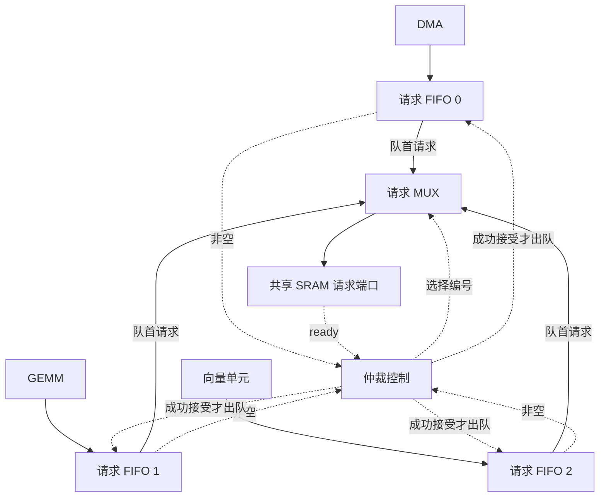
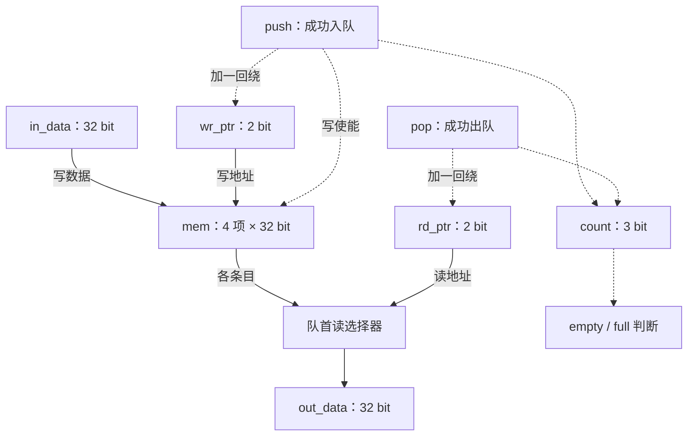
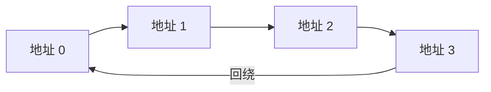
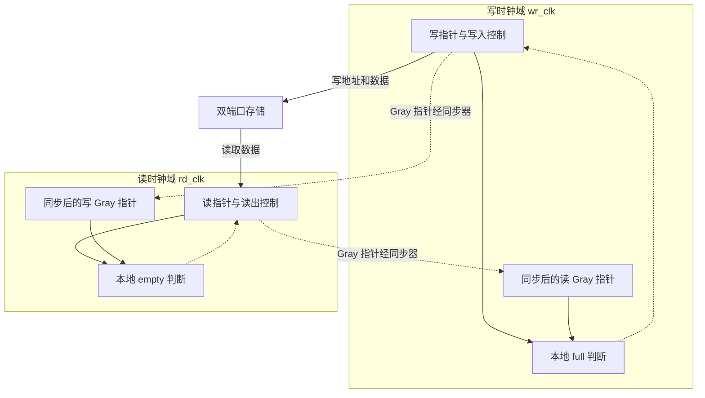
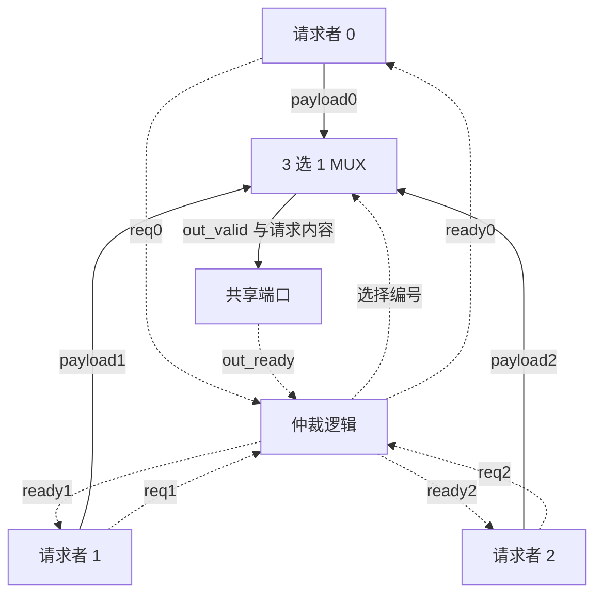

# FIFO 与仲裁：硬件结构、数据流与逐周期执行

2026-11-17；tiny-NPU 基础专题答疑，不改变课程编号。通用 FIFO 与仲裁器为教学设计；最后单独核对真实源码。周期表均为原理推导，未运行 RTL 仿真。

## 1. 两者分别解决什么问题

**FIFO 保存暂时不能处理的数据，并按进入顺序交付；仲裁器决定多个请求者中谁先使用共享资源。**

| 场景 | 机制 | 限制 |
|---|---|---|
| 上下游速度暂时不匹配 | FIFO 缓冲、满时反压 | 无法消除长期带宽不足 |
| 多个模块争用一个端口 | 仲裁器与 MUX | 端口的服务能力没有增加 |
| 等待时请求不能丢 | 上游保持请求，或放入 FIFO | 必须明确接受与完成条件 |

以下是假设三个 NPU 引擎共享 SRAM 请求端口的教学结构，不能当成当前 tiny-NPU 已实现的连接。请求条目可包含地址、读写类型、写数据、字节使能及来源标识。



实线是请求内容的数据通路，虚线是控制。仲裁选择谁，MUX 就把谁的请求送给端口；只有端口真正接受，获选队列才能出队。

微指令可以启动 DMA/GEMM，引擎随后产生访存请求。仲裁器通常不解析 GEMM 微指令，也不能替代 Scoreboard/Barrier 的依赖管理。

## 2. FIFO 里真正有哪些硬件

FIFO 是 First In, First Out，先进先出。先写 A、再写 B、再写 C，合法读出次序就是 A、B、C。

采用一个同步 FIFO 例子：同一时钟、宽度 W=32 bit、深度 D=4、每拍最多入队和出队各一项。数据容量为 4×32 bit=16 Byte，不计控制开销。本例使用寄存器数组、组合队首读；空时不直通，沿前满时不接受输入。



数据通常不需要每拍整体搬动；环形数组通过移动读写指针维护顺序。移位寄存器 FIFO 是另一种实现。

| 名称 | 本例位宽 | 单位、方向与含义 |
|---|---:|---|
| in_data | 32 bit | 输入，一项数据 |
| in_valid | 1 bit | 输入，上游当前数据有效 |
| in_ready | 1 bit | 输出，FIFO 可以接受输入 |
| out_data | 32 bit | 输出，队首内容；out_valid=1 时才有效 |
| out_valid | 1 bit | 输出，FIFO 有有效队首 |
| out_ready | 1 bit | 输入，下游能够接收 |
| push | 1 bit | 内部，成功入队事件 |
| pop | 1 bit | 内部，成功出队事件 |
| wr_ptr | 2 bit | 条目索引 0～3，下一次写入的位置 |
| rd_ptr | 2 bit | 条目索引 0～3，当前队首的位置 |
| count | 3 bit | 条目数 0～4，当前占用量 |

指针是条目索引，不是 Byte 地址。wr_ptr=2 表示 mem[2]，不是偏移 2 Byte。若映射到连续 32-bit 字的外部字节地址，才是基地址+4×索引。

## 3. 请求不等于传输成功

```verilog
assign push = in_valid  && in_ready;
assign pop  = out_valid && out_ready;
```

信号在时钟上升沿采样。只有 valid 和 ready 同时为 1，该沿才交接一项。

| valid | ready | 含义 |
|---:|---:|---|
| 0 | 0 | 没有有效数据，也不准备接收 |
| 0 | 1 | 接收方有空，但没有数据 |
| 1 | 0 | 数据等待，未发生传输 |
| 1 | 1 | 本沿成功交接 |

valid=1、ready=0 时，发送方必须保持 valid 和当前数据直到握手成功。AXI 的 VALID/READY 通道也遵循这一规则。ready 是“能否接收”的控制信号，不是时钟。[Arm AXI 协议规范](https://documentation-service.arm.com/static/651c285c15583d1bff972f94)

本例：

```verilog
assign empty     = (count == 0);
assign full      = (count == 4);
assign in_ready  = !full;
assign out_valid = !empty;
assign out_data  = mem[rd_ptr];
```

空时即使 out_ready=1，也不能 pop；满时即使 in_valid=1，也不能 push。out_data 出现某个数值不等于它有效，还要看 out_valid。

## 4. 环形存储与空满判断



先写 A、B、C，再读走 A，再写 D、E：

| 物理地址 | 有效数据 | 说明 |
|---:|---|---|
| 0 | E | 最新写入 |
| 1 | B | rd_ptr 指向这里；wr_ptr 也等于 1 |
| 2 | C | |
| 3 | D | |

逻辑队列是 B、C、D、E，读取地址为 1→2→3→0，而不是从物理地址 0 开始。

此时 rd_ptr=wr_ptr=1，但 FIFO 满；复位后两者都为 0，FIFO 空。因此地址指针相等不能单独判断空满。

本例使用 count：

\[
empty=(count=0),\qquad full=(count=D)
\]

深度 4 的地址需要 2 bit，而 count 要表示 0～4 五种状态，需要 3 bit。另一些设计使用额外回绕位。对于 2 的幂深度的同步 FIFO，扩展二进制指针可以区分同地址的空与满；异步 FIFO 还要处理 Gray 编码与跨域同步，不能直接套用同步比较逻辑。

## 5. 逐周期观察入队、出队与反压

\[
count_{\mathrm{next}}=count+push-pop
\]

| push | pop | 动作 | count |
|---:|---:|---|---|
| 0 | 0 | 保持 | 保持 |
| 1 | 0 | 写队尾，wr_ptr 前进 | +1 |
| 0 | 1 | 取队首，rd_ptr 前进 | -1 |
| 1 | 1 | 同时入队、出队，两个指针都前进 | 不变 |

count 不变并不表示没有工作：[A,B] 同时读 A、写 C 后成为 [B,C]，占用量仍然是 2。

下面每一行先用沿前状态判断动作，再给出沿后结果。初始 rd_ptr=wr_ptr=0、count=0。输入字母表示 in_valid=1，“—”表示 in_valid=0。

| 时钟沿 | 输入 | out_ready | in_ready 沿前 | 本沿入队 / 读出 | 沿后队列，左为队首 | 沿后 rd / wr | count |
|---|---|---:|---:|---|---|---|---:|
| E1 | A | 0 | 1 | A / — | [A] | 0 / 1 | 1 |
| E2 | B | 0 | 1 | B / — | [A,B] | 0 / 2 | 2 |
| E3 | C | 1 | 1 | C / A | [B,C] | 1 / 3 | 2 |
| E4 | D | 0 | 1 | D / — | [B,C,D] | 1 / 0 | 3 |
| E5 | E | 0 | 1 | E / — | [B,C,D,E] | 1 / 1 | 4 |
| E6 | F | 0 | 0 | — / — | [B,C,D,E] | 1 / 1 | 4 |
| E7 | F | 1 | 0 | — / B | [C,D,E] | 2 / 1 | 3 |
| E8 | F | 1 | 1 | F / C | [D,E,F] | 3 / 2 | 3 |
| E9 | — | 1 | 1 | — / D | [E,F] | 0 / 2 | 2 |
| E10 | — | 1 | 1 | — / E | [F] | 1 / 2 | 1 |
| E11 | — | 1 | 1 | — / F | [] | 2 / 2 | 0 |
| E12 | — | 1 | 1 | — / — | [] | 2 / 2 | 0 |

重点：

- E3 同时读写，count 不变，两个指针都变。
- E4 wr_ptr 回绕为 0，不表示 FIFO 清空。
- E6、E7 输入 F 未被接受，发送方必须继续保持它。
- E7 沿前 FIFO 满，in_ready=0，因此只能读 B，不能同拍接收 F。
- E12 虽然下游 ready，但 FIFO 空，所以不能读。

本例采用保守满边界策略。其他实现可支持“满时同拍读走一项并接收新项”，例如：

```verilog
assign in_ready = !full || pop;
```

但必须处理满时同地址读写语义，并评估 out_ready 到 in_ready 的组合路径；不能直接套到任意 SRAM/FIFO IP。空时输入直通也是独立设计选择，本例没有采用。

## 6. 最小 FIFO RTL 与硬件的对应

以下是固定 4×32-bit 的教学代码片段，不是 tiny-NPU 现有模块；未执行编译或仿真。端口 in_data/out_data 为 32 bit，握手及 clk/rst_n 为 1 bit。

先声明数组和状态：

```verilog
reg [31:0] mem [0:3];
reg [1:0]  wr_ptr, rd_ptr;
reg [2:0]  count;
wire push, pop;
```

组合逻辑给出当前队首、容量和成功事件：

```verilog
assign in_ready  = rst_n && (count < 3'd4);
assign out_valid = rst_n && (count != 3'd0);
assign out_data  = mem[rd_ptr];
assign push = in_valid && in_ready;
assign pop  = out_valid && out_ready;
```

复位时不对外报告有效交接；空时 out_data 可以是旧值或未初始化值，由 out_valid 屏蔽。

时序逻辑：

```verilog
always @(posedge clk or negedge rst_n) begin
    if (!rst_n) begin
        wr_ptr <= 2'd0;
        rd_ptr <= 2'd0;
        count  <= 3'd0;
    end else begin
        if (push) begin
            mem[wr_ptr] <= in_data;
            wr_ptr <= wr_ptr + 2'd1;
        end
        if (pop)
            rd_ptr <= rd_ptr + 2'd1;

        case ({push, pop})
            2'b10: count <= count + 3'd1;
            2'b01: count <= count - 3'd1;
            default: count <= count;
        endcase
    end
end
```

按源码顺序理解：

1. 复位清零指针和 count，声明没有有效条目；不必为 FIFO 正确性清零数组。
2. push 时，用沿前 wr_ptr 写 mem；wr_ptr 随后前进。
3. pop 时，消费者采样沿前队首；rd_ptr 随后前进，沿后组合输出转向新队首。
4. case 的 10 表示只写，01 表示只读，00/11 保持计数。
5. 两个 if 可同拍执行。改成互斥 if...else if 会丢失同时读写能力。
6. 非阻塞赋值 <= 都依据沿前状态计算，再更新；不是先改变 wr_ptr 再写新位置。
7. 2-bit 指针自然溢出实现模 4 回绕。深度为 6 时须显式从 5 回到 0，不能让 3-bit 指针走到 6、7。
8. mem[rd_ptr] 是组合读选择；换为同步 SRAM 后，必须重新设计读延迟和 out_valid。

## 7. 输出模式和时钟域是两回事

| 输出接口 | 队首何时可见 | 读操作的作用 |
|---|---|---|
| 标准同步读 | 发出读请求、经过规定延迟后 | 发起读取 |
| FWFT / show-ahead | 有有效队首时，消费者可先看见 | 消费当前项，推进到下一项 |

FWFT 不意味着空 FIFO 输入必定同周期直通，也不意味着内部必须使用异步读 RAM；可由预取及输出寄存器实现。[AMD FIFO 输出模式](https://docs.amd.com/r/en-US/ug573-ultrascale-memory-resources/FIRST_WORD_FALL_THROUGH)

同步 FIFO 读写共用一个时钟域；异步 FIFO 的写端和读端属于异步时钟域。异步不是“不需要时钟”。



不能让同一个 count 寄存器由两个无关时钟共同控制。常见异步 FIFO 在本域维护二进制地址指针，用 Gray 指针经同步器传递到另一域，再分别产生本地 full/empty。

二进制 011→100 同时变化多位；Gray 相邻状态仅变化一位，配合同步器减少跨域采样歧义。但仍需要跨域时序约束、复位设计和同步器，不能靠 Gray 编码消除全部亚稳态风险。接收域也可能跳过若干发送域状态。数据通过双端口存储传递，不能简单把 32-bit 数据逐位打两拍就当作完整数据字。

此处只介绍架构边界，未给出可部署的异步 FIFO RTL。[Cummings 原论文](https://www-inst.eecs.berkeley.edu/~cs150/fa10/Collections/Papers/CummingsSNUG2002SJ_FIFO1.pdf)

## 8. 仲裁控制与数据选择

三个模块争用一个每拍最多接受一次请求的 SRAM 端口：



| 信号 | 位宽 | 含义 |
|---|---:|---|
| req[2:0] | 3 bit | 各请求者有待处理请求 |
| sel[2:0] | 3 bit | 最多一位为 1，表示实际选择 |
| selected_idx | 2 bit | 编号 0、1、2，须结合选择有效条件 |
| out_valid | 1 bit | 输出请求有效 |
| out_ready | 1 bit | 端口可接受 |
| fire | 1 bit | out_valid && out_ready |
| next_start | 2 bit | 轮询下一次从哪一路开始搜索 |

位序为 [2:0]：001 选 0，010 选 1，100 选 2，000 无选择，称为 one-hot 或全零编码。

不同源码里 grant 有时表示选中，有时已经包含接受条件，必须核对表达式。本文用 sel 区分“选择”，fire 表示“成功交接”。

仲裁器未必保存请求数据。未获选者需要保持请求或在 FIFO 中排队，不能发一个脉冲就假定已被记录。

## 9. 固定优先级

设 0 优先于 1，1 优先于 2。未锁定已有输出时，候选逻辑为：

```verilog
assign sel[0] = req[0];
assign sel[1] = !req[0] && req[1];
assign sel[2] = !req[0] && !req[1] && req[2];
```

| req[2:0] | sel[2:0] | 获选 |
|---|---|---|
| 000 | 000 | 无 |
| 001 | 001 | 0 |
| 010 | 010 | 1 |
| 011 | 001 | 0 |
| 100 | 100 | 2 |
| 110 | 010 | 1 |
| 111 | 001 | 0 |

等价于 if(req0)...else if(req1)...else if(req2)。它描述本周期的组合优先级编码器，不是逐个耗费周期的软件循环。

若每一拍 req=111，0 会一直优先，1、2 可能一直等待，即饥饿。它适用于明确有优先保障需求的场景，但不自动保证公平。上述只是候选逻辑，输出反压时还须满足保持规则。

## 10. Round-robin 轮询仲裁

用 next_start 记录下一次从哪一路开始找：

| next_start | 搜索次序 |
|---:|---|
| 0 | 0、1、2 |
| 1 | 1、2、0 |
| 2 | 2、0、1 |

没请求的人直接跳过。例如 next_start=0、req=110，可以本拍就选 1，不必浪费一拍给空闲的 0。

单请求粒度下，实际成功服务 winner 后：

\[
next\_start=(winner+1)\bmod N
\]

是获胜者的下一位，不是无条件给旧 next_start 加一。若从 0 搜索却选到 1，下次应从 2 开始。

| 时钟沿 | 三者均持续请求且 ready=1 | 沿前 next_start | 沿后 next_start |
|---|---|---:|---:|
| E1 | 服务 0 | 0 | 1 |
| E2 | 服务 1 | 1 | 2 |
| E3 | 服务 2 | 2 | 0 |
| E4 | 服务 0 | 0 | 1 |

在请求持续有效、每次服务最终完成等条件下，标准轮询可以避免饥饿。N 个持续请求者，一个人的两次服务之间最多隔 N−1 次其他服务机会；这不是固定的 N−1 个时钟周期，下游暂停和事务长度都会增加等待时间。

## 11. 反压时必须保持选择

只在 fire 时推进轮询起点还不够。设 next_start=0，最初只有请求者 1 有请求，选中它但下游 ready=0；下一拍请求者 0 新到，如果重新从 0 搜索，会切换输出，违反暂停期间数据稳定。

解决方法是锁定已呈现请求的来源，或使用保持数据的输出寄存器/缓冲：

- 未锁定时正常仲裁。
- out_valid=1、out_ready=0 时记录 held_idx，并置 held_valid。
- 锁定期间继续选择该来源，上游必须保持数据。
- fire 后释放等待保持，并按实际获胜者更新 next_start。

| 时钟沿 | 请求情况 | ready | 输出 | 结果 |
|---|---|---:|---|---|
| E1 | 只有 1 | 0 | 1 的 B | 等待并锁定 1 |
| E2 | 0 新到，1 仍在 | 0 | 仍为 B | 保持 |
| E3 | 0、1 都在 | 1 | 仍为 B | 服务 1，下次从 2 搜索 |

固定优先级同样要满足所连接接口的保持要求，高优先级新请求不能随意覆盖已呈现的等待数据。

## 12. 三个 FIFO 合并为一个输出

每个 FIFO 的输出有效就是请求：

```verilog
req[i] = fifo_out_valid[i];
fifo_out_ready[i] = sel[i] && out_ready;
pop[i] = fifo_out_valid[i] && fifo_out_ready[i];
```

这里 sel 指包含保持机制的实际选择。payload 中地址、写数据、读写类型和字节使能等必须一起选择，不能混接不同来源的字段。

初始 FIFO0=[A0,A1]、FIFO1=[B0,B1]、FIFO2=[C0]，轮询起点 0：

| 时钟沿 | 选择 | ready | 实际交接 | FIFO0 沿后 | FIFO1 沿后 | FIFO2 沿后 |
|---|---:|---:|---|---|---|---|
| E1 | 0 | 1 | A0 | [A1] | [B0,B1] | [C0] |
| E2 | 1 | 0 | 无 | [A1] | [B0,B1] | [C0] |
| E3 | 1，保持 | 1 | B0 | [A1] | [B1] | [C0] |
| E4 | 2 | 1 | C0 | [A1] | [B1] | [] |
| E5 | 0 | 1 | A1 | [] | [B1] | [] |
| E6 | 1 | 1 | B1 | [] | [] | [] |

E2 虽然选中了 FIFO1，但它不能出队，否则 B0 在未被接收时就丢失。

输出顺序 A0、B0、C0、A1、B1，保证每个源内部有序，但不保证不同源按全局到达时间排序。

## 13. 单 beat、事务和任务粒度

| 仲裁粒度 | 何时可换人 | 影响 |
|---|---|---|
| 单条请求 / 单 beat | 成功交接后 | 可交织，但响应需归属正确 |
| burst / 数据包 | 当前事务约定末拍成功交接后 | 需保持 owner |
| 整个引擎任务 | 引擎释放资源后 | 控制简单，空闲周期也可能占住端口 |

不允许事务内交织时，owner 需保持到完成条件。last=1 本身不一定表示完成，通常还须该末拍成功握手，即 valid && ready && last；具体释放事件由协议规定。AXI 地址、写数据和响应是不同通道，末个 W beat 不等于写事务所有阶段已完成。

按事务轮流不等于带宽平均。A 每事务 16 beat，B 每事务 1 beat，即使各获一次服务，A 仍占更多数据周期。可考虑加权轮询、额度等机制。

真实工程例子：[OpenTitan OTP 控制器](https://opentitan.org/book/hw/ip/otp_ctrl/doc/theory_of_operation.html)区分了单次存储访问的周期级仲裁，以及完整操作的事务级仲裁。

## 14. 读请求被接受后，数据还要返回

E1 接受请求者 0 的读地址，数据稍后返回时，仲裁器可能已经选了请求者 1。不能用当前选择编号决定旧读数据的归属。

必须记录接受时的来源并与响应对齐：

- 固定延迟：来源编号经过同样延迟的流水线。
- 多个顺序未完成请求：保存相应来源信息队列。
- 乱序返回：用事务 ID 等机制匹配。
- 返回端可暂停：还需响应缓冲和有效控制。

请求出队、端口接受、数据返回、引擎完成是不同事件。多个 Bank 可并行服务不同 Bank 的请求，同一 Bank 的受限端口仍需仲裁。

## 15. FIFO 深度与长期吞吐量

上游连续 4 拍各产生一项、下游这 4 拍完全暂停，空队列至少需要 4 个可用条目才能全部接收；若原有 2 项，总容量至少应覆盖 6 项。

给定事件序列：

\[
Q(t)=Q(0)+N_{\text{push}}(t)-N_{\text{pop}}(t)
\]

容量需要覆盖目标到达与服务序列的峰值积压，还要考虑边界规则、在途数据和反压传播延迟。实际已接受 push 数不包括被反压挡住的到达，不能用它反推原本所需的无阻塞容量。

若三个源长期各产生 1 请求/拍，而端口每拍只接受 1 请求，任何有限 FIFO 最终都会满。轮询分配现有能力，不增加服务能力；需降速、增加 Bank/端口、调整映射或减少访存。

## 16. 对照 tiny-NPU 的真实 SRAM 选择逻辑

本次核对 harishsg993010/tiny-NPU 固定 commit 8216c22b762011aa20c05fc2768423fd12dda59d：

[sim/verilator/gpt2_block_top.sv，第 613 行起](https://github.com/harishsg993010/tiny-NPU/blob/8216c22b762011aa20c05fc2768423fd12dda59d/sim/verilator/gpt2_block_top.sv#L613)。

SRAM0 读 MUX 是 613～637 行；写 MUX 是 639～677 行。以下是开头节选，省略的分支必须到原文件阅读，不能作为完整可综合替换：

```systemverilog
always_comb begin
    if (gm_busy) begin
        s0_a_en   = gm_rd_en;
        s0_a_addr = gm_rd_addr[SRAM0_AW-1:0];
    end else if (sm_busy) begin
        s0_a_en   = sm_rd_en;
        s0_a_addr = sm_rd_addr[SRAM0_AW-1:0];
    end else if (ln_busy) begin
        s0_a_en   = ln_rd0_en;
        s0_a_addr = ln_rd0_addr[SRAM0_AW-1:0];
    end
    // 节选：后续还有其他引擎及 testbench 分支
end
```

| 信号 | 位宽与含义 |
|---|---|
| gm_busy / sm_busy | 各 1 bit，引擎工作状态，决定谁被选中 |
| gm_rd_en / sm_rd_en | 各 1 bit，本拍是否需要读 |
| s0_a_en | 1 bit，送 SRAM0 A 口的读使能 |
| s0_a_addr | SRAM0_AW bit，本地 SRAM 条目地址 |
| 地址截取 | 从对应引擎地址取低 SRAM0_AW bit；该 SRAM 每项 8 bit，一项恰为一个 Byte |

这段逻辑先按 busy 选择所有者，再送它的 rd_en，属于按忙状态进行固定优先级端口复用。

| gm_busy | gm_rd_en | sm_busy | sm_rd_en | s0_a_en | 本拍行为 |
|---:|---:|---:|---:|---:|---|
| 1 | 1 | 1 | 1 | 1 | 接 GEMM 地址 |
| 1 | 0 | 1 | 1 | 0 | GEMM 占选择权但不读；Softmax 也不能读 |
| 0 | 任意 | 1 | 1 | 1 | 接 Softmax 地址 |

完整优先次序为 GEMM、Softmax、LayerNorm、GELU、Vec、KV，最后为 testbench。

gm_busy=1 时，不会因为 gm_rd_en=0 就自动把端口给 Softmax。它和“只看本拍有效请求、每次访问重新选择”的仲裁不同。

该 MUX 本身没有实现通用请求 FIFO、ready/grant 重试与响应跟踪，不能由此断言所有引擎可以无条件并发争用。也不能直接把 busy 改成 rd_en 就完成改造：还需要等待请求保持、引擎计数暂停、读响应归属和依赖管理。

本文每源 FIFO、轮询和反压结构是教学方案，不能声称本固定版本已经具有这条完整通路。

## 17. 后续读 RTL 时的检查顺序

1. 请求由什么信号表示，等待数据由谁保存？
2. 谁选中使用者，仲裁粒度是什么？
3. 真正接受事件是什么，指针是否仅在接受时推进？
4. 暂停时数据、地址、控制和选择是否保持？
5. 响应如何找到发起者，接受与完成如何区分？
6. 空、满、同拍读写和回绕采用什么边界规则？

已生成和讲解不等于用户已掌握。优先答疑，不自动推进课程编号，不修改作业支线，不代用户运行实验。
