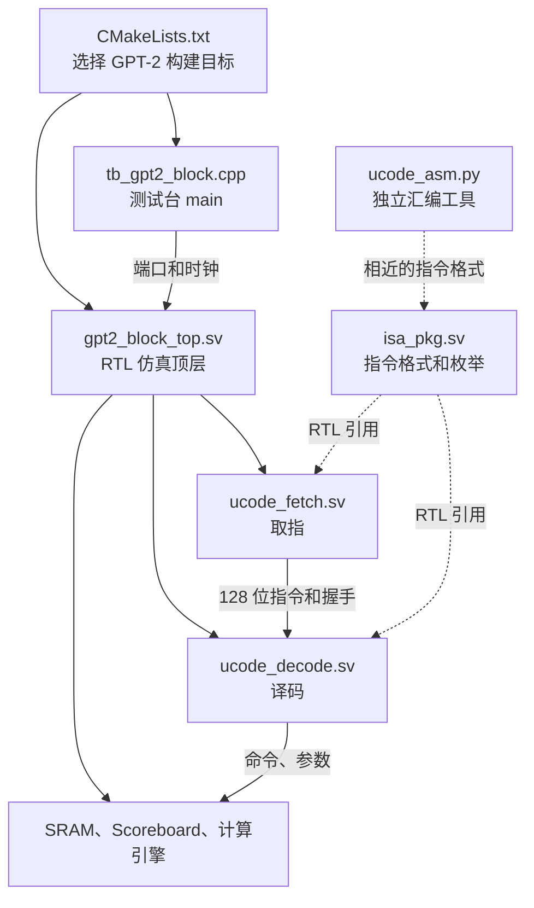

# GPT-2 测试七个文件：代码树与学习路线

固定参考源码：[`harishsg993010/tiny-NPU@8216c22`](https://github.com/harishsg993010/tiny-NPU/tree/8216c22b762011aa20c05fc2768423fd12dda59d)。本专题是用户主动答疑，**不改变第09讲后的主线编号**；提供静态代码解读，不代表用户已掌握或已完成 RTL 仿真。独立作业不自动推进。

## 先辨别七个文件的角色

| 文件 | 语言/角色 | 本例中的真实作用 |
|---|---|---|
| `sim/verilator/CMakeLists.txt` | CMake 构建描述 | 声明 GPT-2 测试可执行目标、RTL 源文件和 Verilator 选项 |
| `sim/verilator/tb_gpt2_block.cpp` | C++ 测试台 | 创建仿真模型，生成测试数据，直接构造/装载微码，驱动时钟和验证 |
| `sim/verilator/gpt2_block_top.sv` | SystemVerilog 仿真顶层 | 实例化和连接微码 SRAM、Fetch、Decode、Scoreboard、数据 SRAM 和计算引擎 |
| `rtl/ctrl/ucode_fetch.sv` | SystemVerilog 控制 RTL | 按 PC 读微码、处理同步读延迟和 valid/ready 反压 |
| `rtl/ctrl/ucode_decode.sv` | SystemVerilog 控制 RTL | 将指令分字段，按 opcode 选择引擎并发出相应命令 |
| `rtl/pkg/isa_pkg.sv` | SystemVerilog package | 声明指令字段、opcode、标志等共享约定 |
| `python/tools/ucode_asm.py` | Python 汇编工具 | 独立地将文本汇编为二进制；该 GPT-2 C++ 测试没有调用它 |

请注意构建、运行和人工编排是不同动作：CMake + Verilator + C++ 编译器构建的是**仿真程序**；C++ 里的 `load_microcode()` 人工编码并加载算子序列；独立 Python 文件能编码它自己的输入文本，但没有出现在此测试运行链中。当前测试没有把任意 PyTorch 模型自动编译成指令。

## 七个文件构成的代码树

这是一棵**按角色和调用关系组织的代码树**；实线表示本测试真实构建/驱动或 RTL 连接关系，虚线标明共享约定或独立工具，不代表实际函数调用。为阅读方便，SRAM、Scoreboard 和计算引擎合并成节点，但它们对应额外源码文件。

注意：C++ 定义自己的常量和编码函数；Python 也手写自己的 opcode 表。它们不是运行时调用 `isa_pkg.sv`，不同实现可能出现不一致。

## 第一棵树：C++ 程序的实际调用顺序

`main()` 源码在文件后部，因此按“函数从哪开始执行”阅读时要先看 [main](https://github.com/harishsg993010/tiny-NPU/blob/8216c22b762011aa20c05fc2768423fd12dda59d/sim/verilator/tb_gpt2_block.cpp#L872)，再回看前面定义的函数：

- 创建 `Vgpt2_block_top` 和波形对象；初始化端口。
- 创建 C++ 参考查找表；`reset_dut()` → 多次 `tick()`。
- `generate_data_and_golden()` → 生成随机输入和权重，计算软件参考。
- `load_microcode()` → 重复 `encode_instr()`、`ucode_write()` → 通过 `tick()` 写微码 SRAM。
- `load_data_to_srams()` → 通过测试端口写入输入/权重。
- 设置 `ucode_len`、`start_pulse` → `tick()` → RTL 开始工作。
- 执行循环 → `tick()` → 若检测到 DMA 命令，调用 `handle_dma_command()` 模拟 SRAM0→SRAM1 复制并反馈完成 → 等待 `program_end` 或超时。
- 回读/比较 → 结合 `all_pass`、GEMM 计数和 DMA 计数给出最终返回值。

这里的树表示 C++ 程序**控制流**，不表示这些函数都是 RTL 里的硬件模块；每个 `tick()` 中 RTL 模块并行求值。

## 第二棵树：仿真顶层内的 RTL 实例

`gpt2_block_top` 包含微码 `sram_dp`、`ucode_fetch`、`ucode_decode`、`scoreboard`、`barrier`、`gemm_ctrl`、`systolic_array`、ACC SRAM、数据 SRAM 和其他算子引擎。数据通路和指令通路分别如下：

- **指令流：** C++ 写 `uc_wr_*` → 微码 SRAM B 口 → SRAM A 口 → Fetch → 128 位指令 + valid/ready → Decode → 引擎命令。
- **数据流：** C++ 测试端口初始化 SRAM → 引擎读输入和权重 → 算法运算 → 写回结果；某个 DMA 命令由 C++ 通过测试端口完成复制。
- **控制流：** C++ 控制 `clk/rst_n/start` → Fetch 状态机 → Decode 选择引擎 → Scoreboard 跟踪忙闲 → `D_BARRIER` 等待 `all_idle` → Fetch 完成且全空闲后 `program_end`。

实例名、关键端口、位宽和状态，见 [RTL 文件逐段讲解](supplement-gpt2-seven-files-02-rtl.md)。这个 GPT-2 顶层与另一个 `rtl/top.sv` 的连接并不一样：它实例化真实算子 RTL，DMA 使用测试台 shim；Scoreboard 此处配置为 8 位，不要机械套用另一顶层的 6 位配置。其 `barrier_stall` 没有接回 Fetch/Decode，实际等待由 Decode 的 `D_BARRIER` 和 `all_idle` 完成。

## 第三棵树：Python 汇编工具的独立流程

- 命令行入口 `if __name__ == '__main__'` → `argparse` 获取参数。
- 如果 `--gen-tiny`：`gen_tiny_transformer_ucode()` 先生成一组固定模板的文本。
- 如果提供输入文件：`assemble_file()` 打开文本并调用 `assemble()`。
- `assemble()` → 每一行调用 `parse_line()` → `parse_int()` 把字段文本转成整数 → `encode_instruction()` 把字段移位拼成 16 字节。
- 根据参数写 `.bin` 或四行 32 bit 格式的 `--hex`。

这个文件把解析键统一转小写，但字典中的 `M/N/K` 是大写，导致这些字段在文本路径中被静默保留为 0。默认模板也走该路径。前次仅单独运行 Python 样例核验，未运行 RTL 仿真。`--hex` 的四行 32 bit 格式也不能直接等同 128 bit 指令 SRAM 的每地址一个元素。

## 建议的阅读顺序

1. 先用本页建立全局关系；理解构建与运行的区别。
2. 读 [C++ 测试台逐段讲解](supplement-gpt2-seven-files-01-cpp.md)，重点顺序是 main → 基础语法 → tick/存储接口 → 编码与 load_microcode → golden 与检查。
3. 读 [RTL 文件逐段讲解](supplement-gpt2-seven-files-02-rtl.md)，按顶层→Fetch→Decode→ISA；需要查位段时随时反查 ISA。
4. 读 [Python 汇编器与 CMake](supplement-gpt2-seven-files-03-python-cmake.md)，对照 C++ 编码路径，最后回顾构建目标及依赖。

所有文稿以代码范围、变量和具体例子来解释，不要求一次记完；用户对某一行的具体问题优先。完整源码分析不等于成功构建或运行，也不等于用户已掌握。
