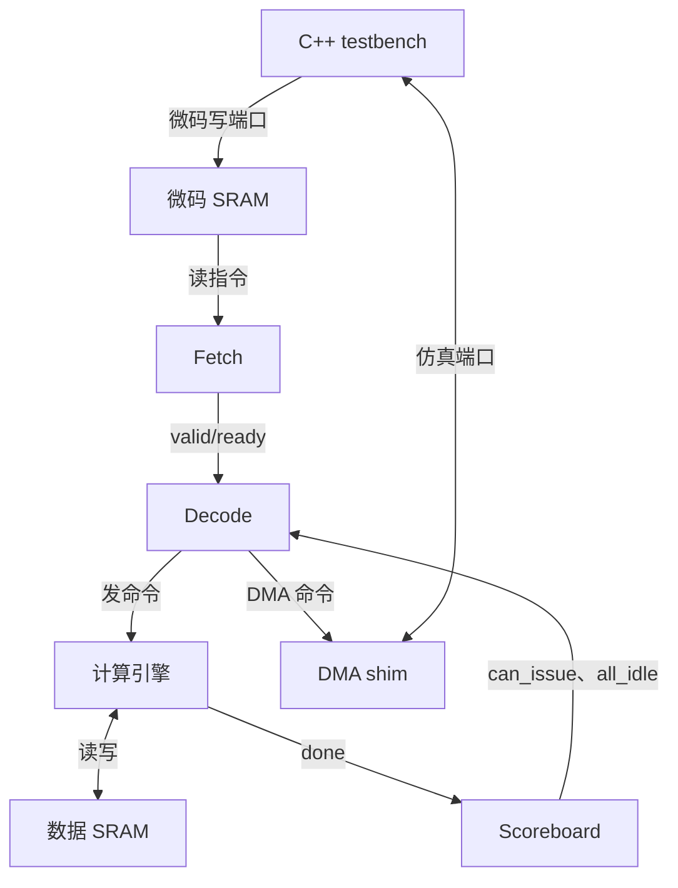

# 七文件专题二：RTL 顶层、Fetch、Decode 与 ISA

> 参考版本：`8216c22b762011aa20c05fc2768423fd12dda59d`。本篇是用户主动提出的七文件专题，源码与时序为静态阅读；没有进行 RTL 仿真。已写讲义不等于用户已掌握。返回[七文件代码树与学习路线](supplement-gpt2-seven-files-00-code-tree.md)。

# RTL 文件一：`gpt2_block_top.sv`——测试专用硬件顶层

源码固定为 [`sim/verilator/gpt2_block_top.sv`](https://github.com/harishsg993010/tiny-NPU/blob/8216c22b762011aa20c05fc2768423fd12dda59d/sim/verilator/gpt2_block_top.sv)。**阅读目标**：识别“谁实例化谁、什么线相连、命令/数据各走哪里”，而不是仅凭模块名字认为任意模型已成功仿真。本文件把真实运算 RTL、存储器、控制器连在一个**仿真专用顶层**；DMA 用 C++ shim 服务。它不是原项目 `rtl/top.sv`，不要直接把另一顶层使用 stub 的判断套过来。

## 一、先看实际硬件结构



注意 C++ 是仿真环境，不是 RTL 芯片内部的一块计算电路；图只画关键连接。该顶层还实例化独立 barrier，但 `barrier_stall` 不反馈 Decode，屏障等待实际在 Decode 的 `D_BARRIER` 状态检查 `all_idle`。指令字的地址按 128-bit **条**计；数据 SRAM 为 8-bit，地址按字节计。

## 二、按文件顺序阅读

### 2.1 模块参数、端口：[9–71 行](https://github.com/harishsg993010/tiny-NPU/blob/8216c22b762011aa20c05fc2768423fd12dda59d/sim/verilator/gpt2_block_top.sv#L9)

`module gpt2_block_top ... #(parameter ...) (...)` 声明可参数化模块。`import isa_pkg::*` 导入包里的指令常量和结构体；`$clog2(1024)=10`，用于求地址所需位宽。

| 参数/端口 | 宽度/默认值 | 作用和单位 |
|---|---:|---|
| `SRAM0_DEPTH` | 默认 8192 | 数据 SRAM0 的 8-bit 元素个数；该 GPT-2 CMake target 覆盖为 65536，字节地址宽 16 位 |
| `SRAM1_DEPTH` | 4096 | 数据 SRAM1 的 8-bit 元素个数；字节地址宽 12 位 |
| `SCRATCH_DEPTH` | 4096 | Softmax 暂存 SRAM 深度，每个元素 16 bit |
| `UCODE_DEPTH_P` | 1024 | 微码存储器 128-bit 指令字数 |
| `UC_ADDR_W` | 10 bit | 指令 SRAM 的指令字地址宽度 |
| `start_pulse` | 1 bit | 启动 Fetch |
| `ucode_len` | 16 bit 输入 | 指令条数；这里仅 `[UC_ADDR_W-1:0]` 进入 Fetch |
| `uc_wr_en/addr/data` | 1/10/128 bit | 测试端口写一条微指令，地址单位为指令字 |
| `tb_sram0_*`、`tb_sram1_*` | 数据 8 bit | 测试台初始化和回读数据 SRAM 的接口 |
| `dma_src/dst/len`、`dma_done_pulse` | 16/16/16/1 bit | C++ 服务 DMA shim 的命令和完成反馈，当前测试长度按字节 |
| `program_end` | 1 bit | Fetch 已结束且等待所跟踪引擎空闲后置位；不证明计算数值正确 |

边界：默认指令地址宽 10 位，长度输入只取低 10 位，因此 `ucode_len=1024` 截断为 0；Fetch 对 `len=0` 也没有在首次读请求之前跳过，不可把它理解为可靠执行零条。当前测试 117 条未触及该截断问题。

### 2.2 微码 SRAM、Fetch 接线：[74–133 行](https://github.com/harishsg993010/tiny-NPU/blob/8216c22b762011aa20c05fc2768423fd12dda59d/sim/verilator/gpt2_block_top.sv#L74)

```systemverilog
sram_dp #(.DEPTH(UCODE_DEPTH_P), .WIDTH(128)) u_ucode_sram (
    .clk    (clk),
    .en_a   (uc_rd_en),
    .we_a   (1'b0),
    .addr_a (uc_rd_addr),
    .dout_a (uc_rd_data),
    .en_b   (uc_wr_en),
    .we_b   (uc_wr_en),
    .addr_b (uc_wr_addr),
    .din_b  (uc_wr_data)
);
```

摘录省略了不影响此处讨论的端口。`#(...)` 改参数，`u_ucode_sram` 是实例名，`.端口(信号)` 是接线，不是像 C++ 那样“调用函数并退出”。A 口读、B 口供 testbench 写。`we_a=0` 把 A 口设为只读；`en_b=we_b=uc_wr_en`，写使能有效时在时钟沿写。

微码 SRAM 是同步读。顶层用 `rd_valid_q <= uc_rd_en` 把读请求延后一拍作为 `rd_valid`；读请求在 E1 沿采样后，SRAM 输出及 `rd_valid_q` 沿后有效，再由 Fetch 在后续沿捕获。Fetch 的 `stop` 固定 0，base 固定 0，`ucode_len` 只取低 `UC_ADDR_W` 位。故 `base+PC` 在本配置下等于 PC，但这是此顶层接线，不是所有 Fetch 实例的通用限制。

### 2.3 Scoreboard、Barrier 和 Decode：[135–301 行](https://github.com/harishsg993010/tiny-NPU/blob/8216c22b762011aa20c05fc2768423fd12dda59d/sim/verilator/gpt2_block_top.sv#L135)

这里实例化 `scoreboard #(.NUM_ENGINES(8))`：`engine_busy_vec[7:0]` 是 8 个忙标志，`can_issue_vec[7:0]` 为发射可用状态，`issue_engine_id[2:0]` 表示引擎编号；`all_idle` 检查所有标志。当前完成向量的 bit 0–4 分别对应 GEMM、Softmax、LayerNorm、GELU、VEC，bit 5 为 DMA/KV 共用；bit 6/7 固定 done=0，RMSNorm/RoPE 引擎在此顶层未实例化。不要将另一顶层的 6 位 scoreboard 口径直接当作此文件的接线；对当前未使用的命令也不能推断它们可正常完成。

`u_decode` 收到 Fetch 的 128-bit `fetch_instr_data` 与 `fetch_instr_valid`，用 `fetch_instr_ready` 回压；输出 `gemm_cmd_*` 等命令，并向 Scoreboard 发送 `issue_valid`/`issue_engine_id`。`decoded_instr` 是类型 `ucode_instr_t` 的结构体，部分引擎直接从中取扩展参数。RTL 的多个模块并行存在；源文件书写在前或在后不代表硬件执行先后。

### 2.4 GEMM 路径与 ACC：[303–404 行](https://github.com/harishsg993010/tiny-NPU/blob/8216c22b762011aa20c05fc2768423fd12dda59d/sim/verilator/gpt2_block_top.sv#L303)

- `u_gemm_ctrl`：`cmd_valid`、源/目的地址、M/N/K/flags 接 Decode；`cmd_imm` 接 `decoded_instr.imm`。产生数据 SRAM 读写、ACC SRAM 读写、脉动阵列使能和输入；以 `busy`/`done` 表示状态。
- `u_systolic`：16×16 阵列，输入数据宽 8 bit，累加结果 32 bit；`gm_sa_a_col[16]` 和 `gm_sa_b_row[16]` 是两组各16个8-bit元素，`gm_sa_acc[16][16]` 是 256 个32-bit累加结果。具体数据推进和计算周期由控制器与阵列源码决定。
- `u_acc_sram`：256 个条目、每条32 bit，用于 K 方向分块时的部分和；ACC SRAM 地址是 32-bit 字条目而不是 SRAM0 的 byte 地址。
- `hw_gemm_cnt` 5 bit，复位或 `start_pulse` 清 0，`gm_done` 时加 1，供测试台检查完成次数。

顶层确实实例化 `gemm_ctrl.sv`，但目标显式 CMake `SOURCES` 中未列出该文件；有 `-I` 路径，是否被当前 Verilator 的模块搜索自动找到，需要实际构建验证。此处没有运行构建或 RTL 仿真。

### 2.5 DMA shim：[406–445 行](https://github.com/harishsg993010/tiny-NPU/blob/8216c22b762011aa20c05fc2768423fd12dda59d/sim/verilator/gpt2_block_top.sv#L406)

这里是 `always_ff` 寄存器逻辑，不是 AXI DMA。`dma_active` 表示当前 shim 有命令未完成。读或写命令有效且 `!dma_active && !kv_busy` 时，硬件锁存源/目的地址、长度、标志并让 `dma_captured_r=1`；接到 `dma_done_pulse && dma_active` 后清忙。C++ 看到捕获脉冲后，在本测试中按字节从 SRAM0 读并写到 SRAM1，再驱动完成脉冲。软件复制产生的仿真时间和实际 AXI DMA 的性能不是一回事。

### 2.6 KV、数据 SRAM 和仲裁：[496–755 行](https://github.com/harishsg993010/tiny-NPU/blob/8216c22b762011aa20c05fc2768423fd12dda59d/sim/verilator/gpt2_block_top.sv#L496)

先例化 `kv_cache_bank` 和 `kv_ctrl`，供顶层的 KV 指令路径使用；不能从其存在推断本 GPT-2 测试一定发射 KV 指令。之后的 `always_comb` 决定 SRAM0 的 A 口读和 B 口写：选择按 `gm_busy`、`sm_busy`、`ln_busy`、`ge_busy`、`ve_busy`、`kv_busy` 依次优先，最后才让测试端口使用。这里是按 **busy 选择**，不是一个能让多个引擎同时使用同一端口的完整仲裁握手；多引擎即使各自空闲检查通过，也必须考虑 SRAM 争用和依赖。

SRAM1 的 A 读口按 LayerNorm、VEC、测试台的顺序选择，B 写口供测试台；Scratch SRAM 保存 Softmax 的中间量，宽16 bit。`assign ... = s0_a_dout` 是将同一 SRAM 读数据广播给相关接收者，不是复制出多个独立存储端口。

### 2.7 其余引擎、完成与结束：[757–924 行](https://github.com/harishsg993010/tiny-NPU/blob/8216c22b762011aa20c05fc2768423fd12dda59d/sim/verilator/gpt2_block_top.sv#L757)

依次例化 Softmax、LayerNorm、GELU、VEC，接入命令字段与各自 SRAM 接口。`engine_done_vec` 把完成信号送回 Scoreboard。`fetch_done_latch` 记住取指已结束；`program_end_latch` 在此前已记住结束且 `all_idle=1` 时置位；新的 `start_pulse` 可清除两者。由于都是时序寄存器，用非阻塞赋值 `<=`：同一个沿上，第二个块看到的 `fetch_done_latch` 是**沿前**旧值。因此不能简单把 `fetch_done` 与 `program_end` 当作同一拍。

# RTL 文件二：`ucode_fetch.sv`——读取并交付一条微指令

源码：[rtl/ctrl/ucode_fetch.sv](https://github.com/harishsg993010/tiny-NPU/blob/8216c22b762011aa20c05fc2768423fd12dda59d/rtl/ctrl/ucode_fetch.sv)。本段的逐沿表是静态代码推导，不是仿真波形。

## 一、结构、接口与数据流

Fetch 是一个六状态 FSM 加上 PC、程序基址、长度、指令缓冲和完成寄存器。控制流：start → 读请求 → 等同步读 → valid/ready 握手 → PC推进 → 达长或 END结束。指令流：SRAM 的 `rd_data` → `instr_buf_q` → `instr_data` → Decode；Fetch 不读取矩阵数据。

| 信号/寄存器 | 宽度 | 单位和变化 |
|---|---:|---|
| `INSTR_W` | 默认128 | 每条指令 bit 宽 |
| `SRAM_ADDR_W` | 模块默认12；GPT-2实例为10 | 指令字地址及相对 PC 的 bit 宽 |
| `start/stop` | 各1 | 启动/停止请求；GPT-2顶层 stop 固定0 |
| `ucode_base_addr/ucode_len` | 地址宽 | 基址为指令字地址，len 为条数 |
| `rd_en/rd_addr` | 1/地址宽 | 发起指令 SRAM 同步读及字地址 |
| `rd_data/rd_valid` | 指令宽/1 | 读回指令与有效指示 |
| `instr_data/valid/ready` | 指令宽/1/1 | 交付 Decode，沿前 valid 与 ready 同时为1才握手 |
| `pc_q` | 地址宽 | 相对基址的指令条目编号 |
| `base_q/len_q` | 地址宽 | 启动时锁存的基址、长度 |
| `instr_buf_q` | 指令宽 | 等待下游时保存整条指令 |
| `state_q` | 3 bit | 6 种 FSM 状态的当前值 |
| `done_q` | 1 | 已寄存的完成脉冲 |

## 二、按源码顺序读

### 2.1 参数与状态：[9–63 行](https://github.com/harishsg993010/tiny-NPU/blob/8216c22b762011aa20c05fc2768423fd12dda59d/rtl/ctrl/ucode_fetch.sv#L9)

`typedef enum logic [2:0]` 定义 3 bit 状态类型，6 个状态为 IDLE、FETCH、WAIT_DATA、DISPATCH、INCREMENT、DONE。`*_q` 是寄存器当前值，`*_d` 是组合逻辑准备的下一值。例如 `pc_q` 不是执行软件语句时立即改变，而是在有效时钟沿由 `pc_d` 更新。

### 2.2 结束识别和 PC 加一：[65–71 行](https://github.com/harishsg993010/tiny-NPU/blob/8216c22b762011aa20c05fc2768423fd12dda59d/rtl/ctrl/ucode_fetch.sv#L65)

```systemverilog
assign fetched_is_end = (rd_data[7:0] == OP_END);
assign pc_plus1 = pc_q + {{(SRAM_ADDR_W-1){1'b0}}, 1'b1};
```

第一个表达式检查本次读出的低8位 opcode；在 WAIT_DATA 的 `rd_valid=1` 时才据此决定结束。第二个表达式用位拼接构造与 PC 位宽匹配的常数1：例如10位时是 `10'b0000000001`。算术结果仍受位宽限制，不能忽视溢出。

### 2.3 组合逻辑默认值：[76–88 行](https://github.com/harishsg993010/tiny-NPU/blob/8216c22b762011aa20c05fc2768423fd12dda59d/rtl/ctrl/ucode_fetch.sv#L76)

先让 `state_d=state_q`、`pc_d=pc_q`、`instr_buf_d=instr_buf_q`，意味着无其他覆盖时下一拍保持；`done_d=0` 让 done 默认不会一直保持；`rd_en=0`、`instr_valid=0` 为默认输出。`instr_data=instr_buf_q` 虽一直驱动数据，但只有 valid 为 1 才代表待交付指令。组合逻辑赋值 `=` 和寄存器时序赋值 `<=` 的更新语义不同。

### 2.4 六个状态：[89–147 行](https://github.com/harishsg993010/tiny-NPU/blob/8216c22b762011aa20c05fc2768423fd12dda59d/rtl/ctrl/ucode_fetch.sv#L89)

| 状态 | 本拍主要动作 | 下一状态 |
|---|---|---|
| `S_IDLE` | 等 `start`，准备 `pc=0` 并锁存 base、len | start 时 FETCH |
| `S_FETCH` | `rd_en=1`，`rd_addr=base_q+pc_q` | WAIT_DATA |
| `S_WAIT_DATA` | stop 时停止；否则等 `rd_valid`，捕获 `rd_data` | END→DONE；非 END→DISPATCH |
| `S_DISPATCH` | `instr_valid=1`，输出缓存；等待 ready | ready→INCREMENT；stop→DONE |
| `S_INCREMENT` | `pc_d=pc_plus1` | 达到 len 或 stop→DONE；否则 FETCH |
| `S_DONE` | `done_d=1` | IDLE |

`instr_valid=1` 时数据来自 `instr_buf_q`，ready 为0则状态保持，数据不丢失。STOP 同拍细节：全局 stop 覆盖会让下一状态转 DONE，但本拍 FETCH 的 `rd_en` 或 DISPATCH 的 `instr_valid` 未被组合屏蔽；若 stop 和 ready 同时有效，仍可能在该沿发生握手。当前 GPT-2 实例 stop 接0，此边界是通用模块语义，不是此次必然发生的运行现象。

### 2.5 时序寄存器与输出：[149–183 行](https://github.com/harishsg993010/tiny-NPU/blob/8216c22b762011aa20c05fc2768423fd12dda59d/rtl/ctrl/ucode_fetch.sv#L149)

`always_ff @(posedge clk or negedge rst_n)` 的 `rst_n` 是低有效异步复位：复位时 `state_q` 为 IDLE，PC、base、len、缓存、done 清0；否则在时钟上升沿把各 `_d` 写入 `_q`。`done=done_q`，`busy=(state_q != S_IDLE)`。S_DONE 中首先组合设置 `done_d=1`、`state_d=IDLE`，**下一沿之后**寄存输出 `done=1` 且状态已回 IDLE，busy 为0。读到 END 时不会发给 Decode，即便 Decode 自己也含 END 分支。

## 三、逐沿示例：普通指令，无反压

假设已经复位；E0 沿前 `start=1`；地址0是一条普通指令；同步 SRAM 读响应为顶层现有 `rd_valid_q`；Decode 空闲且目标引擎可发射。表中沿后值由非阻塞赋值更新；仅源码推导。

| 上升沿 | 沿前动作 | 沿后结果 |
|---|---|---|
| E0 | IDLE 见 start | FETCH；保存 base/len，PC=0 |
| E1 | FETCH 发 `rd_en`、地址0 | SRAM 输出有效数据、`rd_valid_q=1`；Fetch为 WAIT_DATA |
| E2 | WAIT_DATA 见有效数据 | 捕获 `instr_buf_q`，进入 DISPATCH |
| E3 | `valid=ready=1` | Decode 接收指令；Fetch 进入 INCREMENT |
| E4 | Fetch 更新 PC；目标引擎采样 Decode 前一沿寄存的命令 | 如果没达长度，进入 FETCH；下一条 PC=1 |
| E5 | 请求读地址1 | 等待下一次数据 |

若 E3 时 `ready=0`，继续保持 DISPATCH、valid和数据，直到某个有效沿握手。上述时序不推断 GEMM 实际计算时长，也不等于真实波形。
## 文件：`rtl/pkg/isa_pkg.sv` —— 指令格式的公共约定

[固定版本源码（129 行）](https://github.com/harishsg993010/tiny-NPU/blob/8216c22b762011aa20c05fc2768423fd12dda59d/rtl/pkg/isa_pkg.sv)；这里按真实源码顺序阅读。这个 package 定义数据类型、常量、提取函数，本身不是能独立运行的硬件计算引擎；使用 `import isa_pkg::*;` 的 RTL 模块才能引用其中名称。C++ 测试里的常数是另行定义的，不要假设 C++ 自动读取了这个 package。

### 一、L4–L10：文件保护、包、指令宽度

```systemverilog
`ifndef ISA_PKG_SV
`define ISA_PKG_SV
package isa_pkg;
    parameter int INSTR_W = 128;
```

反引号引导预处理指令；`ifndef/define/endif` 防止在同一编译环境里重复包含同一文件。`package ... endpackage` 是可共享类型和常量的命名空间；`parameter int INSTR_W = 128` 给整个指令宽度命名。它描述编码约定，并不生成存储单元。

### 二、L14–L30：opcode 是什么？

`typedef enum logic [7:0] { ... } opcode_t;` 定义了 8 bit 枚举类型。`8'd3` 的意思是 8 位、十进制值为 3。源码用 `OP_GEMM=3`、`OP_VEC=4`、`OP_SOFTMAX=5`、`OP_BARRIER=10`、`OP_END=255` 等名字代替裸数字；完整条目为 `NOP=0, DMA_LOAD=1, DMA_STORE=2, GEMM=3, VEC=4, SOFTMAX=5, LAYERNORM=6, GELU=7, KV_APPEND=8, KV_READ=9, BARRIER=10, RMSNORM=11, ROPE=12, SILU=13, END=255`。有名字不等于该顶层实现了全部功能；Gpt2 顶层源码将 RMSNorm/RoPE 的 decode 输出标注为本测试未使用。

### 三、L35–L57：flag 位是“位置”，不是统一意义的数值

`FLAG_TRANSPOSE_B=0` 表示转置选项在 `flags[0]`，`FLAG_REQUANT=2` 表示再量化在 bit 2；设置它常写 `8'b00000100` 或 `8'h04`。这些参数是 bit **索引**，不是直接的掩码。`DMA_ACT/WGT/KV/OUT/UCODE` 给 DMA 子类型编码；VEC 的 `flags[1:0]` 选 ADD/MUL/SCALE_SHIFT/CLAMP，`flags[2]` 表示 COPY2D。因此同一个 `flags[2]`，GEMM 和 VEC 的意义不同，要结合 opcode 看。

### 四、L62–L72：128 位指令如何排布？

`typedef struct packed` 定义紧密拼接的 128 位结构 `ucode_instr_t`：源码里最先声明的字段 `imm` 放在高位，最后声明的 `opcode` 放在低位。

| 真实位段 | 字段 | 位宽 | GEMM 示例含义 |
|---|---|---:|---|
| `[127:112]` | `imm` | 16 | 量化参数等，视操作而定 |
| `[111:96]` | `K` | 16 | 归约维长度 |
| `[95:80]` | `N` | 16 | 输出列数 |
| `[79:64]` | `M` | 16 | 输出行数 |
| `[63:48]` | `src1_base` | 16 | 另一个源基址 |
| `[47:32]` | `src0_base` | 16 | 第一个源基址 |
| `[31:16]` | `dst_base` | 16 | 输出基址 |
| `[15:8]` | `flags` | 8 | 选项，依操作解释 |
| `[7:0]` | `opcode` | 8 | 操作种类 |

对于第 0 头 Q 投影（该例由 C++ 构造，不经过 Python），`128'h09010040001000080000C400C8000403` 拆出 `opcode=03`、`flags=04`、`dst=C800`、`src0=C400`、`src1=0000`、`M=8,N=16,K=64,imm=0901`。微码 SRAM 地址是指令字序号，数据地址单位由实际数据 SRAM/引擎连接决定，当前 INT8 GPT2 数据 SRAM 使用字节地址。

### 五、L77–L125：字段提取函数

`function automatic logic [7:0] get_opcode(input logic [127:0] instr); return instr[7:0]; endfunction` 是纯字段提取函数：输入 128 位、返回低 8 位，不会自动执行时钟、也不代表访问了 SRAM。`automatic` 让局部变量按每次调用独立分配。后续 `get_flags/get_dst_base/get_src0_base/get_src1_base/get_M/get_N/get_K/get_imm` 分别返回上表切片，`decode_instr(raw)` 把所有字段存入一个 `ucode_instr_t` 并返回。注意 `ucode_decode.sv` 自己在 `always_comb` 里直接切片而没有调用这组函数，效果应对照位段理解。

## 文件：`rtl/ctrl/ucode_decode.sv` —— 将指令变为引擎命令

[固定版本源码（509 行）](https://github.com/harishsg993010/tiny-NPU/blob/8216c22b762011aa20c05fc2768423fd12dda59d/rtl/ctrl/ucode_decode.sv)。这是可综合 RTL 模块，实例连接须结合具体顶层判断。本节的周期例子均为静态源码推导，并非仿真波形。

### 一、先理解实体和三种流

译码模块一边通过 `instr_valid/instr_ready/instr_data` 接收来自 Fetch 的 128 位指令，一边查询 Scoreboard 的 `can_issue` 和 `all_idle`，按 opcode 发出某一组 `*_cmd_valid` 和对应参数，并将 `issue_valid/issue_engine_id` 通知 Scoreboard。它只转发地址/形状/选项；矩阵数据通过数据 SRAM 与对应计算引擎之间的通路搬运，不流经译码器。

`instr_ready=1` 不是数据内容本身；同一上升沿前 `instr_valid && instr_ready` 成立才算该指令被接收。此模块检查目标引擎对应的 Scoreboard 空闲位；`cmd_valid` 的发出并不自动等同于下游任意 ready/valid 接口已经完成握手，需要检查顶层和引擎端口。

### 二、L9–L121：端口如何分组？

| 端口组 | 位宽 | 含义 |
|---|---|---|
| `clk, rst_n` | 各 1 bit | 时钟、低有效复位 |
| `instr_valid, instr_ready` | 各 1 bit | 上游握手 |
| `instr_data` | `INSTR_W` 位，默认 128 | 完整指令 |
| `can_issue` | 8 bit | 按引擎编号对应的可发射位 |
| `all_idle` | 1 bit | 受 Scoreboard 管理的引擎是否均空闲 |
| `*_cmd_valid` | 1 bit | 对指定引擎的命令有效 |
| 地址、M/N/K、imm、len 等 | 通常各 16 bit | 命令字段；实际语义和单位与 opcode、顶层和引擎有关 |
| `*_cmd_flags` | 8 bit | 对应命令选项 |
| `issue_engine_id` | 3 bit | 选择 0–7 号引擎 |
| `decoded_instr` | 128 bit 打包结构 | 输出已寄存字段供下游/调试 |

例：`gemm_cmd_src0` 是地址/基址字段，不是矩阵；`softmax_cmd_len` 是 `N` 字段复用为向量元素数。`gemm_cmd_valid` 高时，相关字段共同描述一条 GEMM 命令。

### 三、L127–L158：三状态和组合字段提取

`typedef enum logic [1:0]` 定义 `D_IDLE`（接收/判定）、`D_DECODE`（命令寄存输出周期）、`D_BARRIER`（等待全部空闲）。`state_q/state_d` 分别是当前寄存状态和组合计算出的下一状态。

`always_comb` 直接从 `instr_data` 切片：`dec_opcode=instr_data[7:0]`、`dec_flags=instr_data[15:8]`、后面依次提取 16 位地址和维度。组合切片不表示指令已接收：只有 valid/ready 上升沿握手时，相应字段才会被保存到命令寄存器。

### 四、L163–L242：opcode 选择哪个引擎？

`target_engine[2:0]` 保存目标引擎号；`target_valid` 表示 opcode 对应可发射的引擎；其他 1 bit 分别表示 NOP、Barrier、END。对应 `npu_pkg.sv` 的编号：GEMM=0、Softmax=1、LayerNorm=2、GELU=3、VEC=4、DMA=5、RMSNorm=6、RoPE=7。DMA_LOAD/STORE 共同用 DMA 位；KV_APPEND/READ 也映射到 DMA 资源位；SiLU 使用 GELU 引擎位。最后 `engine_free = can_issue[target_engine]` 查对应空闲位。

未知 opcode 落入 `default` 被当作 NOP 消费，而不是报非法指令异常。这是该版本源码行为，不能假定它会阻止错误程序。

### 五、L247–L276：为什么有 `_q` 和 `_d` 两组信号？

`cmd_opcode_q`、`cmd_flags_q` 是 8 bit；`cmd_dst_q/src0_q/src1_q/m_q/n_q/k_q/imm_q` 各 16 bit；`cmd_engine_q` 3 bit；`cmd_valid_q/issue_valid_q/barrier_trigger_q/program_end_q` 各 1 bit。`_q` 保存寄存器的当前值，`_d` 由组合逻辑计算下一个值。通常字段默认保持旧值，而 `cmd_valid_d`、`issue_valid_d` 等默认置 0，因此有效脉冲被明确控制；字段仍保持旧值并不代表命令持续有效，必须同时看 valid。

### 六、L281–L359：按源码顺序读状态逻辑

1. 先将 `state_d=state_q`、`instr_ready=0` 作为默认值，并让字段保持旧值、命令有效信号默认为 0。
2. `D_IDLE` 下如果 `instr_valid=0`，继续等待。
3. 若是 END，`instr_ready=1`、`program_end_d=1`；但本 GPT2 路径 Fetch 会先截获 END，因此该 decode 分支通常不经正常 Fetch 触发。
4. 若是 NOP（包含不识别 opcode 的默认分支），准备接收并丢弃。
5. 若是 BARRIER，准备接收，令 `barrier_trigger_d=1`，下一状态 `D_BARRIER`。
6. 若是有效运算、且 `engine_free=1`，同时拉高 `instr_ready`、置 `cmd_valid_d/issue_valid_d`，把指令字段与引擎编号放入相应 `_d`，下一状态 `D_DECODE`。
7. 若引擎忙，则 `instr_ready` 维持 0；Fetch 应保持原指令等待。
8. `D_DECODE` 下一状态是 IDLE；`D_BARRIER` 持续令 ready 为 0，直到 `all_idle=1` 才转回 IDLE。

顶层单独例化的 `barrier` 模块有 `barrier_stall` 输出，但在此路径没有接回 Fetch/Decode；实际阻塞依赖译码器自己的 `D_BARRIER` 和 `all_idle`。

### 七、L364–L398：上升沿何时真的改变寄存器？

`always_ff @(posedge clk or negedge rst_n)`：复位为低时清零并回 IDLE；否则每个上升沿以非阻塞赋值 `<=` 将 `_d` 更新至 `_q`。例如某个沿前 `instr_valid && instr_ready=1` 且目标空闲，沿后命令字段与 `cmd_valid_q` 被更新；当周期组合输出 `gemm_cmd_valid` 等随后有效，引擎和 Scoreboard 在接下来的时钟沿采样。这是源码时序推导，不是已经测得的波形。

### 八、L404–L507：命令字段如何分发？

| opcode | 输出有效信号 | 关键字段对应 |
|---|---|---|
| GEMM | `gemm_cmd_valid` | src0/src1/dst；m/n/k；flags |
| SOFTMAX | `softmax_cmd_valid` | src0/dst；len = N；flags |
| LAYERNORM | `layernorm_cmd_valid` | src0/dst；len = N；flags |
| GELU / SILU | `gelu_cmd_valid` | src0/dst；len = N；SiLU 另由 `silu_mode` 标记 |
| VEC | `vec_cmd_valid` | src0/src1/dst；len = N；flags；imm |
| DMA_LOAD/STORE | `dma_rd_cmd_valid` / `dma_wr_cmd_valid` | src0→src；dst；len = N；flags |
| KV_APPEND/READ | `kv_cmd_valid` | opcode、src0、dst、len = N、flags、imm |
| RMSNORM | `rmsnorm_cmd_valid` | src0、dst、len = N、gamma = src1 |
| ROPE | `rope_cmd_valid` | src0、dst、rows = M、head_dim = N、position = K、sin = src1、cos = imm |

例如 `assign gemm_cmd_valid = cmd_valid_q && (cmd_opcode_q == OP_GEMM);` 是组合门控：当前有寄存命令，且 opcode 为 GEMM，才给 GEMM 的 valid 置 1；地址字段虽然会持续连接，只有对应 valid 有效时才能把它看成一条新命令。`decoded_instr` 打包的是寄存后的命令字段，供下游使用，不是一定等于 Fetch 当前正在呈现的下一条指令。

GPT2 顶层 Scoreboard 配置 `NUM_ENGINES=8`，不能照搬普通 `rtl/top.sv` 中 6 项的结论；该顶层对 RMSNorm/RoPE 输出的代码注释为当前测试未使用。DMA 本测试经顶层接口交给 C++ 侧模拟服务，不等于实际 AXI DMA 链路。在具体工程中，要继续追究端口真实连接和命令是否被接受，不能仅靠 decode 具有某个端口就宣称模型已支持该功能。

具体地，[GPT2 顶层 L871–L878](https://github.com/harishsg993010/tiny-NPU/blob/8216c22b762011aa20c05fc2768423fd12dda59d/sim/verilator/gpt2_block_top.sv#L871) 把 6、7 号引擎的 done 固定为 0；源码静态推导，如果在此顶层错误发射 RMSNorm/RoPE 并使对应 busy 置位，就没有对应完成脉冲清除，可能令 `all_idle` 无法恢复。该测试没有发射这两种指令；不能用理论支持代替实例运行证据。
