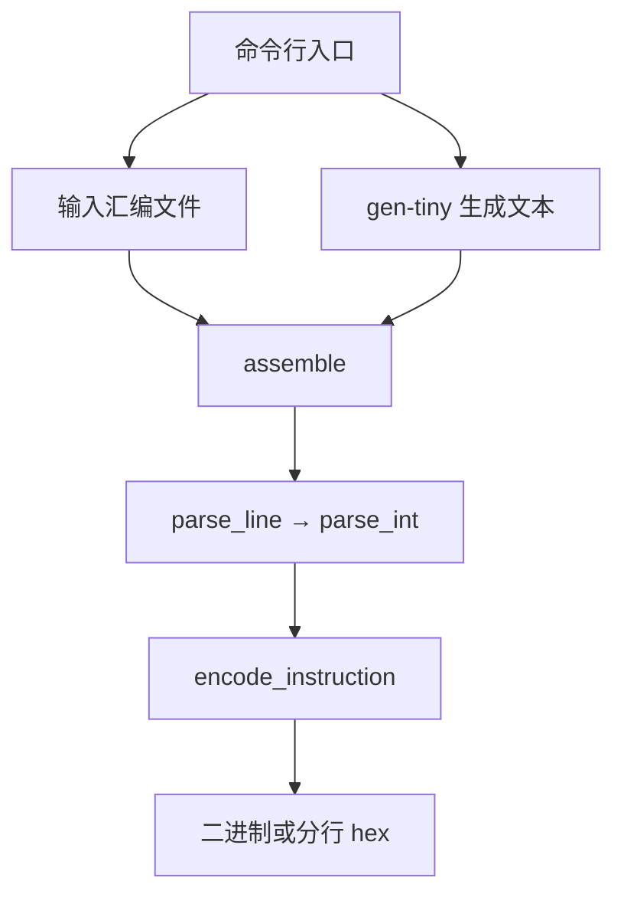

# 专题：CMakeLists.txt 与 Python 汇编器逐段精读


> 参考版本：`8216c22b762011aa20c05fc2768423fd12dda59d`。本篇是用户主动提出的七文件专题，源码与时序为静态阅读；没有进行 RTL 仿真。已写讲义不等于用户已掌握。返回[七文件代码树与学习路线](supplement-gpt2-seven-files-00-code-tree.md)。

本讲使用 [tiny-NPU 固定版本 8216c22](https://github.com/harishsg993010/tiny-NPU/tree/8216c22b762011aa20c05fc2768423fd12dda59d)，分别阅读 [`sim/verilator/CMakeLists.txt`](https://github.com/harishsg993010/tiny-NPU/blob/8216c22b762011aa20c05fc2768423fd12dda59d/sim/verilator/CMakeLists.txt) 和 [`python/tools/ucode_asm.py`](https://github.com/harishsg993010/tiny-NPU/blob/8216c22b762011aa20c05fc2768423fd12dda59d/python/tools/ucode_asm.py)。前者为仿真程序提供构建说明，后者是将文本指令编码成字节的独立软件工具。**GPT-2 block C++ 测试不调用后者，不读取后者输出。**

## 第一部分：先分清“构建仿真器”和“生成微指令”

把系统想成两条不同的生产线：

1. 硬件仿真模型的构建：`CMakeLists.txt` 描述源文件与构建目标 → CMake 配置 → 构建工具执行 → Verilator 将 SystemVerilog 转成 C++ 仿真模型 → C++ 编译和链接得到 `gpt2_block_sim`。这条线产生**在主机运行的可执行程序**。CMake 描述如何构建；调用 Verilator 生成模型和后续编译链接由生成的构建规则组织。
2. 待仿真的微码生成：GPT-2 测试里的 C++ 在可执行程序运行后执行 `load_microcode()`，构造并直接写入微码；而 `ucode_asm.py` 是可单独使用的另一条文本汇编路径。

`CMake` 的“编译”是创建仿真程序，不是把 PyTorch、ONNX 的网络图编译为 NPU 指令。`ucode_asm.py` 的“汇编”是把**已经准备好的文本指令字段**编码为二进制，也不等于完整自动模型编译器。

## 第二部分：CMakeLists.txt，从上到下读

### 2.1 它在项目中的位置

`sim/verilator/CMakeLists.txt` 是 CMake 的输入文件。它不是 C++、Python 或硬件 RTL；其中的 `set(...)`、`add_executable(...)` 是 CMake 自己的命令。配置过程会解释这些命令并生成后续构建规则；在此之后执行构建才会编译链接，最后再运行生成的可执行程序。

通常命令的含义（**仅说明，未在本次执行**）：

```bash
cmake -S sim/verilator -B build/cmake
cmake --build build/cmake --target gpt2_block_sim -j
./build/cmake/gpt2_block_sim
```

第一行 `-S` 指源目录，`-B` 指构建目录；第二行选择目标并构建，`-j` 表示并行构建；第三行运行生成的程序。需要相应编译工具和 Verilator，且本次没有验证本机配置或构建成功。

### 2.2 文件开头：版本、项目和 Verilator（1～8 行）

```cmake
cmake_minimum_required(VERSION 3.12)
project(npu_sim)
find_package(verilator HINTS $ENV{VERILATOR_ROOT})
if (NOT verilator_FOUND)
    message(FATAL_ERROR "Verilator not found. Set VERILATOR_ROOT or add to PATH.")
endif()
```

- `cmake_minimum_required` 指明项目声明的最低 CMake 版本。
- `project(npu_sim)` 声明项目名称；不要把项目名称误认为某个硬件模块或最终要执行的测试程序名。
- `find_package` 查找 Verilator 提供的 CMake 包。`$ENV{VERILATOR_ROOT}` 读取环境变量；`HINTS` 提供查找提示。
- `if (NOT verilator_FOUND)` 表示未找到时进入分支；`FATAL_ERROR` 中止配置。报错文本提示设置环境变量或检查 PATH，但真实查找是否成功取决于本地安装和 CMake 搜索设置。
- `#` 开头是 CMake 注释；`endif()` 结束条件块。

### 2.3 路径变量和共享源文件（10～43 行）

```cmake
set(RTL_DIR ${CMAKE_CURRENT_SOURCE_DIR}/../../rtl)
set(SIM_DIR ${CMAKE_CURRENT_SOURCE_DIR})
set(SV_COMMON
    ${RTL_DIR}/pkg/npu_pkg.sv
    ${RTL_DIR}/pkg/isa_pkg.sv
    ...
)
```

`set(名称 值)` 设置 CMake 变量；`${名称}` 展开变量。`CMAKE_CURRENT_SOURCE_DIR` 是当前正在处理的 CMakeLists 所在的源目录；`../../rtl` 从 `sim/verilator` 回到项目根后再进入 `rtl`。`SV_COMMON` 是源文件路径列表，跨行只是排版，不是产生多个硬件时钟。

列表包含 package、SRAM、MAC、脉动阵列、Softmax、LayerNorm、GELU 等可复用源码。**列入 SOURCES 表示交给 Verilator 的输入，不表示全部必然在目标顶层被实例化或执行。**

### 2.4 分组与公共参数（45～138 行）

- [45 行](https://github.com/harishsg993010/tiny-NPU/blob/8216c22b762011aa20c05fc2768423fd12dda59d/sim/verilator/CMakeLists.txt#L45)：`SV_TOP_EXTRA` 给原 `top` 测试准备总线、AXI、`gemm_ctrl`、`top.sv` 等。
- [61 行](https://github.com/harishsg993010/tiny-NPU/blob/8216c22b762011aa20c05fc2768423fd12dda59d/sim/verilator/CMakeLists.txt#L61)：`VERILATOR_COMMON_ARGS` 保存参数，`--cc` 指定生成 C++ 模型、`--trace` 打开跟踪支持、`-I...` 添加源搜索路径、`-DSIMULATION` 定义条件编译宏；若干 `-Wno-...` 禁用相应警告。
- [89 行](https://github.com/harishsg993010/tiny-NPU/blob/8216c22b762011aa20c05fc2768423fd12dda59d/sim/verilator/CMakeLists.txt#L89)：`SV_GRAPH`、`SV_GRAPH_P3`、`SV_GRAPH_P4` 是其他图模式目标使用的文件组。
- [124 行](https://github.com/harishsg993010/tiny-NPU/blob/8216c22b762011aa20c05fc2768423fd12dda59d/sim/verilator/CMakeLists.txt#L124)：`SV_CTRL` 包含 Scoreboard、Barrier、Fetch、Decode、KV controller。
- [133 行](https://github.com/harishsg993010/tiny-NPU/blob/8216c22b762011aa20c05fc2768423fd12dda59d/sim/verilator/CMakeLists.txt#L133)：`SV_ONNX_SIM` 给 ONNX 仿真使用。

每个目标只使用它自己的源文件组。尤其不能把 `SV_TOP_EXTRA` 里的模块自动算作 GPT-2 block 目标的显式源输入。

### 2.5 GPT-2 可执行目标（177～186 行）

[原始位置](https://github.com/harishsg993010/tiny-NPU/blob/8216c22b762011aa20c05fc2768423fd12dda59d/sim/verilator/CMakeLists.txt#L177)：

```cmake
add_executable(gpt2_block_sim tb_gpt2_block.cpp)

verilate(gpt2_block_sim
    SOURCES ${SV_COMMON} ${SV_CTRL} ${SIM_DIR}/gpt2_block_top.sv
    TOP_MODULE gpt2_block_top
    PREFIX Vgpt2_block_top
    VERILATOR_ARGS ${VERILATOR_COMMON_ARGS}
        -GSRAM0_DEPTH=65536
)
```

逐句理解：

| 代码项 | 作用 |
|---|---|
| `add_executable(gpt2_block_sim tb_gpt2_block.cpp)` | 定义名为 `gpt2_block_sim` 的可执行目标，其 C++ 测试程序是 `tb_gpt2_block.cpp` |
| `verilate(gpt2_block_sim ...)` | 将由 Verilator 生成的仿真模型加入该构建目标；这是 Verilator 的 CMake 集成提供的命令 |
| `SOURCES ...` | 显式给出公共 RTL、控制 RTL 和 GPT-2 顶层 |
| `TOP_MODULE gpt2_block_top` | 指定哪个 SV 模块是被仿真顶层 |
| `PREFIX Vgpt2_block_top` | 指定生成 C++ 模型的前缀；因此测试程序能包含 `Vgpt2_block_top.h` 并使用相应类 |
| `-GSRAM0_DEPTH=65536` | 构建这个目标时覆盖顶层参数，使 SRAM0 深度为 65536 个 8-bit 地址位置；不是指 65536 bit |

**一个尚待实际构建核对的依赖边界：**`gpt2_block_top.sv` 直接实例化 `gemm_ctrl`，但该目标的显式 `SOURCES` 不含 `gemm_ctrl.sv`。公共参数中有 `-I${RTL_DIR}/gemm` 搜索路径；是否由当前工具配置自动找到模块，本次未实际运行构建，不可断言成功或失败。`-I` 出现在参数里不等于已观察到模块被找到。

### 2.6 文件后半：不同目标共享模型（188～303 行）

[188 行起](https://github.com/harishsg993010/tiny-NPU/blob/8216c22b762011aa20c05fc2768423fd12dda59d/sim/verilator/CMakeLists.txt#L188)把 GPT-2 demo、LLaMA、ONNX 图模式分别组织为库或可执行程序。比如 `add_library(... STATIC ...)` 创建静态库目标，`target_link_libraries(A PRIVATE B)` 表示目标 A 链接库 B；同一个转换后的模型可供不同测试复用。`file(WRITE ... "")` 创建的是构建目录中的空占位源文件，供库目标建立，不是用户需要手写的 NPU RTL。

这些其他目标显示项目有多套测试，不代表 `gpt2_block_sim` 顺序执行所有测试。目标名 `gpt2_block_sim` 与 `demo_infer` 也不是同一个程序。

## 第三部分：汇编器的地位和代码树

`python/tools/ucode_asm.py` 以人类可读的文本为输入，将每行的操作名和参数填入 128-bit 指令字段。完整指令是 16 字节。

| 定义/区域 | 行号 | 输入 | 输出/作用 |
|---|---:|---|---|
| `OPCODES`、`FLAGS` | 42、48 | 名称 | 操作码表、标志掩码表 |
| `parse_int(s)` | 58 | 数字字符串 | Python 整数 |
| `encode_instruction(...)` | 65 | opcode、字段值 | 一条 16 字节的 `bytes` |
| `parse_line(line)` | 82 | 一行汇编文本 | 字段字典，空行则为 `None` |
| `assemble(text)` | 111 | 多行汇编文本 | 多条指令拼起来的 `bytes` |
| `assemble_file(...)` | 121 | 输入输出路径与格式 | 读取文件并写二进制或文本 hex |
| `gen_tiny_transformer_ucode(...)` | 142 | 五个可配置维度参数 | 手写模板生成的多行文本 |
| 命令行入口 | 249 | 命令行参数 | 分支调用上述函数 |

调用关系：



注意这是 Python 内的软件调用关系；没有从该图指向 GPT-2 C++ 测试的已实现加载连线。

## 第四部分：从源文件开头按顺序阅读 Python

### 4.1 文件头、import、字典（1～56 行）

第 1 行 `#!/usr/bin/env python3` 在某些系统直接执行脚本时指定解释器。三引号包围的开头文字是模块文档字符串，说明指令布局和举例；它不是指令执行逻辑。`import struct` 使用标准库进行二进制打包，`import argparse` 解析命令行；`sys`、`re` 被导入但本文件没有使用它们完成核心流程。

```python
OPCODES = {'GEMM': 3, 'VEC': 4, 'END': 255}
FLAGS = {'REQUANT': 1 << 2}
```

这是缩写示例，完整字典见源码。字典是键值映射，`OPCODES['GEMM']` 得到整数 `3`。`1 << 2` 是把二进制 1 左移两位，即十进制 4 或 `0x04`。`FLAGS` 只是定义了符号到数值的对照；解析器并没有查这个表来解析 `flags=REQUANT`，当前输入应写数字如 `flags=0x04`。同一标志位可随 opcode 复用：`0x04` 在 GEMM 和 VEC 中不可一概解释成相同含义。

这里的 Python `OPCODES` 也没有列出 RTL ISA 中 RMSNORM、ROPE、SILU 这些名字，不可假定汇编器和 RTL 覆盖范围完全相同。

### 4.2 `parse_int(s)`：字符串转整数（58～63 行）

```python
def parse_int(s):
    s = s.strip()
    if s.startswith('0x') or s.startswith('0X'):
        return int(s, 16)
    return int(s)
```

`def` 定义函数；`s` 是输入；冒号之后以缩进表示代码块。`strip()` 去除首尾空白；`startswith()` 看前缀；`or` 表示任一条件成立；`int(s, 16)` 将十六进制文本转换成整数；`return` 结束函数并返回值。比如 `parse_int(' 0x10 ')` 得到整数 `16`，`parse_int('64')` 得到整数 `64`。

### 4.3 `encode_instruction(...)`：将字段放进位段（65～80 行）

```python
word = 0
word |= (opcode & 0xFF)
word |= (flags & 0xFF) << 8
word |= (dst & 0xFFFF) << 16
# 后面以同样形式处理 src0、src1、M、N、K、imm
lo = word & 0xFFFFFFFFFFFFFFFF
hi = (word >> 64) & 0xFFFFFFFFFFFFFFFF
return struct.pack('<QQ', lo, hi)
```

这是节选，位偏移与完整源码一致。`&` 按位与，`0xFF` 用于只保留 8 位，`0xFFFF` 用于保留 16 位；`<<` 左移到对应位段；`|=` 等价于 `word = word | 右侧`，把字段并入已有指令。`>>` 向右移。Python 整数可容纳 128 位，最终才用 `struct.pack` 固定格式打包。`<QQ` 中 `<` 指小端，两个 `Q` 分别是 64-bit 无符号数，按 `lo` 然后 `hi` 变成 16 字节。

编码函数使用掩码截掉超出位宽的高位，不自动报告字段溢出；比如输入大于 16 位的地址需要上层先做范围检查。位段值与内存中的字节排列是两个概念：前者规定 opcode 等字段在哪些 bit，后者规定写文件时低字节排在前还是后。

### 4.4 `parse_line(line)`：一行转字段字典（82～109 行）

源码先执行 `line.split('#')[0].strip()`：先在 `#` 处分割、取注释前文本、去掉首尾空格。空行返回 `None`。然后 `parts = line.split()` 用空白分出列表；`parts[0].upper()` 得到大写助记符；不认识的 opcode 用 `raise ValueError(...)` 报错。

接着创建字段字典，初值为 0，再用 `for part in parts[1:]:` 逐项处理 `key=value`：

```python
key, val = part.split('=', 1)
key = key.strip().lower()
val = parse_int(val)
if key in fields:
    fields[key] = val
```

`parts[1:]` 是除首项操作码之外的剩余列表；`split('=', 1)` 最多按第一个等号分成键和值；赋值左边两个名字分别接收两项。`in` 对字典检查键是否存在；`continue` 跳过当前循环的剩余部分。

**该版本的错误：**输入键无条件执行 `.lower()`，但初始字段字典的维度键却是大写 `M`、`N`、`K`。所以 `M=8` 变成键 `m`，不在字典里，被静默忽略，维度仍为 0。其他未识别的合法数字键也被静默跳过；没有 `=` 的 token 也跳过。不要将这种行为理解成正确解析。

一个教学修正思路是在 `lower()` 后明确映射：`{'m': 'M', 'n': 'N', 'k': 'K'}.get(key, key)`；同时应该对未知键和范围报错，再建立测试。这里仅说明思路，未修改上游程序。

### 4.5 具体跟踪一条指令，验证发现的差异

输入：

```text
GEMM flags=0x04 dst=0x1000 src0=0x0000 src1=0x0800 M=8 N=64 K=64 imm=0x0701
```

- 助记符 `GEMM` 映射为 opcode 3。
- `flags`、`dst`、`src0`、`src1`、`imm` 正常进入字典。
- `M/N/K` 因大小写问题未更新而保持 0。
- 编码函数仍按当前字段打包，因此可输出文件，但输出不是文本希望表达的矩阵维度。

此前独立运行 Python 汇编器得到实际 128-bit 数值 `0x07010000000000000800000010000403`；按用户输入的维度应为 `0x07010040004000080800000010000403`。此检查仅针对 Python，不是 RTL 仿真或模型精度验证。

### 4.6 `assemble(text)`：把多行变成连续指令字节（111～119 行）

```python
binary = b''
for i, line in enumerate(text.strip().split('\n')):
    fields = parse_line(line)
    if fields is None:
        continue
    binary += encode_instruction(**fields)
return binary
```

`b''` 是空字节串；`split('\n')` 按换行拆分；`enumerate` 依次给出索引和内容，本代码中的 `i` 后续未使用；`fields is None` 检查是否返回空行标记。`**fields` 将字典展开成命名参数，例如 `{'opcode':3,'M':8}` 相当于 `encode_instruction(opcode=3, M=8)`。每次得到 16 字节，`binary += ...` 追加到已有字节串。因为字段解析的错误发生在前一步，这个函数也会受到影响。

### 4.7 `assemble_file`：读取和写出（121～140 行）

`with open(input_path, 'r') as f:` 以文本读模式打开文件，离开 `with` 后会自动关闭；`f.read()` 取得文本；`'wb'` 是二进制写模式；`'w'` 是文本写模式。

普通输出是一条指令 16 字节。`--hex` 的实现将这 16 字节分为四组，每组 `struct.unpack_from('<I', chunk, j)[0]` 解释成一个 32-bit 数，再用 `f'{word:08x}\n'` 输出一行 8 位十六进制，低 32 位先行。因此**一条 128-bit 指令对应四行 32-bit 字符**。

此格式不能直接被认为是每地址 128 bit 指令 SRAM 所需的“一行一条指令”格式；如果加载到 128-bit 数组，需要根据具体加载逻辑拼装四行或改变输出格式，再做验证。当前 GPT-2 C++ 测试根本不读取本文件生成的 hex。

### 4.8 `gen_tiny_transformer_ucode`：手写模板生成器（142～247 行）

函数默认 `hidden=64, heads=4, head_dim=16, ffn_dim=256, seq_len=8`。它不是读取模型图；程序员把目标执行顺序直接写入 `lines` 列表，再在运行时根据维度计算字符串。

| 源码区域 | 模板打算生成的阶段 |
|---|---|
| 162～175 | 创建列表，输入加载和 LN1，穿插 Barrier |
| 177～182 | 加载 QKV 权重并生成 GEMM |
| 184～203 | 对每个 head 计算地址，生成 QKᵀ、Softmax、PV |
| 205～219 | 输出投影、残差、LN2 |
| 221～245 | FFN1、GELU、FFN2、残差、存储和 END |
| 247 | `\n`.join(lines) 返回多行字符串 |

`lines.append(...)` 往列表末尾添加一行；`for h in range(heads)` 遍历 `0` 到 `heads-1`；`f'...{变量}...'` 是 f-string，将表达式值插入文本；`{score_off:#06x}` 生成带 `0x` 前缀的十六进制格式。模板本身写了 DMA 和布局意图，但其地址范围、步幅和 RTL 接口是否吻合仍须验证，不能仅凭模板说明已经完成模型运行。

默认模板之前单独运行检查得 59 条、944 字节（59×16），但因为 `parse_line` 的 M/N/K 问题，这只是文本生成和字节长度统计，不代表有效的 GPT-2 仿真。

### 4.9 主程序入口（249～276 行）

```python
if __name__ == '__main__':
    ...
    if args.gen_tiny:
        ...
    elif args.input:
        ...
    else:
        parser.print_help()
```

文件直接运行时 `__name__` 等于 `'__main__'`；被其他 Python 文件 `import` 时，该入口不会自动执行。`argparse` 接收 `--gen-tiny`、输入文件名、`-o/--output` 和 `--hex`；`if / elif / else` 是互斥分支：

1. 指定 `--gen-tiny`：先生成模板文本，再 `assemble(text)` 编码，然后写文件。
2. 否则提供输入文件：`assemble_file(...)` 读入和输出。
3. 两者都没有：显示帮助。

可供用户自行参考的命令如下，**均会受到该版本字段解析错误影响**：

```bash
python3 python/tools/ucode_asm.py input.asm -o program.bin
python3 python/tools/ucode_asm.py --gen-tiny --hex -o ucode.hex
```

区分：第一条假设已有 `input.asm` 文本；第二条使用写死的模板；二者都不会自动让 `gpt2_block_sim` 读取输出。默认 C++ GPT-2 路径完全不依赖这两条命令。
