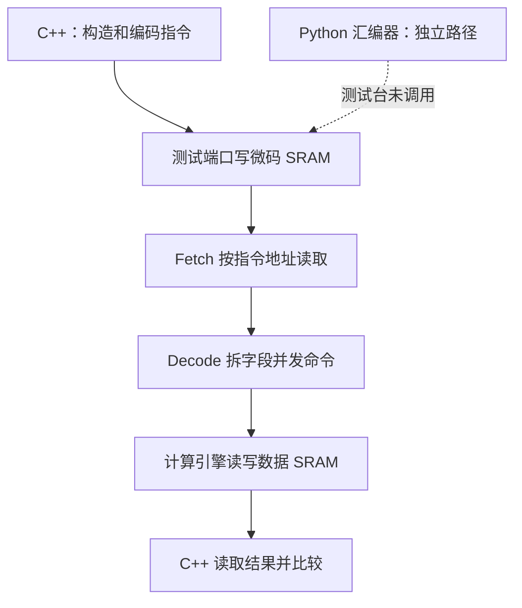
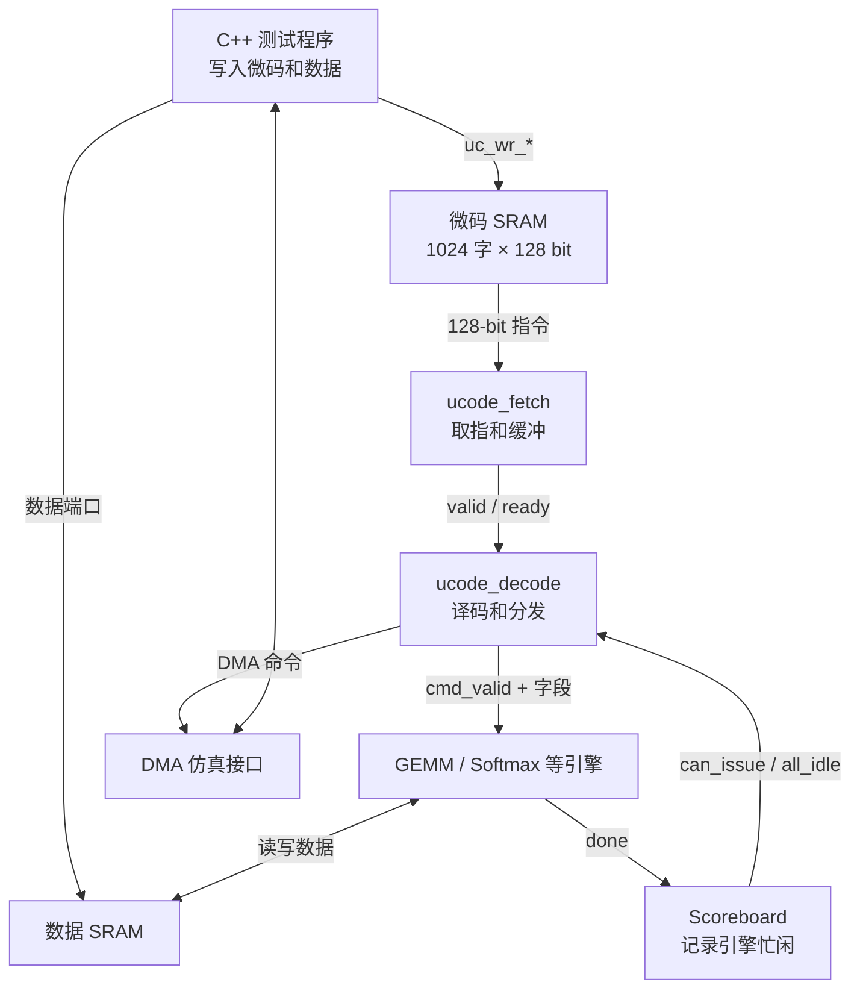

# GPT-2 Block 微码生成、装载与 RTL 仿真：零基础源码精读

固定源码：[`harishsg993010/tiny-NPU@8216c22`](https://github.com/harishsg993010/tiny-NPU/tree/8216c22b762011aa20c05fc2768423fd12dda59d)。本篇是第09讲之后的专题答疑，不是第10讲。时间线与握手均为源码静态推导；没有运行 RTL 仿真。本文所说的“硬件”是在 Verilator 中运行的 RTL 模型，不是实际芯片。Python 汇编器样例已单独运行检查，但这不构成 RTL 仿真验证。

## 1. 先纠正一个关键认识：此处没有自动编译模型

测试用例先在 C++ 中**手写安排**一个缩小版 Transformer block 的计算次序、内存地址、维度和量化参数。`load_microcode()` 的循环展开出指令，由 `encode_instr()` 编码、`ucode_write()` 写入模拟顶层中的微码 SRAM；它不读取 GPT-2 checkpoint、不分析 PyTorch 计算图，也不调用 `ucode_asm.py`。所以我们能学习的是“人工实现的模型映射和指令构造”，不能说项目完成了通用模型编译器。

现实中可编程 NPU 通常还需要：模型图导入→算子和形状分析→量化与布局→算子选择、切分、地址分配与调度→生成目标 ISA 指令→加载；这些是说明性流程，不宣称本测试已实现。Python 的 `--gen-tiny` 是另一套示例指令文本生成器，其地址布局和策略不同，也存在后文所述问题。

## 2. 先认识三个世界

| 场所 | 负责什么 | 本例实体 |
|---|---|---|
| C++ 仿真测试台 | 产生随机测试数据、编写并装载指令、控制时钟、验证结果 | `tb_gpt2_block.cpp` |
| RTL 硬件模型 | 存储并读取指令、译码、调度和计算 | `gpt2_block_top.sv`、`ucode_fetch.sv` 等 |
| Python 汇编工具 | 把文本助记符与字段编码为字节；本测试未调用 | `ucode_asm.py` |



虚线表示潜在集成方向，并不表示源码已有 Python 输出文件加载功能。控制流是 C++ 推动仿真时钟、RTL 根据状态和握手运行；指令流是 128 位微指令从 SRAM 到 Fetch、Decode；数据流是矩阵数值在数据 SRAM 和计算模块间搬运。指令地址按**条**计算，数据 SRAM 地址按**字节**计算，两个地址空间不能混同。

## 3. 模型计算图和维度

测试使用序列长度 8、隐藏维 64、4 个头、每头 16、FFN 宽度 256；输入和权重均是测试生成的 INT8，未载入预训练权重。整体数据维度如下：

| 阶段 | 运算 | 维度 |
|---|---|---|
| 第一归一化 | LN1(X) | 8×64 → 8×64 |
| 每个注意力头 | Q、K、V = LN1 × Wq/Wk/Wv | 每次 (8×64)×(64×16) → 8×16 |
| 每个注意力头 | S = Q × Kᵀ，P = Softmax(S) | (8×16)×(16×8) → 8×8 → 8×8 |
| 每个注意力头 | P × V | (8×8)×(8×16) → 8×16 |
| 拼接和输出投影 | 四头拼接，再乘 Wo | 8×64 × 64×64 → 8×64 |
| 残差、第二归一化 | X2 = 投影 + X；LN2(X2) | 8×64 |
| FFN 与残差 | FFN1→GELU→FFN2→加 X2 | 8×64→8×256→8×64 |

这里的 `M,N,K` 对 GEMM 表示 A[M,K]×B[K,N]→C[M,N] 的矩阵元素数；其他 opcode 对同一字段可有不同含义，必须查译码与引擎，不能一概而论。

## 第一部分：先沿 C++ 仿真程序读懂微指令从哪里来

本部分对应固定版本 [sim/verilator/tb_gpt2_block.cpp](https://github.com/harishsg993010/tiny-NPU/blob/8216c22b762011aa20c05fc2768423fd12dda59d/sim/verilator/tb_gpt2_block.cpp)。文件共有 1228 物理行，含注释和空行。以下时序和指令数量是对该版本源码的静态分析，不代表本次已经成功执行仿真。

### 1. 首先区分三件经常混淆的事

1. **模型编译**：通常需要读取模型计算图、选择算子、切分矩阵、分配存储地址、安排执行顺序和同步，再生成设备指令。
2. **汇编/编码**：已知“要做什么操作、操作数地址和参数”后，把它们按照指令格式填进固定位域，形成二进制指令。
3. **RTL 仿真编译**：Verilator 把 SystemVerilog 硬件描述转换成可由 C++ 驱动的仿真模型；这与将神经网络模型编译成 NPU 指令是两件不同的事。

这个 GPT-2 block 测试的操作顺序、地址和尺寸由程序员在 C++ 中写死：`load_microcode()` 通过循环调用 `encode_instr()`，直接产生和写入 128 位指令。这个测试没有调用 `ucode_asm.py`，也没有读取 GPT-2 计算图并自动把它编译成微指令。故它展示了**人为安排模型算子后怎样编码、装载和执行**，不是完整的自动模型编译器。

这是一个缩小的、随机数据的 GPT-2 风格 Transformer block 仿真，并非读入预训练的 GPT-2 权重后生成文字。C++ 测试程序在主机上运行；`gpt2_block_top.sv` 是仿真里的被测硬件顶层；C++ 通过 Verilator 生成的接口驱动它们。硬件实例连接关系后文再通过 RTL 核对。

### 2. 代码从文件开头看起：程序的角色和尺寸

#### 2.1 头文件和仿真对象

[文件开头](https://github.com/harishsg993010/tiny-NPU/blob/8216c22b762011aa20c05fc2768423fd12dda59d/sim/verilator/tb_gpt2_block.cpp#L8) 包含 `verilated.h`、波形接口以及 `Vgpt2_block_top.h`。最后这个头文件来自 Verilator 对顶层模块的转换；它提供一个 C++ 类，类的成员让测试程序可以设置或读取对应仿真端口。

```cpp
static Vgpt2_block_top* dut;
static VerilatedVcdC* tfp;
```

- `Vgpt2_block_top`：表示被测 RTL 仿真模型的 C++ 类。
- `*`：声明这里存的是一个指针，即指向对象的变量。
- `dut`：device under test，被测设备。
- `tfp`：指向 VCD 波形记录对象。代码在运行时才创建对象。
- `static` 在这个位置使名称只在本源文件内可见。

`main()` 中的 `dut = new Vgpt2_block_top;` 创建仿真对象，之后 `dut->clk = 0;` 通过指针访问对象的 `clk` 成员。`->` 可以理解为“通过这个指针找到对象，再访问其中的成员”。不要把 C++ 对象本身误认为真实芯片。

#### 2.2 尺寸与单位

[第 42 行起](https://github.com/harishsg993010/tiny-NPU/blob/8216c22b762011aa20c05fc2768423fd12dda59d/sim/verilator/tb_gpt2_block.cpp#L42)：

| 常量 | 值 | 含义及单位 |
|---|---:|---|
| `SEQ_LEN` | 8 | 本次处理 8 个 token 位置 |
| `HIDDEN` | 64 | 每个 token 的隐藏向量 64 个元素 |
| `N_HEADS` | 4 | 注意力头数量 4 |
| `HEAD_DIM` | 16 | 每个头 16 个通道，4×16=64 |
| `FFN_DIM` | 256 | 前馈层中间向量 256 个元素 |

例如输入 `X` 为 `int8_t X[8][64]`，共 512 个元素；此测试每个元素 1 字节，因此是 512 字节。一个注意力头的 Q 权重是 `[64,16]`，其投影为 `[8,64] × [64,16] → [8,16]`。

`static const int SEQ_LEN = 8;` 声明一个整数常量。`int8_t` 是 8 位有符号整数，`uint16_t` 是 16 位无符号整数；不应把“16 位地址数值”误当成“传输 16 字节”。

#### 2.3 SRAM 地址和 opcode

[第 50 行起](https://github.com/harishsg993010/tiny-NPU/blob/8216c22b762011aa20c05fc2768423fd12dda59d/sim/verilator/tb_gpt2_block.cpp#L50) 给权重、激活和中间结果分配 SRAM **字节地址**。如：`ADDR_X=0xC000`、`ADDR_LN1_OUT=0xC400`、`ADDR_Q_H=0xC800`。这意味着它们存的是测试中各矩阵的起始位置，不是矩阵的数值本身。`0x` 表示后面的数字使用十六进制。

[第 84 行起](https://github.com/harishsg993010/tiny-NPU/blob/8216c22b762011aa20c05fc2768423fd12dda59d/sim/verilator/tb_gpt2_block.cpp#L84) 定义操作码，如 `OP_GEMM=3`、`OP_BARRIER=10`、`OP_END=255`。`flags` 的同一位可以因 opcode 不同拥有不同意义：例如 0x04 在 GEMM 中表示 REQUANT，在 VEC 中用于 COPY2D，必须结合译码逻辑理解。

### 3. 时钟与测试接口：C++ 怎么“推动” RTL

[第 112 行的 `tick()`](https://github.com/harishsg993010/tiny-NPU/blob/8216c22b762011aa20c05fc2768423fd12dda59d/sim/verilator/tb_gpt2_block.cpp#L112) 先令 `clk=0` 并 `dut->eval()`，再令 `clk=1` 并 `dut->eval()`；如果打开波形记录，会分别调用 `dump()`。`eval()` 使仿真模型依据当前输入更新，不等于物理硬件中的一个软件函数。一次 `tick()` 产生一个低电平和一次上升沿；`tc` 为波形时间管理变量，每次 tick 在两个半周期各自递增一次。

```cpp
void sram0_write(uint16_t addr, uint8_t data) {
    dut->tb_sram0_wr_en = 1;
    dut->tb_sram0_wr_addr = addr;
    dut->tb_sram0_wr_data = data;
    tick();
    dut->tb_sram0_wr_en = 0;
}
```

[源码第 134 行](https://github.com/harishsg993010/tiny-NPU/blob/8216c22b762011aa20c05fc2768423fd12dda59d/sim/verilator/tb_gpt2_block.cpp#L134)。它通过测试端口将一个 8 位数据字节写入一个 16 位地址，再推进一个时钟；并不是通过真实 CPU 总线写权重。下一节看类似的微码写接口。

### 4. 指令是怎样变成 128 位的？

#### 4.1 编码格式

[第 177 行 `encode_instr`](https://github.com/harishsg993010/tiny-NPU/blob/8216c22b762011aa20c05fc2768423fd12dda59d/sim/verilator/tb_gpt2_block.cpp#L177) 接收 opcode、标志、地址、矩阵维度、立即数，并用两个 64 位整数输出整条指令。源码布局如下：

| 指令位段 | 字段 | 位宽 | 当前程序常见含义 |
|---|---|---:|---|
| `[7:0]` | `opcode` | 8 bit | 操作类型 |
| `[15:8]` | `flags` | 8 bit | 操作选项 |
| `[31:16]` | `dst` | 16 bit | 目的地址 |
| `[47:32]` | `src0` | 16 bit | 源地址 0 |
| `[63:48]` | `src1` | 16 bit | 源地址 1 |
| `[79:64]` | `M` | 16 bit | 通常是 GEMM 输出行数 |
| `[95:80]` | `N` | 16 bit | 通常是 GEMM 输出列数 |
| `[111:96]` | `K` | 16 bit | 通常是 GEMM 归约长度 |
| `[127:112]` | `imm` | 16 bit | 立即数，其解释随 opcode 而变 |

`M/N/K` 并不对所有操作都表示矩阵维度。例如 VEC COPY2D 中它们被复用为行数、列数和源步长。因此不能只看字段名字，还要看当前 opcode 对其具体的解释。

代码用 `<<` 左移、`|` 按位或，将互不重叠的字段放到相应位置。例如 `((uint64_t)dst << 16)` 是先将 `dst` 转成 64 位，再向左移动 16 位；`(uint64_t)` 是类型转换。`uint64_t& hi` 中的 `&` 是 **C++ 引用参数**：函数里对 `hi` 赋值会改变调用者传进来的变量，不是按位与运算。

#### 4.2 跟踪一条真正的 Q 投影指令

[第 568 行附近](https://github.com/harishsg993010/tiny-NPU/blob/8216c22b762011aa20c05fc2768423fd12dda59d/sim/verilator/tb_gpt2_block.cpp#L568) 当 `h=0`：

```cpp
encode_instr(OP_GEMM, FLAG_REQUANT,
             ADDR_Q_H, ADDR_LN1_OUT, wq_h_addr,
             SEQ_LEN, HEAD_DIM, HIDDEN, GEMM_IMM_K64,
             hi, lo);
ucode_write(addr++, hi, lo);
```

代入常量：

| 参数 | 数值 | 含义 |
|---|---:|---|
| opcode | `0x03` | GEMM |
| flags | `0x04` | 启用再量化选项 |
| dst | `0xC800` | Q 输出 SRAM0 首地址 |
| src0 | `0xC400` | LN1 输出 SRAM0 首地址 |
| src1 | `0x0000` | 第 0 个头的 Q 权重首地址 |
| M, N, K | 8, 16, 64 | `[8,64] × [64,16] → [8,16]` |
| imm | `0x0901` | 该测试中 scale=1、shift=9 |

填入位段后：

```text
hi = 0x0901004000100008
lo = 0x0000C400C8000403
128位（高位写左边）= 0x09010040001000080000C400C8000403
```

它位于微码地址 9，因为前面是 8 条按行 LayerNorm 加 1 条 Barrier。这里的 `addr++` 是后置自增：**先把当前地址用于函数调用，再令 `addr` 增加 1**。它不是 `addr = addr + 1` 再写入。

#### 4.3 128 位怎么通过 C++ 端口装入硬件？

[第 166 行](https://github.com/harishsg993010/tiny-NPU/blob/8216c22b762011aa20c05fc2768423fd12dda59d/sim/verilator/tb_gpt2_block.cpp#L166) `ucode_write(addr, hi, lo)` 将 128 位按 32 位拆成四份，给 Verilator 生成的宽端口数组赋值：

| 数组元素 | 示例值 | 对应指令位 |
|---|---|---|
| `[0]` | `0xC8000403` | `[31:0]` |
| `[1]` | `0x0000C400` | `[63:32]` |
| `[2]` | `0x00100008` | `[95:64]` |
| `[3]` | `0x09010040` | `[127:96]` |

例如 `lo & 0xFFFFFFFF` 保留低 32 位，`lo >> 32` 把高 32 位移到低位。`uc_wr_en=1`、`uc_wr_addr=addr` 和 128 位写数据准备好之后调用 `tick()`，产生写入时钟沿，随后撤销写使能。数组拆分只是仿真接口表达一个宽信号的方式，不能由此断言真实硬件一定是四次 32 位总线写。

### 5. 模型算子顺序如何写成微指令程序？

[第 550 行 `load_microcode()`](https://github.com/harishsg993010/tiny-NPU/blob/8216c22b762011aa20c05fc2768423fd12dda59d/sim/verilator/tb_gpt2_block.cpp#L550) 先设 `int addr=0`；以下循环都在 **C++ 装载阶段**运行，依次写入微指令存储器。这里的 `for` 不是发给 NPU 的循环控制指令；它把循环体展开为多条指令。

#### 5.1 按行 LayerNorm，再设置同步

`for (int i=0; i<SEQ_LEN; i++)` 的三部分分别是：初始化 `i=0`；每轮判断 `i<8`；每轮结束后 `i++`。代码为每一行生成一条 LN 指令，`src=ADDR_X+i*64`、`dst=ADDR_LN1_OUT+i*64`，所以相邻行地址差 64 **字节**，每行 64 个 INT8 元素。完成 8 条后写入 Barrier，要求后续阶段按 RTL 所实现的同步条件等待。

#### 5.2 对 4 个注意力头循环展开

每个头生成以下顺序：

1. 计算 Q、K、V：每次投影是 `[8,64]×[64,16]→[8,16]`；3 条 GEMM，每条后面各有 Barrier。
2. 计算分数：`Q[8,16] × Kᵀ[16,8] → S[8,8]`，1 条 GEMM，加 Barrier。代码通过转置 B 的 flag 表示如何读取 B。
3. 对 S 的 8 行逐行发送 Softmax：8 条 Softmax，最后加 1 条 Barrier；`K` 字段承载行索引以配合 causal mask 的操作含义。
4. `P[8,8] × V[8,16] → ATTN_H[8,16]`：1 条 GEMM 和 1 条 Barrier。
5. VEC COPY2D 将 `[8,16]` 这一头的输出逐行复制到 `[8,64]` 的对应 16 列；1 条 VEC 和 1 条 Barrier。源行步长为 16 字节，目的行步长为 64 字节。

每个头共 `3×2 + 2 + 9 + 2 + 2 = 21` 条。四个头各自 Q/K/V 等中间缓冲区复用，合并输出落到 ATTN 的不同列。`wq_h_addr = ADDR_WQ + h*64*16` 是第 h 个头权重块的起点，每头 1024 个 INT8 元素，即 1024 字节。

#### 5.3 输出投影、残差与 FFN

随后依次生成：输出投影 `ATTN×Wo`、第一次残差加法、将残差 X2 从 SRAM0 搬到 SRAM1 的 DMA 命令、8 条 LN2、FFN1 GEMM、原址 GELU、FFN2 GEMM、第二次残差加法和 END。每个大的操作阶段之后安排 Barrier。源码里的 DMA 在这个测试由 C++ 侧模拟服务，后文解释，不能直接宣称已使用完整 AXI DMA。

#### 5.4 一共多少条指令？

| 指令阶段 | 静态展开后的数量 |
|---|---:|
| LN1 8 条 + Barrier 1 条 | 9 |
| 4 个头，每头 21 条 | 84 |
| 输出投影、残差 1、DMA：各一条操作和一条 Barrier | 6 |
| LN2 8 条 + Barrier 1 条 | 9 |
| FFN1、GELU、FFN2、残差 2：各一条操作和一条 Barrier | 8 |
| END | 1 |
| **合计** | **117** |

按类别核对：GEMM 23、Softmax 32、LayerNorm 16、VEC 6、DMA 1、GELU 1、Barrier 37、END 1，总计 117。上述是本代码静态展开的计算结果，不是实际运行日志。`load_microcode()` 最后 `return addr;` 返回下一空地址，因此它也等于已写入的指令数。

### 6. 初始化输入和权重：数值不是来自真实模型

[第 442 行](https://github.com/harishsg993010/tiny-NPU/blob/8216c22b762011aa20c05fc2768423fd12dda59d/sim/verilator/tb_gpt2_block.cpp#L442) 的 `generate_data_and_golden()` 用 `srand(42)` 设定伪随机种子，再用 `rand()` 生成输入、权重和 beta；同时用 C++ 函数算出软件参考值。举例 `((rand() % 21) - 10)` 产生范围为 -10 至 10 的整数：`%` 是求余，减 10 将范围移动到零附近。随机序列的具体结果与 C 库实现有关，不应将同一 seed 理解成跨平台一定相同。

[第 736 行](https://github.com/harishsg993010/tiny-NPU/blob/8216c22b762011aa20c05fc2768423fd12dda59d/sim/verilator/tb_gpt2_block.cpp#L736) `load_data_to_srams()` 调用测试接口把这些数逐字节写到 SRAM0；LN beta 和第一次残差所需 X 写 SRAM1。数组访问例如 `X[i][j]` 是第 i 行第 j 列，`ADDR_X + i*HIDDEN + j` 是该 INT8 元素的字节地址。

C++ 算出的 `golden` 是参考结果；它不是送到 NPU 的指令。数据流和指令流分开：权重、激活进入 SRAM，128 位控制指令进入微码存储器；运行时指令字段指导硬件从指定地址访问数据。

### 7. 从 main 追一次完整控制流

[第 872 行 `main()`](https://github.com/harishsg993010/tiny-NPU/blob/8216c22b762011aa20c05fc2768423fd12dda59d/sim/verilator/tb_gpt2_block.cpp#L872) 是 C++ 程序入口，按顺序执行：

1. 创建 RTL 仿真对象和 VCD 追踪对象，初始化输入端口；
2. 建立 C++ 参考函数使用的查找表并复位；
3. 生成随机数据并计算软件参考；
4. `int num_instrs = load_microcode();` 逐条编码与装载指令；
5. `load_data_to_srams();` 装入数据；
6. 设置 `dut->ucode_len = num_instrs`，给 `start_pulse` 拉高一个 `tick()`，再拉低；
7. 进入 `while (cycle < MAX_CYCLES && !done)`，逐 tick 推进模型，处理 DMA、统计完成信号，直到 `program_end` 或超时；
8. 从 SRAM 回读结果，计算比较与最终判定，关闭波形并释放对象。

`while` 是条件为真就循环，`&&` 表示两个条件都为真，`!done` 表示尚未结束。代码中的 `cycle` 不是启动以来所有硬件时钟的精确总数：装载、验证阶段的 tick 不包含在该变量内，并且 DMA 复制内部的许多 tick 也没有逐次增加 `cycle`。因此打印的 `cycle` 要按其源码计数口径理解。

当 `dma_cmd_captured` 有效时，[第 787 行的 `handle_dma_command`](https://github.com/harishsg993010/tiny-NPU/blob/8216c22b762011aa20c05fc2768423fd12dda59d/sim/verilator/tb_gpt2_block.cpp#L787) 用 `dma_src/dst/len` 逐字节从 SRAM0 读、写到 SRAM1；随后测试程序脉冲 `dma_done_pulse` 通知硬件。本项测试中数据复制由 C++ testbench 完成，其实际功能和延迟不等价于 AXI DMA 硬件实现。

### 8. 验证到底证明了什么？

[第 1006 行起](https://github.com/harishsg993010/tiny-NPU/blob/8216c22b762011aa20c05fc2768423fd12dda59d/sim/verilator/tb_gpt2_block.cpp#L1006) 采用 follow-actual：读取某一阶段 RTL 的实际结果，再用 C++ 参考计算它的下一阶段结果，与下一阶段 RTL 输出比较。这有利于定位局部错误，但不能直接证明“从原始输入到最终输出与独立参考端到端一致”，因为早期误差可能被带入后续参考。

LN1、LN2 的比较设置容差 20 并只作信息显示，未纳入 `all_pass`；例如注意力、WO、残差、FFN 等检查则更新 `all_pass`。最后 [第 1204 行](https://github.com/harishsg993010/tiny-NPU/blob/8216c22b762011aa20c05fc2768423fd12dda59d/sim/verilator/tb_gpt2_block.cpp#L1204) 的最终条件是：

```cpp
bool pass = all_pass && (hw_gemm_count == 23) && (dma_count == 1);
```

Softmax、LayerNorm、GELU、VEC 的完成次数会打印，但不直接加入这条最终布尔判断。`return pass ? 0 : 1;` 使用三目运算：条件真返回 0，否则返回 1，通常给操作系统表示成功或失败。即使某次运行输出 PASS，也必须结合这些比较口径来解释，不能当作真实预训练 GPT-2 完整推理精度已验证。

## 从测试程序进入 RTL：顶层、取指与译码

本节分析的源码固定在提交 `8216c22b762011aa20c05fc2768423fd12dda59d`，主要文件为 [gpt2_block_top.sv](https://github.com/harishsg993010/tiny-NPU/blob/8216c22b762011aa20c05fc2768423fd12dda59d/sim/verilator/gpt2_block_top.sv#L9)、[ucode_fetch.sv](https://github.com/harishsg993010/tiny-NPU/blob/8216c22b762011aa20c05fc2768423fd12dda59d/rtl/ctrl/ucode_fetch.sv#L9)、[ucode_decode.sv](https://github.com/harishsg993010/tiny-NPU/blob/8216c22b762011aa20c05fc2768423fd12dda59d/rtl/ctrl/ucode_decode.sv#L9) 和 [sram_dp.sv](https://github.com/harishsg993010/tiny-NPU/blob/8216c22b762011aa20c05fc2768423fd12dda59d/rtl/mem/sram_dp.sv#L9)。时序表是依据这些源码静态推导，不是本次仿真的波形。

### 1. 先建立硬件图



图中箭头区分了两类信息：**指令流**从微码 SRAM 到 Fetch、Decode；**数据流**从数据 SRAM 进入运算引擎再写回 SRAM。Decode 将指令中携带的地址和维度转给运算单元，并不把整个矩阵装入指令。测试程序作为仿真外部环境，负责驱动输入端口；它不等于 RTL 中的一个硬件模块。

这里的 `gpt2_block_top.sv` 是 GPT-2 block 的**仿真集成顶层**：源码实例化了 GEMM 控制器与脉动阵列、Softmax、LayerNorm、GELU、Vec 等运算 RTL 以及存储器。[顶层第 321 行](https://github.com/harishsg993010/tiny-NPU/blob/8216c22b762011aa20c05fc2768423fd12dda59d/sim/verilator/gpt2_block_top.sv#L321)明确写有 `gemm_ctrl ... u_gemm_ctrl`，后面还有 `systolic_array ... u_systolic` 和 256×32 bit ACC SRAM；因此 GEMM 控制器是单独实例，并非在该顶层中自写 FSM。不要将其他顶层中的计时占位引擎与这个顶层混淆。另一方面，DMA 命令通过仿真接口交给 C++ 测试程序协助处理，不应把这条路径说成已经使用真实 AXI DMA 实现完整系统。

### 2. 顶层端口与存储器：先弄清地址单位

[构建文件的 GPT-2 仿真目标](https://github.com/harishsg993010/tiny-NPU/blob/8216c22b762011aa20c05fc2768423fd12dda59d/sim/verilator/CMakeLists.txt#L178)使用 `SV_COMMON`、`SV_CTRL` 和顶层文件，列表中没有显式列出 `gemm_ctrl.sv`；公共 Verilator 参数含 `-I${RTL_DIR}/gemm`。因此不能仅凭文件列表断定构建失败，是否自动搜索到该模块需要实际构建验证；本次没有运行验证。

顶层 [第 12 行起](https://github.com/harishsg993010/tiny-NPU/blob/8216c22b762011aa20c05fc2768423fd12dda59d/sim/verilator/gpt2_block_top.sv#L12) 默认设置如下：

| 名称 | 默认值或位宽 | 含义和单位 |
|---|---:|---|
| `UCODE_DEPTH_P` | 1024 | 微码 SRAM 深度，1024 个**指令字** |
| `UC_ADDR_W` | 10 bit | `$clog2(1024)`，寻址 0～1023 号指令字 |
| `uc_wr_data` | 128 bit | 每次写入的一条完整微指令 |
| `uc_wr_addr` | 10 bit | 目标指令字地址，不是字节地址 |
| `uc_wr_en` | 1 bit | 微码写使能 |
| `ucode_len` | 输入 16 bit | 程序长度；当前顶层只把低 10 位送入 Fetch |
| `SRAM0_DEPTH` | 默认 8192；GPT-2 仿真目标覆盖为 65536 | 数据 SRAM0 深度，字宽 8 bit，单位为字节位置 |
| `SRAM1_DEPTH` | 4096 | 数据 SRAM1 深度，字宽 8 bit |
| `start_pulse` | 1 bit | 让空闲的 Fetch 开始一个程序 |
| `program_end` | 1 bit | 顶层确认取指结束、且所有受 Scoreboard 跟踪的引擎空闲后拉高 |

注意 `ucode_len` 位宽截断：默认 Fetch 接到的是 `ucode_len[9:0]`，因此十进制 1024 无法作为 10 bit 的长度表示，会变成 0。另外，Fetch 的启动流程没有在读第一条之前检查长度是否为 0，所以不能简单认为传入 0 会执行“零条指令”。这是源码边界条件，实际使用应检查。

顶层 [第 74 行起](https://github.com/harishsg993010/tiny-NPU/blob/8216c22b762011aa20c05fc2768423fd12dda59d/sim/verilator/gpt2_block_top.sv#L74) 实例化 `sram_dp #(.DEPTH(UCODE_DEPTH_P), .WIDTH(128))`：

- A 口交给 Fetch 使用。`uc_rd_en` 表示发起读，`uc_rd_addr` 是目标地址，`uc_rd_data` 返回整条 128 bit 微指令。
- B 口交给测试程序使用。测试程序驱动 `uc_wr_en`、`uc_wr_addr` 和 `uc_wr_data`，在有效时钟上升沿写入一个指令字。
- [SRAM 的代码](https://github.com/harishsg993010/tiny-NPU/blob/8216c22b762011aa20c05fc2768423fd12dda59d/rtl/mem/sram_dp.sv#L29) 使用 `always_ff @(posedge clk)`。读操作在上升沿采样地址，经过寄存后输出数据；不是地址一变化就即时返回的组合读。
- 顶层将 `uc_rd_en` 延迟寄存为 `rd_valid_q`，告诉 Fetch 对应读数据已有效。

这里的 SystemVerilog `#(...)` 给模块参数赋值，`u_ucode_sram` 是这个 SRAM 实例的名字，`.clk(clk)` 表示将实例端口 `clk` 接到外部同名信号 `clk`。这些不是函数调用：仿真中各硬件模块同时存在并按时钟协同。

### 3. `ucode_fetch`：为什么读取一条指令需要多个状态？

Fetch 的工作是**按程序计数器访问微码 SRAM、等待同步读数据、暂存指令、等待译码器接收、推进 PC**。状态在 [第 44 行起](https://github.com/harishsg993010/tiny-NPU/blob/8216c22b762011aa20c05fc2768423fd12dda59d/rtl/ctrl/ucode_fetch.sv#L44) 定义：

| 状态 | 职责 | 转移条件 |
|---|---|---|
| `S_IDLE` | 等待开始 | `start=1` 时记下 base、len，PC 清零，进入 FETCH |
| `S_FETCH` | 发起 SRAM 读 | `rd_en=1`，地址为 `base_q + pc_q`，接着进入 WAIT_DATA |
| `S_WAIT_DATA` | 等待读完成 | `rd_valid=1` 时保存 `rd_data`；若 opcode 是 `OP_END` 进入 DONE，否则进入 DISPATCH |
| `S_DISPATCH` | 向 Decode 提供指令 | `instr_valid=1`，保持缓冲；只有 `instr_ready=1` 才进入 INCREMENT |
| `S_INCREMENT` | PC 加 1 | `pc_plus1 >= len_q` 则结束，否则继续 FETCH |
| `S_DONE` | 产生结束脉冲 | 令 `done_d=1` 并转 IDLE，结束信号由寄存器输出 |

代码命名上，`*_q` 通常表示当前寄存器值，`*_d` 表示组合逻辑算出的下一值。`always_comb` 基于当前输入和状态计算 `_d`，`always_ff @(posedge clk or negedge rst_n)` 在时钟上升沿或低有效复位时更新 `_q`。例如 `pc_d = pc_q` 是默认保持，`pc_d = pc_plus1` 是在 INCREMENT 状态请求更新；PC 不是看到赋值的那一瞬间就变了，要到下一个有效时钟沿才更新。

`instr_valid / instr_ready` 是握手：Fetch 用 `valid=1` 声明当前 `instr_data` 是有效的；Decode 用 `ready=1` 表示可以接收。**同一个有效上升沿之前两者同时为 1 才完成一次传递。**如果 `ready=0`，Fetch 留在 DISPATCH，继续输出寄存的同一条指令。这样 Scoreboard 指出目标引擎忙时，指令不会被跳过。

### 4. 一条普通指令的逐沿时间例子

假设复位已经解除、PC 初始为 0、`start_pulse` 在 E0 上升沿前有效；微码 SRAM 中地址 0 是一条普通非 END 指令；Decode 处于空闲且对应引擎可接收，且没有 stop。下表中的“沿前状态”表示电路在该上升沿到来之前处于哪个状态，“沿后”指寄存器更新后的结果：

| 上升沿 | 沿前状态及动作 | 沿后状态与结果 |
|---|---|---|
| E0 | `S_IDLE` 看到 start | 状态变为 `S_FETCH`，`pc_q=0`，锁存长度和基址 |
| E1 | `S_FETCH`：`rd_en=1`，`rd_addr=base+0`；SRAM 采样读请求 | 状态变为 `S_WAIT_DATA`；同步 SRAM 输出读数据，`rd_valid_q=1` |
| E2 | `S_WAIT_DATA` 看到有效数据 | 数据锁存到 `instr_buf_q`；普通指令进入 `S_DISPATCH` |
| E3 | `instr_valid=1` 且 `instr_ready=1` | Fetch 进入 `S_INCREMENT`；Decode 寄存指令字段和命令有效信号 |
| E4 | Fetch 在 INCREMENT；引擎和 Scoreboard 看到上一沿寄存的命令与 issue | PC 加 1；若尚未到长度则进入 FETCH；目标引擎采样命令并开始自己的流程 |
| E5 | 下一条指令发出 SRAM 读请求 | 下一轮等待读数据 |

表中 E3 的“握手”和 E4 的“引擎采样已寄存的命令”是两个不同上升沿，不要把组合输出的变化和对方在时钟沿采样混成一个瞬间。引擎真正耗时多少个周期由各自控制器决定，不能从 Fetch 状态数直接推断。

### 5. 128 bit 如何被 Decode 拆开？

[译码字段提取](https://github.com/harishsg993010/tiny-NPU/blob/8216c22b762011aa20c05fc2768423fd12dda59d/rtl/ctrl/ucode_decode.sv#L148)使用固定切片：

| 指令位 | 字段 | 宽度 | 常见作用 |
|---|---|---:|---|
| `[7:0]` | `opcode` | 8 bit | 选择操作类型 |
| `[15:8]` | `flags` | 8 bit | 操作选项，含义取决于 opcode |
| `[31:16]` | `dst_base` | 16 bit | 目标基址 |
| `[47:32]` | `src0_base` | 16 bit | 第一个源基址 |
| `[63:48]` | `src1_base` | 16 bit | 第二个源基址 |
| `[79:64]` | `M` | 16 bit | 维度或其他参数，取决于指令 |
| `[95:80]` | `N` | 16 bit | 维度或长度，取决于指令 |
| `[111:96]` | `K` | 16 bit | 维度或其他参数，取决于指令 |
| `[127:112]` | `imm` | 16 bit | 立即数或其他参数，取决于指令 |

例如 GEMM 的字段可表达 `C[M,N] = A[M,K] × B[K,N]` 的地址及维度，但编码本身只是命令，矩阵数据要由对应引擎按地址从 SRAM 读。具体字节数、量化和存储布局要看当条操作的 RTL 与测试程序，不能只根据地址字段宽度推断。

Decode 根据 opcode 选择目标引擎，再结合 Scoreboard 的 `can_issue` 判断是否接收。接收后，译码字段进入寄存器，形成例如 `gemm_cmd_valid` 及其地址、M/N/K 等命令。该仿真顶层的 DMA 不是直接经过片上 AXI DMA：Decode 命令被顶层捕获并通过端口交给 C++，由测试程序完成相关模拟并反馈 `dma_done_pulse`。具体搬运方向及数据转换必须回到测试程序核对。

### 6. `BARRIER` 和 `END` 实际在哪里结束？

`BARRIER` 在 Decode 被识别后，Decode 进入 `D_BARRIER` 并等待 `all_idle`，期间 `instr_ready` 保持 0，限制后续指令继续交付。这个顶层还例化了独立 `barrier` 模块，但它的 `barrier_stall` 没有接回 Fetch/Decode；不能把那个未接回的信号画成实际控制路径。

Fetch 在 `S_WAIT_DATA` 直接检查刚读出的 `rd_data[7:0]` 是否是 `OP_END`，如果是，则进入 DONE，**不会将 END 正常送到 Decode**。虽然 Decode 自身也写了 END 分支，这条标准 Fetch 路径通常先截获 END。

此外，`fetch_done` 只说明取指工作结束，先前已发出的引擎仍可能在计算。[顶层末尾](https://github.com/harishsg993010/tiny-NPU/blob/8216c22b762011aa20c05fc2768423fd12dda59d/sim/verilator/gpt2_block_top.sv#L881)先记住 Fetch 已结束，再等待 `all_idle`，之后才拉高 `program_end`，便于测试程序等运算结束再读取输出。该逻辑依赖各已发出引擎按设计返回 done，不能把 `program_end` 本身当作数值正确的证明。

最后，虽然控制平面可分别跟踪引擎忙闲，顶层数据 SRAM0 读写端口是按固定优先级复用的（GEMM、Softmax、LayerNorm、GELU、Vec、KV，再到 TB）。因此“两个引擎的 busy 位可以同时为 1”不自动等于它们能安全共享该 SRAM 并行工作；数据依赖和端口冲突必须由具体调度及实际实现共同保证。

## Python 微指令汇编器：从文本到二进制

本节依据固定版本 [python/tools/ucode_asm.py](https://github.com/harishsg993010/tiny-NPU/blob/8216c22b762011aa20c05fc2768423fd12dda59d/python/tools/ucode_asm.py) 讲解。这里是独立工具路径；GPT-2 的 C++ 测试是否调用它，要以 C++ 调用链为准，不能仅因二者格式类似就推断发生了调用。

### 一、先搞懂什么是汇编和 ISA

硬件只看到一串比特。为了让人看懂，设计者规定某些位置的比特是操作码、某些是地址与尺寸。该规定可以称为指令格式，操作码和功能等一起构成这里的指令集约定。ISA 就像软硬件共同遵守的格式合同，而它不自动替你分析神经网络。

例如一行教学用指令：

```text
GEMM flags=0x04 dst=0x1000 src0=0x0000 src1=0x0800 M=8 N=64 K=64 imm=0x0701
```

意思是让 GEMM 按约定操作：操作数地址为 0x0000 和 0x0800，结果地址为 0x1000，矩阵的逻辑尺寸 M=8、N=64、K=64；矩阵乘法可理解为 (8×64)×(64×64)→8×64。flag 的每一位与当前操作码联合解释；0x04 是二进制第 2 位为 1，对于 GEMM 表示 REQUANT。这里地址、bank、单位和后续操作的具体解释还要以具体 RTL 和顶层接线为准，不能把一个文本行当作已验证可在所有存储布局运行。

**汇编**：把人类可读的 `GEMM` 和参数映射成约定好的二进制字段，得到 128 位机器指令。**模型编译**若要从 PyTorch/ONNX 等自动生成它，还需要读取计算图、算子分解、分块、分配地址、调度并输出这些指令。该文件的 gen-tiny 是人工写死 Transformer 模板、用循环展开的生成器，不是通用模型编译器，不会读取任意 PyTorch 模型。

#### 指令由哪些位构成？

[ISA 定义](https://github.com/harishsg993010/tiny-NPU/blob/8216c22b762011aa20c05fc2768423fd12dda59d/rtl/pkg/isa_pkg.sv#L63-L76) 和 [decode 切片](https://github.com/harishsg993010/tiny-NPU/blob/8216c22b762011aa20c05fc2768423fd12dda59d/rtl/ctrl/ucode_decode.sv#L148-L157)：

| 范围 | 位宽 | 含义 |
|---|---:|---|
| [7:0] | 8 bit | opcode，选择操作 |
| [15:8] | 8 bit | flags，模式控制 |
| [31:16] | 16 bit | dst，目标地址 |
| [47:32] | 16 bit | src0，输入地址 0 |
| [63:48] | 16 bit | src1，输入地址 1 |
| [79:64] | 16 bit | M |
| [95:80] | 16 bit | N |
| [111:96] | 16 bit | K |
| [127:112] | 16 bit | imm，立即数，具体含义随操作改变 |

一条指令 128 bit = 16 B。把完整 128 位数写成 32 个十六进制字符时，左边是高位、右边是低位，按字段从左往右为 imm、K、N、M、src1、src0、dst、flags、opcode。注意：文件中字节排列顺序是另一件事，后面单独解释。

### 二、按程序顺序读 Python

#### 2.1 导入和字典

[第 37–56 行](https://github.com/harishsg993010/tiny-NPU/blob/8216c22b762011aa20c05fc2768423fd12dda59d/python/tools/ucode_asm.py#L37-L56)：`import struct` 用于打包和拆包二进制；`argparse` 读取命令行。`OPCODES = {'GEMM': 3, ...}` 是字典：输入字符串 `'GEMM'` 查出整数 `3`。`FLAGS = {'REQUANT': 1 << 2, ...}` 是预先定义的位掩码；`1 << 2` 等于二进制 00000100、十进制 4。

注意 `FLAGS` 虽然声明了，但当前 `parse_line` 并未用它解析符号表达式，因此 `flags=REQUANT` 不会自动变成 4，输入应按当前程序支持的语法写 `flags=4` 或 `flags=0x04`。flag 按 opcode 解释；例如在 [ISA](https://github.com/harishsg993010/tiny-NPU/blob/8216c22b762011aa20c05fc2768423fd12dda59d/rtl/pkg/isa_pkg.sv#L33-L58) 里 VEC 的 bit 2 可表示 COPY2D，不能机械地把所有操作的 bit 2 都解释为 GEMM 的 REQUANT。另 Python 字典没有列出 RTL 中的 RMSNORM、ROPE、SILU，因而该 Python 版本不能直接识别这些助记符。

#### 2.2 parse_int：把“文本数字”变成 Python 整数

[第 57–63 行](https://github.com/harishsg993010/tiny-NPU/blob/8216c22b762011aa20c05fc2768423fd12dda59d/python/tools/ucode_asm.py#L57-L63)：

```python
s = s.strip()
if s.startswith('0x') or s.startswith('0X'):
    return int(s, 16)
return int(s)
```

`strip()` 去掉首尾空白。`startswith` 判断开头。`int(s, 16)` 将十六进制文本变成整数；`int(s)` 默认按十进制。例如 `"0x10" → 16`，`"64" → 64`。`if` 后的冒号和缩进界定条件代码块；`return` 返回并结束本次函数调用。

#### 2.3 encode_instruction：每个字段放到指定位段

[第 65–80 行](https://github.com/harishsg993010/tiny-NPU/blob/8216c22b762011aa20c05fc2768423fd12dda59d/python/tools/ucode_asm.py#L65-L80) 的参数 `flags=0` 等表示调用时可省略，默认值为 0：

```python
word = 0
word |= (opcode & 0xFF)
word |= (flags & 0xFF) << 8
word |= (dst & 0xFFFF) << 16
...
word |= (M & 0xFFFF) << 64
...
word |= (imm & 0xFFFF) << 112
```

`&` 是逐位与。`0xFF` 的低 8 位为 1，因此 `opcode & 0xFF` 只保留 8 位；`0xFFFF` 保留 16 位。`<<` 是左移，`flags << 8` 把标志放进 [15:8]；`|=` 是“原值与右侧按位或，再写回”，用于拼起来。这个程序通过掩码**截断**超出位宽的数据，而不是自动报错；上层需要先验证数据范围。

后面程序计算 `lo = word & 0xFFFFFFFFFFFFFFFF` 和 `hi = (word >> 64) & 0xFFFFFFFFFFFFFFFF`，分别得到 64 位低半和高半。`struct.pack('<QQ', lo, hi)`：`Q` 是一个无符号 64 位整数，两个 Q 对应两个 64 位；`<` 指定小端，因此每个数的最低有效字节先放入文件，lo 排在 hi 前。最终返回 16 个字节的 `bytes` 对象，不是人类可读的 32 个字符。

#### 2.4 parse_line：一行文本如何变成字段字典？

[第 82–110 行](https://github.com/harishsg993010/tiny-NPU/blob/8216c22b762011aa20c05fc2768423fd12dda59d/python/tools/ucode_asm.py#L82-L110) 的控制顺序：

1. `line.split('#')[0].strip()` 在 # 处分割，取前半段并去掉空白；空行返回 `None`，不会生成指令。
2. `parts = line.split()` 按空白分成列表；`parts[0].upper()` 把第一个单词转大写助记符。不存在于 OPCODES 时，`raise ValueError(...)` 主动报错。
3. `fields = {...}` 建立默认值为 0 的字段字典，先根据助记符填入 opcode。
4. `for part in parts[1:]` 遍历后续 token。若 token 没有 `=` 则静默跳过；`part.split('=', 1)` 最多分一次得到键、值；键转小写，值交给 `parse_int`。只有键存在于 fields 时才写入。
5. `return fields` 返回字典。`if key in fields` 判断一个键是否存在，不是判断值是否存在。

**实际 bug：** 字典维度键是大写 `'M'`、`'N'`、`'K'`，但第 105 行把所有输入键转成小写 `m`、`n`、`k`，因此条件不成立，维度被静默丢弃，仍为 0。空格拆分也意味着应写 `M=8`，不能随意写成三个 token `M = 8`。拼错键名也会被静默忽略。值在识别键前先执行 parse_int，因此非数字值可能报错。

**本次实际验证，仅运行了 Python 汇编器，不是 RTL 仿真：**

```text
输入: GEMM flags=0x04 dst=0x1000 src0=0x0000 src1=0x0800 M=8 N=64 K=64 imm=0x0701
parse_line 得到: opcode=3, flags=4, dst=4096, src0=0, src1=2048,
                 M=0, N=0, K=0, imm=1793
程序实际编码: 0x07010000000000000800000010000403
原意的正确编码: 0x07010040004000080800000010000403
```

可供学习的修正思路（下列为教学示意，未修改仓库）：将解析出的维度键统一映射回 `M`/`N`/`K`，再验证键名和参数范围，例如 `key = {'m': 'M', 'n': 'N', 'k': 'K'}.get(key, key)` 后再更新 fields。修完还应单独做编码、解码与 RTL 接口一致性测试，不能据此声称完整模型运行正确。

#### 2.5 assemble：多行文本组成指令流

[第 112–119 行](https://github.com/harishsg993010/tiny-NPU/blob/8216c22b762011aa20c05fc2768423fd12dda59d/python/tools/ucode_asm.py#L112-L119)：

```python
binary = b''
for i, line in enumerate(text.strip().split('\n')):
    fields = parse_line(line)
    if fields is None:
        continue
    binary += encode_instruction(**fields)
return binary
```

`b''` 是空字节串；`enumerate` 提供行号索引和对应内容，这里的 i 在后续未使用；`continue` 跳过本次循环。最关键的 `**fields` 是把字典展开成命名参数，比如 `{'opcode': 3, 'M': 8}` 相当于调用 `encode_instruction(opcode=3, M=8)`。每条返回 16 B，用 `+=` 依次拼接。Python 动态整数可以容纳 128 位，打包后才是固定 16 字节。

#### 2.6 assemble_file：读入和输出

[第 121–140 行](https://github.com/harishsg993010/tiny-NPU/blob/8216c22b762011aa20c05fc2768423fd12dda59d/python/tools/ucode_asm.py#L121-L140)：`with open(path, 'r') as f` 打开文本并在退出 with 时自动关闭；`f.read()` 读完整内容；二进制模式 `'wb'` 写原始 bytes；文本模式 `'w'` 写文本。`len(binary)//16` 由总字节数整除 16 算出指令条数。

普通二进制一条占 16 个字节。加 `--hex` 后，当前实现每条分成 **4 行 32 位十六进制文本**，最低 32 位所在行先输出：`struct.unpack_from('<I', chunk, j)[0]` 以小端读 4 字节为无符号整数；`f'{word:08x}'` 表示小写 16 进制，不足 8 位在左侧补零。注意 `--hex` 只是文件格式，与 RTL 自动加载不是同义词。如果直接对每个元素宽 128 bit 的数组使用通常逐行填元素的 `$readmemh`，四行会分别写入四个数组元素，不能自动合成一条指令。要使用该格式，需要明确的 32→128 位拼装/写入程序，或生成一行一个 128 位值的文件并验证目标加载逻辑；本 GPT-2 测试是 C++ 通过写端口加载，不能假定已经读取此文件。

#### 2.7 gen_tiny_transformer_ucode：人工模板如何展开

[第 142–247 行](https://github.com/harishsg993010/tiny-NPU/blob/8216c22b762011aa20c05fc2768423fd12dda59d/python/tools/ucode_asm.py#L142-L247) 定义生成函数，默认 `hidden=64, heads=4, head_dim=16, ffn_dim=256, seq_len=8`。它用 `lines=[]` 创建列表，用 `lines.append(...)` 逐条添加文本，最后 `'\n'.join(lines)` 把列表接成多行文本。

这里写死了加载输入→LayerNorm→QKV GEMM→逐头 attention→输出投影→残差→LN→FFN→残差→存回→END 的程序模板。在 `for h in range(heads)` 中循环生成 4 个头的指令；`f"... {seq_len} ..."` 是 f-string，花括号中的变量或表达式在字符串生成时求值；`{score_off:#06x}` 将整数格式化成带 0x 前缀、总宽至少 6 的十六进制（例如 0x3000）。

以单个头为例，文本顺序是 `Q×K^T → BARRIER → SOFTMAX → BARRIER → P×V → BARRIER`。BARRIER 的本意是给后面的依赖操作设置同步点，但真实等待机制必须查 RTL；文本顺序本身不证明结果算对。

源码注释 `imm_requant = (7 << 8) | 1` 指明高字节 shift=7、低字节 scale=1，即 0x0701。文件开头另有 0x0107 的示例注释，和这里的字节解释相反；应以具体接收端 RTL 的使用为准，不要将这一注释当成可靠数值约定。

本次使用该版本函数真实生成并汇编默认模板：`59` 条指令、`944` 字节。但这些指令均经过有 bug 的 `parse_line`，尺寸字段被清零；这只是生成与编码数量的实测，不是有效模型输出或 RTL 数值正确性的证明。模板的内存布局、DMA 注释和多维步幅是否与所选 RTL 实际一致，须逐项验证，不能因为显示 59 条就认为执行了完整推理。

#### 2.8 命令行入口

[第 249–276 行](https://github.com/harishsg993010/tiny-NPU/blob/8216c22b762011aa20c05fc2768423fd12dda59d/python/tools/ucode_asm.py#L249-L276)：`if __name__ == '__main__':` 的意思是这个文件被直接作为程序执行时才运行下面的入口，作为模块 `import` 时不会自动运行入口。`argparse` 收集用户传入的选项，再以 `if args.gen_tiny ... elif args.input ... else ...` 分支处理。

```bash
python3 python/tools/ucode_asm.py input.asm -o program.bin
python3 python/tools/ucode_asm.py --gen-tiny --hex -o ucode.hex
```

第一条是汇编已有文本，第二条是生成固定模板并输出 32-bit 分行 hex。二者在此源码版本都受 M/N/K 大小写错误影响；命令能执行不等于输出语义正确。[Makefile 的 ucode 目标](https://github.com/harishsg993010/tiny-NPU/blob/8216c22b762011aa20c05fc2768423fd12dda59d/Makefile#L128-L132) 也调用后者，而不是因此证明 GPT-2 C++ 测试调用该文件。

### 三、与 C++ 路径的关系

两条路径都可以编码 128 位，但**生成来源和装载方式是不同问题**：

- C++ 的 GPT-2 testbench 按代码写好的 GPT-2 工作流循环调用 `encode_instr`，并通过 `ucode_write` 写入硬件模型的指令 SRAM 端口。应阅读具体调用顺序、实际参数以及模型与内存预加载代码。
- Python 的 gen-tiny 也是人工编排模板；先产生文本再打包，可写成 bin/hex。本次没有证据显示该 testbench 调用该工具或读取其生成的文件。

两者共享 ISA 格式只说明“编码合同相近”，不代表同一程序、同一模型、同一尺寸，或完成了任意神经网络图的自动编译。

## 代码规模：什么算“本次仿真涉及的代码”

以下统计固定版本文件的**物理行数**（包括注释和空行，不包括 Verilator 生成文件或库代码）。范围必须说明：[CMake 的 gpt2_block_sim 目标](https://github.com/harishsg993010/tiny-NPU/blob/8216c22b762011aa20c05fc2768423fd12dda59d/sim/verilator/CMakeLists.txt#L178)显式传入 34 个源码文件、**10,528 行**：33 个 SV 加 1 个 C++。共同列表中有不一定在此测试中实例化或激活的模块，不能说 10,528 行全都参与实际运算。

此外，顶层实际实例化了 `rtl/gemm/gemm_ctrl.sv`（761 行），但它不在该目标显式 `SOURCES` 列表。CMake 带 `-I` 搜索目录，**是否能被当前 Verilator 自动找到、本目标是否能构建成功，本次没有运行构建验证**；因此不能把 34 个文件称为完整构建依赖。CMake 构建文件本身 303 行，单独讲解的 Python 汇编器 276 行，它们不属于上述 34 个源码输入。

| 文件（前缀省略为仓库相对路径） | 物理行数 | 文件 | 物理行数 |
|---|---:|---|---:|
| rtl/pkg/npu_pkg.sv | 172 | rtl/pkg/isa_pkg.sv | 129 |
| rtl/pkg/fixed_pkg.sv | 129 | rtl/graph/fp16_utils.sv | 685 |
| rtl/mem/sram_dp.sv | 68 | rtl/mem/banked_sram.sv | 120 |
| rtl/mem/kv_cache_bank.sv | 181 | rtl/gemm/mac_int8.sv | 66 |
| rtl/gemm/mac_fp16.sv | 383 | rtl/gemm/pe.sv | 89 |
| rtl/gemm/systolic_array.sv | 230 | rtl/ops/vec_engine.sv | 241 |
| rtl/ops/reduce_max.sv | 68 | rtl/ops/reduce_sum.sv | 69 |
| rtl/ops/exp_lut.sv | 302 | rtl/ops/recip_lut.sv | 298 |
| rtl/graph/graph_exp_lut_fp16.sv | 332 | rtl/ops/softmax_engine.sv | 752 |
| rtl/ops/mean_var_engine.sv | 194 | rtl/ops/rsqrt_lut.sv | 302 |
| rtl/graph/graph_rsqrt_lut_fp16.sv | 332 | rtl/ops/layernorm_engine.sv | 658 |
| rtl/ops/gelu_lut.sv | 313 | rtl/ops/gelu_engine.sv | 173 |
| rtl/ops/silu_lut.sv | 310 | rtl/ops/rmsnorm_engine.sv | 288 |
| rtl/ops/rope_engine.sv | 255 | rtl/ctrl/scoreboard.sv | 109 |
| rtl/ctrl/barrier.sv | 121 | rtl/ctrl/ucode_fetch.sv | 183 |
| rtl/ctrl/ucode_decode.sv | 509 | rtl/ctrl/kv_ctrl.sv | 315 |
| sim/verilator/gpt2_block_top.sv | 924 | sim/verilator/tb_gpt2_block.cpp | 1228 |

用户若在本地尝试构建，可参照目标定义和项目环境使用以下命令；未在本次会话中执行，也不保证当前环境依赖齐全：

```bash
cmake -S sim/verilator -B build/cmake
cmake --build build/cmake --target gpt2_block_sim -j
./build/cmake/gpt2_block_sim
```

源码读取和程序构建不会修改或替代独立的课程作业。若今后实际运行，应保留 Verilator 版本、编译日志、退出码、波形与验证输出，才能区分静态预期和实测现象。
