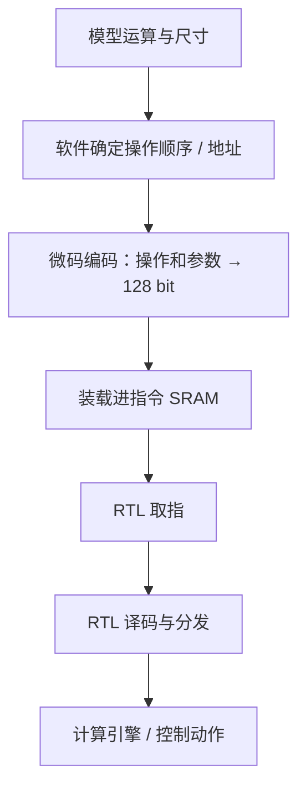

# 补充：tiny-NPU 微码从哪里来？如何进入 RTL？

本文追踪 LLM 模式，源码固定在 [tiny-NPU 8216c22](https://github.com/harishsg993010/tiny-NPU/tree/8216c22b762011aa20c05fc2768423fd12dda59d)。以 GPT-2 block 的 C++/Verilator 测试为具体例子，区分软件生成、编码、装载与硬件执行。下文是源码阅读，未进行仿真。

## 1. 先回答：硬件不会自己发明指令

一条 LLM 微码通常由软件根据网络结构、数据位置和硬件支持的 ISA 编排。硬件的 Fetch/Decode 根据收到的二进制指令工作。



这里“生成指令”与“运行指令”分在不同环节：软件先表达要做什么；Verilator C++ 测试代码把指令写到 RTL 仿真顶层的微码 SRAM；之后 Fetch/Decode 在时钟推动下读取并处理。模型权重、激活数据不等于微码。

在固定版本中有两类不同的相关软件：

| 路径 | 具体内容 | 与 GPT-2 block 仿真如何关联 |
|---|---|---|
| C++ 构造 | `sim/verilator/tb_gpt2_block.cpp` 的 `load_microcode`、`encode_instr` | 该测试实际直接构造并调用端口写入，不需要先运行 Python 汇编器 |
| Python 微码工具 | `python/tools/ucode_asm.py` 的 `parse_line`、`assemble`、`encode_instruction` | 可把自己指定的文本编码为文件；本例源码没有调用它来装载 GPT-2 block 测试指令 |
| Graph Mode 编译器 | `python/onnx_compiler/compile.py` | 面向另一种 Graph ISA / Graph 执行路径，不应说成 LLM 微码的通用来源 |

## 2. 软件决定做哪些操作

以 [tb_gpt2_block.cpp 的 load_microcode](https://github.com/harishsg993010/tiny-NPU/blob/8216c22b762011aa20c05fc2768423fd12dda59d/sim/verilator/tb_gpt2_block.cpp#L550) 为例，软件手工描述某个 Transformer block 的操作顺序：

1. 逐行 LayerNorm；
2. 插入 Barrier；
3. 每个注意力头依次进行 Q、K、V 矩阵乘，以及注意力分数、Softmax、上下文计算；
4. 合并注意力头结果；
5. 输出投影、残差、第二次归一化、FFN 等。

这里的循环是 C++ 在仿真开始前执行的主机代码，例如按 head 循环逐条创建指令；不是说硬件只收到一个“请自动执行所有注意力头”的高级指令，也不是指 C++ 循环被综合进芯片。

### 贯穿例：生成第 0 个头的 Q

本例中的模型尺寸为 `SEQ_LEN=8, HIDDEN=64, HEAD_DIM=16, N_HEADS=4`。第 h 个头：

```text
LN1_OUT: [8,64]
Wq_h:    [64,16]
Q_h:     [8,16]

Q_h = LN1_OUT × Wq_h
```

代码地址以数据 SRAM0 的 **byte 地址**表示：

| 字段 | h=0 的值 | 含义 |
|---|---|---|
| dst | 0xC800 | `ADDR_Q_H`，Q 的 SRAM0 目标地址 |
| src0 | 0xC400 | `ADDR_LN1_OUT`，输入地址 |
| src1 | 0x0000 | `wq_h_addr=ADDR_WQ+h×64×16` |
| M, N, K | 8, 16, 64 | GEMM 维度 |
| flags | 0x04 | 示例设置 REQUANT 标志 |
| imm | 0x0901 | 示例代码中的量化参数 |

源码调用：

```cpp
encode_instr(OP_GEMM, FLAG_REQUANT, ADDR_Q_H,
             ADDR_LN1_OUT, wq_h_addr,
             SEQ_LEN, HEAD_DIM, HIDDEN, GEMM_IMM_K64, hi, lo);
ucode_write(addr++, hi, lo);
```

`encode_instr` 只把给定参数打包；真正哪些操作、什么顺序、地址放在哪里，是周围 `load_microcode`、常量和循环共同决定的。上面出现的 `addr++` 是**指令 SRAM 的指令词索引**；src/dst 是**数据 SRAM 的字节地址字段**，两种地址不要混淆。

示例在每个 Q/K/V GEMM 后插入 Barrier，具体执行要符合依赖和 Scoreboard 的完成约定。上文地址和尺寸属于此测试的特定配置，不是所有 tiny-NPU 应用固定不变。

## 3. 128 bit 是怎么拼出来的？

该测试的 [encode_instr](https://github.com/harishsg993010/tiny-NPU/blob/8216c22b762011aa20c05fc2768423fd12dda59d/sim/verilator/tb_gpt2_block.cpp#L177) 将指令切为两个 64 bit 整数，分别移位、按位或：

```cpp
lo = (uint64_t)opcode | ((uint64_t)flags << 8)
   | ((uint64_t)dst << 16) | ((uint64_t)src0 << 32)
   | ((uint64_t)src1 << 48);
hi = (uint64_t)M | ((uint64_t)N << 16)
   | ((uint64_t)K << 32) | ((uint64_t)imm << 48);
```

这样对应 RTL 中的固定位段：

| 128 bit 位段 | 含义 | 第 0 头示例 |
|---|---|---|
| [7:0] / [15:8] | opcode / flags | 03 / 04 |
| [31:16] | dst | C800 |
| [47:32] | src0 | C400 |
| [63:48] | src1 | 0000 |
| [79:64] / [95:80] | M / N | 0008 / 0010 |
| [111:96] / [127:112] | K / imm | 0040 / 0901 |

从高位写到低位，一条指令为：

```text
hi = 0x0901_0040_0010_0008
lo = 0x0000_C400_C800_0403
128 bit = 0x0901_0040_0010_0008_0000_C400_C800_0403
```

RTL 中 [ucode_decode.sv](https://github.com/harishsg993010/tiny-NPU/blob/8216c22b762011aa20c05fc2768423fd12dda59d/rtl/ctrl/ucode_decode.sv) 用相反的方向做固定切片：`instr_data[7:0]` 得到 opcode，`[79:64]` 得到 M。软件和硬件遵守同一个字段约定，所以硬件能解释软件的二进制编码。

## 4. 指令是怎样“写进 RTL”的？

### 4.1 C++ 的 DUT 是什么？

`tb_gpt2_block.cpp` 创建 `Vgpt2_block_top` 实例：

```cpp
dut = new Vgpt2_block_top;
```

Verilator 根据 SystemVerilog 仿真顶层生成 C++ 模型；`dut->uc_wr_en`、`dut->uc_wr_addr`、`dut->uc_wr_data` 对应该顶层的输入端口。C++ 给这些字段赋值、改变 clk、调用 `dut->eval()`，仿真模型就按 RTL 规则更新。这是**软件驱动 RTL 仿真模型的接口**，不是说真实芯片里存在一行 C++ 赋值。

### 4.2 ucode_write 的写入过程

[ucode_write](https://github.com/harishsg993010/tiny-NPU/blob/8216c22b762011aa20c05fc2768423fd12dda59d/sim/verilator/tb_gpt2_block.cpp#L166) 的关键操作：

```cpp
dut->uc_wr_en = 1;
dut->uc_wr_addr = addr;
dut->uc_wr_data[0] = (uint32_t)(lo & 0xFFFFFFFF);
dut->uc_wr_data[1] = (uint32_t)(lo >> 32);
dut->uc_wr_data[2] = (uint32_t)(hi & 0xFFFFFFFF);
dut->uc_wr_data[3] = (uint32_t)(hi >> 32);
tick();
dut->uc_wr_en = 0;
```

Verilator 在此模型中把 128 bit 端口暴露为 4 个 32 bit 元素；索引 0 是最低 32 bit。对于前述 h=0 GEMM：

| 元素 | 对应指令位 | 值 |
|---|---|---|
| data[0] | [31:0] | C8000403 |
| data[1] | [63:32] | 0000C400 |
| data[2] | [95:64] | 00100008 |
| data[3] | [127:96] | 09010040 |

`tick()` 先将 clk 置 0 并 eval，再置 1 并 eval。写使能和地址在这一上升沿前已给定，于是同步 SRAM 在该上升沿执行一次写入；随后函数把写使能拉低。

在 [gpt2_block_top.sv](https://github.com/harishsg993010/tiny-NPU/blob/8216c22b762011aa20c05fc2768423fd12dda59d/sim/verilator/gpt2_block_top.sv#L77) 中，微码 SRAM 的 B 口接 `uc_wr_en / uc_wr_addr / uc_wr_data`，A 口供 Fetch 读取。因此不是 C++ 修改了 RTL 源代码，而是按测试端口驱动一块仿真 SRAM。

## 5. 开始执行：从写入到 fetch/decode

[main](https://github.com/harishsg993010/tiny-NPU/blob/8216c22b762011aa20c05fc2768423fd12dda59d/sim/verilator/tb_gpt2_block.cpp#L872) 在初始化和复位后：

```cpp
int num_instrs = load_microcode();
load_data_to_srams();
dut->ucode_len = num_instrs;
dut->start_pulse = 1;
tick();
dut->start_pulse = 0;
```

先装微码，再把计算数据/权重写入数据 SRAM，最后给出程序长度和启动脉冲。程序长度单位是**指令条数**，不是 16 字节的字节数；微码 SRAM 的地址单位是指令词。

之后 RTL 工作关系：

1. Fetch 在 start 后初始化 PC。
2. 对微码 SRAM 的 A 口发读请求并等待同步读返回。
3. 若读到的是普通指令，则通过 `instr_valid/instr_ready` 交给 Decode；若读到 END，Fetch 本身会拦截并结束取指。
4. Decode 根据 opcode 拆字段、检查 Scoreboard 忙闲、输出引擎命令。
5. 在本 GPT-2 仿真顶层，GEMM 等连接真实 RTL 计算模块；将程序结束视作系统结果可读取前，还需等待对应条件。

这份仿真顶层用 `fetch_done_latch && all_idle` 触发外部的 `program_end` latch；它不是把 Fetch 的 done 原样作为 program_end。它仍依赖实际引擎完成信号和已连接路径的正确性。

## 6. Verilator 测试中的 DMA 不是 AXI DDR 链路

这个 GPT-2 block 测试中，仿真顶层 DMA shim 抓取一条 DMA 命令，并将 src/dst/len 暴露给 C++。当 C++ 检测 `dma_cmd_captured`：

```cpp
handle_dma_command();
dut->dma_done_pulse = 1;
tick();
dut->dma_done_pulse = 0;
```

该测试的 `handle_dma_command` 循环从 SRAM0 测试读口读字节，并经 SRAM1 测试写口写字节。于是此处是**软件仿真配合**的搬运路径，不能据此声称已验证 AXI DMA 对外部 DDR 的完整事务。

模型权重/输入也由 C++ 的测试端口等路径装入，不要把这些装载动作和微码本身混为一谈。

### 与 rtl/top.sv 的区别

| 对象 | 微码写入 | 计算引擎与 DMA |
|---|---|---|
| `gpt2_block_top.sv` 仿真顶层 | C++ 经 `uc_wr_*` 测试端口写 SRAM | 真实计算 RTL；本测试 DMA 用 C++ shim |
| `rtl/top.sv` 固定版 | 微码 SRAM 写端关闭，Fetch 基址接 0 | GEMM 等是 done 计时占位；DMA 与数据 SRAM 未完整接通 |

`gpt2_block_top.sv` 源码的 SRAM0 默认深度为 8192 个 8-bit 条目，而 [CMake 的 gpt2_block_sim 构建](https://github.com/harishsg993010/tiny-NPU/blob/8216c22b762011aa20c05fc2768423fd12dda59d/sim/verilator/CMakeLists.txt#L178) 覆盖为 65536；必须同时看顶层参数和具体构建，不能把任何一个数当成所有实例的配置。

## 7. Python 汇编器属于另一条工具链

[ucode_asm.py](https://github.com/harishsg993010/tiny-NPU/blob/8216c22b762011aa20c05fc2768423fd12dda59d/python/tools/ucode_asm.py) 提供了：

- `parse_line`：解析文本行中的助记符和 key=value；
- `encode_instruction`：按 ISA 拼成整数，再 `struct.pack('<QQ',lo,hi)` 编码为每条 16 字节的小端二进制；
- `assemble`：逐行解析并连接结果；
- `gen_tiny_transformer_ucode`：构建示例文本。

这条路说明**汇编器可以怎样生成微码文件**，但不能由此推断 `tb_gpt2_block.cpp` 已经读取这个文件：上面已看到该测试自己的 C++ 构造/装载路径。

固定版本还有两个需要留意的工具边界：

1. `parse_line` 对输入键做 `key.lower()`，但默认字典中矩阵字段键是大写 `M/N/K`，因此像文本 `M=8 N=16 K=64` 的键不会匹配并会被跳过，最后三个字段保持默认 0。这是对源码逻辑的静态分析；`--gen-tiny` 最终也调用 `assemble`，同受该问题影响。直接在 Python 中以大写关键字调用 `encode_instruction(M=8,...)` 则经过的是不同入口。
2. `--hex` 每条 128 bit 指令输出 **四行 32 bit word**，不能直接假定与 128 bit 宽指令 SRAM 的“一行一个存储字”`$readmemh` 文件布局一致，需自行转换并验证字节/字序。

此外本固定版本 Python 助记符表只列到其声明的操作集合；与 RTL ISA/其他生成器的能力不可不加检查地视为完全一致。示例文本的 DMA 字段约定也应与实际下游 RTL 对照：本版本 `ucode_decode` 输出 DMA len 接的是 N。

## 8. 软件和硬件谁负责什么？

| 环节 | 本例的承担者 | 职责 |
|---|---|---|
| 网络结构、算子拆分、数据布局、指令顺序 | C++ 的常量、循环和 `load_microcode` | 明确算什么、在哪儿算、依赖怎样同步 |
| 指令位域打包 | `encode_instr` | 按共同 ISA 生成 hi/lo |
| 微码装载 | `ucode_write` + 仿真顶层 SRAM B 口 | 将每条指令写入 SRAM 对应词地址 |
| 取指 | `ucode_fetch.sv` | 产生 SRAM 地址并取出 128 bit 指令 |
| 译码/调度 | `ucode_decode.sv`、Scoreboard | 拆字段、检查忙闲、发引擎命令 |
| 计算 | GEMM 等 RTL 模块 | 读操作数、完成计算并报告状态 |
| DMA 模拟 | 本仿真的 C++ shim | 依测试约定搬运并返回完成 |

这条具体路径回答了“指令从哪来、如何进入硬件”：测试软件按既定计算计划生成编码，通过仿真顶层接口写入指令 SRAM，然后由 RTL 取指和执行。若要在真实系统或不同顶层复现，还必须有对应可用的加载通道、存储映射和软件驱动；不能直接从此测试端口推断它们已经存在。
