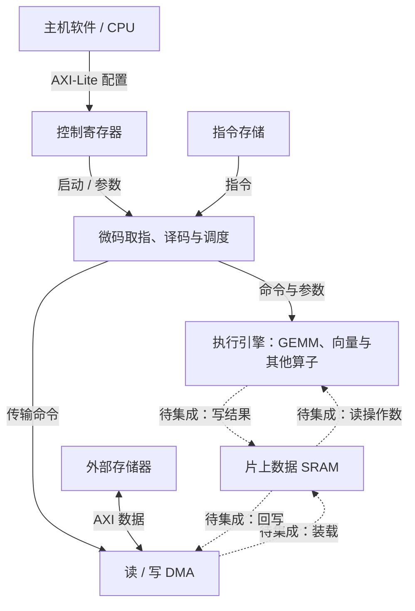
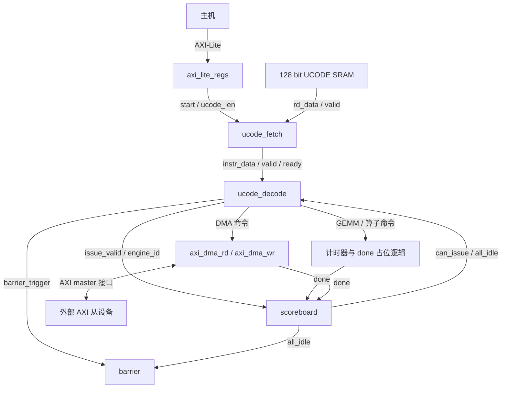

# tiny-NPU 整体硬件结构：数据流、控制流与指令流

本页是已学内容的补充总览，不改变课程进度，也不表示第 08 讲已学完。源码以 [harishsg993010/tiny-NPU 固定版本 8216c22](https://github.com/harishsg993010/tiny-NPU/tree/8216c22b762011aa20c05fc2768423fd12dda59d) 为准。此处区分**项目功能结构示意**和 **rtl/top.sv 实际连接**，两张图不能混为一谈。

## 一、项目功能结构示意

图展示模块在一个完整系统中所承担的功能。**虚线表示概念上的待集成数据路径，并非声明固定版本 top 已有这些连线。** 各模块还存在于不同顶层和仿真环境，不能简单看成下图全都被同一个 top 实例化。

| 功能块 | 硬件职责 | 学习时的对应 |
|---|---|---|
| 主机和寄存器 | 写配置、启动、读状态 | AXI-Lite，控制面 |
| 指令存储与控制 | 取微码、解码、检查忙闲、发命令 | Fetch / Decode / Scoreboard |
| DMA | 将传输命令转换成 AXI 请求或数据事务 | 读 DMA、写 DMA |
| 片上存储 | 暂存输入、权重、结果或部分和 | SRAM、Bank、Buffer |
| GEMM | 根据矩阵块进行乘加 | `gemm_ctrl`、脉动阵列、PE |
| 其他算子 | 逐元素或归约等运算 | Vec、Softmax、LayerNorm、GELU 等 |

功能层次不等同于 SRAM 容量的统一定义：容量取决于具体顶层和参数，不能把一个配置的容量当成所有实现的默认值。

## 二、固定版本的 `rtl/top.sv` 实际连接

图中只画主要关系。源码中读 SRAM 的请求方向是 Fetch 发 `rd_en/rd_addr` 到 SRAM，返回方向是 SRAM 向 Fetch 提供 `rd_data/rd_valid`；图上只强调返回的数据。

必须结合这些实际限制理解：

1. `top.sv` 的 GEMM、Softmax、LayerNorm、GELU、Vec 是计时产生 done 的占位逻辑，**不是已实例化并连接真实计算核心**。计时结束只能说明占位控制行为，不能证明矩阵计算完成。
2. 读 DMA 的 `data_ready` 被置 1；读回数据没有接入数据 SRAM。写 DMA 的 `data_valid` 被置 0，`data_in` 为零；非零写命令不能获得真实写入数据。AXI 主接口和 DMA 存在，但 **DDR↔片上数据 SRAM 端到端路径未接通**。
3. 片上微码 SRAM 的两个写使能在该 top 均为 0。Fetch 能读取其读口，不能据此认为微码可以经 DMA 在本 top 中装入；另外 Fetch 的基地址接常量 0。
4. Graph 控制路径没有在此 `top.sv` 中实例化，Graph 状态是占位。项目中其他 Graph 或仿真顶层是另一条构建路径，不能把其行为直接归给此 top。`onnx_sim_top.sv` 采用 DMA shim 向仿真环境暴露命令，不应直接描述成实例化 AXI DMA 的此 top。
5. 不要将上图中的 `program_end` 或 Fetch 的结束直接等同于**所有引擎都完成且所有结果均已写回**：需要根据实际代码中的等待、完成和端到端接线分别验证。

## 三、三种“流”分别是什么

| 名称 | 实际流动的内容 | 主要问题 |
|---|---|---|
| 指令流 | 微码编码及其字段 | 接下来做什么、操作数在哪里、尺寸和模式是什么？ |
| 控制流 | 启动、有效/就绪、地址、读写使能、忙闲、完成等信号 | 什么时候做、谁可以做、当前是否完成？ |
| 数据流 | 激活、权重、部分和与结果等数值 | 被计算的数据从哪里来，经过什么硬件，到哪里去？ |

一次任务中三者会同时存在：一条 GEMM 指令被取出、译码为命令；控制器按周期给 SRAM 和阵列发控制信号；实际操作数与结果则沿数据通路移动。箭头指的是信息用途，不代表一定有三套物理总线。

## 四、指令流：从程序到模块命令

这张图说明指令被使用的关系；当前 `top.sv` 微码 SRAM 没有可用写入端，图中的“程序进入 SRAM”不能解释成该 top 已支持加载路径。

- `ucode_fetch` 根据 PC 产生读请求，等待同步存储器返回指令，再通过 `instr_valid / instr_ready / instr_data` 将指令交给译码器。`valid` 和 `ready` 同时有效的时钟沿表示一次交接。
- `ucode_decode` 从指令中提取操作码、标志、地址、维度等，判断目标引擎并产生对应命令。引擎繁忙时，可通过 `instr_ready=0` 让 Fetch 等待。
- Scoreboard 根据 issue 和 done 维护引擎忙闲，输出 `can_issue` 与 `all_idle`。Barrier 指令让译码路径等待全部引擎空闲。这个机制不能自动保证任意内存地址之间的数据依赖已被硬件识别。
- 以“DMA_LOAD → BARRIER → GEMM → BARRIER → DMA_STORE → END”为**概念程序**，指令描述一组操作次序；它并不保证此版本 `top.sv` 能真正完成这些数据移动与计算。

固定版本微码为 128 bit。根据 `rtl/pkg/isa_pkg.sv` 和 `ucode_decode.sv`：

| 位段 | 字段 | 基本用途 |
|---|---|---|
| [7:0] | opcode | 操作类型 |
| [15:8] | flags | 模式标志 |
| [31:16] | dst_base | 目标地址字段 |
| [47:32] | src0_base | 第一个源地址字段 |
| [63:48] | src1_base | 第二个源地址字段 |
| [79:64]、[95:80]、[111:96] | M、N、K | 参数字段，GEMM 常用作矩阵维度 |
| [127:112] | imm | 附加参数；具体含义随操作改变 |

地址字段的含义、单位及边界依具体指令和执行单元解释，不能统一视为 CPU 虚拟地址。

## 五、控制流：从启动到忙闲反馈

主机通过 AXI-Lite 配置寄存器并触发 `start_pulse`；在非 Graph 模式，该启动脉冲送往 Fetch。之后形成控制闭环：

1. Fetch 发读请求并持有待交付指令；Decode 的 ready 决定能否接收。
2. Decode 依据指令和 Scoreboard 的 `can_issue` 发命令，并通过 `issue_valid / issue_engine_id` 告知 Scoreboard。
3. 被调度引擎在实际工作或占位计时之后发 `done`；Scoreboard 更新 busy 状态。
4. 指令要求同步时，Decode 等待 `all_idle`。主机也可读取状态寄存器。

这些控制信号的功能不同：`start` 是开始任务，`valid/ready` 是一次交接是否发生，`busy` 是状态，`done` 是某个模块报告结束；没有任何一个词能单独证明完整系统结果已经落存。

## 六、数据流：以矩阵乘法为例

目标计算是 `C[M,N] = A[M,K] × B[K,N]`。在已经把真实存储与执行单元连接起来的**概念系统**中：

1. 外部存储器中的 A、B 经读 DMA 和必要的适配/仲裁写入片上 SRAM。
2. GEMM 控制器依据矩阵维度和地址读取数据，组织分块与送数。
3. 计算阵列内部 PE 完成乘加。A 在阵列行方向向右转发，B 在列方向向下转发；相遇的数参与乘累加。
4. 按控制器约定保存结果或部分和，必要时进行后处理；最终结果经片上存储和写 DMA 回外部存储器。

**此流程描述目标功能，不是固定版本 `top.sv` 已完成的端到端行为。** 上一讲的 128 bit AXI 与 8 bit SRAM 的打包/拆包结构同样是教学设计，不是已在该顶层接通的现成硬件。读 DMA done 也不必然代表所有数据已完成本地落存。

## 七、用一张表回看一次任务

| 阶段 | 指令流 | 控制流 | 数据流 |
|---|---|---|---|
| 准备 | 程序已有或被装载到适当指令存储 | 主机写配置、启动 | 输入和权重准备在存储器 |
| 取指与调度 | 读出并解码 LOAD/GEMM 等 | valid/ready，忙闲检查 | 指令本身传递；操作数未必开始移动 |
| 执行 | 下一条指令等待或继续取出 | 发命令，控制地址、使能和等待 | 操作数流入计算模块，结果/部分和产生 |
| 收尾 | 遇到同步和结束指令 | 等待适当 done，报告状态 | 结果写入目标存储，是否回外存取决于具体接线 |

这张表是通用执行关系；具体能执行到哪一步必须按所选顶层、RTL 接线和验证环境检查。

## 源码入口

- [顶层控制与占位逻辑 rtl/top.sv](https://github.com/harishsg993010/tiny-NPU/blob/8216c22b762011aa20c05fc2768423fd12dda59d/rtl/top.sv)
- [微码 ISA](https://github.com/harishsg993010/tiny-NPU/blob/8216c22b762011aa20c05fc2768423fd12dda59d/rtl/pkg/isa_pkg.sv)、[取指](https://github.com/harishsg993010/tiny-NPU/blob/8216c22b762011aa20c05fc2768423fd12dda59d/rtl/ctrl/ucode_fetch.sv)、[译码](https://github.com/harishsg993010/tiny-NPU/blob/8216c22b762011aa20c05fc2768423fd12dda59d/rtl/ctrl/ucode_decode.sv)
- [GEMM 控制器](https://github.com/harishsg993010/tiny-NPU/blob/8216c22b762011aa20c05fc2768423fd12dda59d/rtl/gemm/gemm_ctrl.sv)、[脉动阵列](https://github.com/harishsg993010/tiny-NPU/blob/8216c22b762011aa20c05fc2768423fd12dda59d/rtl/gemm/systolic_array.sv)
- [主线交接与已学进度](handoff-tiny-npu-mainline.md)

本说明通过阅读源码整理，未修改上游 RTL，也未进行仿真；图和流程不构成已通过的端到端验证。
